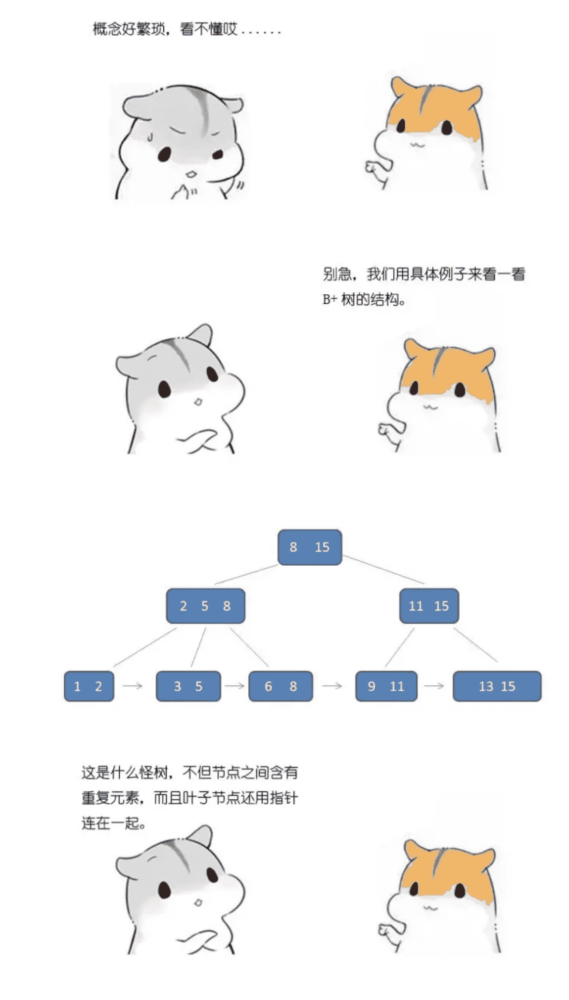
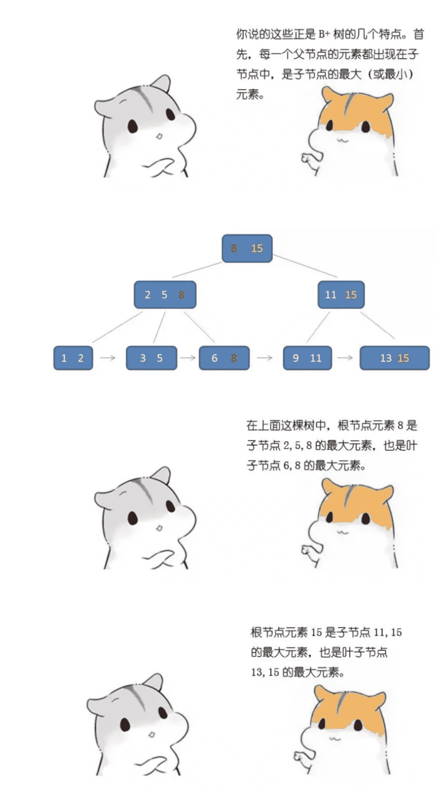
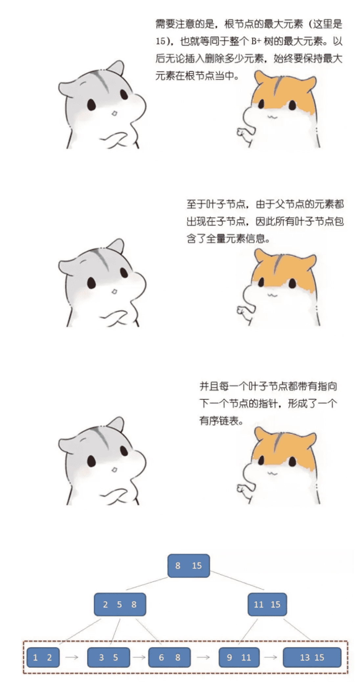
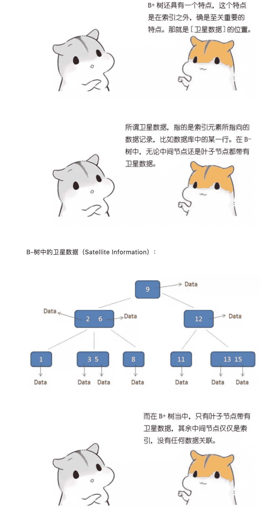
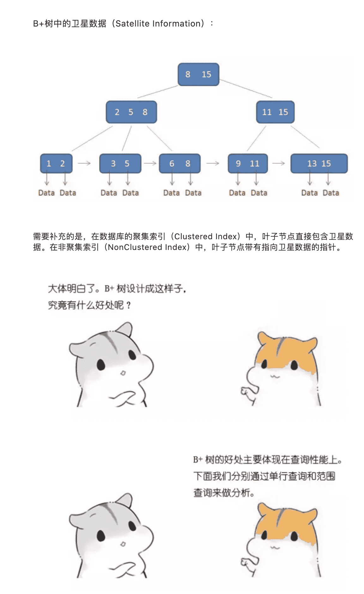
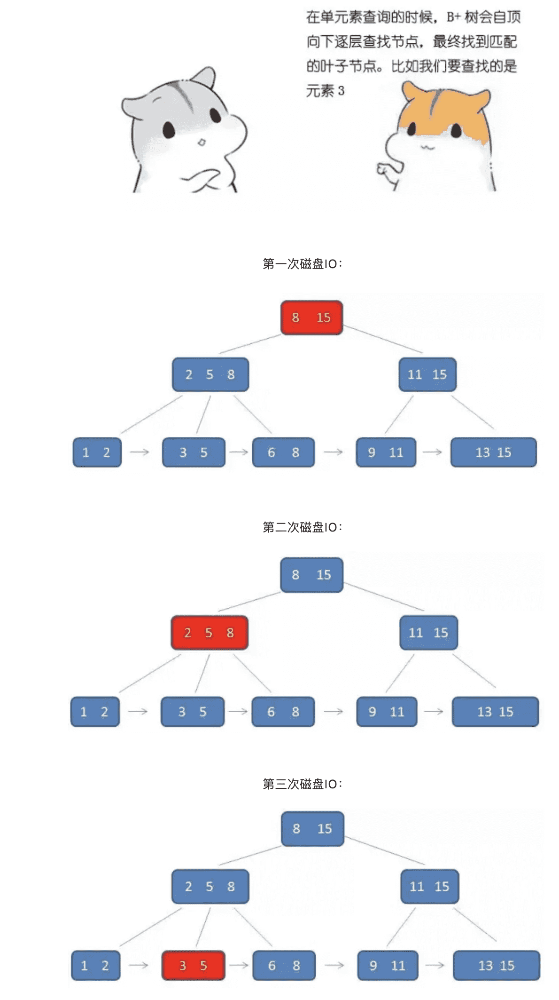
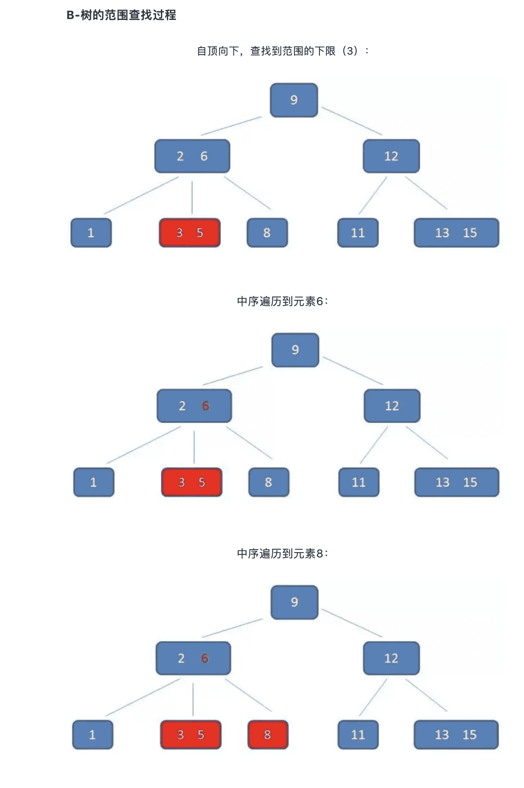
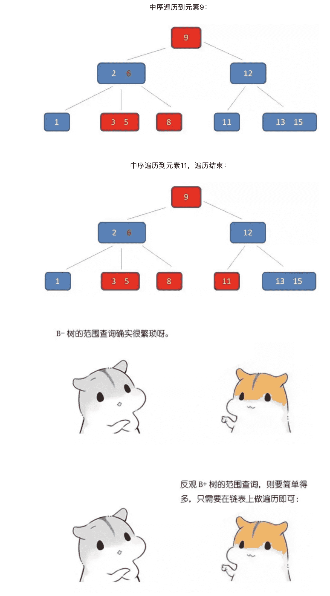
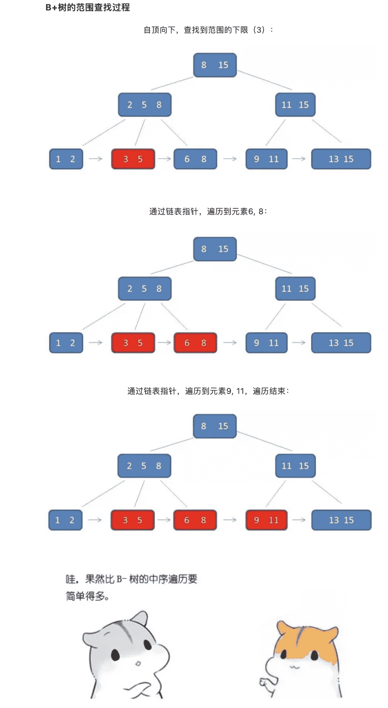

# 数据结构-图说B+树

了解了 B 树后再来了解下它的变形版：B+ 树，它比 B 树的查询性能更高。

一棵 B+ 树需要满足以下条件：

1. 节点的子树数和关键字数相同（B 树是关键字数比子树数少一）
2. 节点的关键字表示的是子树中的最大数，在子树中同样含有这个数据
3. 叶子节点包含了全部数据，同时符合左小右大的顺序

**一个m阶的B树具有如下几个特征：**

1. 根结点至少有两个子女。
2. 每个中间节点都包含k-1个元素和k个孩子，其中 m/2 <= k <= m
3. 每一个叶子节点都包含k-1个元素，其中 m/2 <= k <= m
4. 所有的叶子结点都位于同一层。
5. 每个节点中的元素从小到大排列，节点当中k-1个元素正好是k个孩子包含的元素的值域分划。

**一个m阶的B+树具有如下几个特征：**

1. 有k个子树的中间节点包含有k个元素（B树中是k-1个元素），每个元素不保存数据，只用来索引，所有数据都保存在叶子节点。
2. 所有的叶子结点中包含了全部元素的信息，及指向含这些元素记录的指针，且叶子结点本身依关键字的大小自小而大顺序链接。
3. 所有的中间节点元素都同时存在于子节点，在子节点元素中是最大（或最小）元素。

**B+树的特征：**

1. 有k个子树的中间节点包含有k个元素（B树中是k-1个元素），每个元素不保存数据，只用来索引，所有数据都保存在叶子节点。
2. 所有的叶子结点中包含了全部元素的信息，及指向含这些元素记录的指针，且叶子结点本身依关键字的大小自小而大顺序链接。
3. 所有的中间节点元素都同时存在于子节点，在子节点元素中是最大（或最小）元素。

**B+树的优势：**

1. 单一节点存储更多的元素，使得查询的IO次数更少。
2. 所有查询都要查找到叶子节点，查询性能稳定。
3. 所有叶子节点形成有序链表，便于范围查询。

> 转自：[漫画-什么是B+树](https://mp.weixin.qq.com/s/jRZMMONW3QP43dsDKIV9VQ)

