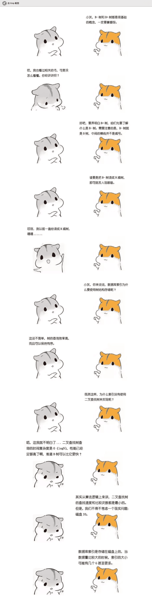
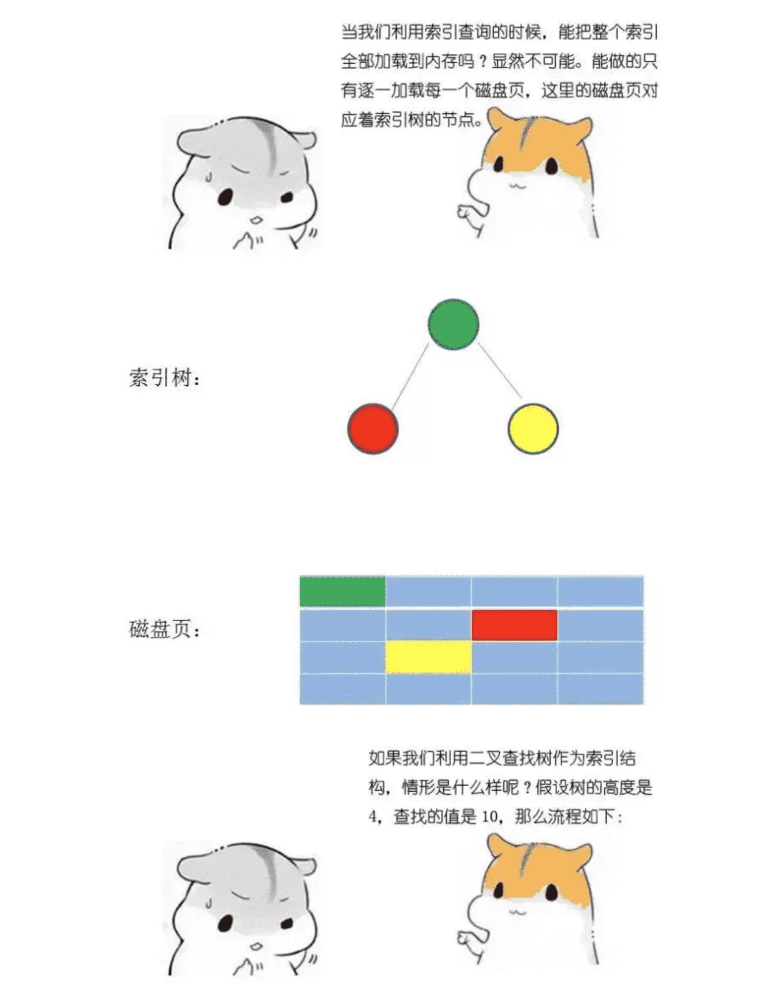
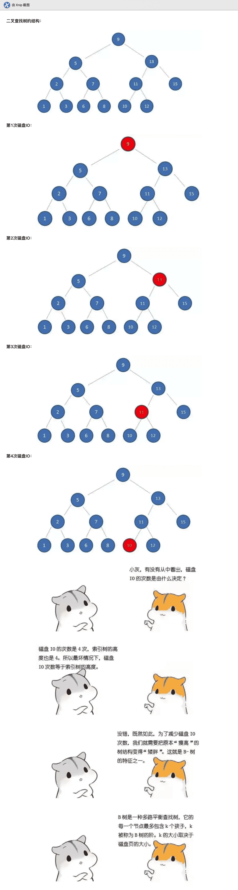
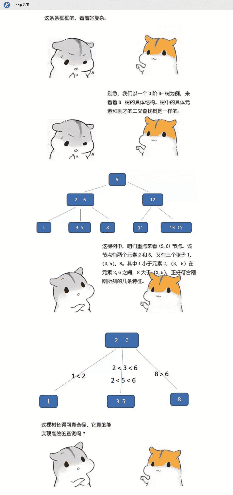
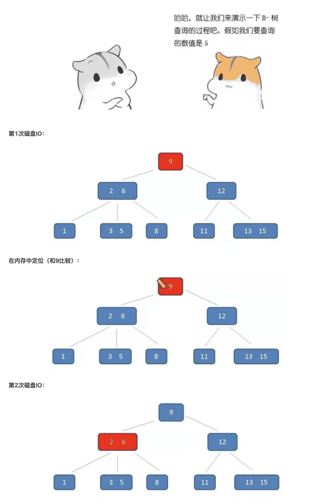
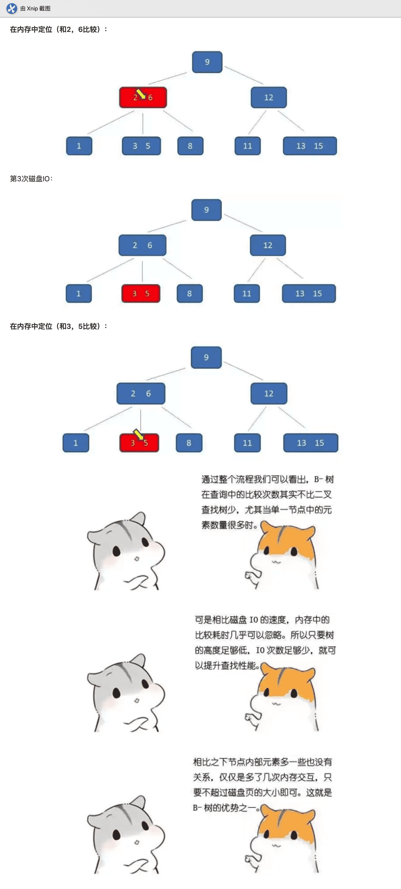
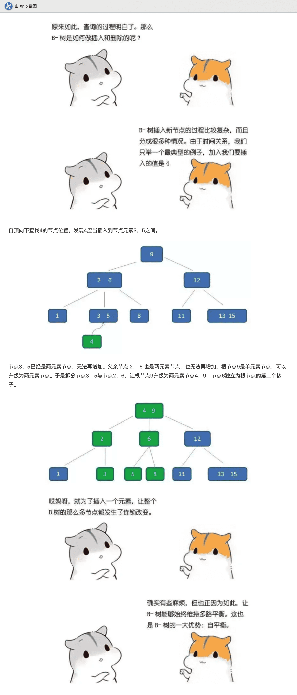
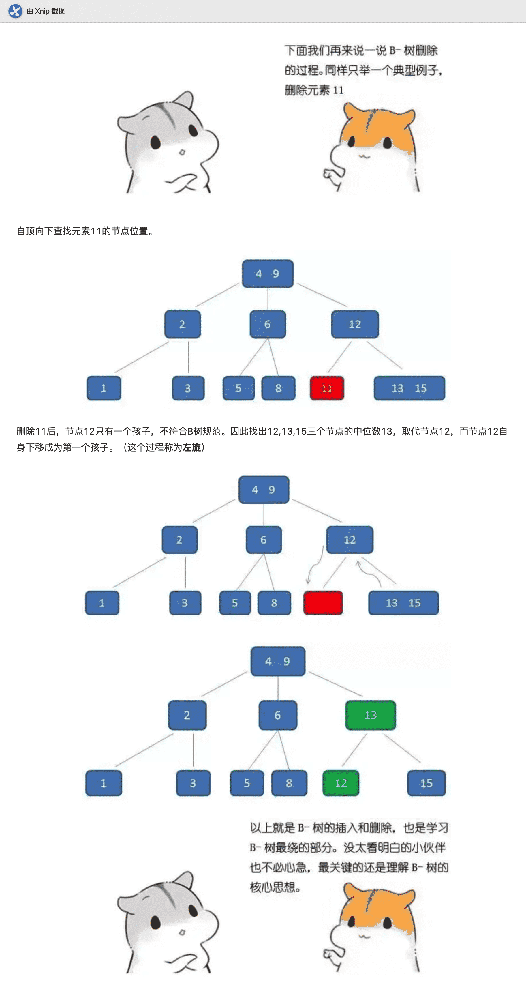

# 数据结构-图说B树

本文提到的「B-树」，就是「B树」，都是 B-tree 的翻译，里面不是减号-，是连接符-。因为有人把 B-tree 翻成 「B-树」，让人以为「B树」和「B-树」是两种树，实际上两者就是同一种树。

**下面来具体介绍一下B-树（Balance Tree），一个m阶的B树具有如下几个特征：**

1. 根结点至少有两个子女。
2. 每个中间节点都包含k-1个元素和k个孩子，其中 m/2 <= k <= m
3. 每一个叶子节点都包含k-1个元素，其中 m/2 <= k <= m
4. 所有的叶子结点都位于同一层。
5. 每个节点中的元素从小到大排列，节点当中k-1个元素正好是k个孩子包含的元素的值域分划。

> 转自：[漫画：什么是B-树](https://mp.weixin.qq.com/s/rDCEFzoKHIjyHfI_bsz5Rw)

