**定义：**

数据结构是指相互之间存在一种或多种特定关系的数据元素的**集合**

- **集合**

数据结构中的元素之间除了“同属一个集合” 的相互关系外，别无其他关系；

- **线性结构**

数据结构中的元素存在一对一的相互关系

- **树形结构**

数据结构中的元素存在一对多的相互关系；

- **图形结构**

数据结构中的元素存在多对多的相互关系。

`常见的数据结构：数组、队列、栈、链表、树、图、堆、散列表`

# 数组

就是在内存中开辟一个连续的空间存放元素，就相当一群人站成一队，从第一个开始编号001,002....可以轻松的通过号码来找到对应的人，但是如果中间有一个人离队了（中间加了一个人），后面的人号码都要向前（向后）移动，如果队伍很长改的变得就越多，所以数组的特点就是：`元素类型是固定的、长度是固定的、通过角标查询，查询快，增删慢。`

# 队列

`线性结构，先进先出`，就跟一群人排队过水管，先进水管的人的人先出去，后进水管的人后出去

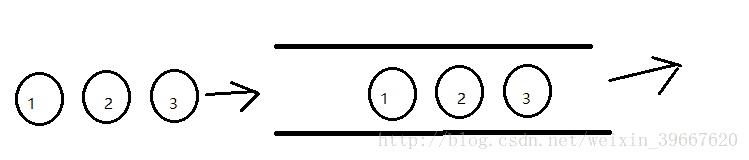

# 栈

`线性结构，先进后出`，就跟手枪上子弹一样，先上的子弹会被后上的子弹压到下面，打枪的时候最后上的子弹会第一个打出来，这个就是大家常说的压栈，底层实现同样用的是LinkedList

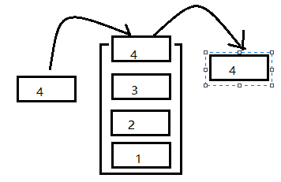

# 链表

`链表的类型有多种：单链表，双链表，有序链表`

链表是一种物理存储单元上非连续、非顺序的存储结构，数据元素的逻辑顺序是通过链表中的指针链接次序实现的。链表由一系列结点（链表中每一个元素称为结点）组成，结点可以在运行时动态生成。

可以这样理解：

有一条街，小明住在街中一角，他有小红的地址，然后小红也是住在这条街，她有小花的地址，同样小花也有别人的地址。某天我想找小红玩，但是我不知道她住哪里，我可以问小明，就知道小红住在哪里了。那么小明小红小花这些人之间的关系就组成一个链表。

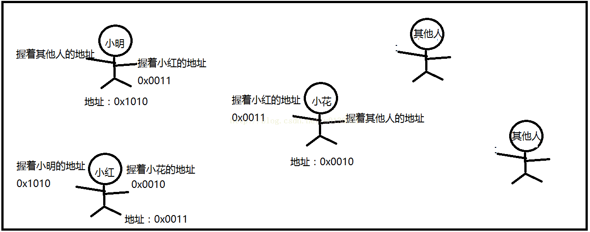

**单链表：**

就是小明只是右手握着小红的地址，他只有小红一个人的地址

**双链表：**

就是小明左手握着小白的地址，右手握着小红的地址，他有两个人的地址

**循环链表：**

就是小明握有小红的地址，小红握有小花的地址，而小花又握有小明的地址，这样就形成了一个循环

**有序链表：**

以某个标准，给链表的元素排序，比如比较内容大小、比较哈希值等

**链表与数组比较：**

优点：链表不需要确定长度大小，也不需要连续的内存空间，

缺点：由于不是连续的空间，所以查找元素比较吃力；相比数组只存储元素，链表的元素还要存储其它元素的地址，内存开销相对增大。

# 树

**什么是树**

树结构是一种包括节点(nodes)和边(edges)的拥有层级关系的一种结构

**树中的概念**

- 根节点(root): 树的最上层的节点，任何非空的树都有一个节点
- 路径(path): 从起始节点到终止节点经历过的边
- 父亲(parent)：除了根节点，每个节点的上一层边连接的节点就是它的父亲(节点)
- 孩子(children): 每个节点由边指向的下一层节点
- 兄弟(siblings): 同一个父亲并且处在同一层的节点
- 叶子节点(leaf node)或终端节点: 没有孩子的节点成为叶子节点

## 二叉树

每个父节点最多只有两个子节点的树称为二叉树

与二叉树相关的概念:
**节点深度(depth)**, **树的高度(height)**, **树的宽度(width)**, **树的 size**

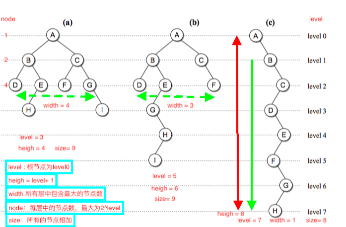

## 满二叉树

除最后一层无任何子节点外，每一层上的所有结点都有两个子结点。也可以这样理解，除叶子结点外的所有结点均有两个子结点。节点数达到最大值，所有叶子结点必须在同一层上。

一棵深度为k且有2k-1（2的k次幂减1）个结点的二叉树称为满二叉树

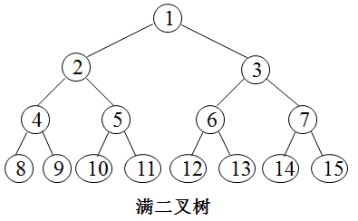

## 完全二叉树

若设二叉树的深度为h，除第 h 层外，其它各层 (1～(h-1)层) 的结点数都达到最大个数，第h层所有的结点都连续集中在最左边，这就是完全二叉树。

深度为k的，有n个结点的二叉树，当且仅当其每一个结点都与深度为k的满二叉树中编号从1至n的结点一一对应时，称之为完全二叉树。

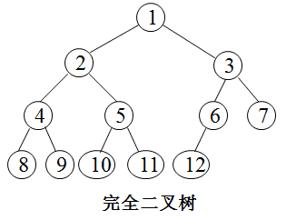

## 二叉排序树（BST）

二叉排序树（Binary Sort Tree）定义：又称为是二叉查找树或二叉搜索树。二叉排序树或者是一棵空树，或者是具有下列性质的二叉树：

1. 若它的左子树不空，则左子树上所有结点的值均小于它的根结点的值；
2. 若它的右子树不空，则右子树上所有结点的值均大于它的根结点的值；
3. 它的左、右子树也分别为二叉排序树；
4. 没有键值相等的节点。

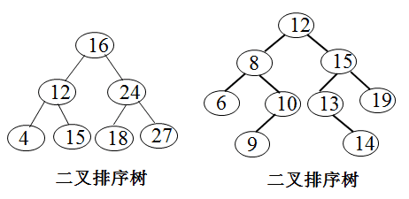

## 平衡二叉树

平衡二叉树（Balanced Binary Tree）又被称为AVL树。它或者是一棵空树，或者是具有下列性质的二叉树：

**它的左子树和右子树都是平衡二叉树，且左子树和右子树的深度之差的绝对值不超过1。（注：平衡二叉树应该是一棵二叉排序树）**

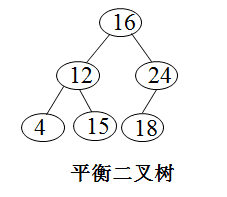

## 红黑树

红黑树，一种二叉查找树，但在每个结点上增加一个存储位表示结点的颜色，可以是Red或Black。通过对任何一条从根到叶子的简单路径上各个结点的颜色进行约束，红黑树确保没有一条路径会比其他路径长出2倍，因而是近似于平衡的。树中每个结点包含5个属性：color、key、left、right和p。如果一个结点没有子节点或父节点，则该结点相应的指针属性值为NIL，我们可以把这些NIL视为指向二叉搜索树的叶节点（外部结点）的指针，而把带关键字的结点视为树的内部结点。
一棵红黑树是满足下面性质的二叉搜索树：

1. 每个结点或是红色的，或是黑色的；
2. 根结点是黑色的；
3. 每个叶结点（叶结点即指树尾端NIL指针或NULL结点）是黑的；
4. 如果一个结点是红色的，则它的两个子结点都是黑色的；
5. 对每个结点，从该结点到其所有后代叶结点的简单路径上，均包含相同数目的黑色结点。

红黑树虽然本质上是一棵二叉查找树，但它在二叉查找树的基础上增加了着色和相关的性质使得红黑树相对平衡，从而保证了红黑树的查找、插入、删除的时间复杂度最坏为O(log n)。

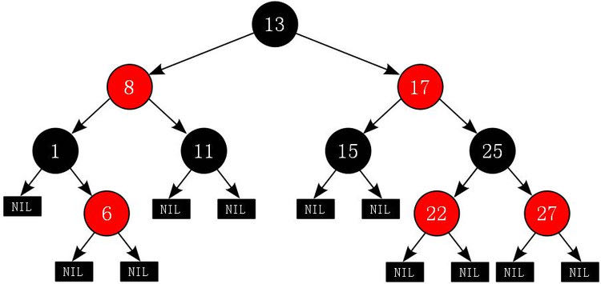

## B树

B树也是一种用于查找的平衡树，但是它不是二叉树。

B树又称为B-树，是一种平衡的多路查找树。B-树的阶是所有结点的孩子结点树的最大值。一棵m阶B-树，或为空树，或为满足下列特性的m叉树：

**一个m阶的B树具有如下几个特征：**

1. 根结点至少有两个子女
2. 子树(节点)的个数(k)：m/2 <= k <= m
3. 每个中间节点都包含k-1个元素(关键字或数据)和k个孩子，其中 m/2 <= k <= m，所以 子树个数(k)=元素个数+1
4. 每一个叶子节点都包含k-1个元素，其中 m/2 <= k <= m
5. 所有的叶子结点都位于同一层。
6. 每个节点中的元素从小到大排列，节点当中k-1个元素正好是k个孩子包含的元素的值域分划。

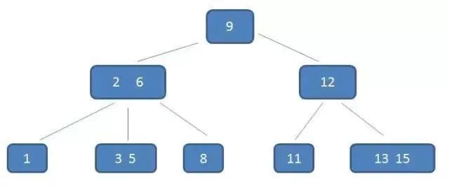

添加元素的逻辑：

1. 首先考虑要插入的子树是否已经超出了关键字数的限制
2. 超出的话，如果要插入的位置是叶子节点，就只能拆一个关键字添加到要插入位置的父节点
3. 如果非叶子节点，就得从其他子树拆子树给新插入的元素做孩子

删除也是一样的，要考虑删除孩子后，父节点是否还满足子树 k 介于 M/2 和 M 的条件，不满足就得从别的节点拆子树甚至修改相关子树结构来保持平衡。

> 具体讲解见：[图说B树](https://www.buubiu.com/2020/08/30/数据结构-图说B树/)

## B+树

了解了 B 树后再来了解下它的变形版：B+ 树，它比 B 树的查询性能更高。

**一棵 B+ 树需要满足以下条件：**

1. 节点的子树数和关键字数相同（B 树是关键字数比子树数少一）
2. 节点的关键字表示的是子树中的最大数，在子树中同样含有这个数据
3. 叶子节点包含了全部数据，同时符合左小右大的顺序

**一个m阶的B+树具有如下几个特征：**

1. 有k个子树的中间节点包含有k个元素（B树中是k-1个元素），每个元素不保存数据，只用来索引，所有数据都保存在叶子节点。
2. 所有的叶子结点中包含了全部元素的信息，及指向含这些元素记录的指针，且叶子结点本身依关键字的大小自小而大顺序链接。
3. 所有的中间节点元素都同时存在于子节点，在子节点元素中是最大（或最小）元素。

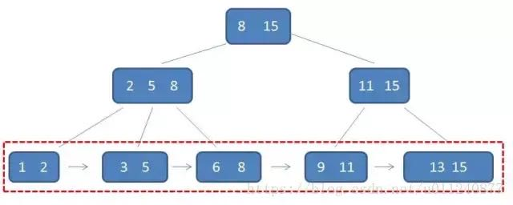

> 具体讲解见：[图说B+树](https://www.buubiu.com/2020/08/31/数据结构-图说B+树)

## B*树

是B+树的变体，在B+树的非根和非叶子结点再增加指向兄弟的指针；

B\*树定义了非叶子结点关键字个数至少为(2/3)\*M，即块的最低使用率为2/3(代替B+树的1/2)。

**B树，B+树，B\*树比较：**

|         | 子树数范围(k)   | 关键字数范围(d)       | 子树数与关键字数关系 |
| ------- | --------------- | --------------------- | -------------------- |
| 6阶B树  | [3,4,5,6]       | [2,3,4,5]             | 关键字数=子树数-1    |
| 6阶B+树 | [3,4,5,6]       | [3,4,5,6]             | 关键字数=子树数      |
| 6阶B*树 | [2,3,4,5,6]     | [2,3,4,5,6]           | 关键字数=子树数      |
| m阶B树  | m/2 <= k <= m   | (m/2)-1 <= d <= (m-1) | d = k-1              |
| m阶B+树 | m/2 <= k <= m   | m/2 <= d <= m         | d=k                  |
| m阶B*树 | m*2/3 <= k <= m | m*2/3 <= k <= m       | d=k                  |

## LSM 树

### 引言

与普通B树相比，B+树的非叶子节点只有索引，所有数据都位于叶子节点，并且叶子节点上的数据会形成有序链表。B+树的主要优点如下：

- 结构比较扁平，高度低（一般不超过4层），随机寻道次数少；
- 数据存储密度大，且都位于叶子节点，查询稳定，遍历方便；
- 叶子节点形成有序链表，范围查询转化为顺序读，效率高。相对而言B树必须通过中序遍历才能支持范围查询。

当然，B+树也不是十全十美的，它的主要缺点有两个：

- 如果写入的数据比较离散，那么寻找写入位置时，子节点有很大可能性不会在内存中，最终会产生大量的随机写，性能下降。下图来自[TokuDB的PPT]，说明了这一点。

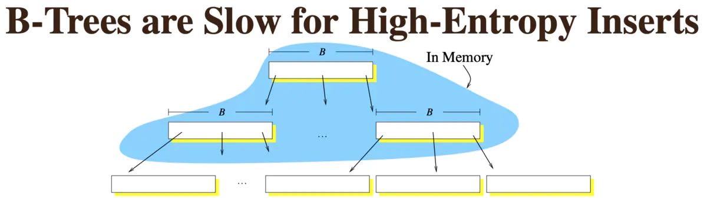

- 如果B+树已经运行了很长时间，写入了很多数据，随着叶子节点分裂，其对应的块会不再顺序存储，而变得分散。这时执行范围查询也会变成随机读，效率降低了。

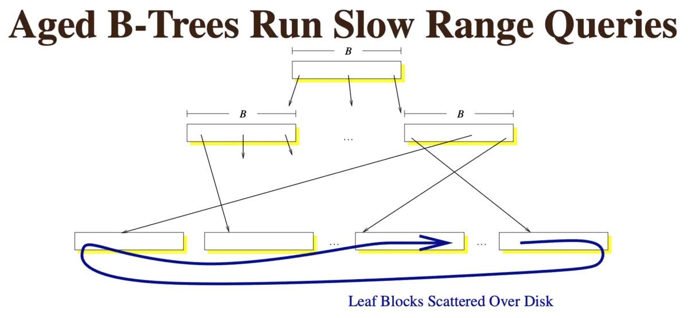

可见，B+树在多读少写（相对而言）的情境下比较有优势，在多写少读的情境下就不是很有威力了。当然，我们可以用SSD来获得成倍提升的读写速率，但成本同样高昂，对海量存储集群而言不太可行。日志结构合并树（LSM Tree）就是作为B+树的替代方案产生的。

### 认识LSM树

LSM树由Patrick O'Neil等人在论文[《The Log-Structured Merge Tree》]中提出，它实际上不是一棵树，而是2个或者多个树或类似树的结构（注意这点）的集合。下图示出最简单的有2个结构的LSM树。

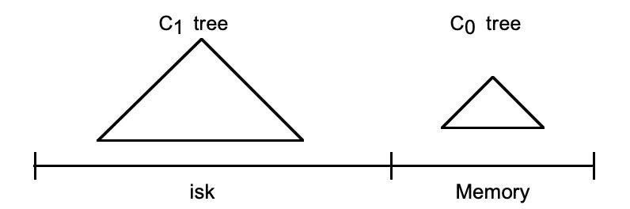

在LSM树中，最低一级也是最小的C0树位于内存里，而更高级的C1、C2...树都位于磁盘里。数据会先写入内存中的C0树，当它的大小达到一定阈值之后，C0树中的全部或部分数据就会刷入磁盘中的C1树，如下图所示。

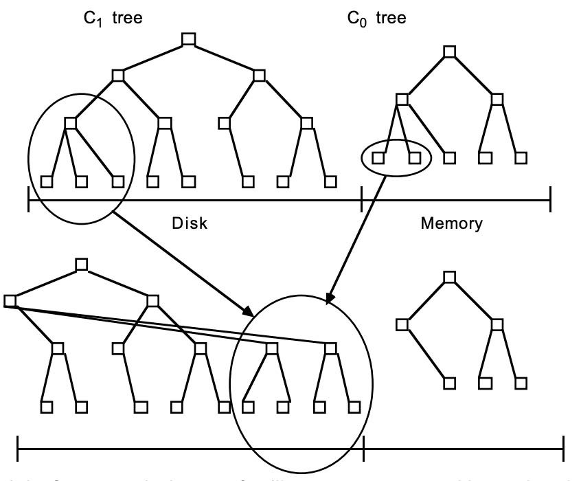

由于内存的读写速率都比外存要快非常多，因此数据写入C0树的效率很高。并且数据从内存刷入磁盘时是预排序的，也就是说，LSM树将原本的随机写操作转化成了顺序写操作，写性能大幅提升。不过，它的tradeoff就是牺牲了一部分读性能，因为读取时需要将内存中的数据和磁盘中的数据合并。总体上来讲这种tradeoff还是值得的，因为：

- 可以先读取内存中C0树的缓存数据。内存的效率很高，并且根据局部性原理，最近写入的数据命中率也高。
- 写入数据未刷到磁盘时不会占用磁盘的I/O，不会与读取竞争。读取操作就能取得更长的磁盘时间，变相地弥补了读性能差距。

在实际应用中，为了防止内存因断电等原因丢失数据，写入内存的数据同时会顺序在磁盘上写日志，类似于我们常见的预写日志（WAL），这就是LSM这个词中Log一词的来历。另外，如果有多级树的话，低级的树在达到大小阈值后也会在磁盘中进行合并，如下图所示。

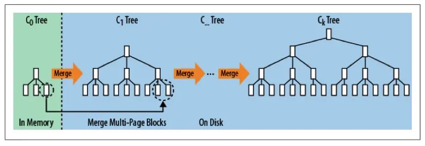

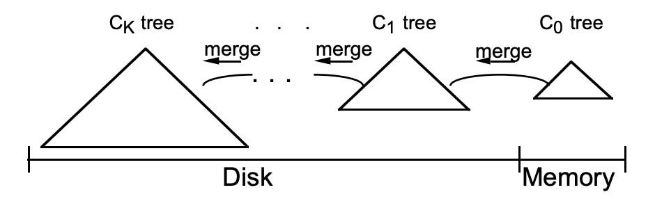

