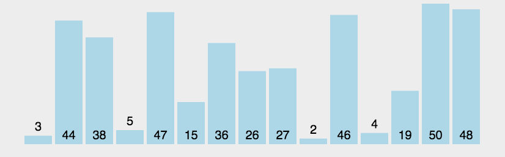

# 定义

冒泡排序是一种简单的排序算法。它重复地走访过要排序的数列，一次比较两个元素，如果它们的顺序错误就把它们交换过来。走访数列的工作是重复地进行直到没有再需要交换，也就是说该数列已经排序完成。这个算法的名字由来是因为越小的元素会经由交换慢慢“浮”到数列的顶端。

# 算法描述

- 比较相邻的元素。如果第一个比第二个大，就交换它们两个；
- 对每一对相邻元素作同样的工作，从开始第一对到结尾的最后一对，这样在最后的元素应该会是最大的数；
- 针对所有的元素重复以上的步骤，除了最后一个；
- 重复步骤1~3，直到排序完成。

# 动图演示



# 代码实现

```java
public static void main(String[] args) {
    int[] array = {3, 44, 38, 5, 47, 15, 36, 26, 27, 2, 46, 4, 19, 50, 48};
		// 只需要修改成对应的方法名就可以了
    bubbleSort(array);

    System.out.println(Arrays.toString(array));
}
```

```java
/**
 * Description:冒泡排序
 *
 * @param array 需要排序的数组
 */
public static void bubbleSort(int[] array) {
	if (array == null || array.length <= 1) {
		return;
	}

	int length = array.length;

	// 外层循环控制比较轮数i
	for (int i = 0; i < length; i++) {
		// 内层循环控制每一轮比较次数，每进行一轮排序都会找出一个较大值
		// (array.length - 1)防止索引越界，(array.length - 1 - i)减少比较次数
		for (int j = 0; j < length - 1 - i; j++) {
			// 前面的数大于后面的数就进行交换
			if (array[j] > array[j + 1]) {
				int temp = array[j + 1];
				array[j + 1] = array[j];
				array[j] = temp;
			}
		}
	}

}
```

# 算法分析

**最佳情况：**$T(n) = O(n)$

**最差情况：**$T(n)=O(n^2)$

**平均情况：**$T(n)=O(n^2)$


**`n:`**代表关键字的个数

**`O:`**算法复杂度 : 这里表中指的是算法的时间复杂度, 一般由O(1), O(n), O(logn), O(nlogn), O(n²), ..., O(n!). 从左到右复杂度依次增大, 时间复杂度是指在多少时间内能够执行完这个算法, 常数时间内呢, 还是平方时间还是指数时间等等.

还有个概念叫`空间复杂度`, 这就指的是执行这个算法需要多少额外的空间. (源数组/链表所占的空间不算)

`稳定性` : 算法的稳定性体现在执行算法之前, 若a = b, a在b的前面, 若算法执行完之后a依然在b的前面, 则这个算法是稳定的, 否则这个算法不稳定.
