# windowns2012server安装AD(LDAP)

## 介绍

AD属于LDAP的一种，其中微软AD在系统中可以直接启动安装，无需下载其它软件。

## 安装AD

1. 设置静态IP

   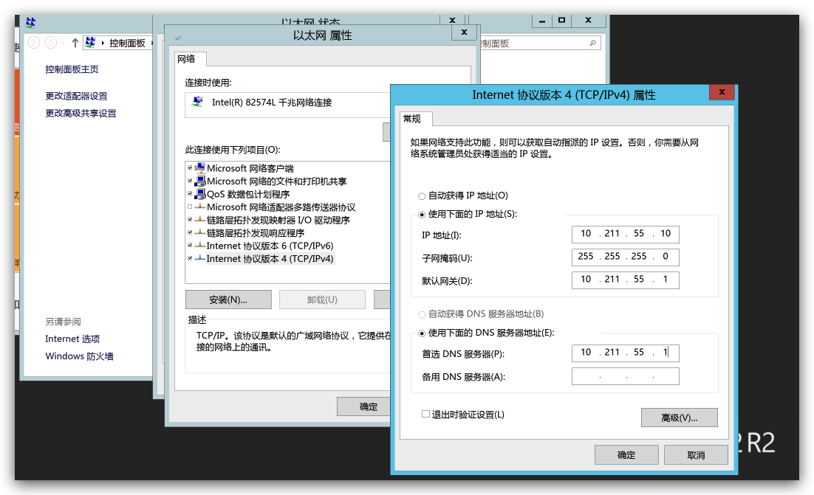

2. 设置计算机名称，并自动重启系统

   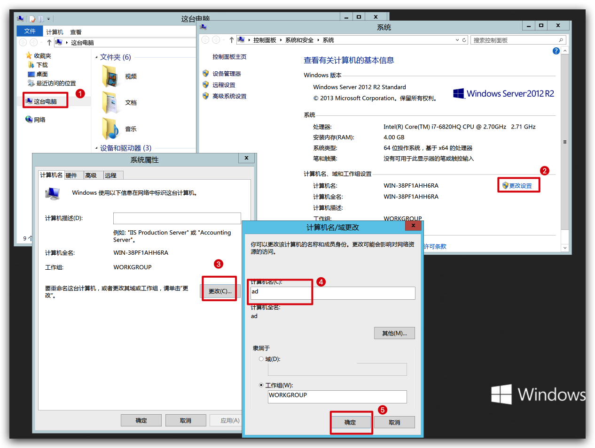

3. 命令行执行

   ```sh
   $ net user administrator /passwordreq:yes
   ```

   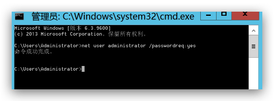

4. 添加角色，一直下一步，直到选择角色

   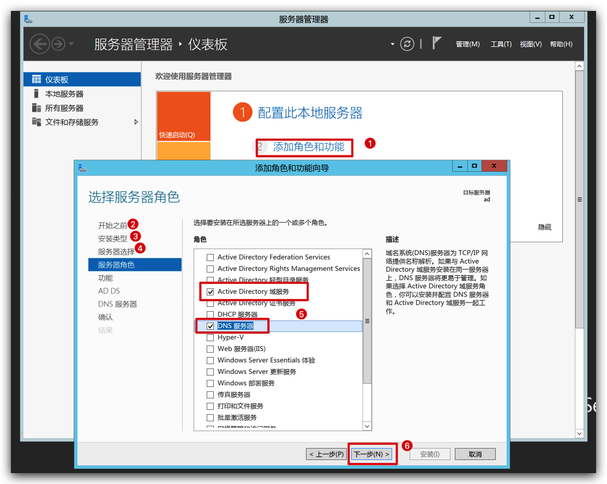

5. 继续一直下一步，直到选择安装

   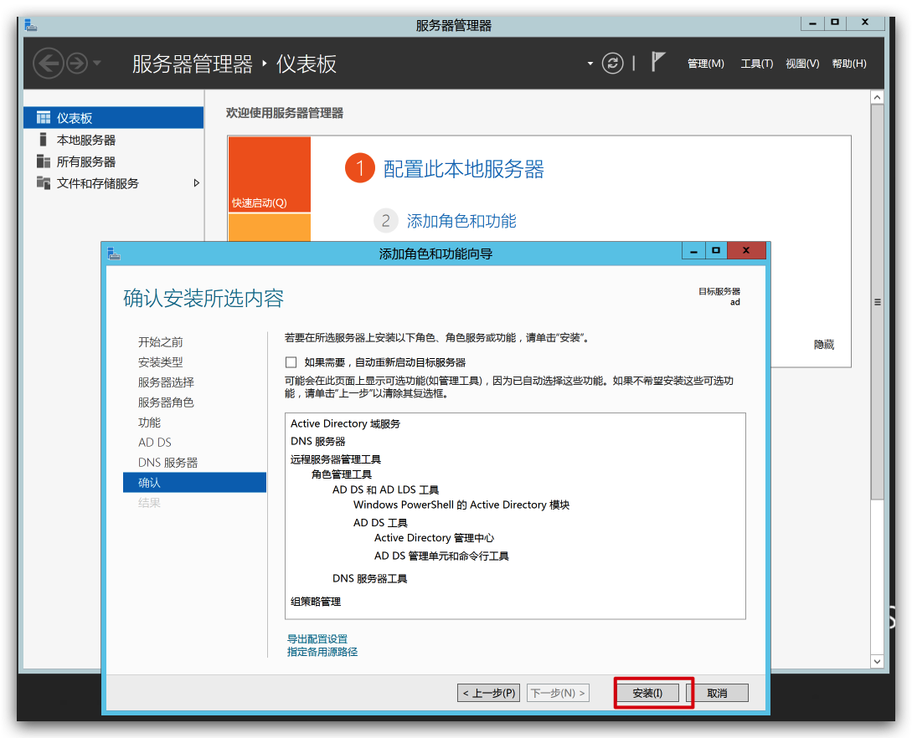

6. 安装完成后，当前页面选择升级为域控制器

   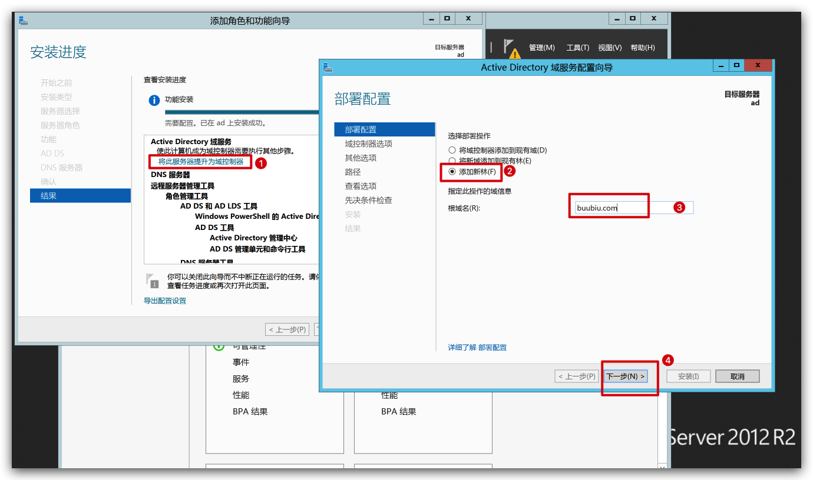

7. 继续下一步，输入密码

   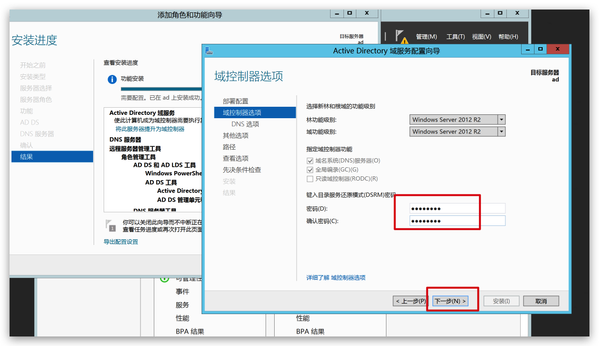

8. 继续一直下一步，直到 “先决条件检查”，点击安装

   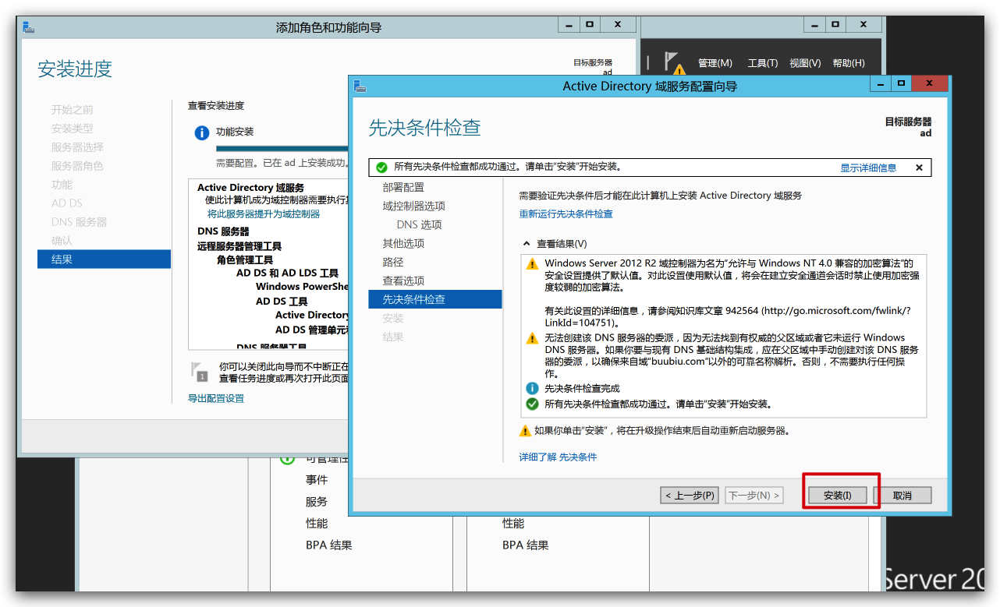

9. 提示注销，重新登录

   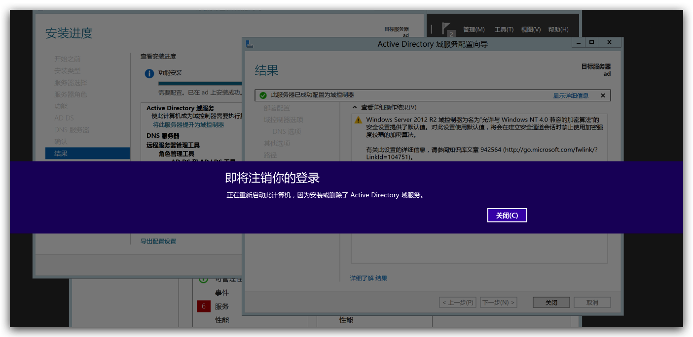

   `直接登录，或者用域登录都可以`

   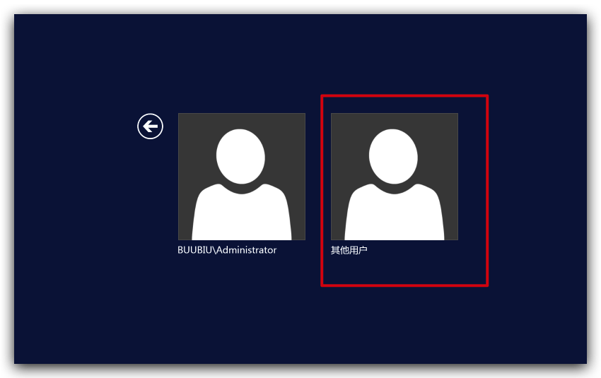

   

10. 打开电脑属性会发现变了，安装成功

    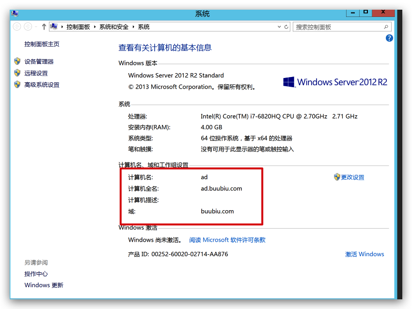

## 配置AD

### 新增域组织单位

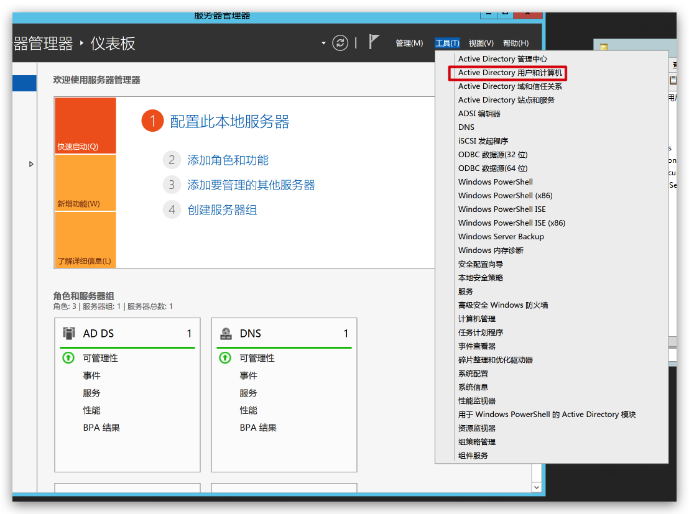

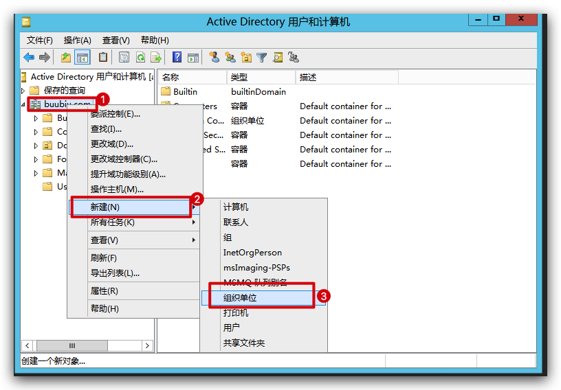

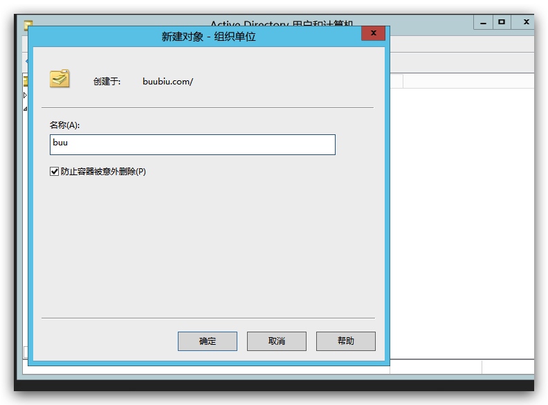

### 创建域用户

组织创建完成后，在该组织下创建域用户

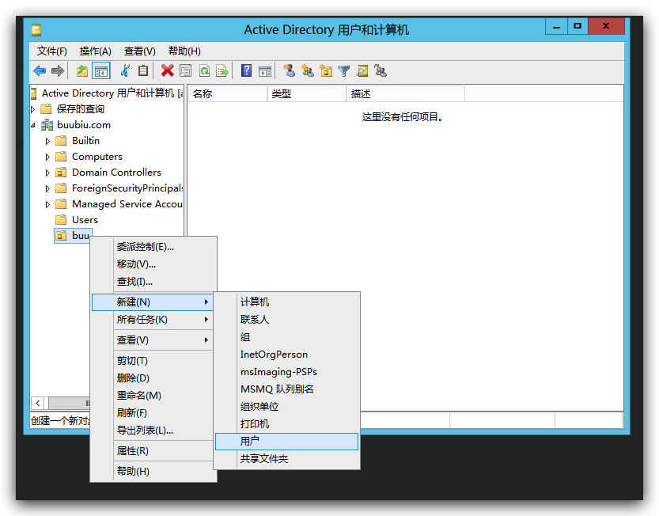

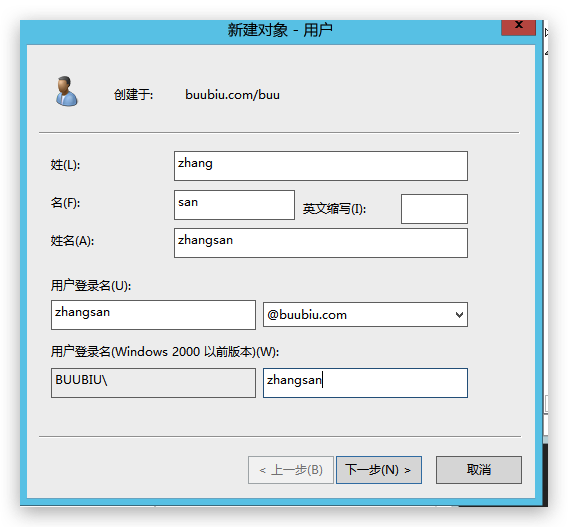

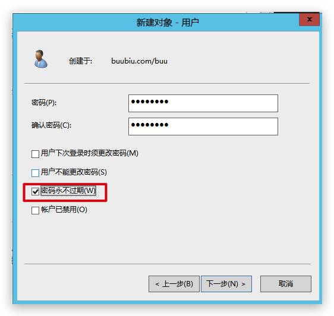

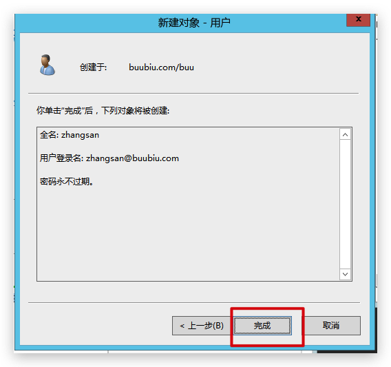
