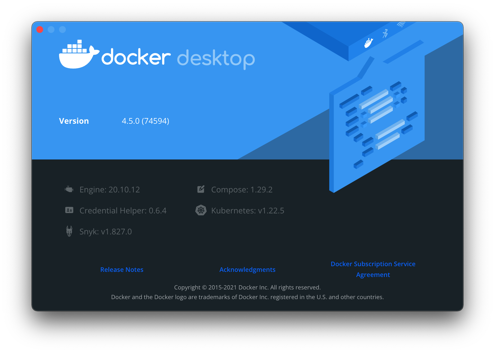
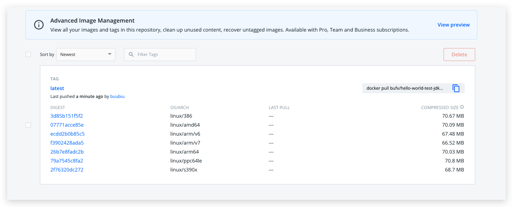

# 使用Docker buildx构建多平台的镜像

## 介绍

官网：[Docker Buildx](https://docs.docker.com/buildx/working-with-buildx/)

在日常的开发中，我们会有让程序在不同平台运行的需求。除了常用的Windows系统，Linux系统以及Mac OS系统外，我们甚至还希望让程序运行在以树莓派为代表的ARM平台下，或者是跑在嵌入式设备的路由器上。要构建出适合不同平台的镜像并不是一件容易的事情，除非你直接到目标平台下构建，或者模拟出目标平台下的环境来进行构建。

幸好，新版的Docker从版本19.03后已经开始支持一个新的命令行工具，叫做`buildx`，目地就是为了解决我们在一个平台下，一次性构建出多个平台可用镜像的需求。BuildKit 是下一代的 Docker 镜像构建工具，来源于 [Moby/BuildKit](https://github.com/moby/buildkit)。在最新的 Docker Desktop 和 Docker CE 中，官方以 Buildx 形式集成到 Docker CLI 中，不再需要额外构建添加。`buildx`是一个基于命令行的Docker扩展插件。

> 本章以macOS示例




## 安装

根据不同系统可选择以下几种安装方式

### macOS和Windows

Docker Buildx 包含在适用于 Windows 和 macOS的Docker Desktop中。

### Linux

若物理机[使用DEB 或 RPM 包](https://docs.docker.com/engine/install/)安装的，则 Docker Linux 包含了 Docker Buildx。

### 手动安装

> 不推荐，因为用这种方式安装，因为它不会使用安全更新自动更新。

1. 从[GitHub 上的发布页面](https://github.com/docker/buildx/releases/latest)下载最新的二进制文件

2. 重命名相关二进制文件并将其复制到与您的操作系统匹配的目标位置：

   | 系统    | 二进制名称          | 目标文件夹                          |
   | :------ | :------------------ | :---------------------------------- |
   | Linux   | `docker-buildx`     | `$HOME/.docker/cli-plugins`         |
   | macOS   | `docker-buildx`     | `$HOME/.docker/cli-plugins`         |
   | Windows | `docker-buildx.exe` | `%USERPROFILE%\.docker\cli-plugins` |

3. 或者将其复制到这些文件夹之一以在系统范围内安装它：

   在 Unix 环境中：

   - `/usr/local/lib/docker/cli-plugins`或者`/usr/local/libexec/docker/cli-plugins`

   - `/usr/lib/docker/cli-plugins`或者`/usr/libexec/docker/cli-plugins`

     >在 Unix 环境中，可能还需要使用以下命令使其可执行`chmod +x`：
     >
     >```sh
     >$ chmod +x ~/.docker/cli-plugins/docker-buildx
     >```

   在 Windows 上：

   - `C:\ProgramData\Docker\cli-plugins`
   - `C:\Program Files\Docker\cli-plugins`

### Dockerfile

以下是如何通过镜像在 Dockerfile 中安装和使用 Buildx [`docker/buildx-bin`](https://hub.docker.com/r/docker/buildx-bin)：

```dockerfile
FROM docker
COPY --from=docker/buildx-bin:latest /buildx /usr/libexec/docker/cli-plugins/docker-buildx
RUN docker buildx version
```

## 验证安装结果

执行命令验证：（查询版本）

```sh
$ docker buildx version
github.com/docker/buildx v0.7.1 05846896d149da05f3d6fd1e7770da187b52a247
```

看到显示的版本号，表示buildx已经启用成功。

## 构建多平台镜像

### 使用构建器实例

#### 创建构建器

默认情况下，Docker不会启用多平台架构的构建器，需要我们自己创建一个新的构建器，并激活和启动这个新的构建器:

```sh
# 创建构建器
$ docker buildx create --name mybuilder
mybuilder
# 查看构建器
$ docker buildx ls
NAME/NODE       DRIVER/ENDPOINT             STATUS   PLATFORMS
mybuilder       docker-container
  mybuilder0    unix:///var/run/docker.sock inactive
desktop-linux   docker
  desktop-linux desktop-linux               running  linux/amd64, linux/arm64, linux/riscv64, linux/ppc64le, linux/s390x, linux/386, linux/arm/v7, linux/arm/v6
default *       docker
  default       default                     running  linux/amd64, linux/arm64, linux/riscv64, linux/ppc64le, linux/s390x, linux/386, linux/arm/v7, linux/arm/v6
```

#### 构建器的生命周期

检查构建器并启动

用法：`docker buildx inspect [NAME]`

选项：

| 名称，简写                                                   | 默认 | 描述                       |
| ------------------------------------------------------------ | ---- | -------------------------- |
| [`--bootstrap`](https://docs.docker.com/engine/reference/commandline/buildx_inspect/#bootstrap) |      | 在检查之前确保构建器已启动 |
| [`--builder`](https://docs.docker.com/engine/reference/commandline/buildx_inspect/#builder) |      | 覆盖配置的构建器实例       |

```sh
# 检查并启动
$ docker buildx inspect mybuilder --bootstrap
[+] Building 15.9s (1/1) FINISHED
 => [internal] booting buildkit                                                                                                                                                                                                             15.9s
 => => pulling image moby/buildkit:buildx-stable-1                                                                                                                                                                                          14.7s
 => => creating container buildx_buildkit_mybuilder0                                                                                                                                                                                         1.2s
Name:   mybuilder
Driver: docker-container

Nodes:
Name:      mybuilder0
Endpoint:  unix:///var/run/docker.sock
Status:    running
Platforms: linux/amd64, linux/arm64, linux/riscv64, linux/ppc64le, linux/s390x, linux/386, linux/mips64le, linux/mips64, linux/arm/v7, linux/arm/v6

# 这时查看构建器列表
$ docker buildx ls
NAME/NODE       DRIVER/ENDPOINT             STATUS  PLATFORMS
mybuilder       docker-container
  mybuilder0    unix:///var/run/docker.sock running linux/amd64, linux/arm64, linux/riscv64, linux/ppc64le, linux/s390x, linux/386, linux/mips64le, linux/mips64, linux/arm/v7, linux/arm/v6
desktop-linux   docker
  desktop-linux desktop-linux               running linux/amd64, linux/arm64, linux/riscv64, linux/ppc64le, linux/s390x, linux/386, linux/arm/v7, linux/arm/v6
default *       docker
  default       default                     running linux/amd64, linux/arm64, linux/riscv64, linux/ppc64le, linux/s390x, linux/386, linux/arm/v7, linux/arm/v6
```


默认情况下，`inspect`显示有关当前构造器的信息。

```sh
$ docker buildx inspect mybuilder
Name:   mybuilder
Driver: docker-container

Nodes:
Name:      mybuilder0
Endpoint:  unix:///var/run/docker.sock
Status:    running
Platforms: linux/amd64, linux/arm64, linux/riscv64, linux/ppc64le, linux/s390x, linux/386, linux/mips64le, linux/mips64, linux/arm/v7, linux/arm/v6
```

#### 停止构建器

用法：` docker buildx stop [NAME]`

```sh
# 停止构建器
$ docker buildx stop mybuilder

# 查看构建器列表
$ docker buildx ls
NAME/NODE       DRIVER/ENDPOINT             STATUS  PLATFORMS
mybuilder       docker-container
  mybuilder0    unix:///var/run/docker.sock stopped
desktop-linux   docker
  desktop-linux desktop-linux               running  linux/amd64, linux/arm64, linux/riscv64, linux/ppc64le, linux/s390x, linux/386, linux/arm/v7, linux/arm/v6
default *       docker
  default       default                     running  linux/amd64, linux/arm64, linux/riscv64, linux/ppc64le, linux/s390x, linux/386, linux/arm/v7, linux/arm/v6

# 查询详情
$ docker buildx inspect mybuilder
Name:   mybuilder
Driver: docker-container

Nodes:
Name:      mybuilder0
Endpoint:  unix:///var/run/docker.sock
Status:    stopped
Platforms:
```

#### 删除构建器

用法：`docker buildx rm [NAME]`

选项：

| 名称，简写                                                   | 默认 | 描述                 |
| ------------------------------------------------------------ | ---- | -------------------- |
| [`--keep-state`](https://docs.docker.com/engine/reference/commandline/buildx_rm/#keep-state) |      | 保持 BuildKit 状态   |
| [`--builder`](https://docs.docker.com/engine/reference/commandline/buildx_rm/#builder) |      | 覆盖配置的构建器实例 |

```sh
# 删除构建器
$ docker buildx rm mybuilder

# 查看构建器列表
$ docker buildx ls
NAME/NODE       DRIVER/ENDPOINT STATUS  PLATFORMS
desktop-linux   docker
  desktop-linux desktop-linux   running linux/amd64, linux/arm64, linux/riscv64, linux/ppc64le, linux/s390x, linux/386, linux/arm/v7, linux/arm/v6
default *       docker
  default       default         running linux/amd64, linux/arm64, linux/riscv64, linux/ppc64le, linux/s390x, linux/386, linux/arm/v7, linux/arm/v6
  
# 查看详情
$ docker buildx inspect mybuilder
error: no builder "mybuilder" found
```

#### 切换构建器

用法：` docker buildx use [OPTIONS] NAME` 

选项

| 名称，简写                                                   | 默认 | 描述                             |
| ------------------------------------------------------------ | ---- | -------------------------------- |
| `--default`                                                  |      | 将构建器设置为当前上下文的默认值 |
| `--global`                                                   |      | 生成器持久化上下文更改           |
| [`--builder`](https://docs.docker.com/engine/reference/commandline/buildx_use/#builder) |      | 覆盖配置的构建器实例             |

```sh
# 切换构建器
$ docker buildx use mybuilder

# 查看构建器列表，带 * 号的就是当前启用的构建器,在此可以看到，新的构建器已经支持其他多种平台。
$ docker buildx ls
NAME/NODE       DRIVER/ENDPOINT             STATUS  PLATFORMS
mybuilder *     docker-container
  mybuilder0    unix:///var/run/docker.sock running linux/amd64, linux/arm64, linux/riscv64, linux/ppc64le, linux/s390x, linux/386, linux/mips64le, linux/mips64, linux/arm/v7, linux/arm/v6
desktop-linux   docker
  desktop-linux desktop-linux               running linux/amd64, linux/arm64, linux/riscv64, linux/ppc64le, linux/s390x, linux/386, linux/arm/v7, linux/arm/v6
default         docker
  default       default                     running linux/amd64, linux/arm64, linux/riscv64, linux/ppc64le, linux/s390x, linux/386, linux/arm/v7, linux/arm/v6
```

### 构建镜像

因为镜像仓库支持一个仓库上传多种架构，并且会根据构建平台pull相匹配架构的镜像，所以我们可以在一个Dockerfile，并且通过一个命令打包镜像并push。

#### 创建 Dockerfile

```dockerfile
FROM openjdk:8-jdk-alpine AS build
MAINTAINER buubiu.com
ENV TZ=Asia/Shanghai
RUN ln -snf /usr/share/zoneinfo/$TZ /etc/localtime && echo $TZ > /etc/timezone
ENTRYPOINT ["java" "-version"]
```

#### 打包构建

```sh 
# --platform 参数表示：以指定构建输出的目标平台（例如，linux/amd64、linux/arm64或 darwin/amd64）。
# -f 指定Dockerfile文件
# -t 指定镜像的名称和标签
# --push 参数表示：构建完成之后，并push到镜像仓库当中
$ docker buildx build \
--platform linux/386,linux/amd64,linux/arm/v6,linux/arm/v7,linux/arm64,linux/ppc64le,linux/s390x \
-f Dockerfile \
-t buubiu/hello-world-test-jdk . \
--push
[+] Building 237.9s (28/28) FINISHED
 => [internal] load build definition from Dockerfile                                                                                                                                                                                         0.0s
 => => transferring dockerfile: 227B                                                                                                                                                                                                         0.0s
 => [internal] load .dockerignore                                                                                                                                                                                                            0.0s
 => => transferring context: 2B                                                                                                                                                                                                              0.0s
 => [linux/s390x internal] load metadata for docker.io/library/openjdk:8-jdk-alpine                                                                                                                                                          8.9s
 => [linux/arm/v6 internal] load metadata for docker.io/library/openjdk:8-jdk-alpine                                                                                                                                                         8.7s
 => [linux/386 internal] load metadata for docker.io/library/openjdk:8-jdk-alpine                                                                                                                                                            8.7s
 => [linux/amd64 internal] load metadata for docker.io/library/openjdk:8-jdk-alpine                                                                                                                                                          8.6s
 => [linux/arm64 internal] load metadata for docker.io/library/openjdk:8-jdk-alpine                                                                                                                                                          8.6s
 => [linux/arm/v7 internal] load metadata for docker.io/library/openjdk:8-jdk-alpine                                                                                                                                                         8.6s
 => [linux/ppc64le internal] load metadata for docker.io/library/openjdk:8-jdk-alpine                                                                                                                                                        8.5s
 => [auth] library/openjdk:pull token for registry-1.docker.io                                                                                                                                                                               0.0s
 => [auth] library/openjdk:pull token for registry-1.docker.io                                                                                                                                                                               0.0s
 => [linux/arm/v7 1/2] FROM docker.io/library/openjdk:8-jdk-alpine@sha256:94792824df2df33402f201713f932b58cb9de94a0cd524164a0f2283343547b3                                                                                                  17.5s
 => => resolve docker.io/library/openjdk:8-jdk-alpine@sha256:94792824df2df33402f201713f932b58cb9de94a0cd524164a0f2283343547b3                                                                                                                0.1s
 => => sha256:43ff02e0daa55f3a4df7eab4f7128e6b39b03ece75dfeedb53bf646fce03529c 67.40MB / 67.40MB                                                                                                                                            16.2s
 => => sha256:962e53e3f8337e63290eb26703e31f0e87d70db371afae581ad3898b1dccb972 238B / 238B                                                                                                                                                   0.5s
 => => sha256:856f4240f8dba160c5323506c1e9a4dbaaca840bf1b0c244af3b8d1b42b0f43b 2.35MB / 2.35MB                                                                                                                                               4.1s
 => => extracting sha256:856f4240f8dba160c5323506c1e9a4dbaaca840bf1b0c244af3b8d1b42b0f43b                                                                                                                                                    0.1s
 => => extracting sha256:962e53e3f8337e63290eb26703e31f0e87d70db371afae581ad3898b1dccb972                                                                                                                                                    0.0s
 => => extracting sha256:43ff02e0daa55f3a4df7eab4f7128e6b39b03ece75dfeedb53bf646fce03529c                                                                                                                                                    1.4s
 => [linux/386 1/2] FROM docker.io/library/openjdk:8-jdk-alpine@sha256:94792824df2df33402f201713f932b58cb9de94a0cd524164a0f2283343547b3                                                                                                     19.6s
 => => resolve docker.io/library/openjdk:8-jdk-alpine@sha256:94792824df2df33402f201713f932b58cb9de94a0cd524164a0f2283343547b3                                                                                                                0.0s
 => => sha256:c5e66a33dcf8b38a71f0e9f16f03244e3d4cee8e4fec285fc521bd315d0b2e0e 71.35MB / 71.35MB                                                                                                                                            18.1s
 => => sha256:78a94db5087f7f8bcd0cadca9c6d446a22a96182ec9c08d67fda830b278e8dc2 236B / 236B                                                                                                                                                   0.5s
 => => sha256:d0c434c0359e2da36b788ae4f5a3a70015d83ee20070aa412e714c7feecca465 2.75MB / 2.75MB                                                                                                                                               2.1s
 => => extracting sha256:d0c434c0359e2da36b788ae4f5a3a70015d83ee20070aa412e714c7feecca465                                                                                                                                                    0.1s
 => => extracting sha256:78a94db5087f7f8bcd0cadca9c6d446a22a96182ec9c08d67fda830b278e8dc2                                                                                                                                                    0.0s
 => => extracting sha256:c5e66a33dcf8b38a71f0e9f16f03244e3d4cee8e4fec285fc521bd315d0b2e0e                                                                                                                                                    1.4s
 => [linux/amd64 1/2] FROM docker.io/library/openjdk:8-jdk-alpine@sha256:94792824df2df33402f201713f932b58cb9de94a0cd524164a0f2283343547b3                                                                                                    0.1s
 => => resolve docker.io/library/openjdk:8-jdk-alpine@sha256:94792824df2df33402f201713f932b58cb9de94a0cd524164a0f2283343547b3                                                                                                                0.1s
 => [linux/ppc64le 1/2] FROM docker.io/library/openjdk:8-jdk-alpine@sha256:94792824df2df33402f201713f932b58cb9de94a0cd524164a0f2283343547b3                                                                                                 41.8s
 => => resolve docker.io/library/openjdk:8-jdk-alpine@sha256:94792824df2df33402f201713f932b58cb9de94a0cd524164a0f2283343547b3                                                                                                                0.1s
 => => sha256:026710fda3bf73cee7ded1ff99dccbbd0077f65b00a4ebd331ef777fc7dfecf4 71.45MB / 71.45MB                                                                                                                                            38.5s
 => => sha256:a97b7b4784d132b1e215acf6612c7852271c10c4ff9f096f9847f16559741c5e 238B / 238B                                                                                                                                                   1.4s
 => => sha256:221c32b360a801e69a8aac598d495aaac3512642f967704a9d9bc5d6b4b4709e 2.78MB / 2.78MB                                                                                                                                               4.6s
 => => extracting sha256:221c32b360a801e69a8aac598d495aaac3512642f967704a9d9bc5d6b4b4709e                                                                                                                                                    0.1s
 => => extracting sha256:a97b7b4784d132b1e215acf6612c7852271c10c4ff9f096f9847f16559741c5e                                                                                                                                                    0.0s
 => => extracting sha256:026710fda3bf73cee7ded1ff99dccbbd0077f65b00a4ebd331ef777fc7dfecf4                                                                                                                                                    1.3s
 => [linux/arm64 1/2] FROM docker.io/library/openjdk:8-jdk-alpine@sha256:94792824df2df33402f201713f932b58cb9de94a0cd524164a0f2283343547b3                                                                                                    0.1s
 => => resolve docker.io/library/openjdk:8-jdk-alpine@sha256:94792824df2df33402f201713f932b58cb9de94a0cd524164a0f2283343547b3                                                                                                                0.1s
 => [linux/s390x 1/2] FROM docker.io/library/openjdk:8-jdk-alpine@sha256:94792824df2df33402f201713f932b58cb9de94a0cd524164a0f2283343547b3                                                                                                   31.4s
 => => resolve docker.io/library/openjdk:8-jdk-alpine@sha256:94792824df2df33402f201713f932b58cb9de94a0cd524164a0f2283343547b3                                                                                                                0.1s
 => => sha256:bea4f04d8b33c5bd68ccb34849e615333c5ef00958b400841a03970dd2d5e9ae 2.54MB / 2.54MB                                                                                                                                               1.1s
 => => sha256:beaa0ca3e410795baed0978b91dcb428e9f31c46e39a429f31aa4c833592476a 237B / 237B                                                                                                                                                   0.9s
 => => extracting sha256:bea4f04d8b33c5bd68ccb34849e615333c5ef00958b400841a03970dd2d5e9ae                                                                                                                                                    0.2s
 => => sha256:4bdb8ad98e9071bff3dbd2263a56ae1de6725a1128df43c7a69289bce1db0e17 69.50MB / 69.50MB                                                                                                                                            11.1s
 => => extracting sha256:beaa0ca3e410795baed0978b91dcb428e9f31c46e39a429f31aa4c833592476a                                                                                                                                                    0.0s
 => => extracting sha256:4bdb8ad98e9071bff3dbd2263a56ae1de6725a1128df43c7a69289bce1db0e17                                                                                                                                                    1.2s
 => [linux/arm/v6 1/2] FROM docker.io/library/openjdk:8-jdk-alpine@sha256:94792824df2df33402f201713f932b58cb9de94a0cd524164a0f2283343547b3                                                                                                  42.2s
 => => resolve docker.io/library/openjdk:8-jdk-alpine@sha256:94792824df2df33402f201713f932b58cb9de94a0cd524164a0f2283343547b3                                                                                                                0.1s
 => => sha256:0d7a17c0e68e2e4ed5efa96d2888beead64d70d841b73187cfa278d342a29e70 68.21MB / 68.21MB                                                                                                                                            29.8s
 => => sha256:ab2b204f0fc5c4fd136771b708ddfd60e2bdc3cc56eff6e6e3d4ee5440b4c930 239B / 239B                                                                                                                                                   2.0s
 => => sha256:6e39823df636e42cc4ea056843af98c9bec31b5ae0a75cdc5628cd19b589189c 2.54MB / 2.54MB                                                                                                                                               0.9s
 => => extracting sha256:6e39823df636e42cc4ea056843af98c9bec31b5ae0a75cdc5628cd19b589189c                                                                                                                                                    0.2s
 => => extracting sha256:ab2b204f0fc5c4fd136771b708ddfd60e2bdc3cc56eff6e6e3d4ee5440b4c930                                                                                                                                                    0.0s
 => => extracting sha256:0d7a17c0e68e2e4ed5efa96d2888beead64d70d841b73187cfa278d342a29e70                                                                                                                                                    1.3s
 => CACHED [linux/arm64 2/2] RUN ln -snf /usr/share/zoneinfo/Asia/Shanghai /etc/localtime && echo Asia/Shanghai > /etc/timezone                                                                                                              0.1s
 => CACHED [linux/amd64 2/2] RUN ln -snf /usr/share/zoneinfo/Asia/Shanghai /etc/localtime && echo Asia/Shanghai > /etc/timezone                                                                                                              0.1s
 => [linux/arm/v7 2/2] RUN ln -snf /usr/share/zoneinfo/Asia/Shanghai /etc/localtime && echo Asia/Shanghai > /etc/timezone                                                                                                                    0.5s
 => [linux/386 2/2] RUN ln -snf /usr/share/zoneinfo/Asia/Shanghai /etc/localtime && echo Asia/Shanghai > /etc/timezone                                                                                                                       0.3s
 => [linux/s390x 2/2] RUN ln -snf /usr/share/zoneinfo/Asia/Shanghai /etc/localtime && echo Asia/Shanghai > /etc/timezone                                                                                                                     0.4s
 => [linux/ppc64le 2/2] RUN ln -snf /usr/share/zoneinfo/Asia/Shanghai /etc/localtime && echo Asia/Shanghai > /etc/timezone                                                                                                                   0.4s
 => [linux/arm/v6 2/2] RUN ln -snf /usr/share/zoneinfo/Asia/Shanghai /etc/localtime && echo Asia/Shanghai > /etc/timezone                                                                                                                    0.1s
 => exporting to image                                                                                                                                                                                                                     186.2s
 => => exporting layers                                                                                                                                                                                                                      0.4s
 => => exporting manifest sha256:3d85b151f5f22dc5fbe3851564cc816ca4b36049ef5edcc475ca7047e6d635a0                                                                                                                                            0.0s
 => => exporting config sha256:edaa346ce8b806050015142d18e03052aadf71e1013ccc6eef841db3c5093b8d                                                                                                                                              0.0s
 => => exporting manifest sha256:07771acce85e1cfc09d385ad1d517abb52f7294e0cace55b8da2dab8ddf96089                                                                                                                                            0.0s
 => => exporting config sha256:3835fddec92484e9132560d7068beb63c092c45807ccd80327aa6c1068d22c2e                                                                                                                                              0.0s
 => => exporting manifest sha256:ecdd2b0b85c5ccb01b2544ca33377c28512b99c26f9c547cc959553de0882833                                                                                                                                            0.0s
 => => exporting config sha256:1c5637a825e6b43e40abfb7b24bd6c2a3c3d5582b09dfcc83987d7e991cc909e                                                                                                                                              0.0s
 => => exporting manifest sha256:f3902428ada57cf7a8502a8350a4bd69d173198611bafcc78ebf6e535ffd913e                                                                                                                                            0.0s
 => => exporting config sha256:3fd7577f19874b0dfb0465c49ed83b8bc94d70d7cac43697d144b5fb11384a94                                                                                                                                              0.0s
 => => exporting manifest sha256:26b7e8fadc2b0515128c542ce88c5fc711ff25c4ed2072b4f3a32b918265c572                                                                                                                                            0.0s
 => => exporting config sha256:7dfd783dceb22b57104bea5999dde9a0719dd55b855a1f0704b94b797ee26964                                                                                                                                              0.0s
 => => exporting manifest sha256:79a7545c8fa29cb079127335db5b8649d7e64ef1287d5ed90351ef98801e990c                                                                                                                                            0.0s
 => => exporting config sha256:29484984460def9cb40530dd64249c1c1bec05069c60e3fa5368f830156437a2                                                                                                                                              0.0s
 => => exporting manifest sha256:2f76320dc27291a3f13673d4e1a6626e1aacee1d53d87196a24a0396bf8e4d37                                                                                                                                            0.0s
 => => exporting config sha256:5f061b0e8947c64db8457482fc3b01fb6ac044b382cedb769c91de5ff03b691b                                                                                                                                              0.0s
 => => exporting manifest list sha256:3a75883a8cfa7d68aff237c60b944e907478df03a31ffb05b110803f417f1977                                                                                                                                       0.0s
 => => pushing layers                                                                                                                                                                                                                      180.2s
 => => pushing manifest for docker.io/buubiu/hello-world-test-jdk:latest@sha256:3a75883a8cfa7d68aff237c60b944e907478df03a31ffb05b110803f417f1977                                                                                               5.4s
 => [auth] buubiu/hello-world-test-jdk:pull,push token for registry-1.docker.io                                                                                                                                                                0.0s
 => [auth] buubiu/hello-world-test-jdk:pull,push token for registry-1.docker.io
```

去 DockerHub 上看，可以看到多平台的镜像了：




如果想将构建好的镜像保存在本地，可以将 `type` 指定为 `docker`，但必须分别为不同的 CPU 架构构建不同的镜像，不能合并成一个镜像，即：

```sh
$ docker buildx build --platform=linux/arm64 -f Dockerfile -t buubiu/hello-world-test-jdk-arm64 -o type=docker .
[+] Building 8.0s (7/7) FINISHED
 => [internal] load build definition from Dockerfile                                                                                                                                                                                         0.0s
 => => transferring dockerfile: 227B                                                                                                                                                                                                         0.0s
 => [internal] load .dockerignore                                                                                                                                                                                                            0.0s
 => => transferring context: 2B                                                                                                                                                                                                              0.0s
 => [internal] load metadata for docker.io/library/openjdk:8-jdk-alpine                                                                                                                                                                      1.8s
 => [1/2] FROM docker.io/library/openjdk:8-jdk-alpine@sha256:94792824df2df33402f201713f932b58cb9de94a0cd524164a0f2283343547b3                                                                                                                0.0s
 => => resolve docker.io/library/openjdk:8-jdk-alpine@sha256:94792824df2df33402f201713f932b58cb9de94a0cd524164a0f2283343547b3                                                                                                                0.0s
 => CACHED [2/2] RUN ln -snf /usr/share/zoneinfo/Asia/Shanghai /etc/localtime && echo Asia/Shanghai > /etc/timezone                                                                                                                          0.0s
 => exporting to oci image format                                                                                                                                                                                                            6.1s
 => => exporting layers                                                                                                                                                                                                                      0.0s
 => => exporting manifest sha256:26b7e8fadc2b0515128c542ce88c5fc711ff25c4ed2072b4f3a32b918265c572                                                                                                                                            0.0s
 => => exporting config sha256:7dfd783dceb22b57104bea5999dde9a0719dd55b855a1f0704b94b797ee26964                                                                                                                                              0.0s
 => => sending tarball                                                                                                                                                                                                                       6.0s
 => importing to docker
 
$ docker buildx build --platform=linux/amd64 -f Dockerfile -t buubiu/hello-world-test-jdk-amd64 -o type=docker .
[+] Building 4.9s (7/7) FINISHED
 => [internal] load build definition from Dockerfile                                                                                                                                                                                         0.0s
 => => transferring dockerfile: 227B                                                                                                                                                                                                         0.0s
 => [internal] load .dockerignore                                                                                                                                                                                                            0.0s
 => => transferring context: 2B                                                                                                                                                                                                              0.0s
 => [internal] load metadata for docker.io/library/openjdk:8-jdk-alpine                                                                                                                                                                      1.4s
 => [1/2] FROM docker.io/library/openjdk:8-jdk-alpine@sha256:94792824df2df33402f201713f932b58cb9de94a0cd524164a0f2283343547b3                                                                                                                0.0s
 => => resolve docker.io/library/openjdk:8-jdk-alpine@sha256:94792824df2df33402f201713f932b58cb9de94a0cd524164a0f2283343547b3                                                                                                                0.0s
 => CACHED [2/2] RUN ln -snf /usr/share/zoneinfo/Asia/Shanghai /etc/localtime && echo Asia/Shanghai > /etc/timezone                                                                                                                          0.0s
 => exporting to oci image format                                                                                                                                                                                                            3.3s
 => => exporting layers                                                                                                                                                                                                                      0.0s
 => => exporting manifest sha256:07771acce85e1cfc09d385ad1d517abb52f7294e0cace55b8da2dab8ddf96089                                                                                                                                            0.0s
 => => exporting config sha256:3835fddec92484e9132560d7068beb63c092c45807ccd80327aa6c1068d22c2e                                                                                                                                              0.0s
 => => sending tarball                                                                                                                                                                                                                       3.3s
 => importing to docker
 
 
$ docker images
REPOSITORY                                      TAG                                                     IMAGE ID       CREATED         SIZE
buubiu/hello-world-test-jdk-arm64                        latest                                                  7dfd783dceb2   3 minutes ago   103MB
buubiu/hello-world-test-jdk-amd64                        latest                                                  3835fddec924   4 minutes ago   105MB
```
