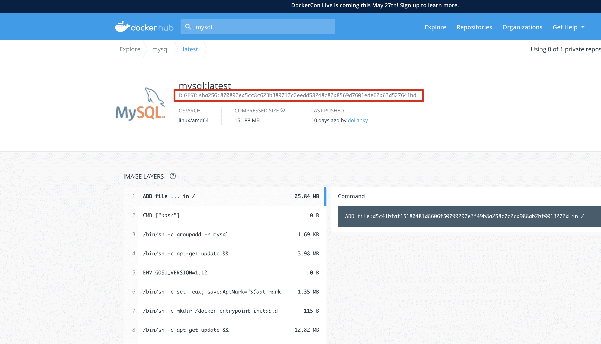

# Docker的常用命令

##  基本命令

```dockerfile
docker version	#查看docker的版本信息
docker info			#查看更详细的信息
docker --help || docker		#帮助命令

#docker执行命令格式
docker [options] command(具体命令)
```


##  Images镜像命令

###  查看本机中所有镜像

```dockerfile
docker images [镜像名] #列出本地所有镜像
  -a #列出所有镜像（包含中间映像层） 
  -q #只显示镜像id
```

###  搜索镜像

```dockerfile
docker search [options] 镜像名	#去dockerhub上查询当前镜像
  -s 指定值	#列出收藏数不少于指定值的镜像
  --no-trunc	#显示完整的镜像信息
```

###  从仓库下载镜像

```dockerfile
#1.根据版本号下载
docker pull 镜像名[:TAG] #推荐使用
#例如：docker pull mysql:5.6.0

#2.根据摘要下载
docker pull 镜像名 [@DIGEST]
#例如：docker pull mysql@sha256:870892ea5cc8c623b389717c2eedd58248c82a8569d7601ede62a63d527641bd
```



###  删除镜像

```dockerfile
#删除指定镜像
docker image rm 镜像名[:TAG]｜镜像ID
docker rmi 镜像名[:TAG]｜镜像ID #简写
  -f #强制删除

#删除所有镜像
docker rmi -f $(docker images -q)
```

##  Contrainer容器命令

运行容器

```dockerfile
docker run 镜像名:tag ｜ 镜像ID  ##镜像名新建并启动容器
  --name #别名 为容器起一个名字
  -d #启动守护容器（在后台启动容器）
  -p #指定端口号启动（映射的外部端口号:容器内部端口号）可书写多个
  -P #大写P，随机一个端口号映射到容器内部du a
  -i #以交互模式运行容器，通常与-t一起使用
  -t #分配一个伪终端shell窗口
#例如：
#docker run -it --name myTomcat -p 8888:8080 tomcat
#docker run -d --name myTomcat -P tomcat
```

###  查看运行的容器

```dockerfile
docker ps #列出所有正在运行的容器
  -a #查看所有容器（运行和非运行）
  -q #静默模式，只显示运行容器的ID
```

| 容器ID       | 基于某镜像 | 内部启动命令      | 创建时间      | 当前状态     | 内部监听的端口(0.0.0.0:表示任意机器都可以访问) | 容器名称     |
| ------------ | ---------- | ----------------- | ------------- | ------------ | ---------------------------------------------- | ------------ |
| CONTAINER ID | IMAGE      | COMMAND           | CREATED       | STATUS       | PORTS                                          | NAMES        |
| 9b816120e028 | tomcat     | "catalina.sh run" | 6 seconds ago | Up 6 seconds | 0.0.0.0:8080->8080/tcp                         | frosty_tharp |

###  停止｜关闭｜重启容器

```dockerfile
docker start   容器名字或者容器id    开启容器
docker restart 容器名或者容器id      重启容器
docker stop  容器名或者容器id 	      正常停止容器运行
docker kill  容器名或者容器id        立即停止容器运行
```

###  删除容器

```dockerfile
docker rm 容器名称｜容器ID #删除停止的容器
docker rm -f 容器名称｜容器ID #删除正在运行的容器
docker rm -f $(docker ps -aq) #删除所有的容器
```

###  查看容器内服务运行日志

```dockerfile
docker logs [OPITONS] 容器名称｜容器ID #查看容器日志
  -f #查看实时日志
  -t #加入时间戳
  --tail N #显示最后N行日志
```

###  查看容器内进程

```dockerfile
docker top 容器名称｜容器ID
```

###  进入容器内部

```dockerfile
docker exec [OPTIONS] 容器名称｜容器ID 容器内部命令(bash) 
  -i #以交互模式运行容器，通常与-t一起使用
  -t #分配一个伪终端shell窗口
exit #退出容器
```

###  容器和宿主机之间传输文件

```dockerfile
  从容器复制文件到宿主机
docker cp 容器名称｜容器ID:容器内资源文件｜目录 宿主机文件｜目录
#例如： docker cp 3334ad:/usr/local/tomcat/text.txt ./text.txt

  从宿主机复制文件到容器
docker cp 宿主机资源文件｜目录 容器名称｜容器ID:容器内文件｜目录
#例如 docker cp text2.txt 3334ad:/usr/local/tomcat
```

###  查看容器内部细节

```dockerfile
docker inspect 容器名称｜容器ID
```

###  数据卷(volum)

####  作用

实现宿主机系统与容器之间的文件共享

####  使用

#####  自定义数据卷目录

**注意：**宿主机目录会覆盖容器内目录内容

```dockerfile
docker run -v 宿主机绝对目录:容器内绝对目录 容器名称｜容器ID
docker run -v 宿主机绝对目录:容器内绝对目录:ro 容器名称｜容器ID #ro代表容器内目录只读
  例如：docker run -d -p 8080:8080 --name myTomcat -v /root/apps:/usr/local/tomcat/webapps tomcat
```

#####  自动数据卷目录

**注意：**这种方式会在docker运行容器时自动在宿主机中创建一个目录,并将容器目录文件复制到宿主机中

```dockerfile
docker run -v 卷名(任意别名):容器内绝对路径 	容器名称｜容器ID
docker run -v 卷名(任意别名):容器内绝对路径:ro 	容器名称｜容器ID #ro代表容器内目录只读
#例如：docker run -d -p 8080:8080 --name myTomcat -v aa:/usr/local/tomcat/webapps tomcat
```

#####  容器内部执行的流程

1. aa代表一个数据卷名称，名称可以随便写，docker在发现aa目录不存在时，会自动创建这个数据卷，并自动映射宿主机某个目录

2. 同时在启动容器时会将aa对应容器目录中全部内容复制到aa映射到目录中

3. 这个aa目录在宿主机：/var/lib/docker/volumes/aa/_data


###  容器打包成新的镜像

```dockerfile
docker commit -m "描述信息" -a "作者信息" 容器名称｜容器ID 打包后的镜像名称(必须全部小写字母):标签
#例如：docker commit -m "deploy" -a "buubiu" myTomcat my-tomcat:1.0
```

###  导出镜像文件（备份镜像）

```dockerfile
docker save 镜像名:TAG -o 文件名称.tar
#例如：docker save my-tomcat:1.0 -o my-tomcat-1.0.tar
```

###  载入镜像（导入tar包镜像文件）

```dockerfile
docker load -i 导入镜像的tar文件名
  -i image缩写
```

