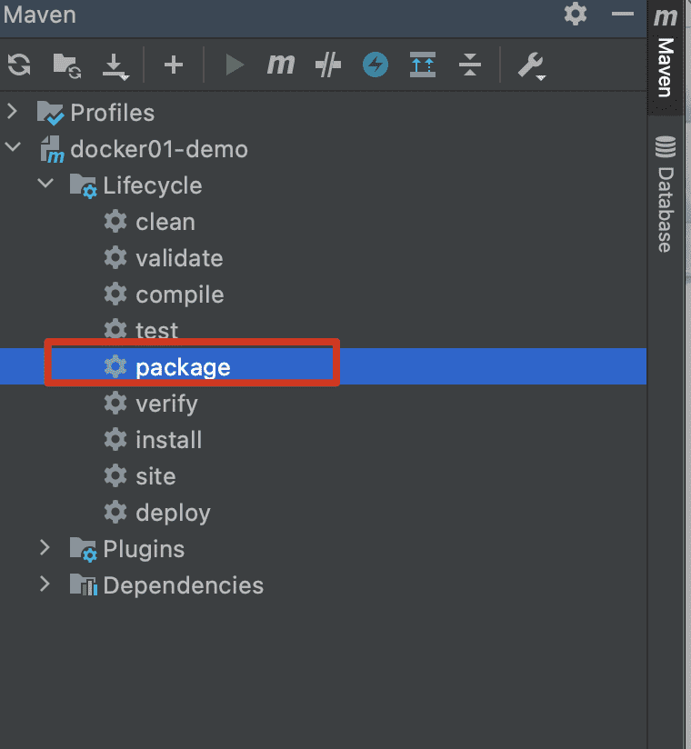
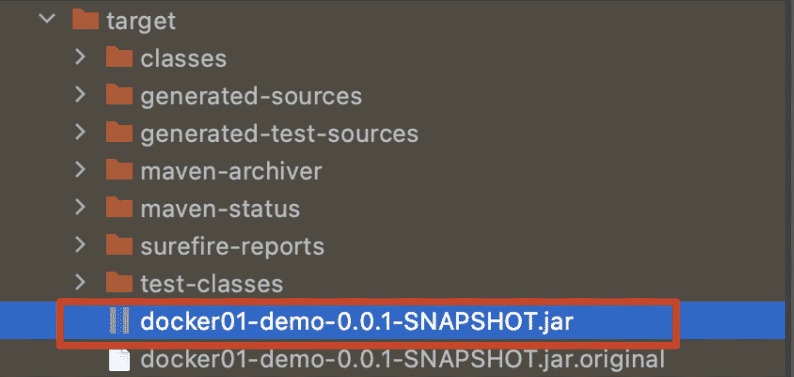

# Dockerfile构建springboot项目

##  准备开发好的Springboot应用程序

###  对springboot应用进行打包

####  jar包方式（主流）

​	**这种方式要以 jdk的镜像为基础构建**

- 执行maven package命令






####  war方式（过度）

​	**这种方式要以 tomcat镜像为基础构建**

##  把包上传到服务器或者本机的一个目录

这里由于我本机安装了docker，所以就在项目下新建个目录

##  在服务器或本机创建Dockerfile上下文目录context

###  创建目录

`mkdir demo` 这个目录作为context目录

###  在demo目录中创建Dockerfile文件并编写

```dockerfile
#基于哪个镜像进行构建
FROM openjdk:8-jre
#定义进入容器时默认位置，接下来后续操作的工作位置
WORKDIR /app 
#将上下文中名字为docker01-demo-xxx.jar复制到工作目录，同时修改名称为app.jar
ADD docker01-demo-0.0.1-SNAPSHOT.jar app.jar 
#让当前容器暴漏8081端口，因为项目使用的端口为8081
EXPOSE 8081
#启动应用固定命令
ENTRYPOINT ["java","-jar"]
#执行jar包命令
CMD ["app.jar"]
```

###  执行构建

```dockerfile
docker build -t docker-demo:0.1 .
```

###  运行容器

```dockerfile
docker run -d - p 8081:8081 --name docker-demo docker-demo:0.1
```

