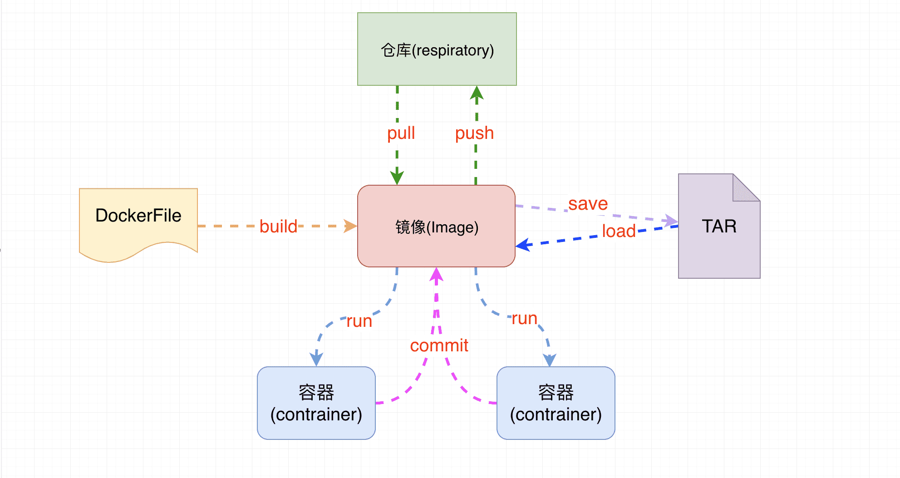
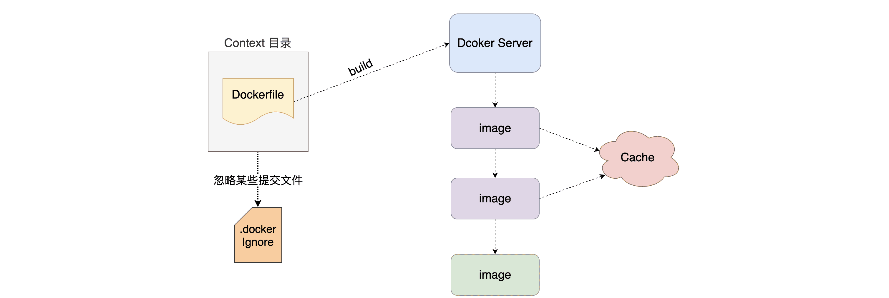

# Dockerfile的使用

##  什么是Dockerfile

Dockerfile可以认为是**Docker镜像的描述文件，是由一系列命令和参数构成的脚本**。主要作用是**用来帮助我们自己构建一个自定义镜像，日后用户可以将自己应用打包成镜像，这样就可以让我们应用进行容器运行。**




##  Dockerfile构建镜像原理



###  构建镜像命令

1. 先在需要打包的目录下建`Dockerfile`文件

2. 书写Dockerfile命令

3. 运行Dockerfile

   ```dockerfile
   docker build -t 镜像名:TAG -f Dockerfile .
   ```

   `-t`：指定生成镜像的名称和标签

   `-f`：指定dockerfile文件
   
   `.`：表示打包当前文件夹所有文件

##  Dockerfile的基本命令

官方说明:https://docs.docker.com/engine/reference/builder/

| 保留字         | 作用                                                         |
| -------------- | ------------------------------------------------------------ |
| **FROM**       | **当前镜像是基于哪个镜像的** `第一个指令必须是FROM`          |
| MAINTAINER     | 镜像维护者的姓名和邮箱地址(将要弃用)                         |
| **RUN**        | **构建镜像时需要运行的指令**                                 |
| **EXPOSE**     | **当前容器对外暴露出的端口号**                               |
| **WORKDIR**    | **指定在创建容器后，终端默认登录进来的工作目录，一个落脚点** |
| **ENV**        | **用来在构建镜像过程中设置环境变量**                         |
| **ADD**        | **将宿主机目录下的文件拷贝进镜像且ADD命令会自动处理URL和解压tar包** |
| **COPY**       | **类似于ADD，拷贝文件和目录到镜像中<br/>将从构建上下文目录中<原路径>的文件/目录复制到新的一层的镜像内的<目标路径>位置** |
| **VOLUME**     | **容器数据卷，用于数据保存和持久化工作**                     |
| **CMD**        | **指定一个容器启动时要运行的命令<br/>Dockerfile中可以有多个CMD指令，但只有最后一个生效，CMD会被docker run之后的参数替换** |
| **ENTRYPOINT** | **指定一个容器启动时要运行的命令<br/>ENTRYPOINT的目的和CMD一样，都是在指定容器启动程序及其参数** |

###  FROM命令

- 基于那个镜像进行构建新的镜像,在构建时会自动从docker hub拉取base镜像 必须作为Dockerfile的第一个指令出现

- 语法:

  ```dockerfile
  FROM  <image>
  FROM  <image>[:<tag>]     #使用版本不写为latest
  FROM  <image>[@<digest>]  #使用摘要
  ```

- 例如：

  ```dockerfile
  FORM centos:7
  ```

###  MAINTAINER  命令

- 镜像维护者的姓名和邮箱地址[废弃]

- 语法:

  ```dockerfile
  MAINTAINER <name>
  ```

- 例如：

  ```dockerfile
  MAINTAINER buubiu.com
  ```

###  RUN命令

- RUN指令将在当前映像之上的新层中执行任何命令并提交结果。生成的提交映像将用于Dockerfile中的下一步

- 语法:可以直接跟命令行，也可以json数据形式

  ```dockerfile
  RUN <command> (shell form, the command is run in a shell, which by default is /bin/sh -c on Linux or cmd /S /C on Windows)
  RUN echo hello
  
  RUN ["executable", "param1", "param2"] (exec form)
  RUN ["/bin/bash", "-c", "echo hello"]
  ```

- 例如：

  ```dockerfile
  RUN yum install -y vim
  #或者 json数组形式
  RUN ["yum","install","-y","vim"]
  ```

###  EXPOSE命令

- 用来指定构建的镜像在运行为容器时对外暴露的端口

- 语法：

  ```dockerfile
  EXPOSE 80/tcp  如果没有显示指定则默认暴露都是tcp
  EXPOSE 80/udp
  ```

- 例如：

  ```dockerfile
  EXPOSE 8080
  EXPOSE 8081
  ```

WORKDIR命令

- 用来为Dockerfile中的任何RUN、CMD、ENTRYPOINT、COPY和ADD指令设置工作目录。如果WORKDIR不存在，即使它没有在任何后续Dockerfile指令中使用，它也将被创建。

- 注意:**WORKDIR指令可以在Dockerfile中多次使用。如果提供了相对路径，则该路径将与先前WORKDIR指令的路径相对**

- 语法：可以绝对路径，也可以相对路径

  ```dockerfile
  WORKDIR /path/to/workdir
  
  WORKDIR /a
  WORKDIR b
  WORKDIR c
  ```

- 例如：

  ```dockerfile
  WORKDIR /data
  
  WORKDIR aa
  ```

###  ENV 命令

- 用来为构建镜像设置环境变量。这个值将出现在构建阶段中所有后续指令的环境中。

- 语法：

  ```dockerfile
  ENV <key> <value>
  ENV <key>=<value> ...
  ```

- 例如：

  ```dockerfile
  ENV BASE_DIR /mydir
  ENV BASE_DIR=/mydir
  #其他引用是用$符号
  WORKDIR $BASE_DIR/aa
  ```

###  ADD命令

- 用来从context上下文复制文件、目录或远程文件URL，并将它们添加到位于指定路径的镜像文件系统中，跟COPY命令类似，区别在于**ADD命令会自动处理URL和解压tar包**

- 语法：

  ```dockerfile
  ADD 原文件 目标路径 
  ADD ["原文件","目标路径"] #也支持json数据形式
  ADD url #添加远程文件(直接跟URL 不会自动解压压缩包)
  ADD 文件名.tar.gz 目标路径 #直接跟压缩包会自动解压
  ```

- 例如：

  ```dockerfile
  ADD hom* /mydir/ #通配符添加多个文件
  ADD hom?.txt /mydir/ #通配符添加
  ADD test.txt relativeDir/ #可以指定相对路径
  ADD test.txt /absoluteDir/ #可以指定绝对路径
  ADD ["test.txt","/mydir/"] #也支持json数据形式
  ADD https://mirrors.bfsu.edu.cn/apache/tomcat/tomcat-8/v8.5.64/bin/apache-tomcat-8.5.64.tar.gz /mydir/ #添加远程文件
  ADD apache-tomcat-8.5.64.tar.gz /mydir/ #会自动解压到mydir目录
  
  #可以与以下命令连用
  RUN mv apache-tomcat-8.5.64 tomcat #改名为tomcat
  WORKDIR tomcat #指定容器运行后的目录为tomcat
  ```

###  COPY命令

- 用来将context上下文目录中的指定文件复制到镜像的指定目录中，跟ADD命令类似

- 语法：

  ```dockerfile
  ADD 原文件 目标路径 
  ADD ["原文件","目标路径"] #也支持json数据形式
  ```

- 例如：

  ```dockerfile
  COPY test.txt /mydir/
  COPY ["test.txt","/mydir/"] #也支持json数据形式
  ```

###  VOLUME命令

- 用来定义容器运行时可以挂载到宿主机的目录

- 语法：

  ```dockerfile
  VOLUME 容器内部待挂载的绝对路径
  VOLUME ["容器内部待挂载的绝对路径"] #也支持json格式
  ```

- 例如：

  ```dockerfile
  VOLUME /mydir/tomcat/webapps
  VOLUME ["/mydir/tomcat/webapps"]
  #后续运行容器才能指定挂载目录
  docker run -v tomcatwebapps:/mydir/tomcat/webapps centos7
  ```

###  CMD 命令

- 用来为启动的容器指定执行的命令,在Dockerfile中只能有一条CMD指令。如果列出多个命令，则只有最后一个命令才会生效。

- 注意: 

  1. **Dockerfile中只能有一条CMD指令。如果列出多个命令，则只有最后一个命令才会生效。**

  2. **我们可以在run容器时覆盖掉cmd命令**

- 语法:

  ```dockerfile
  CMD command
  CMD ["command", "command", "command"] #也支持json格式
  ```

- 例如：

  ```dockerfile
  CMD ls /mydir/tomcat #查看目录下文件
  #或者
  CMD ["ls","/mydir/tomcat"]
  
  #docker run 覆盖CMD命令
  docker run centos7 ls /mydir/tomcat/webapps
  ```

###  ENTRYPOINT命令

- 用来指定容器启动时执行命令和CMD类似

- 注意：

  **我们不可以在run容器时像CMD那样覆盖命令，但是如果想覆盖ENTRYPOINT的命令，可以加上 `--entrypoint=command`**

- 语法:

  ```dockerfile
  ENTRYPOINT command
  ENTRYPOINT ["command", "command", "command"] #也支持json格式
  ```

- 例如：

  ```dockerfile
  ENTRYPOINT ls /mydir/tomcat #查看目录下文件
  #或者
  ENTRYPOINT ["ls","/mydir/tomcat"]
  
  #docker run 覆盖ENTRYPOINT命令
  docker run centos7 --entrypoint=ls /mydir/tomcat/webapps
  ```

###  CMD与ENTRYPOINT的区别

- ENTRYPOINT指令，往往用于设置容器启动后的**第一个命令**，这对一个容器来说往往是固定的。

- CMD指令，往往用于设置容器启动的第一个命令的**默认参数**，这对一个容器来说可以是变化的。

- 联合使用

  - **注意：联合使用时，必须是json数组格式的命令，否则无法联合使用**

  ```dockerfile
  #第一种应用：展示目录
  ENTRYPOINT ["ls"]
  CMD ["/mydir/tomcat"]
  #第二种应用：运行不同的jar包
  ENTRYPOINT ["java","-jar"]
  CMD ["buubiu.jar"]
  
  #启动容器
  docker run centos7 #结果展示tomcat目录
  docker run centos7 /mydir/tomcat/webapps #结果展示webapps目录，因为覆盖了CMD命令
  ```

  