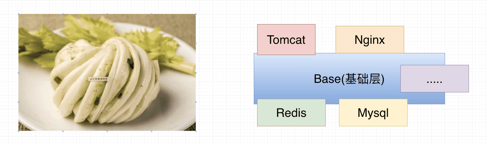
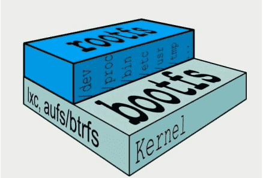

# Docker的镜像原理

## 镜像是什么？

镜像是一种轻量级的，可执行的独立软件包，用来打包软件运行环境和基于运行环境开发的软件，它包含运行某个软件所需的所有内容，包括代码、运行时所需的库、环境变量和配置文件。

## 一个镜像会那么大？

`镜像就是花卷`

- UnionFS（联合文件系统）:

  Union文件系统是一种分层，轻量级并且高性能的文件系统，它支持对文件系统的修改作为一次提交来一层层的叠加，同时可以将不同目录挂载到同一个虚拟文件系统下。Union文件系统是Docker镜像的基础。这种文件系统特性:就是一次同时加载多个文件系统，但从外面看起来，只能看到一个文件系统，联合加载会把各层文件系统叠加起来，这样最终的文件系统会包含所有底层的文件和目录 。	

## Docker镜像原理

`docker的镜像实际是由一层一层的文件系统组成。`

- bootfs（boot file system）主要包含bootloader和kernel，bootloader主要是引导加载kernel，Linux刚启动时会加载bootfs文件系统。在docker镜像的最底层就是bootfs。这一层与Linux/Unix 系统是一样的，包含boot加载器（bootloader）和内核（kernel）。当boot加载完,后整个内核就都在内存中了，此时内存的使用权已由bootfs转交给内核，此时会卸载bootfs。

- rootfs（root file system），在bootfs之上，包含的就是典型的linux系统中的/dev，/proc，/bin，/etc等标准的目录和文件。rootfs就是各种不同的操作系统发行版，比如Ubuntu/CentOS等等。

- 我们平时安装进虚拟机的centos都有1到几个GB，为什么docker这里才200MB？对于一个精简的OS，rootfs可以很小，只需要包括最基本的命令，工具，和程序库就可以了，因为底层直接使用Host的Kernal，自己只需要提供rootfs就行了。由此可见不同的linux发行版，他们的bootfs是一致的，rootfs会有差别。因此不同的发行版可以共用bootfs。

## 为什么docker镜像要采用这种分层结构呢?

`最大的一个好处就是资源共享`

- 比如：有多个镜像都是从相同的base镜像构建而来的，那么宿主机只需在磁盘中保存一份base镜像。同时内存中也只需要加载一份base镜像，就可以为所有容器服务了。而且镜像的每一层都可以被共享。Docker镜像都是只读的。当容器启动时，一个新的可写层被加载到镜像的顶部。这一层通常被称为容器层，容器层之下都叫镜像层。