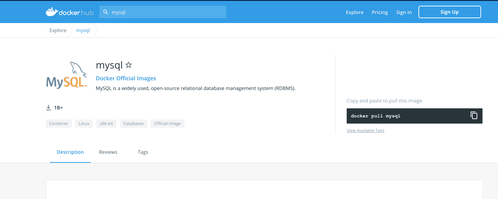
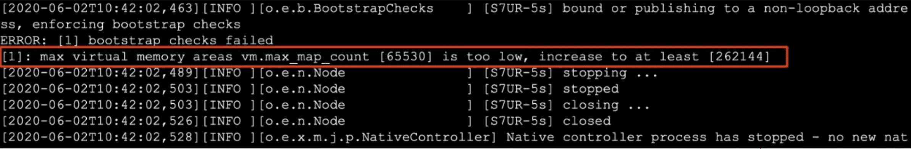

# Docker安装常用服务

## 基础安装步骤

1. 安装哪个服务就去docker hub搜索对应服务的镜像

2. 点击进入该服务的docker hub，如图：

   
   1. Description：描述信息
   2. Tags：版本信息

3. 确定使用的版本

   `docker pull mysql:5.7`


## 安装mysql

- 基本启动mysql服务

  ```dockerfile
  docker run -e MYSQL_ROOT_PASSWORD=root mysql:5.7
  # -e MYSQL_ROOT_PASSWORD=root e是指环境变量；代表给root用户指定密码
  ```

- 启动一个mysql服务，后台运行，指定映射端口，指定root用户密码，指定容器名字

  ```dockerfile
  docker run -d -p 3307:3306 -e MYSQL_ROOT_PASSWORD=root --name mysql mysql:5.7
  ```

- 启动一个mysql服务，后台运行，指定映射端口，指定root用户密码，指定容器名字，使用数据卷将数据持久化到宿主机系统

  **注意：通过docker hub描述得知，mysql存储数据文件目录是`/var/lib/mysql`**

  ```dockerfile
  docker run -d -p 3307:3306 -e MYSQL_ROOT_PASSWORD=root --name mysql -v mysqldata:/var/lib/mysql mysql:5.7
  ```

- 启动一个mysql服务，后台运行，指定映射端口，指定root用户密码，指定容器名字，使用数据卷将数据持久化到宿主机系统，用已修改之后的配置文件启动

  **注意：通过docker hub描述得知，mysql配置文件的路径是`/etc/mysql`**

  ```dockerfile
  docker run -d -p 3307:3306 -e MYSQL_ROOT_PASSWORD=root --name mysql -v mysqldata:/var/lib/mysql -v mysqlconfig:/etc/mysql mysql:5.7
  ```

- 将mysql数据库备份为sql文件

  ```dockerfile
  #导出全部数据
  docker exec mysql|容器id sh -c 'exec mysqldump --all-databases -uroot -p"$MYSQL_ROOT_PASSWORD"' > /root/all-databases.sql
  
  #导出指定库数据
  docker exec mysql sh -c 'exec mysqldump --databases 库表 -uroot -p"$MYSQL_ROOT_PASSWORD"' > /root/all-databases.sql
  
  #导出指定库数据不要数据
  docker exec mysql sh -c 'exec mysqldump --no-data --databases 库表 -uroot -p"$MYSQL_ROOT_PASSWORD"' > /root/all-databases.sql
  ```

- 执行sql文件到mysql中

  ```dockerfile
  docker exec -i mysql sh -c 'exec mysql -uroot -p"$MYSQL_ROOT_PASSWORD"' < /root/xxx.sql
  ```

## 安装tomcat

- 启动一个基本tomcat服务

  ```dockerfile
  docker run -d -p 8081:8080 --name tomcat tomcat:8.0-jre8
  ```

- 启动tomcat服务，并将部署应用目录通过数据卷挂载到宿主机系统

  **注意：通过docker hub描述得知，部署web应用在容器中目录为`/usr/local/tomcat/webapps`**

  ```dockerfile
  docker run -d -p 8081:8080 --name tomcat -v apps:/usr/local/tomcat/webapps tomcat:8.0-jre8
  ```

- 修改配置文件，并将部署应用目录通过数据卷挂载到宿主机系统（如果修改端口的话，需要重新起一个容器才能生效）

  **注意：通过docker hub描述得知，配置文件在`/usr/local/tomcat/conf`**

  ```dockerfile
  docker run -d -p 8081:8080 --name tomcat -v apps:/usr/local/tomcat/webapps -v confs:/usr/local/tomcat/conf tomcat:8.0-jre8
  ```

## 安装redis

- 启动一个基本redis服务

  ```dockerfile
  docker run -d -p 6379:6379 --name redis redis:5.0
  ```

- 开启redis持久化(` --appendonly yes`)，并将持久化的目录通过数据卷挂载到宿主机系统

  **注意：一旦开启持久化后，持久化生成的aof文件会被放入容器中`/data`目录中**

  ```dockerfile
  docker run -d -p 6379:6379 -v redisdata:/data --appendonly yes --name redis redis:5.0
  ```

- 加载外部配置文件，以配置文件方式启动

  **注意：**

  **1. 默认情况下redis官方镜像中没有redis.conf配置文件 需要去官网下载指定版本的配置文件**

  **2. 将官方安装包中配置文件进行复制到宿主机指定目录中如 /root/redis/redis.conf文件**

  **3. 修改需要自定义的配置**

  ```shell
  bind 0.0.0.0 开启远程权限
  appenonly yes 开启aof持久化
  ```

  **4. 加载配置启动，并让配置生效(`redis-server /usr/local/etc/redis/redis.conf`)**

  ```dockerfile
  docker run -d -p 6379:6379 -v /root/redis/redis.conf:/usr/local/etc/redis --name redis redis:5.0 redis-server /usr/local/etc/redis/redis.conf
  ```

## 安装nginx

- 启动一个基本nginx服务

  ```dockerfile
  docker run -d -p 80:80 --name mynginx nginx
  ```

- 挂载nginx配置文件以及html到宿主机系统

  1. 进入容器

     ```dockerfile
     docker exec -it mynginx /bin/bash
     ```

  2. 查找目录：`whereis nginx`

  3. 配置文件路径：`/etc/nginx/nginx.conf`

  4. 复制配置文件到宿主机

     ```dockerfile
     docker cp mynginx(容器id|容器名称):/etc/nginx/nginx.conf /root/nginx/nginx.conf(宿主机目录)
     ```

  5. 启动容器

     ```dockerfile
     docker run -d -p 80:80 --name mynginx -v /root/nginx/nginx.conf:/etc/nginx/nginx.conf -v /root/nginx/html:/usr/share/nginx/html nginx
     ```

## 安装elasticsearch

- 启动一个基础服务

  ```dockerfile
  docker run -d -p 9200:9200 -p 9300:9300 --name elasticsearch -e "discovery.type=single-node" elasticsearch:7.9.3
  ```

  **注意：如果启动出现如下错误的解决办法**

  

  - 在centos中修改配置`/etc/sysctl.conf`
  - 加入或修改如下配置 `vm.max_map_count=262144`
  - 启用配置`sysctl -p`

- 启动服务，并持久化索引数据和配置

  **注意：**

  **1. ES中所有数据都在容器中的`/usr/share/elasticsearch/data`**

  **2. ES中的配置文件在容器中的`/usr/share/elasticsearch/config`**

  ```dockerfile
  docker run -d -p 9200:9200 -p 9300:9300 --name elasticsearch -e "discovery.type=single-node"  -v esdata:/usr/share/elasticsearch/data -v esconfig:/usr/share/elasticsearch/config elasticsearch:7.9.3
  ```

- 启动服务，并持久化索引数据，持久化配置，安装ik分词器

  **注意：ES中的分词插件路径为`/usr/share/elasticsearch/plugins`**

  1. 下载对应版本的IK分词器

     ```shell
     wget https://github.com/medcl/elasticsearch-analysis-ik/releases/download/v7.9.3/elasticsearch-analysis-ik-7.9.3.zip
     ```

  2. 解压到plugins文件夹中

     ```shell
     yum install -y unzip
     unzip -d ik elasticsearch-analysis-ik-7.9.3.zip
     ```

  3. 添加自定义扩展词和停用词

     `vim plugins/elasticsearch/config/IKAnalyzer.cfg.xml`

     ```shell
     <properties>
       <comment>IK Analyzer 扩展配置</comment>
       <!--用户可以在这里配置自己的扩展字典 -->
       <entry key="ext_dict">ext_dict.dic</entry>
       <!--用户可以在这里配置自己的扩展停止词字典-->
       <entry key="ext_stopwords">ext_stopwords.dic</entry>
     </properties>
     ```

  4. 在ik分词器目录下config目录中创建ext_dict.dic文件   编码一定要为UTF-8才能生效

     `vim ext_dict.dic `加入扩展词即可

  5. 在ik分词器目录下config目录中创建ext_stopword.dic文件 

     `vim ext_stopwords.dic `加入停用词即可

  6. 启动容器生效

  ```dockerfile
  docker run -d -p 9200:9200 -p 9300:9300 --name elasticsearch -e "discovery.type=single-node"  -v esdata:/usr/share/elasticsearch/data -v esconfig:/usr/share/elasticsearch/config -v esplugins:/usr/share/elasticsearch/plugins elasticsearch:7.9.3
  ```

- 加密es登录

  在启动命令中加入环境变量：

  ```bash
  $ docker run -d -p 9200:9200 -p 9300:9300 \
    ---name elasticsearch \
    -e "discovery.type=single-node" \
    -v esdata:/usr/share/elasticsearch/data \
    -v esconfig:/usr/share/elasticsearch/config \
    -v esplugins:/usr/share/elasticsearch/plugins \
    -e xpack.security.enabled=true \
    -e xpack.security.transport.ssl.enabled: true \
    -e ELASTIC_PASSWORD=buubiu
    elasticsearch:7.9.3
  ```

## 安装kibana

- 启动一个基本的kibana服务

  ```dockerfile
  docker run -d -p 5601:5601 --name kibana kibana:7.9.3
  ```

- 启动kibana，并通过设置环境变量连接ES `-e ELASTICSEARCH_HOSTS`

  ```dockerfile
  docker run -d -p 5601:5601 -e ELASTICSEARCH_HOSTS=http://127.0.0.1:9200 --name kibana kibana:7.9.3
  ```

- 启动kibana，并通过配置文件连接ES

  **注意：kibana的配置文件在容器中`/usr/share/kibana/config`**

  ```dockerfile
  docker run -d -p 5601:5601 -v kibanaconif:/usr/share/kibana/config --name kibana kibana:7.9.3
  ```

  1. 修改宿主机中kibana的配置文件kibana.yml

     若es加了用户名密码访问，则还需要追加后两行：

     ```shell
     elasticsearcch.hosts:["http://127.0.0.1:9200"]
     elasticsearch.username: "kibana"
     elasticsearch.password: "Aa000000"
     xpack.security.enabled: true
     #32位以上的随机数即可，用作信息的加密
     xpack.security.encryptionKey: "4297f44b13955235245b2497399d7a93" 
     ```
  
  2. 重启容器即可
  
  3. 登录kibana的时候，输入的用户名和密码是:elastic/Aa000000

## 安装mariadb

与mysql类似

```sh
$ docker load -i mariadb-10.2.12.tar
$ mkdir -p /home/mariadb/data /home/mariadb/binlog
$ docker run -d -p 3306:3306 -e MYSQL_ROOT_PASSWORD=root --name mariadb --mount type=bind,source=/home/mariadb/binlog,target=/var/log/mysql/mariadb-bin --restart=always -v /home/mariadb/data:/var/lib/mysql mariadb:10.2.12

# 创建并开启binlog
$ docker exec mariadb bash -c "echo 'log_bin=/var/log/mysql/mariadb-bin' >> /etc/mysql/mariadb.cnf"
$ docker exec mariadb bash -c "echo 'server-id=123456' >> /etc/mysql/mariadb.cnf"
```

## 安装nacos

```sh
$ docker run -d -p 8848:8848 -e MODE=standalone --name nacos nacos/nacos-server:1.4.1
```

## 安装apollo

初始化sql

```bash
$ docker exec -i mariadb sh -c 'exec mysql -uroot -p"$MYSQL_ROOT_PASSWORD"' < /opt/software/docker-images/apollo/apollo_sql/apolloconfigdb.sql
$ docker exec -i mariadb sh -c 'exec mysql -uroot -p"$MYSQL_ROOT_PASSWORD"' < /opt/software/docker-images/apollo/apollo_sql/apolloportaldb.sql
```

通过sql脚本修改默认config地址：

```sql
UPDATE ApolloConfigDB.ServerConfig t SET t.Value = 'http://192.168.91.100:8080/eureka/' WHERE t.Id = 1;
UPDATE ApolloPortalDB.ServerConfig t SET t.Value = '[{"orgId":"TEST1","orgName":"样例部门1"},{"orgId":"TEST2","orgName":"样例部门2"},{"orgId":"BOMS","orgName":"BOMS"}]' WHERE t.Id = 2;
```

导入apollo镜像，并启动：

```bash
$ docker run -d -p 8080:8080 \
 -e SPRING_DATASOURCE_URL="jdbc:mysql://192.168.91.100:3306/ApolloConfigDB?characterEncoding=utf8" \
 -e SPRING_DATASOURCE_USERNAME=root \
 -e SPRING_DATASOURCE_PASSWORD=root \
 -e EUREKA_INSTANCE_IP_ADDRESS=192.168.91.100 \
 --name apollo-configservice apolloconfig/apollo-configservice:1.7.1
 
$ docker run -d -p 8090:8090 \
 -e SPRING_DATASOURCE_URL="jdbc:mysql://192.168.91.100:3306/ApolloConfigDB?characterEncoding=utf8" \
 -e SPRING_DATASOURCE_USERNAME=root \
 -e SPRING_DATASOURCE_PASSWORD=root \
 -e EUREKA_INSTANCE_IP_ADDRESS=192.168.91.100 \
 --name apollo-adminservice apolloconfig/apollo-adminservice:1.7.1
 
$ docker run -d -p 8070:8070 \
 -e SPRING_DATASOURCE_URL="jdbc:mysql://192.168.91.100:3306/ApolloPortalDB?characterEncoding=utf8" \
 -e SPRING_DATASOURCE_USERNAME=root \
 -e SPRING_DATASOURCE_PASSWORD=root \
 -e APOLLO_PORTAL_ENVS=dev \
 -e DEV_META=http://192.168.91.100:8080 \
 --name apollo-portal apolloconfig/apollo-portal:1.7.1
```

## 安装Zookeeper

创建挂载目录：

```bash
 $ mkdir -p /home/zookeeper
```

先不挂载目录启动容器，然后把相应的目录拷贝出来

```bash
$ docker run -d -p 2181:2181 \
--name zookeeper zookeeper:3.7.0
$ docker cp zookeeper:/conf /home/zookeeper
$ docker cp zookeeper:/data /home/zookeeper
```

修改配置文件：

路径：`/home/zookeeper/conf/zoo.cfg`

- 若是集群需要修改server.1，否则不需要变

```yaml
dataDir=/data
dataLogDir=/datalog
tickTime=2000
initLimit=5
syncLimit=2
autopurge.snapRetainCount=3
autopurge.purgeInterval=0
maxClientCnxns=60
standaloneEnabled=true
admin.enableServer=true
server.1=localhost:2888:3888;2181
```

删除zookeeper容器，重新以挂载目录启动:

```bash
$ docker run -d -p 2181:2181 \
 -v /home/zookeeper/conf:/conf \
 -v /home/zookeeper/data:/data \
 --name zookeeper zookeeper:3.7.0
```

## 安装Kafka

创建挂载目录：

```bash
$ mkdir -p /home/kafka
```

先不挂载目录启动容器，然后把相应的目录拷贝出来

```bash
$ docker run -d -p 9092:9092 \
 -e KAFKA_BROKER_ID=0 \
 -e KAFKA_ZOOKEEPER_CONNECT=192.168.91.100:2181/kafka \
 -e KAFKA_ADVERTISED_LISTENERS=PLAINTEXT://192.168.91.100:9092 \
 -e KAFKA_LISTENERS=PLAINTEXT://0.0.0.0:9092 \
 -v /etc/localtime:/etc/localtime \
 --name kafka wurstmeister/kafka:2.13-2.7.0
$ docker cp kafka:/opt/kafka/config /home/kafka
```

删除kafka容器，重新以挂载目录启动:

```bash
$ docker run -d -p 9092:9092 \
 -e KAFKA_BROKER_ID=0 \
 -e KAFKA_ZOOKEEPER_CONNECT=192.168.91.100:2181/kafka \
 -e KAFKA_ADVERTISED_LISTENERS=PLAINTEXT://192.168.91.100:9092 \
 -e KAFKA_LISTENERS=PLAINTEXT://0.0.0.0:9092 \
 -v /home/kafka/config:/opt/kafka/config \
 -v /etc/localtime:/etc/localtime \
 --name kafka wurstmeister/kafka:2.13-2.7.0
```

## 安装Logstash

创建挂载目录：

```bash
 $ mkdir -p /home/logstash
```

先不挂载目录启动容器，然后把相应的目录拷贝出来

```bash
 $ docker run -d -p 5044:5044 -p 9600:9600 \
   --privileged=true  \
   --name logstash logstash:7.9.3
 $ docker cp logstash:/usr/share/logstash/config/ /home/logstash
 $ docker cp logstash:/usr/share/logstash/pipeline/ /home/logstash
```

修改配置文件：

路径：`/home/logstash/config/logstash.yml`

- 把es地址写上，若是集群就用逗号隔开，格式["","",""]
- 后面三行直接追加

```yaml
http.host: "0.0.0.0"
xpack.monitoring.elasticsearch.hosts: [ "http://192.168.91.100:9200" ]
path.config: /usr/share/logstash/pipeline/*.conf
pipeline.batch.size: 500
pipeline.batch.delay: 50
# 若es有安全校验，加上如下三行，用户名不用变，修改相应的密码即可
xpack.monitoring.enabled: true
# 若是docker启动的es，用户名写elastic，若是虚拟机启动的，用户名写 logstash_system
xpack.monitoring.elasticsearch.username: elastic
xpack.monitoring.elasticsearch.password: Aa000000
```

新建配置文件

- 并修改相应的kafka地址 `192.168.91.100:9092`
- es地址 `10.10.23.85:9200`，若是集群，格式["","",""]
- 日志名前缀 `jnbank-logs`
- 若es有安全校验，在elasticsearch配置的地方加上相应的密码即可

路径：`/home/logstash/pipeline/test.conf`

```properties
# Sample Logstash configuration for creating a simple
# Beats -> Logstash -> Elasticsearch pipeline.

input {
  kafka {
    codec => "json"
    topics => ["elk-log"]
    bootstrap_servers => "192.168.91.100:9092"
    auto_offset_reset => "latest"
  }
}

#input {
#  beats {
#    port => 5044
#    codec => json
#    codec => multiline
#    {
#      pattern => "^[0-9]{4}-[0-9]{2}-[0-9]{2}"
#      negate => true
#      what => "previous"
#    }
#  }
#}

filter {
  if "test-logs" in [tags] {
    json {
      source => "message"
      target => "messages"
    }
	
    date {
      match => ["[messages][timestamp]","yyyy-MM-dd HH:mm:ss.SSS"]
      target => "@log_timestamp"
      #timezone => "Asia/Shanghai"
    }

    ruby {
      code => "
        path = event.get('log')['file']['path']
        #puts format('path = %<path>s', path: path)
        if (!path.nil?) && (!path.empty?)
          event.set('app_index', path.split('/')[-1].split('.')[0])
        end
        mytid = event.get('messages')['tid']
        if (!mytid.nil?) && (!mytid.empty?)
          event.set('tid',mytid.split(':')[1])
        end
        #event.set('@log_timestamp',event.get('@log_timestamp').time.localtime - 8*60*60)
      "
    }	
	
    mutate{
      add_field=>{
        'thread' => "%{[messages][thread]}"
        'level' => "%{[messages][level]}"
        'logger_name' => "%{[messages][logger_name]}"
      }
      remove_field => ["agent","ecs","@version","host","messages"]
    }
  }
}


output {
  if "test-logs" in [tags] {
    elasticsearch {
      hosts => ["192.168.91.100:9200"]
      index => "%{log_source}-%{+YYYY.MM.dd}"
      user => "elastic"
      password => "Aa000000"
    }
  }else{
      elasticsearch {
        hosts => ["192.168.91.100:9200"]
        index => "%{my-index}-log-%{+YYYY.MM.dd}"
        user => "elastic"
        password => "Aa000000"
    }
  }
#  stdout{
#    codec => json
#  }
}
```

删除logstash容器，重新以挂载目录启动:

```bash
$ docker run -d -p 5044:5044 -p 9600:9600 \
   --privileged=true  \
   -v /home/logstash/config:/usr/share/logstash/config \
   -v /home/logstash/pipeline:/usr/share/logstash/pipeline \
   --name logstash logstash:7.9.3
```

## 安装Filebeat

创建挂载目录：

```bash
 $ mkdir -p /home/filebeat
```

先不挂载目录启动容器，然后把相应的目录拷贝出来

```bash
 $ docker run -d --name filebeat docker.elastic.co/beats/filebeat:7.9.3
 $ docker cp filebeat:/usr/share/filebeat/filebeat.yml /home/filebeat
```

修改配置文件：

路径：`/home/filebeat/filebeat.yml`，

- 配置好收集路径规则 `- /opt/boms-sc-demo/*/logs/*.log`
- 配置好日志前缀 `test-logs`
- 配置好kafka地址 `192.168.91.100:9092`

```yaml
#=========================== Filebeat inputs =============================
filebeat.inputs:
- type: log
  enabled: true
  paths:
    - /opt/boms-sc-demo/*/logs/*.log
  fields:
    log_source: test-logs
  fields_under_root: true
  tags: ["test-logs"]
#  multiline.pattern: '^[0-9]{4}-[0-9]{2}-[0-9]{2}'
#  multiline.negate: true
#  multiline.match: after
  
#output.logstash:
#  enabled: true
#    index: "test-logstash-%{+yyyy.MM.dd}"
# hosts: ["10.10.23.66:5044"]

output.kafka:
  enabled: true
  hosts: ["192.168.92.100:9092"]
  topic: elk-log

#logging.level: debug
```

删除filebeat容器，重新以挂载目录启动:

```bash
$ docker run -d --name filebeat \
  -v /home/filebeat/filebeat.yml:/usr/share/filebeat/filebeat.yml \
  docker.elastic.co/beats/filebeat:7.9.3
```

## 安装Skywalking

加载skywalking两个镜像

```bash
$ docker load -i skywalking-oap-8.2.0-20210425.tar
$ docker load -i skywalking-ui-8.2.0-20210425.tar
```

创建一个目录，上传文件夹`skywalking-config.tar.gz`到此目录并解压缩

```bash
$ mkdir -p /home/skywalking
$ cd /home/skywalking
$ tar -zxvf skywalking-config.tar.gz
```

创建挂载目录：

```bash
$ mkdir -p /home/skywalking/logs
```

编辑配置：

路径：`/home/skywalking/docker-compose/.env`

```bash
# skywalking-oap镜像的tag标签，通过docker images获得
TAG=8.2.0-20210425
# jvm
JAVA_OPTS="-Xms256M -Xmx512M"

# 是否集群，若是单机填写：standalone，若是集群在nacos和consul中选择
SW_CLUSTER=nacos
#--------如果注册中心是nacos--------
# nacos地址，集群用逗号隔开
SW_CLUSTER_NACOS_HOST_PORT=192.168.91.100:8848
# Nacos Configuration namespace
SW_CLUSTER_NACOS_NAMESPACE=public
# Nacos auth username
SW_CLUSTER_NACOS_USERNAME=nacos
SW_CLUSTER_NACOS_PASSWORD=nacos
#--------如果注册中心是 consul--------
# Consul cluster nodes, example: 10.0.0.1:8500,10.0.0.2:8500,10.0.0.3:8500
SW_CLUSTER_CONSUL_HOST_PORT=127.0.0.1:8500
# token
SW_CLUSTER_CONSUL_ACLTOKEN=

# restHost
SW_CORE_REST_HOST=0.0.0.0
#链路数据保存的期限，包括链路追踪和告警。单位：天
SW_CORE_RECORD_DATA_TTL=3
#指标数据保存的期限，包括包括百分比，热图，成功率，cpm（rpm）等。单位：天
SW_CORE_METRICS_DATA_TTL=7

# ----elasticsearch7配置------
SW_STORAGE=elasticsearch7
# 索引前缀配置，谨慎修改，boms工程中broker会用到
SW_NAMESPACE=boms
# es地址，集群用逗号隔开
SW_STORAGE_ES_CLUSTER_NODES=192.168.91.100:9200
# 若es配置了用户名和密码，填写下面两个配置
SW_ES_USER=elastic
SW_ES_PASSWORD=Aa000000

# ----配置中心apollo----
SW_CONFIGURATION=apollo
#apollo meta地址
SW_META_APOLLO=http://192.168.91.100:8080
#apollo config地址，这个地址和meta地址的值一直，但是作用不同，场景不同。
# 一般情况下都建议使用Apollo的Meta Server机制来实现Config Service的服务发现，从而可以实现Config Service的高可用。不过apollo-client也支持跳过Meta Server服务发现，主要用于以下场景：
# #
# #1. Config Service部署在公有云上，注册到Meta Server的是内网地址，本地开发环境无法直接连接，如果通过公网 SLB 对外暴露 Config Service的话，记得要设置 IP 白名单，避免数据泄露
# #
# #2. Config Service部署在docker环境中，注册到Meta Server的是docker内网地址，本地开发环境无法直接连接
# #
# #3. Config Service部署在kubernetes中，希望使用kubernetes自带的服务发现能力（Service）
# #
# #针对以上场景，可以通过直接指定Config Service地址的方式来跳过Meta Server服务发现
# #
# #要想让skywalking跳过Meta Server，只需要让参数apolloMeta为空，apolloConfig为Apollo的Config Service地址即可。
SW_CONFIG_APOLLO=
# apollo 集群名称，默认即可
SW_CONFIG_APOLLO_CLUSTER=default
# apollo 环境名称，默认DEV
SW_CONFIG_APOLLO_ENV=DEV
# skywalking在Apollo中的项目名称，默认skywalking即可
SW_CONFIG_APOLLO_APP_ID=skywalking

# skywalking OAP服务的rest地址和端口(上面配置文件设置)，若是集群，地址用逗号隔开
SW_OAP_ADDRESS=192.168.91.100:12800
```

运行docker compose

进入目录`/home/skywalking/docker-compose`

```bash
$ cd /home/skywalking/docker-compose
$ docker-compose -f docker-compose-boms.yml up -d 
```

查看日志：

```bash
docker-compose -f docker-compose-boms.yml logs -f
```

查看页面是否正常：

http://192.168.91.100:18080

## 安装seata

1. 加载镜像：

```sh
$ docker load -i seataio/seata-server-1.4.2.tar
# 或者
$ docker pull seataio/seata-server:1.4.2
```

2. 创建挂载目录，并且从官方下载[registry.conf](https://github.com/seata/seata/blob/1.4.0/script/server/config/registry.conf) 和 [file.conf](https://github.com/seata/seata/blob/1.4.0/script/server/config/file.conf)拷贝到此目录中

```sh
$ mkdir -p /home/seata/config
```

3. 在 `registry.conf` 文件中将 `config` 配置改为以下内容，`name` 的值为容器中对应的路径

```
config {
  type = "file"

  file {
    name = "file:/root/seata-config/file.conf"
  }
}
```

4. 启动容器：

```sh
$ docker run -d --name seata-server \
        -p 8091:8091 \
        -e SEATA_IP=10.10.103.56 \
        -e SEATA_PORT=8091 \
        -e SEATA_CONFIG_NAME=file:/root/seata-config/registry \
        -v /home/seata/config:/root/seata-config  \
        seataio/seata-server:1.4.2
```

5. 查看启动日志

```sh
$ docker logs -f seata-server
```

## 安装青龙面板

项目地址：[GitHub](https://github.com/whyour/qinglong/)

```dockerfile docker-compose.yml
version: '2'
services:
  web:
    image: whyour/qinglong:latest
    volumes:
      - ./data/config:/ql/config
      - ./data/log:/ql/log
      - ./data/db:/ql/db
      - ./data/scripts:/ql/scripts
      - ./data/repo:/ql/repo
      - ./data/raw:/ql/raw
      - ./data/jbot:/ql/jbot
    ports:
      - 5700:5700
    environment:
      - ENABLE_HANGUP=true
      - ENABLE_WEB_PANEL=true
    restart: always
```

## 安装consul

1. 创建挂载目录：

```bash
 $ mkdir -p /home/consul
```

2. 新增配置文件：

   路径：`/home/consul/config/acl.json`

```json acl.json
{
  "acl_datacenter": "buubiudatacentor",
  "acl_master_token": "p2BE1AtpwPbrxZdC6k+eXA==",
  "acl_default_policy": "deny",
  "acl_down_policy": "extend-cache"
}
```

字段说明：

- `acl_datacenter`:该配置项指定了对ACL信息具有权威性的数据中心。 必须提供它才能启用ACL。 所有Server实例和数据中心必须就ACL数据中心达成一致。必须在整个集群的Server节点上设置该配置项。在Consul 0.8及更高版本中，还可以启用代理级别的ACL。 有关详细信息，请参阅[ACL指南](https://www.consul.io/docs/guides/acl.html)。

- `acl_master_token`:该配置项只能用在`acl_datacenter`中的Server节点上。 如果该令牌不存在，则将使用管理级权限创建该令牌。 它允许操作员使用众所周知的令牌ID来引导ACL系统。

- `acl_default_policy`:该配置项可选的值为`allow`和`deny`。默认值为’allow’。默认的策略控制token在没有匹配的规则时的行为。

  - 在`allow`模式下，ACL规则是一个黑名单：任何没有被禁止的操作都是可以执行的。

  - 在`deny`模式下，ACL规则是一个白名单，任何没有明确指定的操作都是被禁止的。

    > 注意：该配置项只有在配置了`acl_datacenter`后才起作用

- `acl_down_policy`:该配置项可选的值为`allow`，`deny`或`extend-cache`，　默认值是`extend-cache`。假如不能从`acl_datacenter`或`Leader`节点获取一个token的acl信息，则该配置项指定的策略被使用。

  - `allow`模式下，所有的操作都允许。
  - `deny`模式下，所有的操作都被禁止。
  - `extend-cache`模式下,使用缓存的 ACL规则并忽略这些规则的过期时间。如果一个不可缓存的ＡＣＬ的规则被使用，则当作`deny`策略来处理。

  路径：`/home/consul/config/server.json`

  ```json server.json
  {
    "datacenter": "buubiudatacentor",
    "retry_join": ["0.0.0.0"],
    "retry_interval": "15s",
    "rejoin_after_leave": true,
    "start_join": ["0.0.0.0"],
    "bootstrap_expect": 1,
    "server": true,
    "ui": true,
    "dns_config": {"allow_stale": true, "max_stale": "5s"},
    "node_name": "consul"
  }
  ```

  

3. 先不挂载目录启动容器，然后把相应的目录拷贝出来

```bash
# agent consul核心，运行一个agent
# -server：定义agent运行在server模式，每个集群至少有一个server，建议每个集群的server不要超过5个
# -bootstrap-expect：在一个datacenter中期望提供的server节点数目，当该值提供的时候，consul一直等到达到指定sever数目的时候才会引导整个集群，该标记不能和bootstrap同时使用
# -ui：开启自带的ui web-server，可以通过HTTP API端口外部访问
$ docker run -d --name consul consul:1.4.2 agent -server -bootstrap-expect=1 -ui
$ docker cp consul:/consul/data /home/consul/data
```

4. 删除consul容器，重新以挂载目录启动:

```bash
$ docker run -d \
  -p 8500:8500 \
  -p 8600:8600/udp \
  -v /home/consul/data:/consul/data \
  -v /home/consul/config:/consul/config \
  --name consul consul:1.4.2 \
  agent -server -bootstrap-expect=1 -ui \
  -bind=0.0.0.0 \
  -client=0.0.0.0
```
