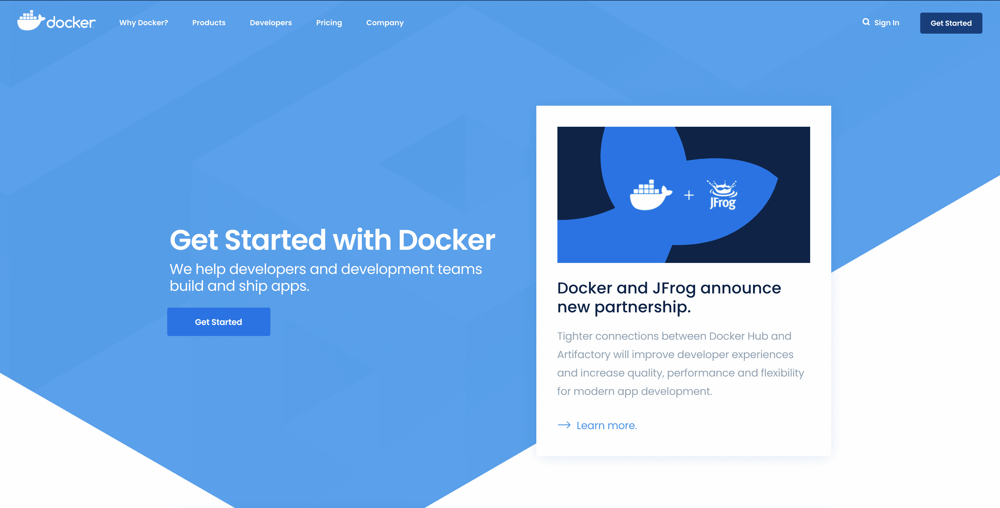
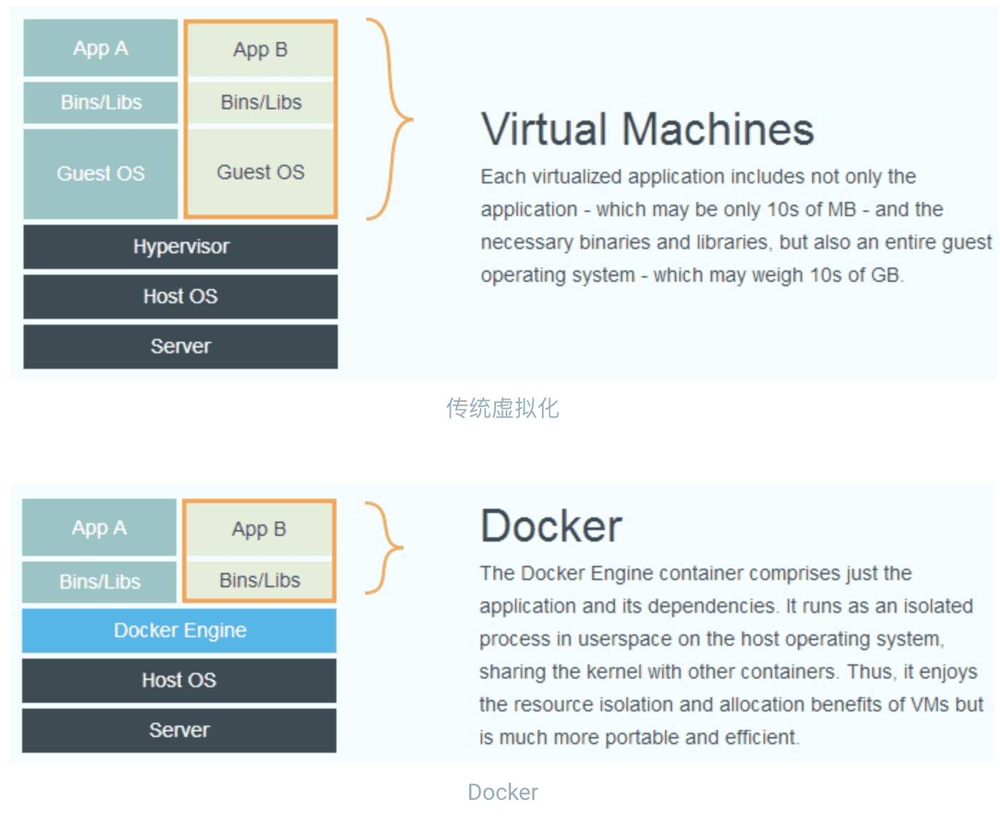
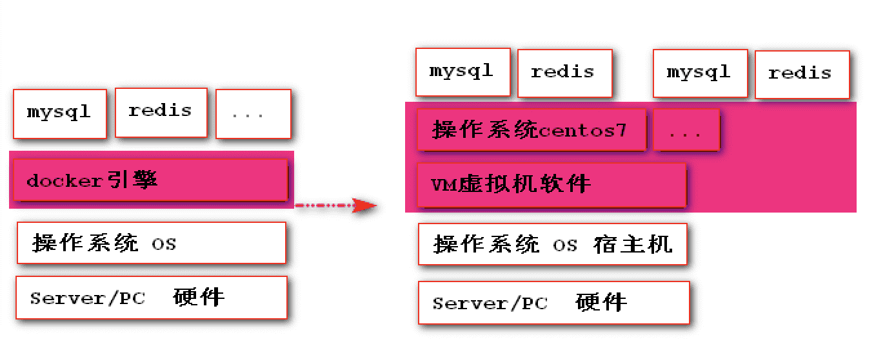
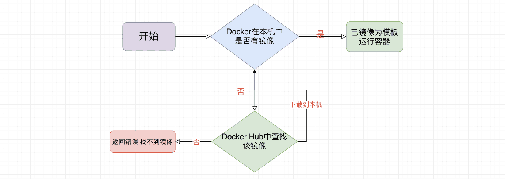
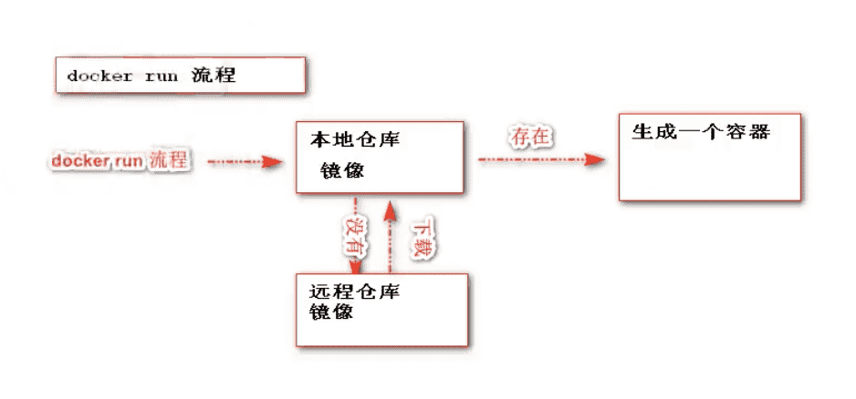

# Docker的基本概念

- 官方文档地址:https://www.docker.com/get-started
- 中文参考手册:https://yeasy.gitbook.io/docker_practice

## 什么是Docker

### 官方定义



- We have a complete container solution for you - no matter who you are and where you are on your containerization journey.
- 我们为您提供完整的容器解决方案-不管你是谁,不管你在哪,你都可以开始容器的的旅程。


### Docker的起源

- Docker 最初是 dotCloud 公司创始人 Solomon Hykes 在法国期间发起的一个公司内部项目，它是基于 dotCloud 公司多年云服务技术的一次革新，并于 2013 年 3 月以 Apache 2.0 授权协议开源，主要项目代码在 GitHub 上进行维护。Docker 项目后来还加入了 Linux 基金会，并成立推动 开放容器联盟（OCI）。

- Docker 自开源后受到广泛的关注和讨论，至今其 GitHub 项目 已经超过 5 万 7 千个星标和一万多个 fork。甚至由于 Docker 项目的火爆，在 2013 年底，dotCloud 公司决定改名为 Docker。Docker 最初是在 Ubuntu 12.04 上开发实现的；Red Hat 则从 RHEL 6.5 开始对 Docker 进行支持；Google 也在其 PaaS 产品中广泛应用 Docker。

- Docker 使用 Google 公司推出的 Go 语言 进行开发实现，基于 Linux 内核的 cgroup，namespace，以及 OverlayFS 类的 Union FS 等技术，对进程进行封装隔离，属于操作系统层面的虚拟化技术。由于隔离的进程独立于宿主和其它的隔离的进程，因此也称其为容器。

## 为什么要用Docker

- `在开发的时候，在本机测试环境可以跑，生产环境跑不起来`

  这里我们拿java Web应用程序举例，我们一个java Web应用程序涉及很多东西，比如jdk、tomcat、mysql等软件环境。当这些其中某一项版本不一致的时候，可能就会导致应用程序跑不起来这种情况。Docker则将程序以及使用软件环境直接打包在一起，无论在那个机器上保证了环境一致。

  **优势1:  一致的运行环境,更轻松的迁移**

  

- `服务器自己的程序挂了，结果发现是别人程序出了问题把内存吃完了，自己程序因为内存不够就挂了`

  这种也是一种比较常见的情况，如果你的程序重要性不是特别高的话，公司基本上不可能让你的程序独享一台服务器的，这时候你的服务器就会跟公司其他人的程序共享一台服务器，所以不可避免地就会受到其他程序的干扰，导致自己的程序出现问题。Docker就很好解决了环境隔离的问题，别人程序不会影响到自己的程序。

  **优势2：对进程进行封装隔离,容器与容器之间互不影响,更高效的利用系统资源**

  

- `公司要弄一个活动，可能会有大量的流量进来，公司需要再多部署几十台服务器`

  在没有Docker的情况下，要在几天内部署几十台服务器，这对运维来说是一件非常折磨人的事，而且每台服务器的环境还不一定一样，就会出现各种问题，最后部署地头皮发麻。用Docker的话，我只需要将程序打包到镜像，你要多少台服务，我就给你跑多少容器，极大地提高了部署效率。

  **优势3: 通过镜像复制N多个环境一致容器**

## Docker和虚拟机区别





`比较上面两张图，我们发现虚拟机是携带操作系统，本身很小的应用程序却因为携带了操作系统而变得非常大，很笨重`。Docker是不携带操作系统的，所以Docker的应用就非常的轻巧。另外在调用宿主机的CPU、磁盘等等这些资源的时候，拿内存举例，虚拟机是利用Hypervisor去虚拟化内存，整个调用过程是虚拟内存->虚拟物理内存->真正物理内存，但是Docker是利用Docker Engine去调用宿主的的资源，这时候过程是虚拟内存->真正物理内存。

|             | 传统虚拟机                           | Docker容器                            |
| ----------- | ------------------------------------ | ------------------------------------- |
| 磁盘占用    | 几个GB到几十个GB左右                 | 几十MB到几百MB左右                    |
| CPU内存占用 | 虚拟操作系统非常占用CPU和内存        | Docker引擎占用极低                    |
| 启动速度    | （从开机到运行项目）几分钟           | （从开启容器到运行项目）几秒          |
| 安装管理    | 需要专门的运维技术                   | 安装、管理方便                        |
| 应用部署    | 每次部署都费时费力                   | 从第二次部署开始轻松简捷              |
| 耦合性      | 多个应用服务安装到一起，容易互相影响 | 每个应用服务一个容器，达成隔离        |
| 系统依赖    | 无                                   | 需求相同或相似的内核，目前推荐是Linux |

## Docker的安装

**注意：docker引擎支持主流操作系统 Windows macOS Linux unix**

### Docker在Windows系统安装

下载：https://desktop.docker.com/win/stable/Docker%20Desktop%20Installer.exe

安装：直接点击.exe进行安装

windows10安装时要开启Hyper-V（若版本为 v1903 及以上则无需开启 Hyper-V）

方法：控制面板->程序->卸载程序->启用和关闭window功能->Hyper-V 勾选->完成后重启

### Docker在Linux系统安装

#### 通用方式安装

1. 在测试或开发环境中 Docker 官方为了简化安装流程，提供了一套便捷的安装脚本，Raspberry Pi OS 系统上可以使用这套脚本安装，另外可以通过 `--mirror` 选项使用国内源进行安装：

   >若你想安装测试版的 Docker, 请从 test.docker.com 获取脚本

   ```sh
   # $ curl -fsSL https://test.docker.com -o get-docker.sh
   $ curl -fsSL https://get.docker.com -o get-docker.sh
   $ sudo sh get-docker.sh --mirror Aliyun
   # $ sudo sh get-docker.sh --mirror AzureChinaCloud
   ```

   执行这个命令后，脚本就会自动的将一切准备工作做好，并且把 Docker 的稳定(stable)版本安装在系统中。

2. 启动docker

   ```sh
   $ sudo systemctl enable docker
   $ sudo systemctl start docker
   ```

3. 创建`docker`用户组

   默认情况下，`docker` 命令会使用 [Unix socket](https://en.wikipedia.org/wiki/Unix_domain_socket) 与 Docker 引擎通讯。而只有 `root` 用户和 `docker` 组的用户才可以访问 Docker 引擎的 Unix socket。出于安全考虑，一般 Linux 系统上不会直接使用 `root` 用户。因此，更好地做法是将需要使用 `docker` 的用户加入 `docker` 用户组。

   ```sh
   $ sudo groupadd docker
   ```
   
4. 将当前用户加入 `docker` 组：

   ```sh
   $ sudo usermod -aG docker $USER
   ```

5. 测试`docker`安装是否正确

   ```sh
   $ docker run hello-world
   ```

   

#### 根据系统类型安装

##### CentOS

系统要求

Docker 支持 64 位版本 CentOS 7/8，并且要求内核版本不低于 3.10。 CentOS 7 满足最低内核的要求，但由于内核版本比较低，部分功能（如 `overlay2` 存储层驱动）无法使用，并且部分功能可能不太稳定。

- 卸载原始docker

  ```sh
  $ sudo yum remove docker \
                    docker-client \
                    docker-client-latest \
                    docker-common \
                    docker-latest \
                    docker-latest-logrotate \
                    docker-logrotate \
                    docker-engine
  ```

- 安装docker依赖

  ```shell
  $ sudo yum install -y yum-utils
  ```
  
- 设置docker的yum源

  ```bash
  $ sudo yum-config-manager \
      --add-repo \
      https://download.docker.com/linux/centos/docker-ce.repo
  ```

- 安装最新版的docker

  ```bash
  $ sudo yum install -y docker-ce docker-ce-cli containerd.io
  ```

- 指定版本安装docker

  ```bash
  $ yum list docker-ce --showduplicates | sort -r
  $ sudo yum install docker-ce-<VERSION_STRING> docker-ce-cli-<VERSION_STRING> containerd.io
  $ sudo yum install docker-ce-18.09.5-3.el7 docker-ce-cli-18.09.5-3.el7 containerd.io
  ```

- 启动docker

  ```bash
  $ sudo systemctl enable docker
  $ sudo systemctl start docker
  ```

- 关闭docker

  ```bash
  $ sudo systemctl stop docker
  ```

- 测试docker安装

  ```bash
  $ sudo docker run hello-world
  ```

###### CentOS8 额外设置

由于 CentOS8 防火墙使用了 `nftables`，但 Docker 尚未支持 `nftables`， 我们可以使用如下设置使用 `iptables`：

更改 `/etc/firewalld/firewalld.conf`

```shell
# FirewallBackend=nftables
FirewallBackend=iptables
```

或者执行如下命令：

```shell
$ firewall-cmd --permanent --zone=trusted --add-interface=docker0
$ firewall-cmd --reload
```

#### 创建非root用户（可选）

1. 创建用户组：

   ```sh
   $ sudo groupadd docker
   ```

   

2. 创建`docker`用户[可选：创建密码]：

   ```sh
   #-g参数来制定 所属用户组
   $ sudo useradd -g docker docker
   $ sudo passwd docker
   ```

   

3. 将用户加入 `docker` 组：

   ```sh
   $ sudo usermod -aG docker docker
   ```

   

### Docker配置阿里镜像加速服务

#### docker运行流程



####  docker配置阿里云镜像加速

- 访问阿里云登录自己账号查看docker镜像加速服务

  (点击管理控制台 -> 登录账号(淘宝账号) -> 右侧镜像中心 -> 镜像加速器 -> 复制地址)

- 在 `/etc/docker/daemon.json` 中写入如下内容（如果文件不存在请新建该文件）：

  ```shell
  {
    "registry-mirrors": [
    	"https://lz2nib3q.mirror.aliyuncs.com"
    ]
  }
  ```

  > 注意，一定要保证该文件符合 json 规范，否则 Docker 将不能启动。

- 之后重新启动服务。

  ```shell
  $ sudo systemctl daemon-reload
  $ sudo systemctl restart docker
  ```

- 验证docker的镜像加速是否生效

```shell
[root@localhost ~]# docker info
		..........
    127.0.0.0/8
   Registry Mirrors:
    'https://lz2nib3q.mirror.aliyuncs.com/'
   Live Restore Enabled: false
   Product License: Community Engine
```

## Docker的核心架构


- `镜像:` 一个镜像代表一个应用环境,他是一个只读的文件,如 mysql镜像,tomcat镜像,nginx镜像等
- `容器:` 镜像每次运行之后就是产生一个容器,就是正在运行的镜像,特点就是可读可写
- `仓库:`用来存放镜像的位置,类似于maven仓库,也是镜像下载和上传的位置
- `dockerFile:`docker生成镜像配置文件,用来书写自定义镜像的一些配置
- `tar:`一个对镜像打包的文件,日后可以还原成镜像

## Docker的入门应用

### docker的第一个程序

`docker run hello-world`

```shell
[root@localhost ~]# docker run hello-world

Hello from Docker!
This message shows that your installation appears to be working correctly.

To generate this message, Docker took the following steps:
 1. The Docker client contacted the Docker daemon.
 2. The Docker daemon pulled the "hello-world" image from the Docker Hub.
    (amd64)
 3. The Docker daemon created a new container from that image which runs the
    executable that produces the output you are currently reading.
 4. The Docker daemon streamed that output to the Docker client, which sent it
    to your terminal.

To try something more ambitious, you can run an Ubuntu container with:
 $ docker run -it ubuntu bash

Share images, automate workflows, and more with a free Docker ID:
 https://hub.docker.com/

For more examples and ideas, visit:
 https://docs.docker.com/get-started/
```



## Docker的卸载

### centos

1. 卸载 Docker Engine、CLI 和 Containerd 包：

   ```sh
    $ sudo yum remove -y docker-ce docker-ce-cli containerd.io
   ```

   

2. 主机上的映像、容器、卷或自定义配置文件不会自动删除。删除所有镜像、容器和卷：

   ```sh
   $ sudo rm -rf /var/lib/docker
   $ sudo rm -rf /var/lib/containerd
   ```


