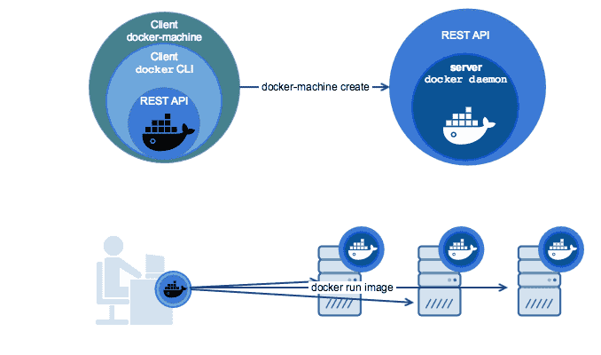

# Docker Machine使用

## 简介

官方：https://docs.docker.com/machine/

Docker Machine 是一种可以让您在虚拟主机上安装 Docker 的工具，并可以使用 docker-machine 命令来管理主机。

Docker Machine 也可以集中管理所有的 docker 主机，比如快速的给 100 台服务器安装上 docker。


Docker Machine 管理的虚拟主机可以是机上的，也可以是云供应商，如阿里云，腾讯云，AWS，或 DigitalOcean。

使用 docker-machine 命令，您可以启动，检查，停止和重新启动托管主机，也可以升级 Docker 客户端和守护程序，以及配置 Docker 客户端与您的主机进行通信。



### 安装

Docker Machine不再包含在Docker Desktop安装程序中，可通过以下方法进行安装。

安装Docker Machine之前要先安装Docker，然后通过下载Docker Machine二进制文件的方式安装。

Docker Machine 可以在多种操作系统平台上安装，包括 Linux、macOS，以及 Windows。

#### macOS 安装命令

```shell
$ base=https://github.com/docker/machine/releases/download/v0.16.0 &&
  curl -L $base/docker-machine-$(uname -s)-$(uname -m) >/usr/local/bin/docker-machine &&
  chmod +x /usr/local/bin/docker-machine
```

#### Linux 安装命令

```shell
$ base=https://github.com/docker/machine/releases/download/v0.16.0 &&
  curl -L $base/docker-machine-$(uname -s)-$(uname -m) >/tmp/docker-machine &&
  sudo mv /tmp/docker-machine /usr/local/bin/docker-machine &&
  chmod +x /usr/local/bin/docker-machine
```

#### Windows 安装命令

```shell
$ base=https://github.com/docker/machine/releases/download/v0.16.0 &&
  mkdir -p "$HOME/bin" &&
  curl -L $base/docker-machine-Windows-x86_64.exe > "$HOME/bin/docker-machine.exe" &&
  chmod +x "$HOME/bin/docker-machine.exe"
```

> 仅当使用支持[Git BASH之](https://git-for-windows.github.io/)类的终端仿真器（如[Git BASH）时](https://git-for-windows.github.io/)，以上命令才能在Windows上运行`chmod`。

#### 查看是否安装成功

```shell
$ docker-machine -v #或者 docker-machine version
docker-machine version 0.16.0, build 702c267f
```

### 卸载

删除执行文件即可：`rm $(which docker-machine)`

## Docker Machine的使用

Docker Machine 支持多种后端驱动，包括虚拟机、本地主机和云平台等。

### 创建本地主机实例

#### Virtualbox 驱动

首先下载最新的virtualbox，官方：https://www.virtualbox.org/wiki/Downloads

使用 `virtualbox` 类型的驱动，创建一台 Docker 主机，命名为 test。

```dockerfile
docker-machine create -d virtualbox test
```

也可以在创建时加上如下参数，来配置主机或者主机上的 Docker。

`--engine-opt dns=114.114.114.114` 配置 Docker 的默认 DNS

`--engine-registry-mirror https://hub-mirror.c.163.com` 配置 Docker 的仓库镜像

`--virtualbox-memory 2048` 配置主机内存

`--virtualbox-cpu-count 2` 配置主机 CPU

更多参数请使用 `docker-machine create --driver virtualbox --help` 命令查看。

#### macOS xhyve 驱动

`xhyve` 驱动 GitHub: https://github.com/zchee/docker-machine-driver-xhyve

[`xhyve`](https://github.com/mist64/xhyve) 是 macOS 上轻量化的虚拟引擎，使用其创建的 Docker Machine 较 `VirtualBox` 驱动创建的运行效率要高。

1. 安装xhyve驱动

   ```shell
   brew install docker-machine-driver-xhyve
   sudo chown root:wheel /usr/local/opt/docker-machine-driver-xhyve/bin/docker-machine-driver-xhyve
   sudo chmod u+s /usr/local/opt/docker-machine-driver-xhyve/bin/docker-machine-driver-xhyve
   ```

2. 创建主机

   ```shell
   $ docker-machine create -d xhyve test
   ```

   也可以在创建时加上如下参数，来配置主机或者主机上的 Docker。

   `--xhyve-boot2docker-url ~/.docker/machine/cache/boot2docker.iso`指定本地ISO镜像

   `--engine-opt dns=114.114.114.114` 配置 Docker 的默认 DNS

   `--engine-registry-mirror https://hub-mirror.c.163.com` 配置 Docker 的仓库镜像

   `--xhyve-memory 2048` 配置主机内存

   `--xhyve-rawdisk`使用简单的"原始磁盘"格式和virtio-blk驱动程序进行存储。 

   `--xhyve-cpu-count 2` 配置主机 CPU

更多参数请使用 `docker-machine create --driver xhyve --help` 命令查看。

> 注意：非首次创建时建议加上 `--xhyve-boot2docker-url ~/.docker/machine/cache/boot2docker.iso` 参数，避免每次创建时都从 GitHub 下载 ISO 镜像。

#### Windows 10

Windows 10 安装 Docker Desktop for Windows 之后不能再安装 VirtualBox，也就不能使用 `virtualbox` 驱动来创建 Docker Machine，我们可以选择使用 `hyperv` 驱动。

> 注意，必须事先在 `Hyper-V` 管理器中新建一个 **外部虚拟交换机** 执行下面的命令时，使用 `--hyperv-virtual-switch=MY_SWITCH` 指定虚拟交换机名称

```
$ docker-machine create --driver hyperv --hyperv-virtual-switch=MY_SWITCH vm
```

更多参数请使用 `docker-machine create --driver hyperv --help` 命令查看。

### 使用介绍

创建好主机之后，查看主机

```shell
$ docker-machine ls
NAME   ACTIVE   DRIVER       STATE     URL   SWARM   DOCKER    ERRORS
test   -        virtualbox   Stopped                 Unknown
```

创建主机成功后，可以通过 `env` 命令来让后续操作对象都是目标主机。

```
$ docker-machine env test
```

后续根据提示在命令行输入命令之后就可以操作 test 主机。

也可以通过 `SSH` 登录到主机。

```shell
$ docker-machine ssh test

docker@test:~$ docker --version
Docker version 19.03.12, build 48a66213fe
```

shell连接到主机之后你就可以在其上使用 Docker 了。

### 官方支持驱动

通过 `-d` 选项可以选择支持的驱动类型。

- amazonec2
- azure
- digitalocean
- exoscale
- generic
- google
- hyperv
- none
- openstack
- rackspace
- softlayer
- virtualbox
- vmwarevcloudair
- vmwarefusion
- vmwarevsphere

### 第三方驱动

请到 [第三方驱动列表](https://github.com/docker/docker.github.io/blob/master/machine/AVAILABLE_DRIVER_PLUGINS.md) 查看

## Docker Machine 操作命令

- `active`                查看活跃的 Docker 主机
- `config`                输出连接的配置信息
- `create`                创建一个 Docker 主机
- `env`                   显示连接到某个主机需要的环境变量
- `inspect`               输出主机更多信息
- `ip`                    获取主机地址
- `kill`                  停止某个主机
- `ls`                    列出所有管理的主机
- `provision`             重新设置一个已存在的主机
- `regenerate-certs`      为某个主机重新生成 TLS 认证信息
- `restart`               重启主机
- `rm`                    删除某台主机
- `ssh`                   SSH 到主机上执行命令
- `scp`                   在主机之间复制文件
- `mount`                 挂载主机目录到本地
- `start`                 启动一个主机
- `status`                查看主机状态
- `stop`                  停止一个主机
- `upgrade`               更新主机 Docker 版本为最新
- `url`                   获取主机的 URL
- `version`               输出 docker-machine 版本信息
- `help`                  输出帮助信息

每个命令，又带有不同的参数，可以通过

```
$ docker-machine COMMAND --help
```

来查看具体的用法。