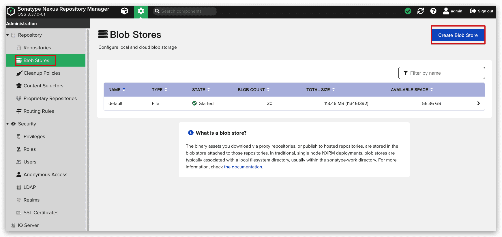
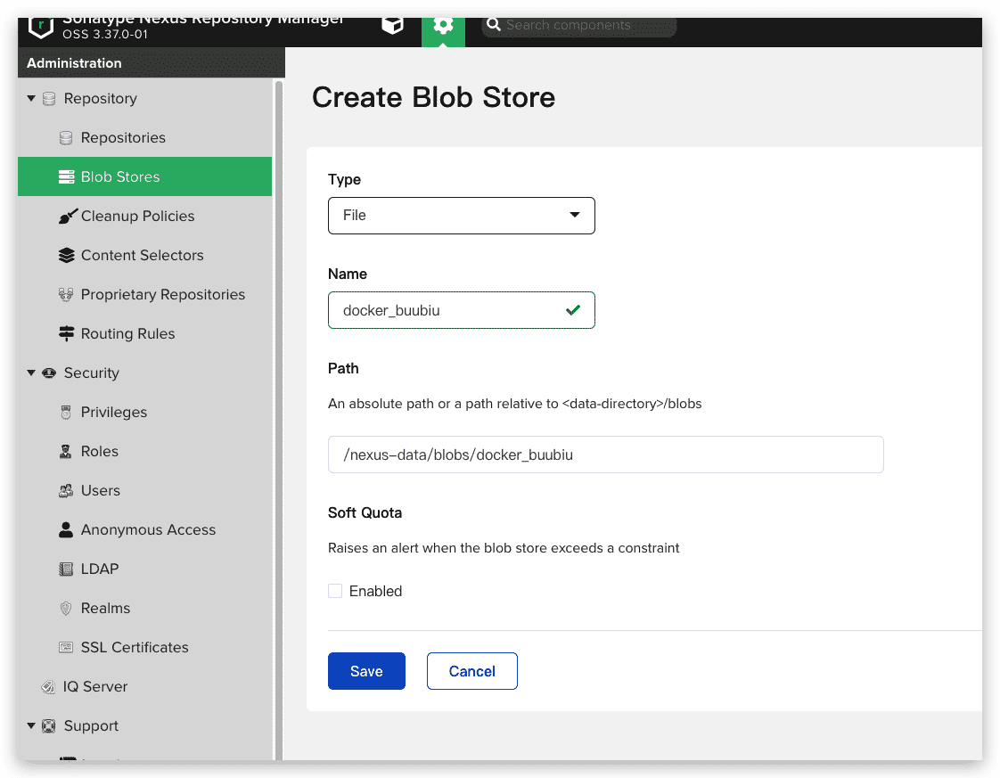
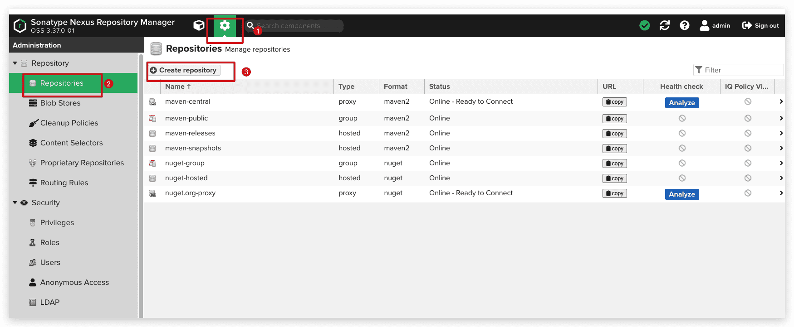
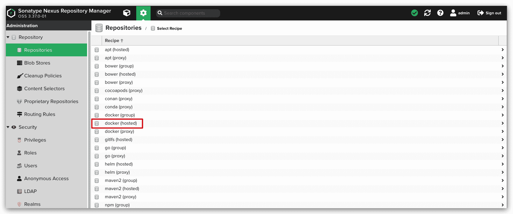
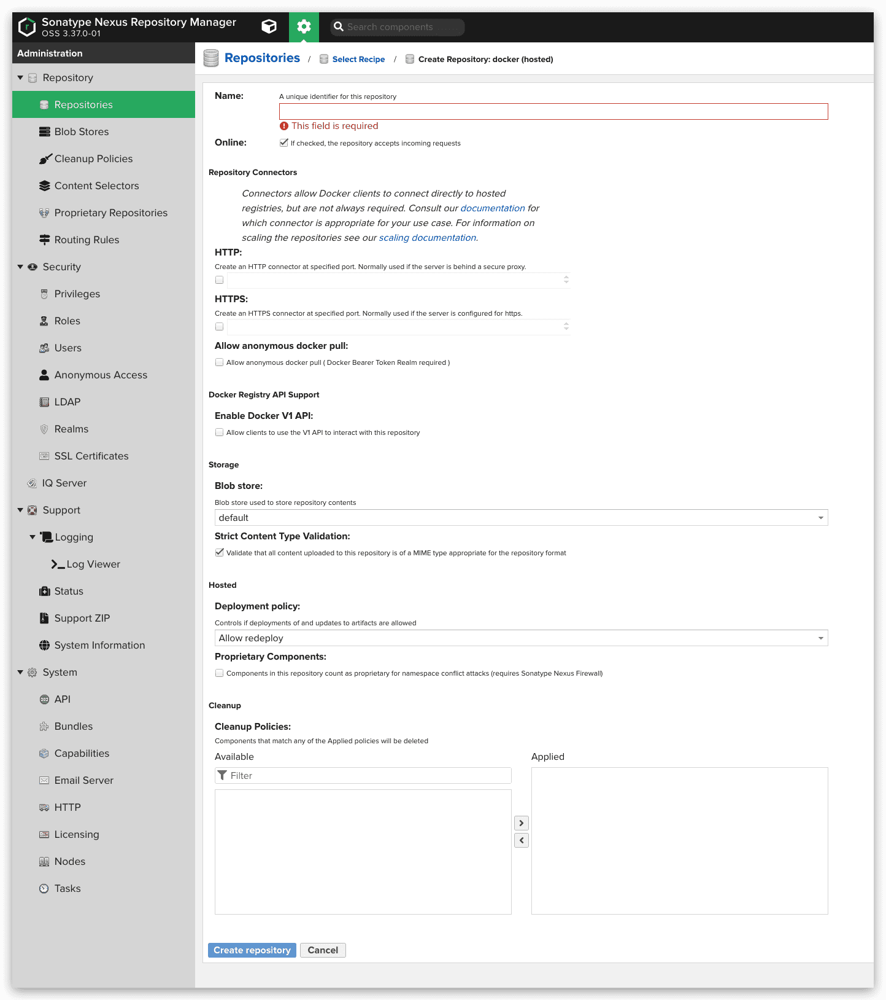
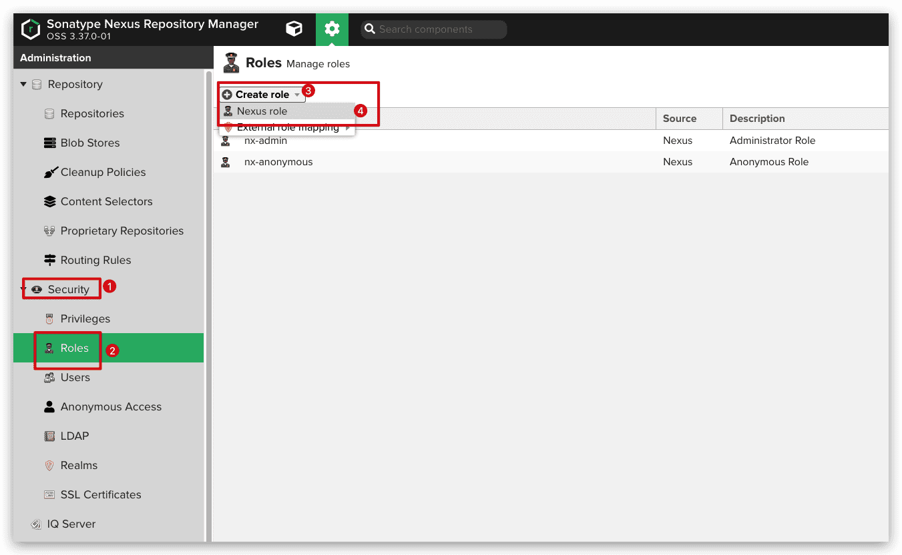
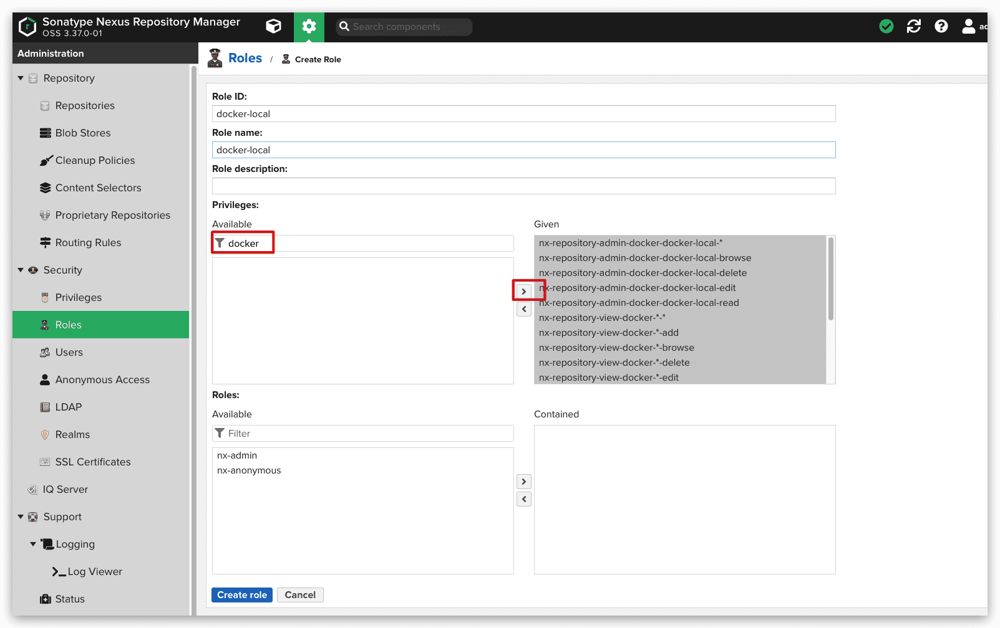
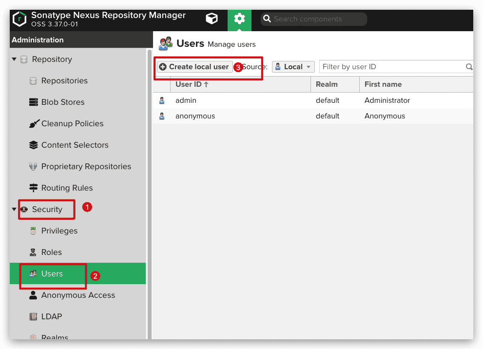
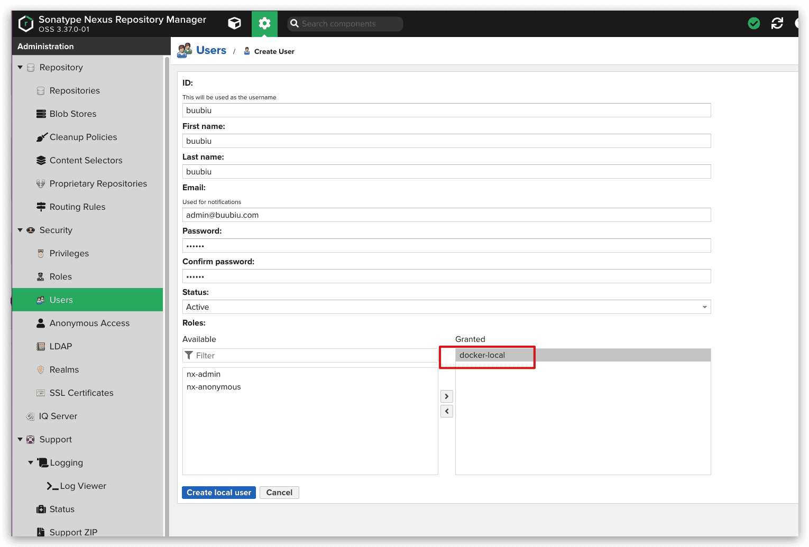
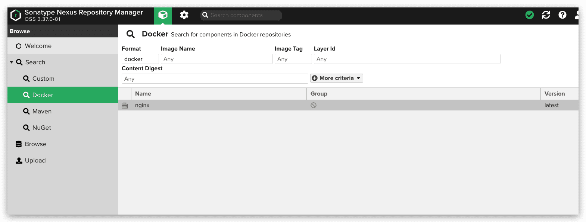

# Nexus3管理docker

## Nexus安装

使用 Docker 官方的 Registry 创建的仓库面临一些维护问题。比如某些镜像删除以后空间默认是不会回收的，需要一些命令去回收空间然后重启 Registry。在企业中把内部的一些工具包放入 `Nexus` 中是比较常见的做法，最新版本 `Nexus3.x` 全面支持 Docker 的私有镜像。所以使用 [Nexus3.x](https://www.sonatype.com/product/repository-oss-download) 一个软件来管理 `Docker` , `Maven` , `Yum` , `PyPI` 等是一个明智的选择。

安装方式见：[Nexus3介绍与安装](https://blog.buubiu.com/2021/12/16/Nexus3介绍与安装)

## 创建仓库

登录之后可以点击页面上方的齿轮按钮按照下面的方法进行设置。

### 创建blob存储

首先创建一个blob存储，用以和其他的仓库进行区分开来，当然，也可以不创建

### 创建私有仓库

然后创建一个私有仓库的方法： `Repository->Repositories` 点击右边菜单 `Create repository` 选择 `docker (hosted)`

仓库区别：

-  `docker (hosted)`类型的仓库链接到私有仓库中的镜像

- `docker (proxy)` 类型的仓库链接到 DockerHub 或其他私服 上，并缓存到 Nexus 中
- `docker (group)` 类型的仓库把刚才的 `hosted` 与 `proxy` 添加在一起，主机在访问的时候默认下载私有仓库中的镜像，如果没有将链接到 DockerHub 中下载并缓存到 Nexus 中。

- **Name**: 仓库的名称
- **HTTP**: 仓库单独的访问端口（例如：**5001**）
- **Hosted -> Deployment pollcy**: 请选择 **Allow redeploy** 否则无法上传 Docker 镜像。

## 添加访问权限

菜单 `Security->Realms` 把 Docker Bearer Token Realm 移到右边的框中保存。

添加用户规则：菜单 `Security->Roles`->`Create role` 在 `Privlleges` 选项搜索 docker 把相应的规则移动到右边的框中然后保存。

添加用户：菜单 `Security->Users`->`Create local user` 在 `Roles` 选项中选中刚才创建的规则移动到右边的窗口保存。

## Docker主机访问镜像仓库

### 非https方式

参考： [配置非 https 仓库地址](https://blog.buubiu.com/2021/12/15/Docker配置私有仓库registry/#配置非-https-仓库地址)

### https方式

参考：[使用NGINX 加密代理配置](https://blog.buubiu.com/2021/12/15/Docker配置私有仓库registry/#使用NGINX-加密代理配置)

### 验证测试

参考：[测试私有仓库功能](https://blog.buubiu.com/2021/12/15/Docker配置私有仓库registry/#测试私有仓库功能-1)

只是`docker login`的用户名和密码是上面配置的nexus系统内的用户密码。

打标签上传后成功截图：

