# Nexus3管理maven

## Nexus安装

java后端开发人员，对于maven应该不会陌生，对于一些优秀的jar，我们都可以在maven仓库当中找到，同时maven还提供各类插件进行项目级的编译、打包等工作。通过maven很大程度解决了我们对于包管理的问题。无论是使用外部库还是内部发布的jar包管理，基于nexus的maven私服为我们提供了这中管理功能。


安装方式见：[Nexus3介绍与安装](https://blog.buubiu.com/2021/12/16/Nexus3介绍与安装)

## 创建仓库

登录之后可以点击页面上方的齿轮按钮按照下面的方法进行设置。

### 创建blob存储

首先创建一个blob存储，用以和其他的仓库进行区分开来，当然，也可以不创建

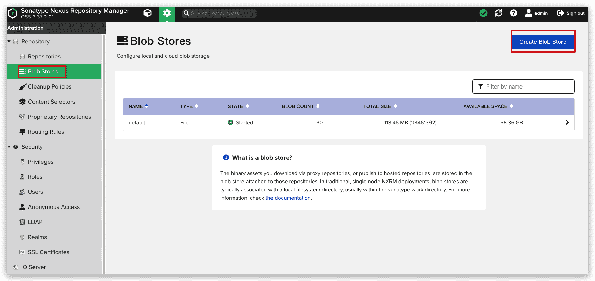

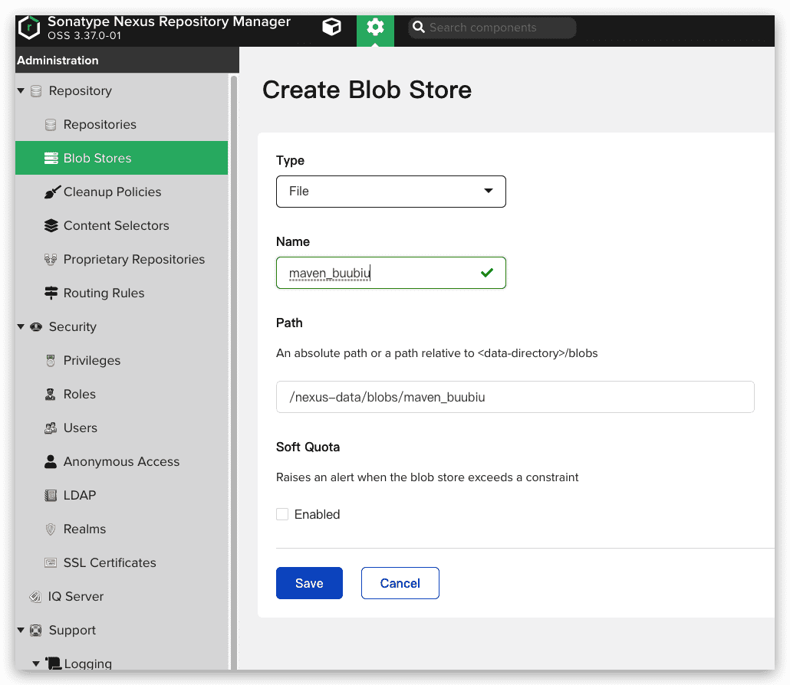

### 创建私有仓库

然后创建一个私有仓库的方法： `Repository->Repositories` 点击右边菜单 `Create repository` 选择 `maven (hosted)`

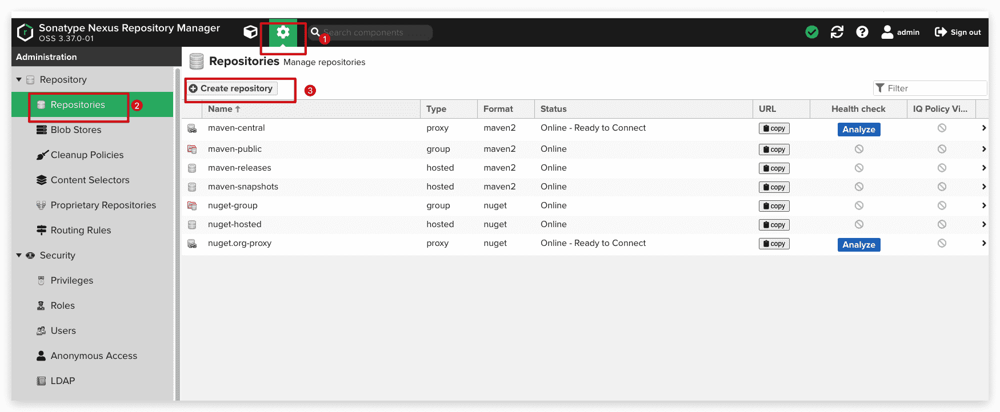

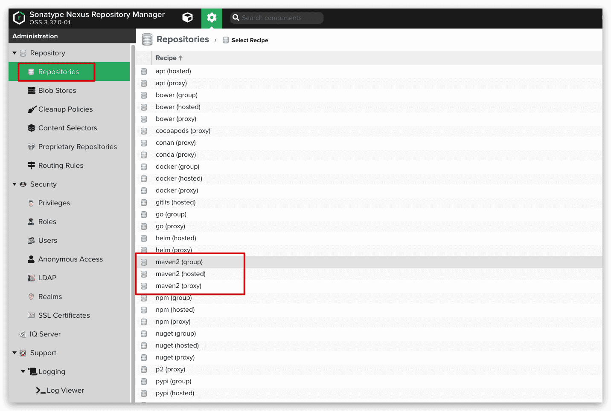

仓库区别：

-  `maven2 (hosted)`类型的仓库链接到私有仓库中的镜像

- `maven2 (proxy)` 类型的仓库链接到 Maven公共仓库 或其他私服 上，并缓存到 Nexus 中
- `maven2 (group)` 类型的仓库把刚才的 `hosted` 与 `proxy` 添加在一起，主机在访问的时候默认下载私有仓库中的jar包，如果没有将链接到 代理服 中下载并缓存到 Nexus 中。

### 举例：以 hosted 方式创建 snapshots release仓库

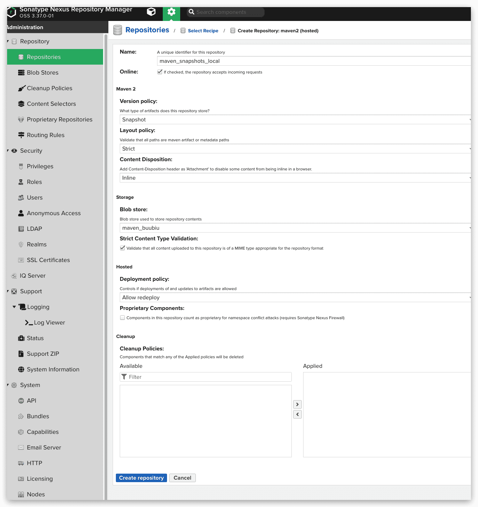

- **Name**: 仓库的名称
- **Maven2.Version policy**：仓库类型，这里可以选择 **snapshots、releases**

在`pom.xml`区别是：

```xml pom.xml
<version>1.0.0-SNAPSHOT</version>
#或者
<version>1.0.0</version>
```

### 举例：以proxy方式代理maven中央仓库

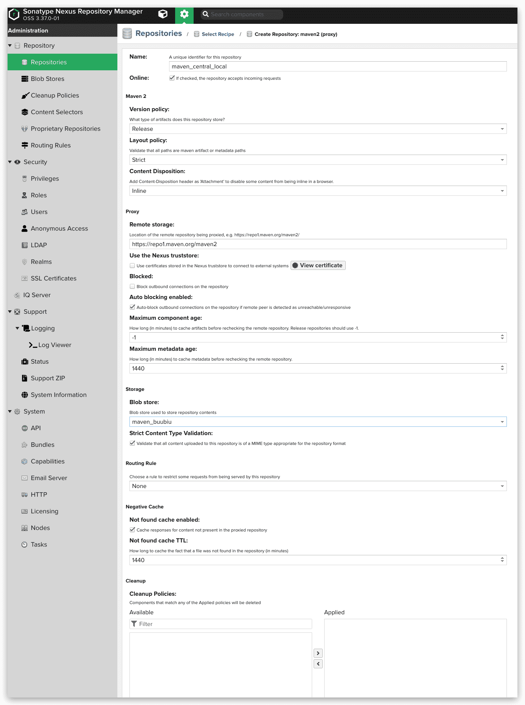

### 举例：以group方式创建仓库

将上述所有存储进行分组，提供一个URL来配置到客户端pom文件中

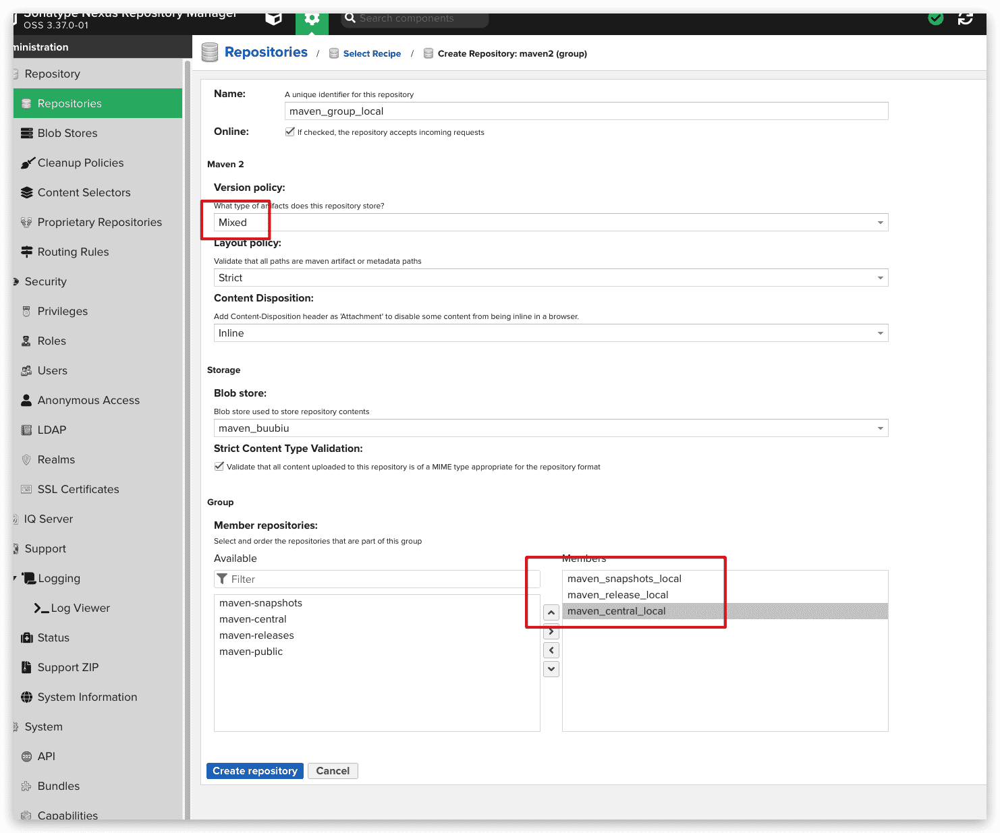

## 添加访问权限

菜单 `Security->Realms` 把 Docker Bearer Token Realm 移到右边的框中保存。

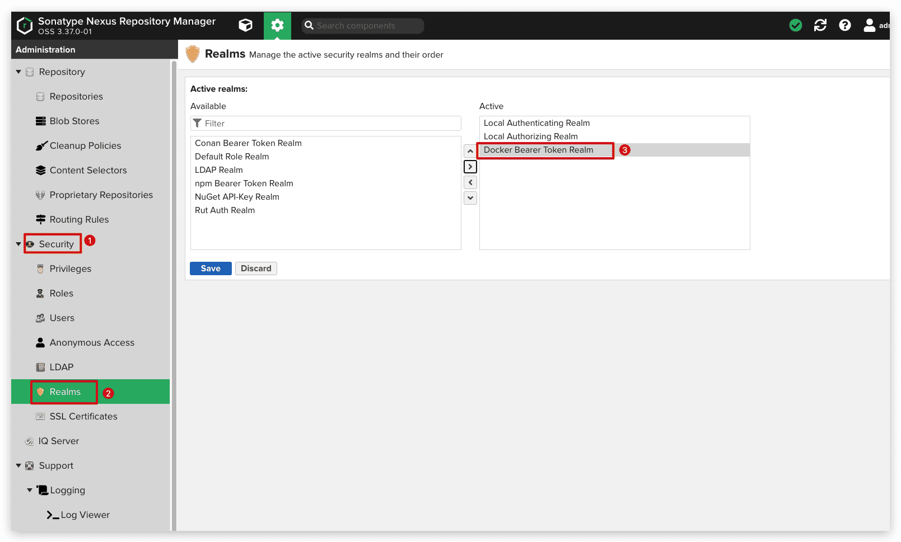

添加用户规则：菜单 `Security->Roles`->`Create role` 在 `Privlleges` 选项搜索 maven 把相应的规则移动到右边的框中然后保存。


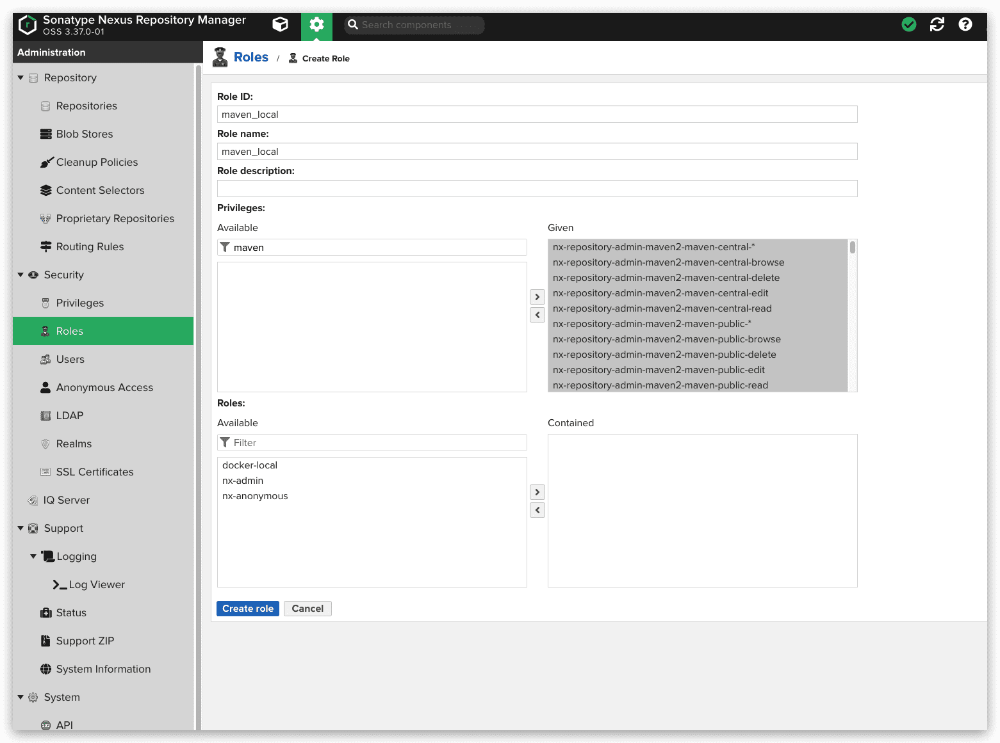

添加用户：菜单 `Security->Users`->`Create local user` 在 `Roles` 选项中选中刚才创建的规则移动到右边的窗口保存。

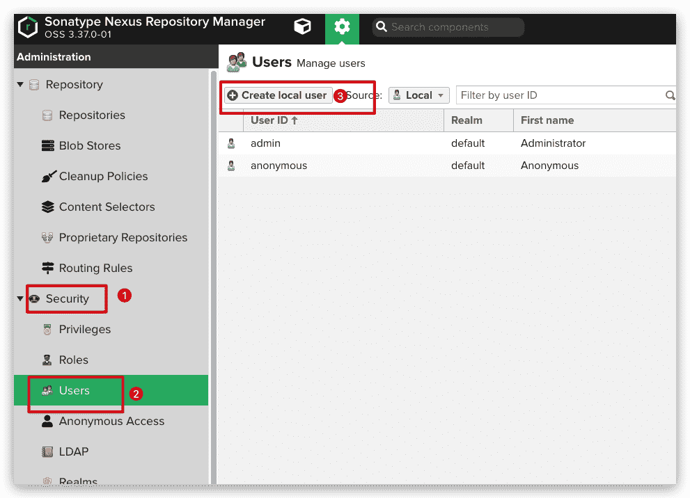

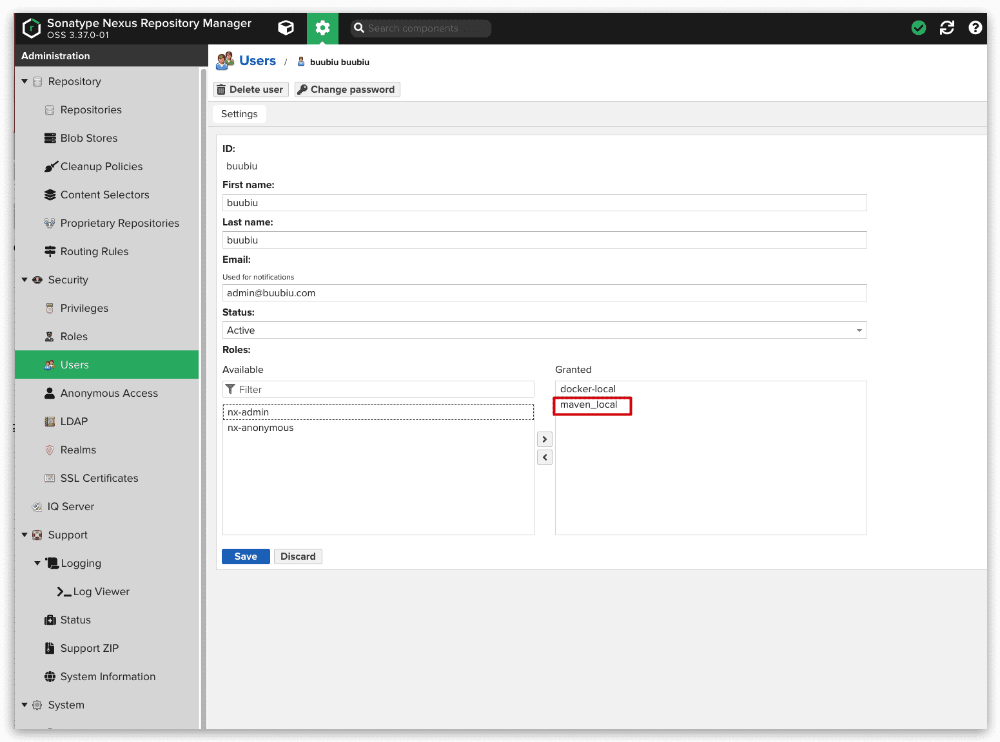

## 配置客户端和项目以使用Nexus Repos

### 修改配置文件

1. 在`~/.m2/settings.xml`中配置，适用于所有项目

   ```xml
   <?xml version="1.0" encoding="UTF-8"?>
   <settings xmlns="http://maven.apache.org/SETTINGS/1.1.0"
     xmlns:xsi="http://www.w3.org/2001/XMLSchema-instance"
     xsi:schemaLocation="http://maven.apache.org/SETTINGS/1.1.0 http://maven.apache.org/xsd/settings-1.1.0.xsd">
   
     <servers>
       <server>
         <id>nexus-group-local</id>
         <username>buubiu</username>
         <password>buubiu</password>
       </server>
     </servers>
   
     <profiles>
       <profile>
         <!--此id会在idea里面显示，供开发者选择激活-->
         <id>profile-nexus-group-local</id>
         
         <!--一般的远程仓库-->
         <repositories>
           <repository>
         		<!--此id要与上面server的id对应，才会用配置的用户密码-->
             <id>nexus-group-local</id>
             <name>nexus-group-local</name>
             <url>http://your-host:8081/repository/maven_group_local/</url>
             <layout>default</layout>
             <releases>
               <enabled>true</enabled>
               <!--表示更新的频率，值有：never, always,interval,daily, daily 为默认值-->
               <updatePolicy>always</updatePolicy>
             </releases>
             <snapshots>
               <enabled>true</enabled>
               <!--表示更新的频率，值有：never, always,interval,daily, daily 为默认值-->
               <updatePolicy>always</updatePolicy>
             </snapshots>
           </repository>
         </repositories>
         
         <!--下载插件的仓库-->
         <pluginRepositories>
           <pluginRepository>
             <id>nexus-group-local</id>
             <name>nexus-group-local</name>
             <url>http://your-host:8081/repository/maven_group_local/</url>
             <layout>default</layout>
             <snapshots>
               <enabled>true</enabled>
             </snapshots>
             <releases>
               <enabled>true</enabled>
             </releases>
           </pluginRepository>
         </pluginRepositories>
       </profile>
     </profiles>
   
   </settings>
   ```

2. 如果想在一个项目里面用，就只单独配置`pom.xml`

   ```xml
   <project ...>
   
     ...
   
     <repositories>
       <repository>
         <id>nexus-group-local</id>
         <url>http://your-host:8081/repository/maven_group_local/</url>
       </repository>
     </repositories>
   </project>
   ```

3. 如果想发布项目也是分两种情况

   1. 适用于所有项目，在 `~/.m2/settings.xml`中配置

      ```xml
      <setting>
        
        ...
        
         <profile>
            <id>profile-nexus-group-local-deploy</id>
            <properties>
              <altSnapshotDeploymentRepository>
                nexus-group-local::default::http://your-host:8081/repository/maven_snapshot_local/
              </altSnapshotDeploymentRepository>
              <altReleaseDeploymentRepository>
                nexus-group-local::default::http://your-host:8081/repository/maven_release_local/
              </altReleaseDeploymentRepository>
            </properties>
          </profile>
        </profiles>
      </settings>
      ```

   2. 如果想单独配置，配置`pom.xml`即可

      ```xml
      <project>
        
        ...
        
        <distributionManagement>
              <snapshotRepository>
                  <id>nexus-group-local</id>
                  <url>http://your-host:8081/repository/maven_snapshot_local/</url>
              </snapshotRepository>
              <repository>
                  <id>nexus-group-local</id>
                  <url>http://your-host:8081/repository/maven_release_local/</url>
              </repository>
          </distributionManagement>
      </project>
      ```

### 编译运行打包

```sh
$ mvn clean install -Dmaven.test.skip=true -P profile-nexus-group-local
```


