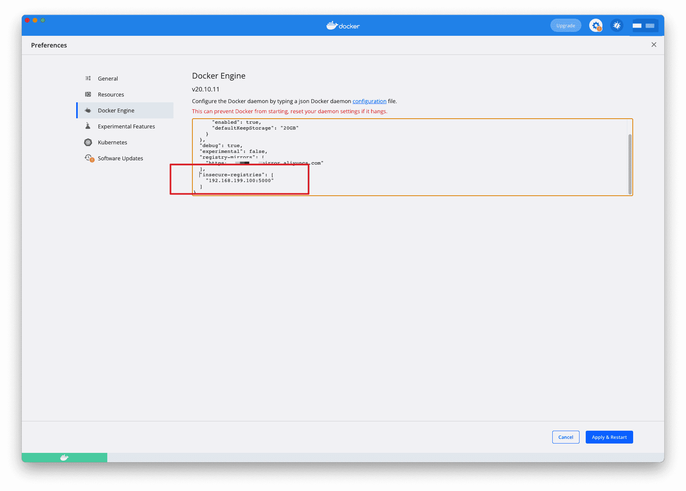

# Docker配置私有仓库registry

## 介绍

有时候使用 Docker Hub 这样的公共仓库可能不方便，用户可以创建一个本地仓库供私人使用。

[`docker-registry`](https://docs.docker.com/registry/) 是官方提供的工具，可以用于构建私有的镜像仓库。本文内容基于 [`docker-registry`](https://github.com/docker/distribution) v2.x 版本。


## 安装docker-registry

这里使用官方的 `registry` 镜像来启动私有仓库。

```sh
# 先创建两个目录
# data存放镜像
# config存放配置
$ mkdir -p volumes/data volumes/config
$ vim volumes/config/config.yml
```

```yaml config.yml
version: 0.1
log:
  fields:
    service: registry
storage:
  cache:
    blobdescriptor: inmemory
  filesystem:
    rootdirectory: /var/lib/registry
http:
  addr: :5000
  headers:
    X-Content-Type-Options: [nosniff]
health:
  storagedriver:
    enabled: true
    interval: 10s
    threshold: 3
```

使用`docker-compose`启动容器

```yaml docker-compose.yml
version: "3.0"
services:
  registry:
    container_name: registry
    image: registry:latest
    ports:
      - "5000:5000"
    volumes:
      - ./volumes/config/registry:/etc/docker/registry
      - ./volumes/data/registry:/var/lib/registry
    networks: 
      - registry

networks:
  registry:
    driver: bridge
```

## 上传下载镜像

创建好私有仓库之后，就可以使用 `docker tag` 来标记一个镜像，然后推送它到仓库。例如私有仓库地址为 `127.0.0.1:5000`。

### 上传

1. 先在本机查看已有的镜像：

```sh
$ docker images
REPOSITORY                             TAG            IMAGE ID       CREATED         SIZE
nginx                                  latest         f652ca386ed1   12 days ago     141MB
```

2. 使用 `docker tag` 将 `nginx:latest` 这个镜像标记为 `127.0.0.1:5000/nginx:latest`。

   格式：`docker tag IMAGE[:TAG] [REGISTRY_HOST[:REGISTRY_PORT]/]REPOSITORY[:TAG]`

```sh
$ docker tag nginx:latest 127.0.0.1:5000/nginx:latest
REPOSITORY                             TAG            IMAGE ID       CREATED         SIZE
127.0.0.1:5000/nginx                   latest         f652ca386ed1   12 days ago     141MB
```

3. 使用`docker push`上传标记的镜像

```sh
$ docker push 127.0.0.1:5000/nginx:latest
The push refers to repository [127.0.0.1:5000/nginx]
2bed47a66c07: Pushed
82caad489ad7: Pushed
d3e1dca44e82: Pushed
c9fcd9c6ced8: Pushed
0664b7821b60: Pushed
9321ff862abb: Pushed
latest: digest: sha256:4424e31f2c366108433ecca7890ad527b243361577180dfd9a5bb36e828abf47 size: 1570
```

### 查看

用浏览器或者`curl`查看仓库中的镜像

```sh
$ curl http://127.0.0.1:5000/v2/_catalog
{"repositories":["nginx"]}
```

表明镜像已经被成功上传了.

### 下载

先删除已有镜像，再尝试从私有仓库中下载这个镜像。

```sh
$ docker rmi 127.0.0.1:5000/nginx:latest
Untagged: 127.0.0.1:5000/nginx:latest
Untagged: 127.0.0.1:5000/nginx@sha256:4424e31f2c366108433ecca7890ad527b243361577180dfd9a5bb36e828abf47

$ docker pull 127.0.0.1:5000/nginx:latest
latest: Pulling from nginx
e5ae68f74026: Pull complete
21e0df283cd6: Pull complete
ed835de16acd: Pull complete
881ff011f1c9: Pull complete
77700c52c969: Pull complete
44be98c0fab6: Pull complete
Digest: sha256:4424e31f2c366108433ecca7890ad527b243361577180dfd9a5bb36e828abf47
Status: Downloaded newer image for 127.0.0.1:5000/nginx:latest
127.0.0.1:5000/nginx:latest
```

## 配置非 https 仓库地址

如果你不想使用 `127.0.0.1:5000` 作为仓库地址，比如想让本网段的其他主机也能把镜像推送到私有仓库。你就得把例如 `192.168.199.100:5000` 这样的内网地址作为私有仓库地址，这时你会发现无法成功推送镜像。

这是因为 Docker 默认不允许非 `HTTPS` 方式推送镜像。我们可以通过 Docker 的配置选项来取消这个限制，或者查看配置能够通过 `HTTPS` 访问的私有仓库。

### linux系统设置

请在 `/etc/docker/daemon.json` 中写入如下内容（如果文件不存在请新建该文件）,然后重启docker

```json
{
  "registry-mirror": [
    "https://hub-mirror.c.163.com",
    "https://mirror.baidubce.com"
  ],
  "insecure-registries": [
    "192.168.199.100:5000"
  ]
}
```

>注意：该文件必须符合 `json` 规范，否则 Docker 将不能启动。

### macOS、Windows

对于 Docker Desktop for Windows 、 Docker Desktop for Mac 在设置中的 `Docker Engine` 中进行编辑 ，增加和上边一样的字符串即可。



## 配置https仓库地址

### 原生配置

新建目录，`volumes/config/registry/ssl`

- 配置https需要证书，两个文件：`.key`和`.crt`,放到上面的`ssl`目录

- 若你拥有一个域名，国内各大云服务商都提供免费的站点证书，直接下载下来即可
- 若没有域名，也你可以使用`openssl`自行签发证书，放到`ssl`目录

#### 准备站点证书

这里假设我们将要搭建的私有仓库地址为 `docker.domain.com`，下面我们介绍使用 `openssl` 自行签发 `docker.domain.com` 的站点 SSL 证书。

1. 第一步创建 `CA` 私钥。

   ```sh
   $ cd volumes/config/registry/ssl
   $ openssl genrsa -out "root-ca.key" 4096
   Generating RSA private key, 4096 bit long modulus
   ..................................................................................................................................................++
   ..........................................++
   e is 65537 (0x10001)
   ```

2. 第二步利用私钥创建 `CA` 根证书请求文件。

   ```sh
   $ openssl req \
             -new -key "root-ca.key" \
             -out "root-ca.csr" -sha256 \
             -subj '/C=CN/ST=JiangSu/L=SuZhou/O=Your Company Name/CN=Your Company Name Docker Registry CA'
   ```

   >以上命令中 `-subj` 参数里的 `/C` 表示国家，如 `CN`；`/ST` 表示省；`/L` 表示城市或者地区；`/O` 表示组织名；`/CN` 通用名称。

3. 第三步配置 `CA` 根证书，新建 `root-ca.cnf`。

   ```sh
   $ vim root-ca.cnf
   [root_ca]
   basicConstraints = critical,CA:TRUE,pathlen:1
   keyUsage = critical, nonRepudiation, cRLSign, keyCertSign
   subjectKeyIdentifier=hash
   ```

4. 第四步签发根证书。

   ```sh
   $ openssl x509 -req  -days 3650  -in "root-ca.csr" \
     -signkey "root-ca.key" -sha256 -out "root-ca.crt" \
     -extfile "root-ca.cnf" -extensions \
     root_ca
   ```

5. 第五步生成站点 `SSL` 私钥。

   ```sh
   $ openssl genrsa -out "docker.domain.com.key" 4096
   ```

6. 第六步使用私钥生成证书请求文件。

   ```SH
   $ openssl req -new -key "docker.domain.com.key" -out "site.csr" -sha256 \
             -subj '/C=CN/ST=JiangSu/L=SuZhou/O=Your Company Name/CN=docker.domain.com'
   ```

   >以上命令中 `-subj` 参数里的 `/C` 表示国家，如 `CN`；`/ST` 表示省；`/L` 表示城市或者地区；`/O` 表示组织名；`/CN` 通用名称。

7. 第七步配置证书，新建 `site.cnf` 文件。

   ```sh
   $ vim site.cnf
   [server]
   authorityKeyIdentifier=keyid,issuer
   basicConstraints = critical,CA:FALSE
   extendedKeyUsage=serverAuth
   keyUsage = critical, digitalSignature, keyEncipherment
   subjectAltName = DNS:docker.domain.com, IP:127.0.0.1
   subjectKeyIdentifier=hash
   ```

8. 第八步签署站点 `SSL` 证书。

   ```sh
   $ openssl x509 -req -days 750 -in "site.csr" -sha256 \
       -CA "root-ca.crt" -CAkey "root-ca.key"  -CAcreateserial \
       -out "docker.domain.com.crt" -extfile "site.cnf" -extensions server
   ```

这样已经拥有了 `docker.domain.com` 的网站 SSL 私钥 `docker.domain.com.key` 和 SSL 证书 `docker.domain.com.crt` 及 CA 根证书 `root-ca.crt`。

将 `docker.domain.com.key` `docker.domain.com.crt` `root-ca.crt` 这三个保留，删除其他文件。

#### 生成http认证文件

```sh
$ mkdir volumes/config/registry/auth

$ docker run --rm \
    --entrypoint htpasswd \
    httpd:alpine \
    -Bbn username password > auth/nginx.htpasswd
```

>将上面的 `username` `password` 替换为你自己的用户名和密码。

#### 配置私有仓库

编辑配置文件：`volumes/config/registry/config.yml`

官方配置文件文档：https://docs.docker.com/registry/configuration/

```yaml
version: 0.1
log:
  accesslog:
    disabled: true
  level: debug
  formatter: text
  fields:
    service: registry
    environment: staging
storage:
  delete:
    enabled: true
  cache:
    blobdescriptor: inmemory
  filesystem:
    rootdirectory: /var/lib/registry
auth:
  htpasswd:
    realm: basic-realm
    path: /etc/docker/registry/auth/nginx.htpasswd
http:
  addr: :443
  host: https://docker.domain.com
  headers:
    X-Content-Type-Options: [nosniff]
  http2:
    disabled: false
  tls:
    certificate: /etc/docker/registry/ssl/docker.domain.com.crt
    key: /etc/docker/registry/ssl/docker.domain.com.key
health:
  storagedriver:
    enabled: true
    interval: 10s
    threshold: 3
```

#### 修改本地hosts

编辑 `/etc/hosts`

```sh
$ vim /etc/hosts
127.0.0.1 docker.domain.com
```

#### 修改docker-compose.yml文件

把端口改为`443`

#### 重启docker-compose

```sh
$ docker-compose down
$ docker-compose up -d
```

#### 测试私有仓库功能

由于自行签发的 CA 根证书不被系统信任，所以我们需要将 CA 根证书 `ssl/root-ca.crt` 移入 `/etc/docker/certs.d/docker.domain.com` 文件夹中。

```sh
$ sudo mkdir -p /etc/docker/certs.d/docker.domain.com

$ sudo cp ssl/root-ca.crt /etc/docker/certs.d/docker.domain.com/root-ca.crt
```

登录到私有仓库。

```sh
$ docker login docker.domain.com
Username: username
Password:
WARNING! Your password will be stored unencrypted in /root/.docker/config.json.
Configure a credential helper to remove this warning. See
https://docs.docker.com/engine/reference/commandline/login/#credentials-store

Login Succeeded
```

尝试推送、拉取镜像。

```sh
$ docker tag nginx:latest docker.domain.com/nginx:latest

$ docker push docker.domain.com/nginx:latest
The push refers to repository [docker.domain.com/nginx]
2bed47a66c07: Pushed
82caad489ad7: Pushed
d3e1dca44e82: Pushed
c9fcd9c6ced8: Pushed
0664b7821b60: Pushed
9321ff862abb: Pushed
latest: digest: sha256:4424e31f2c366108433ecca7890ad527b243361577180dfd9a5bb36e828abf47 size: 1570

$ docker rmi docker.domain.com/nginx:latest

$ docker pull docker.domain.com/nginx:latest
latest: Pulling from nginx
e5ae68f74026: Pull complete
21e0df283cd6: Pull complete
ed835de16acd: Pull complete
881ff011f1c9: Pull complete
77700c52c969: Pull complete
44be98c0fab6: Pull complete
Digest: sha256:4424e31f2c366108433ecca7890ad527b243361577180dfd9a5bb36e828abf47
Status: Downloaded newer image for docker.domain.com/nginx:latest
docker.domain.com/nginx:latest
```

**测试成功，如果我们退出登录，尝试推送镜像。**

```sh
$ docker logout docker.domain.com
Removing login credentials for docker.domain.com

$ docker push docker.domain.com/nginx:latest
Error response from daemon: Head https://docker.domain.com/v2/buubiu/nginx/manifests/latest: no basic auth credentials
```

**发现会提示没有登录，不能将镜像推送到私有仓库中。**

### 使用NGINX 加密代理配置

如果你本机占用了 `443` 端口，你也可以用以下配置

官方示例： [Nginx 代理](https://docs.docker.com/registry/recipes/nginx/)

#### 准备站点证书

见 [准备站点证书](#准备站点证书)

#### 配置nginx

这里用docker启动nginx

NGINX 示例配置如下

```nginx
upstream register
{
  	#端口为上面添加私有镜像仓库时设置的 HTTP 选项的端口号
    #例如：server 192.168.199.100:5000
    server "YourHostName OR IP":5000;
}

map $http_upgrade $connection_upgrade {
    default upgrade;
    ''      close;
}

server {
    #如果没有 DNS 服务器做解析，请删除此选项使用本机 IP 地址访问；或者在本机配置hosts
    #例如：docker.domain.com
    server_name YourDomainName;
    listen       443 ssl;

    ssl_certificate /etc/nginx/conf.d/ssl/example.crt; # docker.domain.com.crt
    ssl_certificate_key /etc/nginx/conf.d/ssl/example.key; # docker.domain.com.key

    ssl_session_timeout  5m;
    ssl_protocols TLSv1 TLSv1.1 TLSv1.2;
    ssl_ciphers  HIGH:!aNULL:!MD5;
    ssl_prefer_server_ciphers   on;
    large_client_header_buffers 4 32k;
    client_max_body_size 300m;
    client_body_buffer_size 512k;
    proxy_connect_timeout 600;
    proxy_read_timeout   600;
    proxy_send_timeout   600;
    proxy_buffer_size    128k;
    proxy_buffers       4 64k;
    proxy_busy_buffers_size 128k;
    proxy_temp_file_write_size 512k;

    location /v2 {
        proxy_set_header Host $host;
        proxy_set_header X-Forwarded-Proto $scheme;
        proxy_set_header X-Forwarded-Port $server_port;
        proxy_set_header X-Forwarded-For $proxy_add_x_forwarded_for;
        proxy_http_version 1.1;
        proxy_set_header Upgrade $http_upgrade;
        proxy_set_header Connection $connection_upgrade;
        proxy_redirect off;
        proxy_set_header X-Real-IP $remote_addr;
        proxy_pass http://register;
        proxy_read_timeout 900s;

    }
    error_page   500 502 503 504  /50x.html;
}
```

启动命令：

记得把证书放到conf.d目录中，挂载到容器中

```sh
$ docker run -d \
  -p 5043:443 \
  -name nginx \
  -v ./volumes/config/conf.d:/etc/nginx/conf.d \
  nginx:latest
```

#### 配置https

```sh
# 在docker客户端操作
# 生成密钥
# 例如：openssl s_client -showcerts -connect docker.domain.com:5043 </dev/null 2>/dev/null|openssl x509 -outform PEM >ca.crt
$ openssl s_client -showcerts -connect YourDomainName OR HostIP:443 </dev/null 2>/dev/null|openssl x509 -outform PEM >ca.crt
# 把密钥放到linux环境下面
$ cat ca.crt | sudo tee -a /etc/ssl/certs/ca-certificates.crt
# 重启docker
$ systemctl restart docker
```

#### 测试私有仓库功能

登录到私有仓库。

```sh
$ docker login docker.domain.com:5043
Username: username
Password:
WARNING! Your password will be stored unencrypted in /root/.docker/config.json.
Configure a credential helper to remove this warning. See
https://docs.docker.com/engine/reference/commandline/login/#credentials-store

Login Succeeded
```

尝试推送、拉取镜像。

```sh
$ docker tag nginx:latest docker.domain.com/nginx:latest

$ docker push docker.domain.com:5043/nginx:latest
The push refers to repository [docker.domain.com:5043/nginx]
2bed47a66c07: Pushed
82caad489ad7: Pushed
d3e1dca44e82: Pushed
c9fcd9c6ced8: Pushed
0664b7821b60: Pushed
9321ff862abb: Pushed
latest: digest: sha256:4424e31f2c366108433ecca7890ad527b243361577180dfd9a5bb36e828abf47 size: 1570

$ docker rmi docker.domain.com:5043/nginx:latest

$ docker pull docker.domain.com:5043/nginx:latest
latest: Pulling from nginx
e5ae68f74026: Pull complete
21e0df283cd6: Pull complete
ed835de16acd: Pull complete
881ff011f1c9: Pull complete
77700c52c969: Pull complete
44be98c0fab6: Pull complete
Digest: sha256:4424e31f2c366108433ecca7890ad527b243361577180dfd9a5bb36e828abf47
Status: Downloaded newer image for docker.domain.com:5043/nginx:latest
docker.domain.com:5043/nginx:latest
```

**测试成功，如果我们退出登录，尝试推送镜像。**

```sh
$ docker logout docker.domain.com:5043
Removing login credentials for docker.domain.com:5043

$ docker push docker.domain.com:5043/nginx:latest
Error response from daemon: Head https://docker.domain.com:5043/v2/nginx/manifests/latest: no basic auth credentials
```

**发现会提示没有登录，不能将镜像推送到私有仓库中。**