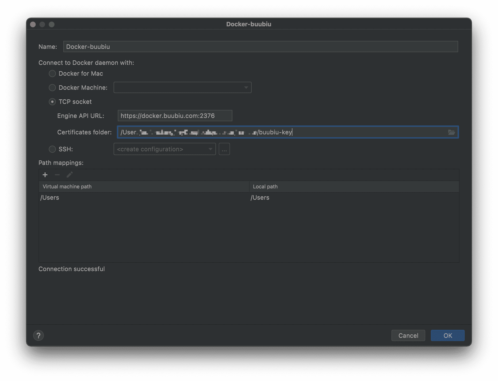
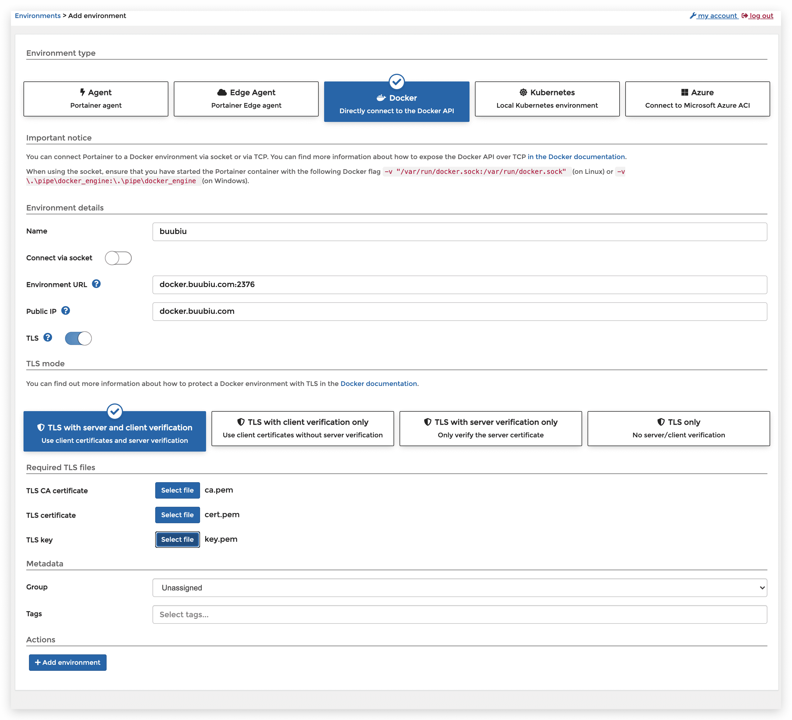

# Docker开启远程安全访问

## 介绍

docker可以开启远程访问API，供外部调用，这里介绍一下如何开启的。


## MAC环境

处于安全原因，Docker Mac 客户端并没有开启 2375 端口的配置，所以我们可以用 socat 来 fork 一个端口出来：

```sh
$ docker run -d \
 -v /var/run/docker.sock:/var/run/docker.sock \
 -p 127.0.0.1:2376:2376 bobrik/socat \
 TCP-LISTEN:1234,fork UNIX-CONNECT:/var/run/docker.sock
```

## Linux环境

### 不安全开启

编辑docker文件：/usr/lib/systemd/system/docker.service

```sh
$ vim /usr/lib/systemd/system/docker.service
```

修改ExecStart行为下面内容

```properties
ExecStart=/usr/bin/dockerd -H tcp://0.0.0.0:2376 -H unix://var/run/docker.sock \
```

重新加载daemon并重启docker

```sh
$ systemctl daemon-reload 
$ systemctl restart docker
```

### 安全开启（推荐）

思路：**服务端生成证书以及配置白名单等，用来达到验证客户端身份的目的。**

#### 服务端配置

##### 生成私钥公钥

1. 创建certs文件夹，用来存放CA私钥和公钥

   ```sh
   $ mkdir -pv /opt/docker/certs
   $ cd /opt/docker/certs/
   ```
   
2. 创建密码

   需要连续输入两次相同的密码

   ```sh
   $ openssl genrsa -aes256 -out ca-key.pem 4096
   ```

3. 依次输入密码、国家、省、市、组织名称等（除了密码外其他的可以直接回车跳过）

   ```sh
   $ openssl req -new -x509 -days 365 -key ca-key.pem -sha256 -out ca.pem
   ```

4. 生成server-key.pem

   ```sh
   $ openssl genrsa -out server-key.pem 4096
   ```

5. 生成server.csr（把下面的IP换成你自己服务器外网的IP或者域名）

   ```sh
   $ openssl req -subj "/CN=www.example.com" -sha256 -new -key server-key.pem -out server.csr
   ```

6. 配置白名单

   0.0.0.0表示所有ip都可以连接。（这里需要注意，虽然0.0.0.0可以匹配任意，但是仍需要配置你的外网ip和127.0.0.1，否则客户端会连接不上）

   ```sh
   $ echo subjectAltName = IP:123.123.123.123,IP:0.0.0.0,IP:127.0.0.1 >> extfile.cnf
   ```

   或者也可以设置成域名

   ```sh
   $ echo subjectAltName = DNS:docker.buubiu.com,IP:0.0.0.0,IP:127.0.0.1 >> extfile.cnf
   ```

7. 将Docker守护程序密钥的扩展使用属性设置为仅用于服务器身份验证

   ```sh
   $ echo extendedKeyUsage = serverAuth >> extfile.cnf
   ```

8. 生成server-cert.pem，输入之前设置的密码，生成签名证书

   ```sh
   $ openssl x509 -req -days 365 -sha256 -in server.csr -CA ca.pem -CAkey ca-key.pem \
     -CAcreateserial -out server-cert.pem -extfile extfile.cnf
   ```

9. 生成供客户端发起远程访问时使用的key.pem

   ```sh
   $ openssl genrsa -out key.pem 4096
   ```

10. 生成client.csr（把下面的IP换成你自己服务器外网的IP或者域名）

    ```sh
    $ openssl req -subj "/CN=docker.example.com" -new -key key.pem -out client.csr
    ```

11. 创建扩展配置文件，把密钥设置为客户端身份验证用

    ```sh
    $ echo extendedKeyUsage = clientAuth > extfile-client.cnf
    ```

12. 生成cert.pem，输入前面设置的密码，生成签名证书

    ```sh
    $ openssl x509 -req -days 365 -sha256 -in client.csr -CA ca.pem -CAkey ca-key.pem \
      -CAcreateserial -out cert.pem -extfile extfile-client.cnf
    ```

13. 删除不需要的配置文件和两个证书的签名请求（可选）

    ```sh
    $ rm -v client.csr server.csr extfile.cnf extfile-client.cnf
    ```

14. 为了防止私钥文件被更改以及被其他用户查看，修改其权限为所有者只读（可选）

    ```sh
    $ chmod -v 0400 ca-key.pem key.pem server-key.pem
    ```

15. 为了防止公钥文件被更改，修改其权限为只读

    ```sh
    $ chmod -v 0444 ca.pem server-cert.pem cert.pem
    ```

##### Docker配置

16. 修改Docker配置，使Docker守护程序仅接受来自提供CA信任的证书的客户端的连接

    > 注意：docker升级会覆盖这个配置，升级后记得重复修改一下

    ```sh
    $ vi /lib/systemd/system/docker.service
    ```

    在`ExecStart=/usr/bin/dockerd-current`修改成下面：

    ```sh
    # for containers run by docker
    ExecStart=/usr/bin/dockerd \
    --tlsverify \
    --tlscacert=/opt/docker/certs/ca.pem \
    --tlscert=/opt/docker/certs/server-cert.pem \
    --tlskey=/opt/docker/certs/server-key.pem \
    -H tcp://0.0.0.0:2376 \
    -H unix:///var/run/docker.sock \
    -H fd:// --containerd=/run/containerd/containerd.sock
    ```

17. 重新加载daemon并重启docker

    ```sh
    $ systemctl daemon-reload
    $ systemctl restart docker
    ```

18. 使用 `netstat -lnpt` 查看2376端口是否被监听，记得开放云服务器端口防火墙

### 客户端配置

保存相关客户端的pem文件到本地，文件为`ca.pem、cert.pem、key.pem`，idea工具连接直接选择客户端证书文件夹就行， portainer等安装要求选择特定的文件即可。

1. IDEA配置如图：

   

2. portainer配置如图：

   