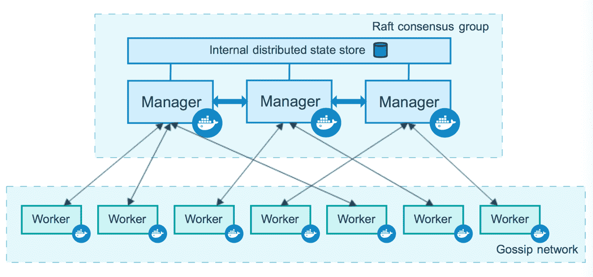
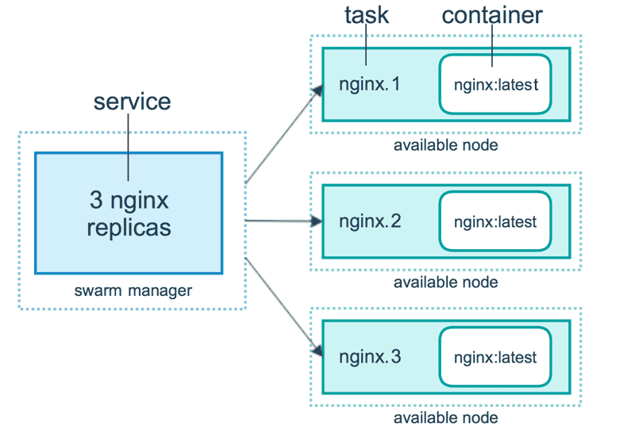
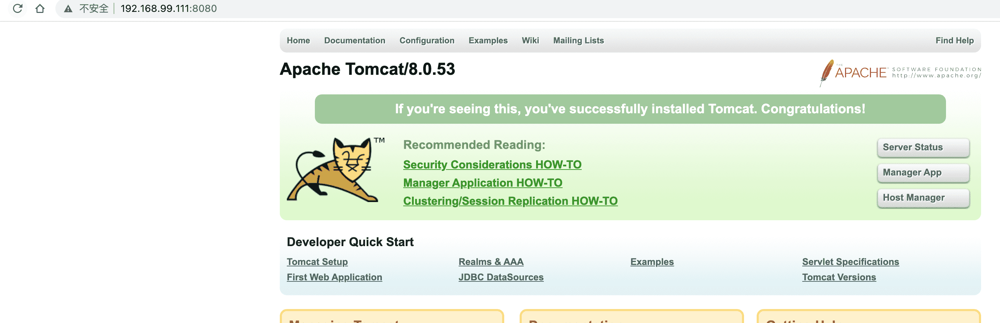

# Docker Swarm使用

## 简介

官方：https://docs.docker.com/engine/swarm/

Docker Swarm 是 Docker 官方项目之一，提供 Docker 容器集群服务，是 Docker 官方对容器云生态进行支持的核心方案。使用它，用户可以将多个 Docker 主机封装为单个大型的虚拟 Docker 主机，快速打造一套容器云平台。


Docker 1.12 Swarm mode 已经内嵌入 Docker 引擎，成为了 docker 子命令 `docker swarm`。请注意与旧的 `Docker Swarm` 区分开来。

`Swarm mode` 内置 kv 存储功能，提供了众多的新特性，比如：具有容错能力的去中心化设计、内置服务发现、负载均衡、路由网格、动态伸缩、滚动更新、安全传输等。使得 Docker 原生的 `Swarm` 集群具备与 Mesos、Kubernetes 竞争的实力。

## 相关概念

Swarm 是使用 SwarmKit 构建的 Docker 引擎内置（原生）的集群管理和编排工具。使用 Swarm 集群之前需要了解以下几个概念。

### 节点

运行Docker的主机可以主动初始化一个`Swarm`集群或者加入一个已经存在的`Swarm`集群，这样这个运行Docker的主机就成为了一个`Swarm`集群的节点（`node`）。

节点分为管理 (`manager`) 节点和工作 (`worker`) 节点。

#### 管理节点

管理节点用于 `Swarm` 集群的管理，`docker swarm` 命令基本只能在管理节点执行（节点退出集群命令 `docker swarm leave` 可以在工作节点执行）。一个 `Swarm` 集群可以有多个管理节点，但只有一个管理节点可以成为 `leader`，`leader` 通过 `raft` 协议实现。

> **raft：**就是保证集群中一半以上的机器正常才算集群有效，这就是为什么大部分集群的机器都是奇数台，假如有四台机器，其中两台挂了，则集群也就失效了，这和总共有三台机器的效果一样，所以为了保证资源充分利用，集群的机器数为奇数台。

#### 工作节点

工作节点是任务执行节点，管理节点将服务 (`service`) 下发至工作节点执行。管理节点默认也作为工作节点。你也可以通过配置让服务只运行在管理节点。

来自 Docker 官网的这张图片形象的展示了集群中管理节点与工作节点的关系。



### 服务和任务

任务 （`Task`）是 `Swarm` 中的最小的调度单位，目前来说就是一个单一的容器。

服务 （`Services`） 是指一组任务的集合，服务定义了任务的属性。服务有两种模式：

- `replicated services` 按照一定规则在各个工作节点上运行指定个数的任务。
- `global services` 每个工作节点上运行一个任务

两种模式通过 `docker service create` 的 `--mode` 参数指定。

来自 Docker 官网的这张图片形象的展示了容器、任务、服务的关系。



## 创建Swarm集群

我们来创建一个包含一个管理节点和两个工作节点的最小 `Swarm` 集群。

### 初始化集群

在 `Docker Machine` 一节中我们了解到 `Docker Machine` 可以在数秒内创建一个虚拟的 Docker 主机，下面我们使用它来创建三个 Docker 主机，并加入到集群中。

1. 我们首先创建一个 Docker 主机作为管理节点。

```shell
$ docker-machine create -d virtualbox manager
```

2. SSH到manager机器上执行命令

```shell
$ docker-machine ssh manager
```

3. 我们使用`docker swarm init`在管理节点初始化一个`Swarm`集群

   - 如果你的 Docker 主机有多个网卡，拥有多个 IP，必须使用 `--advertise-addr` 指定 IP，否会提示报错

     ```shell
     docker@manager:~$ docker swarm init
     Error response from daemon: could not choose an IP address to advertise since this system has multiple addresses on different interfaces (10.0.2.15 on eth0 and 192.168.99.101 on eth1) - specify one with --advertise-addr
     ```

4. - 执行 `docker swarm init` 命令的节点自动成为管理节点。

```shell
docker@manager:~$ docker swarm init --advertise-addr 192.168.99.101
Swarm initialized: current node (ss6edkoczov6ha2xkl7muqm4a) is now a manager.

To add a worker to this swarm, run the following command:

    docker swarm join --token SWMTKN-1-4iwiay7mou608578t0xiluv381i2k0y3uuu1t0sfabowww84qr-54x2xsupnmlr18ealfgp8uaqk 192.168.99.101:2377

To add a manager to this swarm, run 'docker swarm join-token manager' and follow the instructions.
```

### 增加工作节点

创建两个 Docker 主机作为工作节点，并加入到集群中

```shell
$ docker-machine create -d virtualbox worker1


$ docker-machine ssh worker1
   ( '>')
  /) TC (\   Core is distributed with ABSOLUTELY NO WARRANTY.
 (/-_--_-\)           www.tinycorelinux.net

docker@worker1:~$ docker swarm join --token SWMTKN-1-4iwiay7mou608578t0xiluv381i2k0y3uuu1t0sfabowww84qr-54x2xsupnmlr18ealfgp8uaqk 192.168.99.101:2377

This node joined a swarm as a worker.
```


```shell
$ docker-machine create -d virtualbox worker2


$ docker-machine ssh worker2
   ( '>')
  /) TC (\   Core is distributed with ABSOLUTELY NO WARRANTY.
 (/-_--_-\)           www.tinycorelinux.net

docker@worker1:~$ docker swarm join --token SWMTKN-1-4iwiay7mou608578t0xiluv381i2k0y3uuu1t0sfabowww84qr-54x2xsupnmlr18ealfgp8uaqk 192.168.99.101:2377

This node joined a swarm as a worker.
```

### 查看所有节点的IP

```shell
docker-machine ls
NAME      ACTIVE   DRIVER       STATE     URL                         SWARM   DOCKER      ERRORS
manager   -        virtualbox   Running   tcp://192.168.99.110:2376           v19.03.12
worker1   -        virtualbox   Running   tcp://192.168.99.111:2376           v19.03.12
```


### 查看集群

#### docker node ls

在管理节点使用 `docker node ls` 查看集群列表

```sh
docker@manager:~$ docker node ls
ID                            HOSTNAME            STATUS              AVAILABILITY        MANAGER STATUS      ENGINE VERSION
hztlhn18uasmj981k6q5k32sa *   manager             Ready               Active              Leader              19.03.12
t7ats765xa9bmq2xeyytlroj1     worker1             Ready               Active                                  19.03.12
s1yb705h1ebur8ojxttu9ikr1     worker2             Ready               Active                                  19.03.12
```

## 部署服务

我们使用`docker service`命令来管理 `Swarm` 集群中的服务，该命令只能在管理节点运行。

**注意，最好每个节点都把镜像源替换为阿里云，否则下载很慢。**

### 新建服务

#### docker service

现在我们在manager节点创建的 `Swarm` 集群中运行一个名为 `tomcat` 服务。

```shell
# --replicas 3 启用 3 个副本
docker@manager:~$ docker service create --replicas 3 -p 8080:8080 --name tomcat tomcat:8.0-jre8
```

现在我们使用浏览器，输入任意节点 IP:8080 ，即可看到 tomcat 默认页面。

### 查看服务

#### docker service ls

使用 `docker service ls` 来查看当前 `Swarm` 集群运行的服务

```shell
docker@manager:~$ docker service ls
ID                  NAME                MODE                REPLICAS            IMAGE               PORTS
gb68wnbd9g46        tomcat              replicated          3/3                 tomcat:8.0-jre8     *:8080->8080/tcp
```

#### docker service ps

使用 `docker service ps` 来查看某个服务的详情

```shell
docker@manager:~$ docker service ps tomcat
ID                  NAME                IMAGE               NODE                DESIRED STATE       CURRENT STATE             ERROR               PORTS
nuvede7hmggu        tomcat.1            tomcat:8.0-jre8     worker2             Running             Preparing 3 minutes ago
w5psn6cpr16m        tomcat.2            tomcat:8.0-jre8     manager             Running             Preparing 3 minutes ago
pshili013nya        tomcat.3            tomcat:8.0-jre8     worker1             Running             Preparing 3 minutes ago
```

#### docker service logs

使用 `docker service logs` 来查看某个服务的日志

```shell
docker@manager:~$ docker service logs tomcat
docker@manager:~$ docker service logs tomcat
tomcat.1.8v0xggulqhx0@manager    | 27-Mar-2021 16:22:26.051 INFO [main] org.apache.catalina.startup.VersionLoggerListener.log Server version:        Apache Tomcat/8.0.53
...
tomcat.1.8v0xggulqhx0@manager    | 27-Mar-2021 16:22:28.449 INFO [main] org.apache.coyote.AbstractProtocol.start Starting ProtocolHandler ["http-apr-8080"]
tomcat.1.8v0xggulqhx0@manager    | 27-Mar-2021 16:22:28.466 INFO [main] org.apache.coyote.AbstractProtocol.start Starting ProtocolHandler ["ajp-apr-8009"]
tomcat.1.8v0xggulqhx0@manager    | 27-Mar-2021 16:22:28.472 INFO [main] org.apache.catalina.startup.Catalina.start Server startup in 2133 ms
tomcat.2.f566j6imruvq@worker1    | 27-Mar-2021 16:22:51.954 INFO [main] org.apache.catalina.startup.VersionLoggerListener.log Server version:        Apache Tomcat/8.0.53
tomcat.2.f566j6imruvq@worker1    | 27-Mar-2021 16:22:51.958 INFO [main] org.apache.catalina.startup.VersionLoggerListener.log Server built:          Jun 29 2018 14:42:45 UTC
.....
tomcat.2.f566j6imruvq@worker1    | 27-Mar-2021 16:22:53.753 INFO [main] org.apache.coyote.AbstractProtocol.start Starting ProtocolHandler ["http-apr-8080"]
tomcat.2.f566j6imruvq@worker1    | 27-Mar-2021 16:22:53.787 INFO [main] org.apache.coyote.AbstractProtocol.start Starting ProtocolHandler ["ajp-apr-8009"]
tomcat.2.f566j6imruvq@worker1    | 27-Mar-2021 16:22:53.810 INFO [main] org.apache.catalina.startup.Catalina.start Server startup in 1624 ms
```

### 访问页面

随便打开一个ip:8080都可以

http://192.168.99.111:8080/



### 服务伸缩

#### docker service scale

我们可以使用 `docker service scale` 对一个服务运行的容器数量进行伸缩。

- 当业务处于高峰期时，我们需要扩展服务运行的容器数量。

```shell
docker@manager:~$ docker service scale tomcat=5
tomcat scaled to 5
overall progress: 5 out of 5 tasks
1/5: running   [==================================================>]
2/5: running   [==================================================>]
3/5: running   [==================================================>]
4/5: running   [==================================================>]
5/5: running   [==================================================>]
verify: Service converged
```

- 当业务平稳时，我们需要减少服务运行的容器数量。

```shell
docker@manager:~$ docker service scale tomcat=2
tomcat scaled to 2
overall progress: 2 out of 2 tasks
1/2: running   [==================================================>]
2/2: running   [==================================================>]
verify: Service converged
```

### 删除服务

#### docker service rm

使用 `docker service rm` 来从 `Swarm` 集群移除某个服务。

```shell
docker@manager:~$ docker service rm tomcat
```

## 使用 docker compose文件

在 `Swarm` 集群中也可以使用 `compose` 文件 （`docker-compose.yml`） 来配置、启动多个服务。

我们使用 `docker service create` 一次只能部署一个服务，使用 `docker-compose.yml` 我们可以一次启动多个关联的服务。

我们使用 `docker stack deploy` 而不是 `docker service create`，Stack 会帮我们管理这些对象。

我们可以直接用 `docker-compose.yml` 文件，但是不能 `build` 镜像，Swarm 只接收构建好的镜像，新加了一个 `deploy` 字段。当使用 `docker-compose` 执行这个文件时，会忽略 `deploy` 字段。`docker stack` 中会忽略 `build` 字段，所以我们可以开发和发布都使用一个 `docker-compose.yml` 文件。

### 创建docker-compose.yml文件

1. 在一个空目录中创建一个docker-compose.yml文件

2. 在配置文件中定义一个项目存在哪些服务

   相对于之前新加了一个 `deploy` 字段。

   ```dockerfile
   version: "3.0" #定义版本，官方要求，最高为4.0
   services: #所有的服务
     tomcat: #服务名，唯一
       image: tomcat:8.0-jre8 #创建当前这个服务使用哪个镜像
       ports: #映射端口，是个数组
         - 8080:8080
       networks: #指定自定义网络
         - overlay
       deploy: # 部署
         mode: replicated # 复制模式
         replicas: 3 #启动多少个容器
         #update_config: # 更新规则
           #parallelism: 2 # 一次两个
           #delay: 10s # 更新延迟 10s，给 app 一个启动时间
         #restart_policy: # 重启规则
           #condition: on-failure #遇到失败就重启
         #placement:
           #constraints: [node.role == manager] # 只部署在 manager 节点
   networks:
     overlay:
   ```

### 运行docker-compose部署服务

部署服务使用 `docker stack deploy`，其中 `-c` 参数指定 compose 文件名

命令：`docker stack deploy -c docker-compose.yml tomcat`

- -c 指定配置文件 
- deploy 也可以换成 up

```shell
docker@manager:~$ docker stack deploy -c docker-compose.yml tomcat
Creating network tomcat_overlay
Creating service tomcat_tomcat
```

### 查看compose服务

命令：`docker stack ls`

```shell
docker@manager:~$ docker stack ls
NAME                SERVICES            ORCHESTRATOR
tomcat              1                   Swarm
```

### 查看compose容器

命令：`docker stack ps tomcat`

```shell
docker@manager:~$ docker stack ps tomcat
ID                  NAME                IMAGE               NODE                DESIRED STATE       CURRENT STATE                ERROR               PORTS
kn4sesyafad3        tomcat_tomcat.1     tomcat:8.0-jre8     manager             Running             Running about a minute ago
yiqfmly0simi        tomcat_tomcat.2     tomcat:8.0-jre8     manager             Running             Running about a minute ago
v9ygrv2al221        tomcat_tomcat.3     tomcat:8.0-jre8     worker1             Running             Running about a minute ago
```

### 移除服务

命令：`docker stack rm tomcat`

该命令不会移除服务所使用的 `数据卷`，如果你想移除数据卷请使用 `docker volume rm`

```shell
docker@manager:~$ docker stack rm tomcat
Removing service tomcat_tomcat
Removing network tomcat_overlay
```

### 更新服务

如果我们更新这个配置文件，可以重新执行docker-compose.yml文件即可。

## 管理密钥

在动态的、大规模的分布式集群上，管理和分发 `密码`、`证书` 等敏感信息是极其重要的工作。传统的密钥分发方式（如密钥放入镜像中，设置环境变量，volume 动态挂载等）都存在着潜在的巨大的安全风险。

Docker 目前已经提供了 `secrets` 管理功能，用户可以在 Swarm 集群中安全地管理密码、密钥证书等敏感数据，并允许在多个 Docker 容器实例之间共享访问指定的敏感数据。它最大支持 500KB 的字符串或二进制内容。

`Secret` 会被加密的保存在管理节点的硬盘上，被加密传输。只有被允许的容器才能查看 `Secret`，在容器中它只会被存在内存中，可以在 `/run/secrets/<secret_name | secret_alias>` 访问到。

> 注意： `secret` 也可以在 `Docker Compose` 中使用。

我们可以用 `docker secret` 命令来管理敏感信息。

### 创建secret

我们使用 `docker secret create` 命令创建 `secret`。

`Secret` 可以通过两种方式创建，一种是文件另一种是 `stdin(管道符｜)` 创建。

#### 文件创建

1. 先创建文件，并填写需要加密的内容

2. 执行创建命令

   命令格式：`docker secret create [KEY] [FILENAME]`

```shell
docker@manager:~$ cat mysql_root_password.txt
123456
docker@manager:~$ docker secret create mysql_root_password mysql_root_password.txt
lvn3k6ajcytuno476mferezr5
docker@manager:~$
```

#### 管道符形式创建

​	命令格式：`[可以生成字符串的命令] | docker secret create [KEY]`

```shell
docker@manager:~$ echo '123456' | docker secret create mysql_password -
p94kxcvqfmkwdg55om2i8fmbe
docker@manager:~$
```

### 查看secret

命令格式：使用 `docker secret ls` 

```shell
docker@manager:~$ docker secret ls
ID                          NAME                DRIVER              CREATED             UPDATED
p94kxcvqfmkwdg55om2i8fmbe   mysql_password                            21 seconds ago      21 seconds ago
lvn3k6ajcytuno476mferezr5   mysql_root_password                       30 seconds ago      30 seconds ago
docker@manager:~$
```

### 使用secret创建服务

如果你没有在 `target` 中显式的指定路径时，`secret` 默认通过 `tmpfs` 文件系统挂载到容器的 `/run/secrets` 目录中。

```shell
docker@manager:~$ docker service create \
     --name mysql \
     --replicas 2 \
     --secret source=mysql_root_password,target=mysql_root_password \
     --secret source=mysql_password,target=mysql_password \
     -e MYSQL_ROOT_PASSWORD_FILE="/run/secrets/mysql_root_password" \
     -e MYSQL_PASSWORD_FILE="/run/secrets/mysql_password" \
     -e MYSQL_USER="buubiu" \
     -e MYSQL_DATABASE="buubiu" \
     mysql:latest

overall progress: 2 out of 2 tasks
1/2: running   [==================================================>]
2/2: running   [==================================================>]
verify: Service converged
docker@manager:~$
```

**--secret：** 用来指定 Service 能使用哪个 secret

### 查看通过secret创建的服务

```shell
docker@manager:~$ docker service ls
ID                  NAME                MODE                REPLICAS            IMAGE               PORTS
mai1e55esrrs        mysql               replicated          2/2                 mysql:latest
docker@manager:~$
```

### 删除服务的secret

- 单纯的删除secret，命令：`docker secret rm [KEY][KEY]...`

```shell
docker@manager:~$ docker secret rm my_password
my_password
docker@manager:~$
```

- 如果我们现在删除 Service 的 `secret`，可以使用 `--secret-rm`

  > 注意：删除 Service 的 secret，容器会自动重建，因为 Service 是容器的一部分。

```shell
docker@manager:~$ docker service update --secret-rm mysql_user
```

通过以上方法，我们没有像以前通过设置环境变量来设置 MySQL 密码， 而是采用 `docker secret` 来设置密码，防范了密码泄露的风险。

## 管理配置信息

在动态的、大规模的分布式集群上，管理和分发配置文件也是很重要的工作。传统的配置文件分发方式（如配置文件放入镜像中，设置环境变量，volume 动态挂载等）都降低了镜像的通用性。

在 Docker 17.06 以上版本中，Docker 新增了 `docker config` 子命令来管理集群中的配置信息，以后你无需将配置文件放入镜像或挂载到容器中就可实现对服务的配置。

> 注意：`config` 仅能在 Swarm 集群中使用。

这里我们以在 Swarm 集群中部署 `redis` 服务为例。

### 创建config

命令格式：`docker config create [NAME] [FILE]`

1. 新建 `redis.conf` 文件

```sh
port 6380
```

此项配置 Redis 监听 `6380` 端口

2. 创建config

```shell
docker@manager:~$ docker config create redis.conf redis.conf
iqxk8sghv1vtj2kzkc2bwgp1e
docker@manager:~$
```

### 查看config

命令格式：`docker config ls`

```shell
docker@manager:~$ docker config ls
ID                          NAME                CREATED             UPDATED
iqxk8sghv1vtj2kzkc2bwgp1e   redis.conf          52 seconds ago      52 seconds ago
```

### 使用config

```shell
docker@manager:~$ docker service create \
     --name redis \
     # --config source=redis.conf,target=/etc/redis.conf \
     --config redis.conf \
     -p 6380:6380 \
     redis:latest \
     redis-server /redis.conf
```

如果你没有在 `target` 中显式的指定路径时，默认的 `redis.conf` 以 `tmpfs` 文件系统挂载到容器的 `/config.conf`。

经过测试，redis 可以正常使用。

以前我们通过监听主机目录来配置 Redis，就需要在集群的每个节点放置该文件，如果采用 `docker config` 来管理服务的配置信息，我们只需在集群中的管理节点创建 `config`，当部署服务时，集群会自动的将配置文件分发到运行服务的各个节点中，大大降低了配置信息的管理和分发难度。

## 滚动升级

滚动升级是一次只升级一部分副本，不一次性全部升级，它降低了应用更新的风险，如果某个副本更新失败，整个更新将暂停，其他副本则可以继续提供服务。在更新的过程中，总是有副本在运行的，也保证了业务的连续性。

现在我们把 `nginx:1.16` 版本升级到 `nginx:1.17`。

### 创建服务

```shell
docker@manager:~$ docker service create --name nginx --replicas=3 nginx:1.16
jzxnmnhw2lif7uklj8cp6d4qw
overall progress: 3 out of 3 tasks
1/3: running   [==================================================>]
2/3: running   [==================================================>]
3/3: running   [==================================================>]
verify: Service converged
docker@manager:~$
```

### 升级服务版本

命令格式：`docker service update`

> swarm 会停止一个容器，更新它，如果失败就会暂停整个更新过程

```shell
docker@manager:~$ docker service update --image nginx:1.17 nginx
nginx
overall progress: 2 out of 3 tasks
1/3: running   [==================================================>]
2/3: running   [==================================================>]
3/3: pending   [================>                                  ]


docker@manager:~$ docker service ps nginx
ID                  NAME                IMAGE               NODE                DESIRED STATE       CURRENT STATE            ERROR               PORTS
u25clkz1vw5p        nginx.1             nginx:1.17          manager             Running             Running 2 minutes ago
3urf32x2gn39         \_ nginx.1         nginx:1.16          manager             Shutdown            Shutdown 3 minutes ago
210z5dcn3lg2        nginx.2             nginx:1.17          manager             Running             Running 2 minutes ago
zns691zenqd5         \_ nginx.2         nginx:1.16          manager             Shutdown            Shutdown 2 minutes ago
kx7709qb8d6l        nginx.3             nginx:1.17          manager             Running             Running 2 minutes ago
l6s0tyoxqhrs         \_ nginx.3         nginx:1.16          manager             Shutdown            Shutdown 2 minutes ago
docker@manager:~$
```

以上命令使用 `--image` 选项更新了服务的镜像。当然我们也可以使用 `docker service update` 更新任意的配置。

`--secret-add` 选项可以增加一个密钥

`--secret-rm` 选项可以删除一个密钥

更多选项可以通过 `docker service update -h` 命令查看。

### 服务回退

命令格式：`docker service update --rollback [NAME]` 或者`docker serivice rollback [NAME]`

> 注意：只能回滚到上一次执行 `docker service update` 之前的状态，并不能无限制地回滚。

```shell
docker@manager:~$ docker service update --rollback nginx
nginx
rollback: manually requested rollback
overall progress: rolling back update: 3 out of 3 tasks
1/3: running   [>                                                  ]
2/3: running   [>                                                  ]
3/3: running   [>                                                  ]
verify: Waiting 5 seconds to verify that tasks are stable...


docker@manager:~$ docker service ps nginx
ID                  NAME                IMAGE               NODE                DESIRED STATE       CURRENT STATE             ERROR               PORTS
c8jq0s3ezu0s        nginx.1             nginx:1.16          manager             Running             Running 20 seconds ago
u25clkz1vw5p         \_ nginx.1         nginx:1.17          manager             Shutdown            Shutdown 20 seconds ago
3urf32x2gn39         \_ nginx.1         nginx:1.16          manager             Shutdown            Shutdown 6 minutes ago
9jjghoimxmcv        nginx.2             nginx:1.16          manager             Running             Running 22 seconds ago
210z5dcn3lg2         \_ nginx.2         nginx:1.17          manager             Shutdown            Shutdown 22 seconds ago
zns691zenqd5         \_ nginx.2         nginx:1.16          manager             Shutdown            Shutdown 6 minutes ago
qg7b61je5l9a        nginx.3             nginx:1.16          manager             Running             Running 18 seconds ago
kx7709qb8d6l         \_ nginx.3         nginx:1.17          manager             Shutdown            Shutdown 19 seconds ago
l6s0tyoxqhrs         \_ nginx.3         nginx:1.16          manager             Shutdown            Shutdown 6 minutes ago
docker@manager:~$
```

