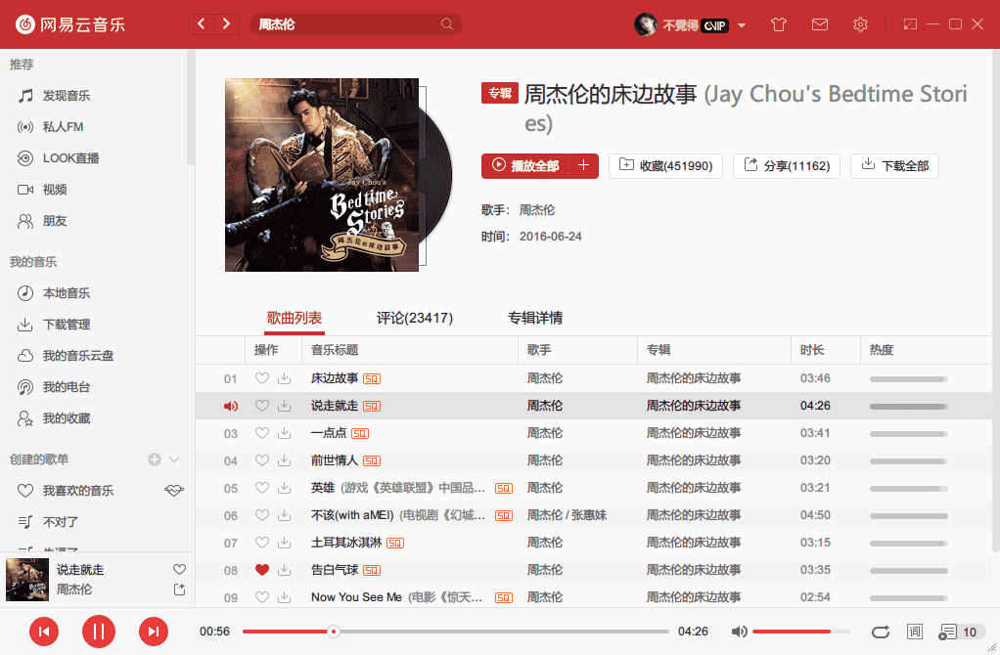
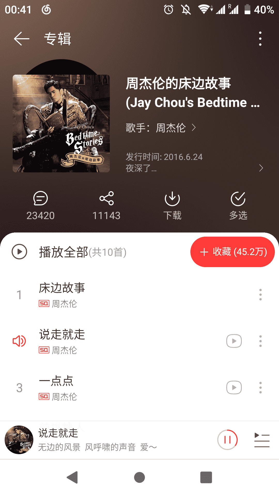
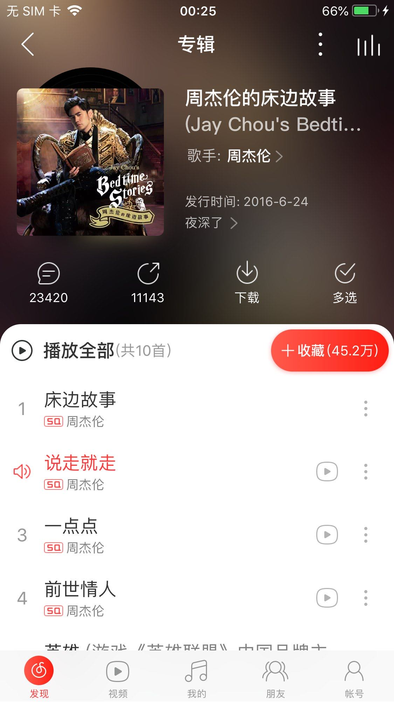

# docker解锁网易云音乐所有音乐

## 概述

解锁网易云音乐客户端变灰歌曲

## 特性

- 使用 QQ / 虾米 / 百度 / 酷狗 / 酷我 / 咪咕 / JOOX 音源替换变灰歌曲链接 (默认仅启用一、五、六)
- 为请求增加 `X-Real-IP` 参数解锁海外限制，支持指定网易云服务器 IP，支持设置上游 HTTP / HTTPS 代理
- 完整的流量代理功能 (HTTP / HTTPS)，可直接作为系统代理 (同时支持 PAC)


## 服务端安装并使用镜像

### 下载镜像

```sh
$ docker pull nondanee/unblockneteasemusic
```

### 使用镜像

#### 生成私钥

为了支持https，这里需要生成密钥对：

```sh
# 生成 CA 私钥
$ mkdir -p /data/docker_volumes/netease-music
$ cd /data/docker_volumes/netease-music
$ openssl genrsa -out ca.key 2048

# 生成 CA 证书 ("buubiu" 处填上你自己的名字)
$ openssl req -x509 -new -nodes -key ca.key -sha256 -days 1825 -out ca.crt -subj "/C=CN/CN=UnblockNeteaseMusic Root CA/O=buubiu"


# 生成服务器私钥
$ openssl genrsa -out server.key 2048


# 生成证书签发请求
$ openssl req -new -sha256 -key server.key -out server.csr -subj "/C=CN/L=Hangzhou/O=NetEase (Hangzhou) Network Co., Ltd/OU=IT Dept./CN=*.music.163.com"


# 使用 CA 签发服务器证书
$ openssl x509 -req -extfile <(printf "extendedKeyUsage=serverAuth\nsubjectAltName=DNS:music.163.com,DNS:*.music.163.com") -sha256 -days 365 -in server.csr -CA ca.crt -CAkey ca.key -CAcreateserial -out server.crt

[root@VM-4-6-centos netease-music]# ll
total 24
-rw-r--r-- 1 root root 1245 Oct 21 09:28 ca.crt
-rw------- 1 root root 1679 Oct 21 09:28 ca.key
-rw-r--r-- 1 root root   41 Oct 21 09:29 ca.srl
-rw-r--r-- 1 root root 1294 Oct 21 09:29 server.crt
-rw-r--r-- 1 root root 1029 Oct 21 09:29 server.csr
-rw------- 1 root root 1679 Oct 21 09:28 server.key
```

上述步骤完成后

将服务器私钥 (server.key) 和服务器证书 (server.crt) 拷贝到仓库中覆盖原有文件 (**若使用 docker，可通过添加 -v /path/to/server.crt:/usr/src/app/server.crt -v /path/to/server.key:/usr/src/app/server.key 参数映射本地路径覆盖原有文件**)，再将 CA 证书 (ca.crt) 安装到系统；如果不自行签发，直接安装仓库里的 CA 证书 ([ca.crt](https://raw.githubusercontent.com/nondanee/UnblockNeteaseMusic/master/ca.crt)) 即可

#### 启动容器

```sh
$ docker run -d -p 28080:8080 -p 28081:8081 \
  -v /data/docker_volumes/netease-music/server.crt:/usr/src/app/server.crt \
  -v /data/docker_volumes/netease-music/server.key:/usr/src/app/server.key \
  --name neteas-music \
  --restart always nondanee/unblockneteasemusic -p 8080:8081
```

## 客户端使用

> 注意：记得防火墙开放端口 28080

### 方法一：修改 hosts（不推荐）

向 hosts 文件添加两条规则

```sh
<Server IP> music.163.com
<Server IP> interface.music.163.com
```

> 使用此方法必须监听 80 端口 `-p 80`
>
> **若在本机运行程序**，请指定网易云服务器 IP `-f xxx.xxx.xxx.xxx` (可在修改 hosts 前通过 `ping music.163.com` 获得) **或** 使用代理 `-u http(s)://xxx.xxx.xxx.xxx:xxx`，以防请求死循环
>
> **Android 客户端下修改 hosts 无法直接使用**，原因和解决方法详见[云音乐安卓又搞事啦](https://jixun.moe/post/netease-android-hosts-bypass/)，[安卓免 root 绕过网易云音乐 IP 限制](https://jixun.moe/post/android-block-netease-without-root/)

### 方法二：设置代理（推荐）

PAC 自动代理脚本地址 `http://<Server Name:PORT>/proxy.pac`

全局代理地址填写服务器地址和端口号即可

| 平台    | 基础设置                              |
| ------- | ------------------------------------- |
| Windows | 设置 > 工具 > 自定义代理 (客户端内)   |
| UWP     | Windows 设置 > 网络和 Internet > 代理 |
| Linux   | 系统设置 > 网络 > 网络代理            |
| macOS   | 系统偏好设置 > 网络 > 高级 > 代理     |
| Android | WLAN > 修改网络 > 高级选项 > 代理     |
| iOS     | 无线局域网 > HTTP 代理 > 配置代理     |

> 代理工具和方法有很多请自行探索，欢迎在 评论处 讨论

### 方法三：调用接口（开发人员使用）

作为依赖库使用

```sh
$ npm install @nondanee/unblockneteasemusic
```


```typescript
const match = require('@nondanee/unblockneteasemusic')

/** 
 * Set proxy or hosts if needed
 */
global.proxy = require('url').parse('http://127.0.0.1:1080')
global.hosts = {'i.y.qq.com': '59.37.96.220'}

/**
 * Find matching song from other platforms
 * @param {Number} id netease song id
 * @param {Array<String>||undefined} source support qq, xiami, baidu, kugou, kuwo, migu, joox
 * @return {Promise<Object>}
 */
match(418602084, ['qq', 'kuwo', 'migu']).then(console.log)
```

## 效果

#### Windows 客户端



#### UWP 客户端


#### Linux 客户端


#### macOS 客户端


#### Android 客户端



#### iOS 客户端



## 致谢

[UnblockNeteaseMusic](https://github.com/nondanee/UnblockNeteaseMusic)

> 本次教程仅限于自己测试使用，禁止传播商业化使用，否则后果自负。