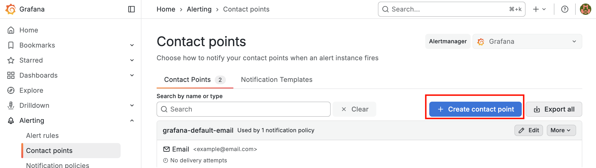
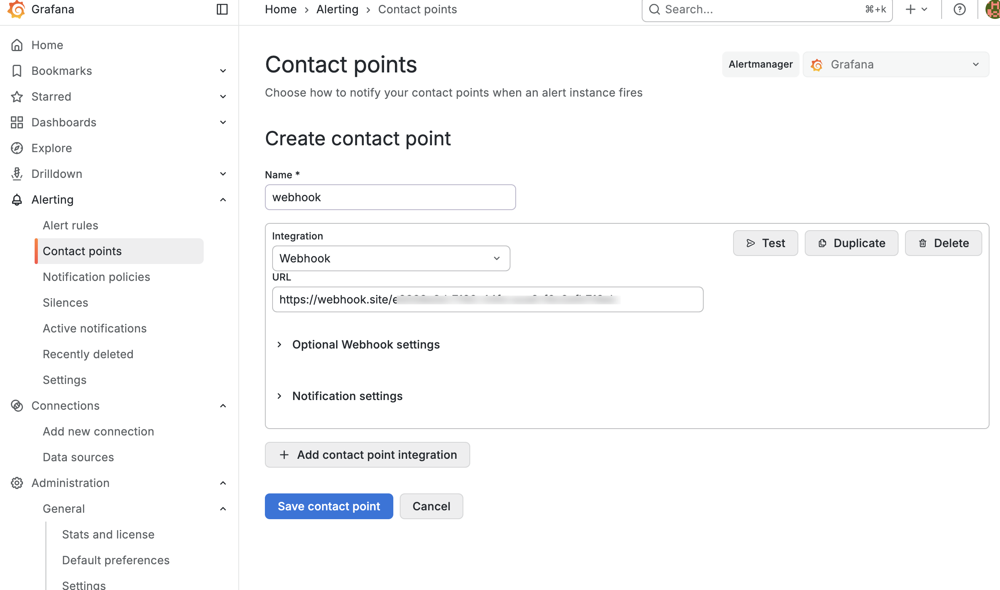
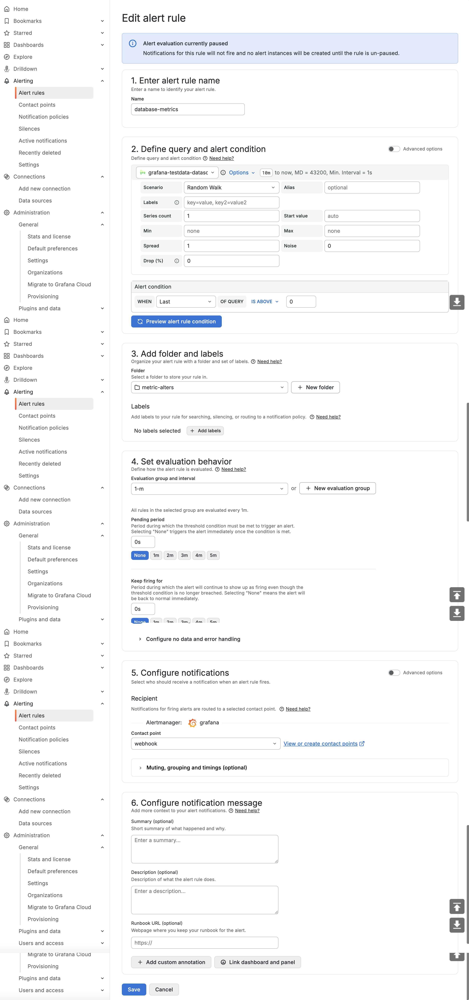
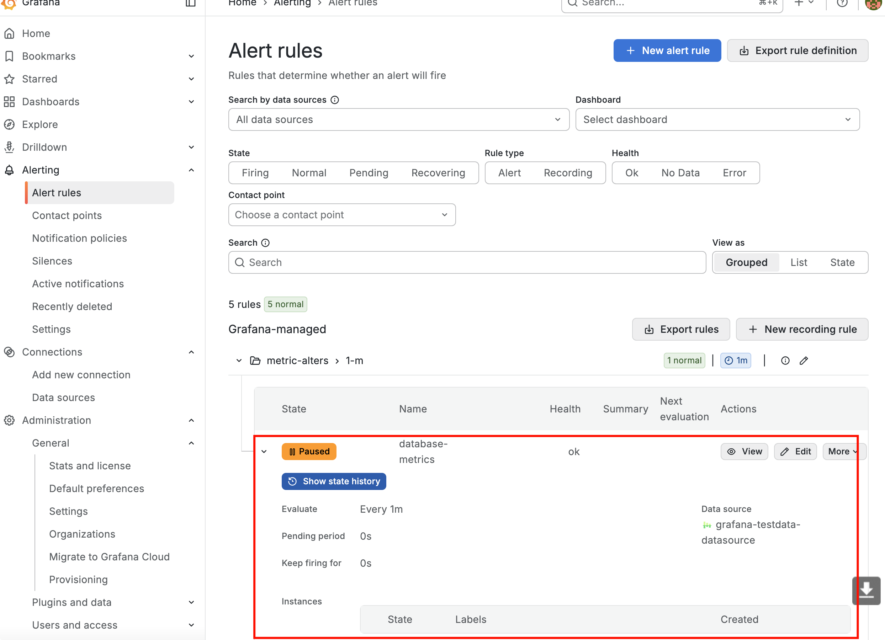

# Grafana-01-告警-创建简单的告警

## 创建联系点

Grafana 内置了告警服务，使用联系点来指定接收警报通知的媒介。联系点包含发送警报通知的配置，包括电子邮件、Slack、IRM、Webhook 等媒介。

下面以 webhook （[Webhook.site](https://webhook.site)）为例，来创建一个联系点。

点击创建联系点

选择 webhook ，输入url，测试通知，点击保存。

## 创建告警规则

输入名称，选择自带的测试数据源，设置告警文件夹与告警评估行为，配置刚刚创建的联系点，点击保存。

## 查看告警通知

