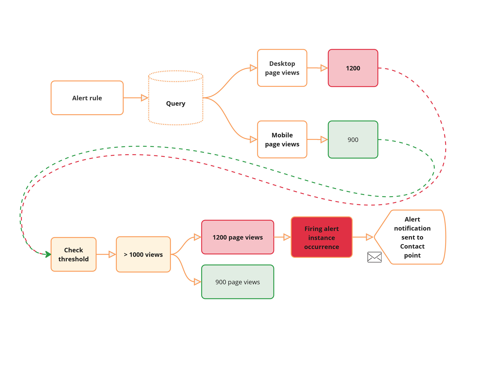
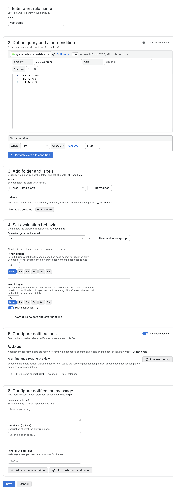
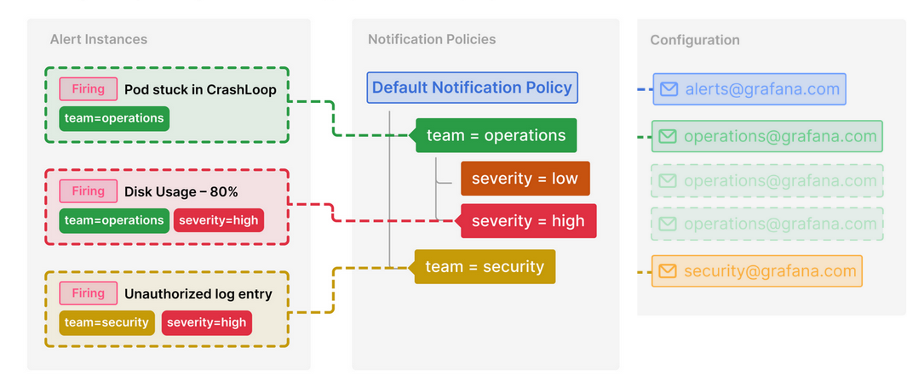
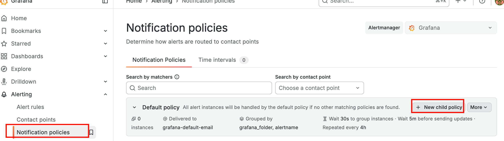
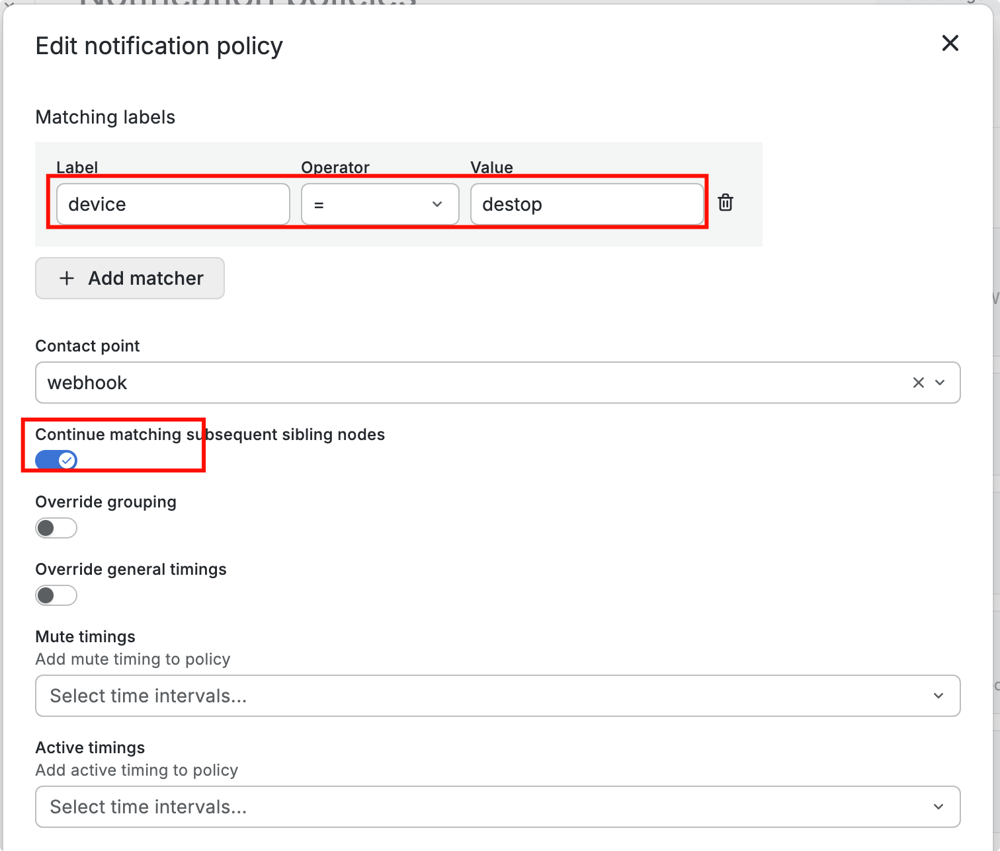
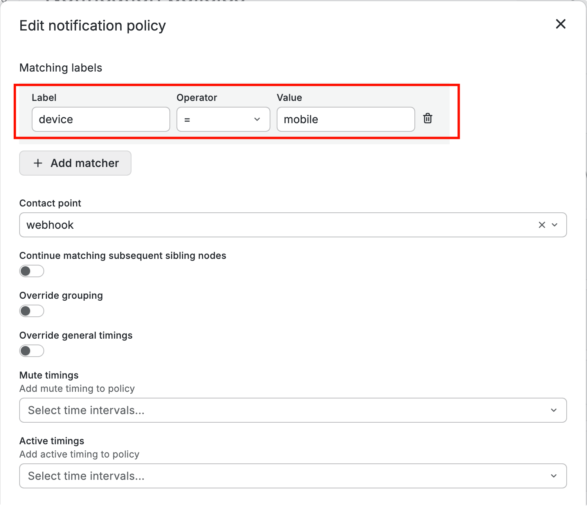

# Grafana-02-告警-配置通知策略

## 告警实例 (Alert Instances)

告警实例是**一个与告警规则查询返回的指标相匹配的事件**。

**通俗理解：**
当监控指标满足告警规则设定的条件时，就会产生一个具体的告警事件，这个事件就是一个“告警实例”。

### 示例场景：网站流量监控

假设正在使用Grafana监控网站流量，并设置了一个告警规则：

-   **规则条件**：过去5分钟内，页面浏览量超过1000次。
-   **触发机制**：当该条件被满足时，系统就会生成一个**告警实例**。

假设查询返回了两个时间序列：

1.  **桌面端页面浏览量**
2.  **移动端页面浏览量**

**评估过程如下：**

-   **桌面端时间序列**：其数值（例如：1200次浏览）超过了1000次的阈值。因此，系统会为其创建一个状态为 **`Firing`（告警中）** 的告警实例，并**发送告警通知**。
-   **移动端时间序列**：其数值（例如：800次浏览）未达到阈值。因此，其对应的告警实例将保持 **`Normal`（正常）** 状态，**不会发送任何通知**。

### 创建告警规则

和之前创建告警规则一样，只是在选择告警联系点的时候，不选中哪一个，选择高级，让告警根据标签自动匹配到哪个告警通知策略。

## 通知策略 (Notification Policies)

### 核心定义与目的

通知策略用于**将告警路由到不同的通信渠道**。它的主要作用是：

1.  **减少告警噪音**：避免无关人员收到不相关的告警。
2.  **提供发送控制权**：精确控制告警的发送时间和方式。

### 典型应用场景

-   **确保关键告警被及时处理**：例如，将关于**服务器宕机**的严重告警，立即发送给**值班工程师**的通信工具（如 Slack、PagerDuty）。
-   **分流非紧急告警**：例如，将**性能相关的告警**路由给**开发团队**进行审阅和后续处理。

### 核心特性

1.  **基于标签的路由**
    -   这是通知策略的核心机制。系统通过**匹配告警实例上的标签**和**策略中定义的标签**来决定路由路径。
    -   **工作原理**：只有携带了特定标签的告警实例，才会被送入对应标签的策略分支中进行处理。
2.  **管理通知发送时机**
    -   通知策略允许您为不同的告警组配置不同的发送规则，例如：
        -   **分组等待**：将短时间内触发的多个相关告警分组，合并为一条通知发送，防止“告警风暴”。
        -   **发送频率限制**：限制重复告警的通知频率。
        -   **静默时间**：在特定时段（如非工作时间）禁止发送非紧急告警。

### 创建告警通知策略

