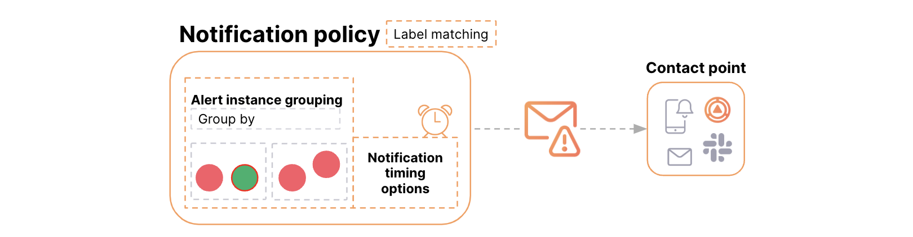
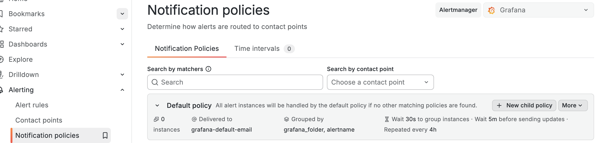
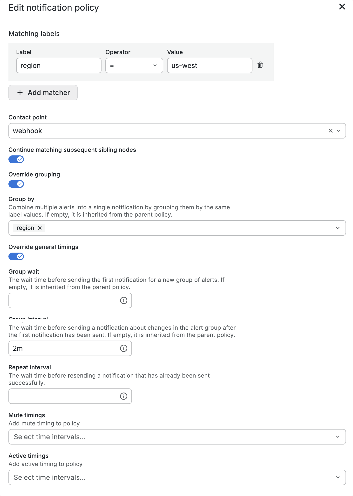
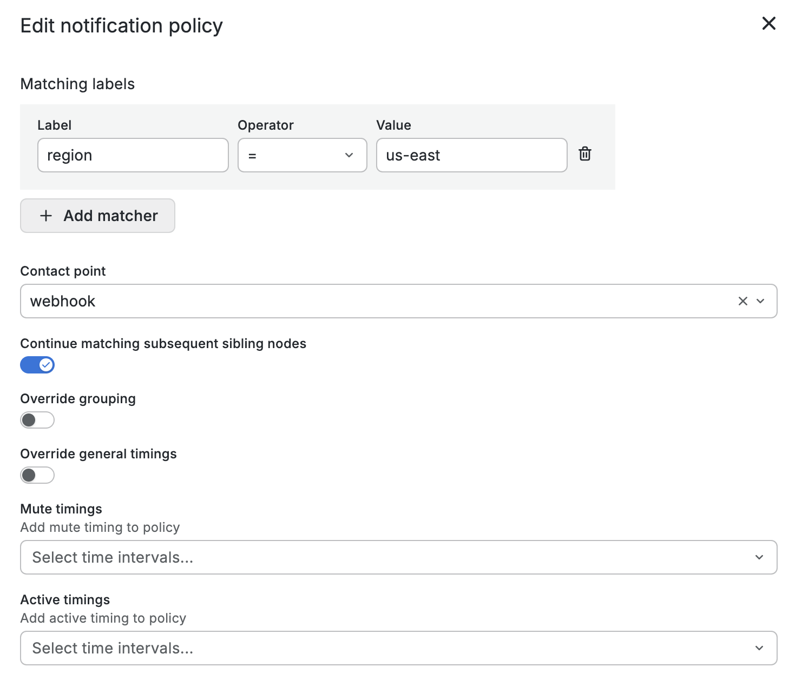
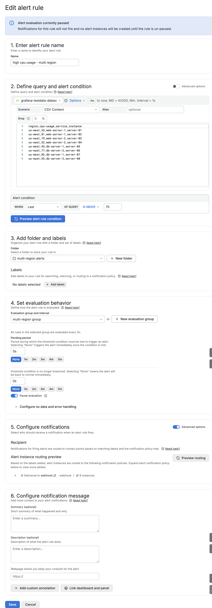
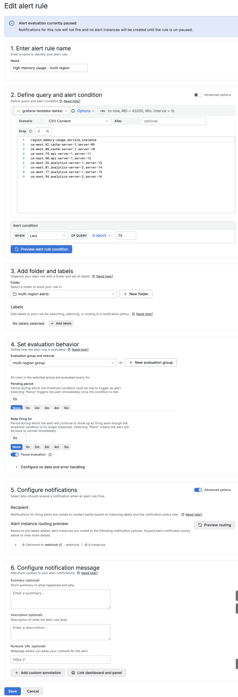

# Grafana-03-告警-分组告警通知

## 分组告警通知 (Group Alert Notifications)

### 定义

分组功能通过**将相关的告警实例合并为一条简洁的通知**，来显著**减少通知噪音**。

## 工作原理

### 分组配置基础

-   **配置基础**：在**通知策略**中通过配置**标签**实现分组
-   **分组逻辑**：通知策略会检查告警实例携带的标签进行匹配分组，所有**共享相同指定标签值**的告警实例，将被归入同一个组，并发送一条合并通知。

### 标签类型与作用

告警实例的标签是分组的关键依据，主要分为三类：

| 标签类型         | 来源                         | 说明                         | 示例                                                         |
| :--------------- | :--------------------------- | :--------------------------- | :----------------------------------------------------------- |
| **保留标签**     | Grafana **自动生成**         | 系统预设的元数据标签。       | `alertname="CPU使用率过高"` `grafana_folder="生产环境仪表板"` |
| **用户配置标签** | 用户在告警规则中**手动添加** | 用于自定义分类和优先级。     | `severity="critical"` `priority="P1"` `team="backend"`       |
| **查询标签**     | 数据源查询**返回**           | 从监控数据中继承的维度标签。 | `region="us-east-1"` `service="payment-api"` `environment="prod"` |

### 定时选项控制

这三个选项共同决定了分组通知的发送节奏，通常按层级配置。

| 选项         | 作用                                                         | 默认值 | 场景说明                                                     |
| :----------- | :----------------------------------------------------------- | ------ | :----------------------------------------------------------- |
| **分组等待** | 在发送**第一个**通知前，等待新告警加入同一组的时间。         | `30s`  | 一个告警触发后，等待30秒，看是否有同组其他告警（如同一服务的其他实例）也触发，然后一并通知。 |
| **分组间隔** | **不同分组**通知之间的最短等待时间。                         | `5m`   | 即使有多个不同的告警组同时触发，通知系统每分钟最多处理一个组，防止多个组同时触发导致"通知风暴"。 |
| **重复间隔** | 对于**状态未改变**（未解决告警，持续触发）的同一个告警组，重复发送提醒通知的间隔时间。 | `4h`   | 对于持续了4小时仍未解决的CPU过载告警组，每隔4小时重新发送一次提醒，直到问题解决。 |

## 创建分组告警

### 配置通知策略

### 配置告警规则

