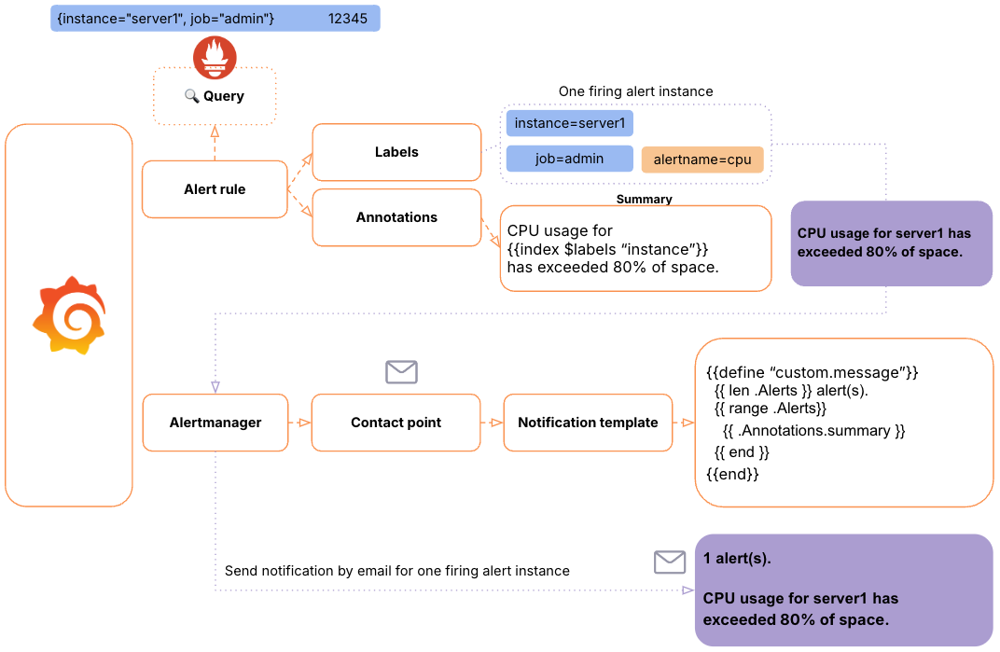
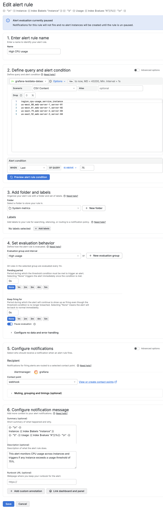
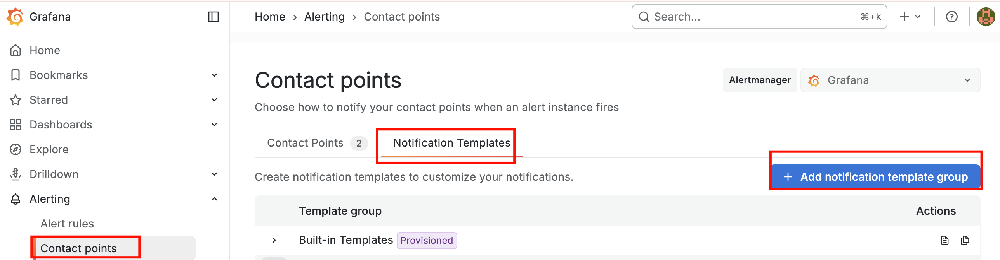
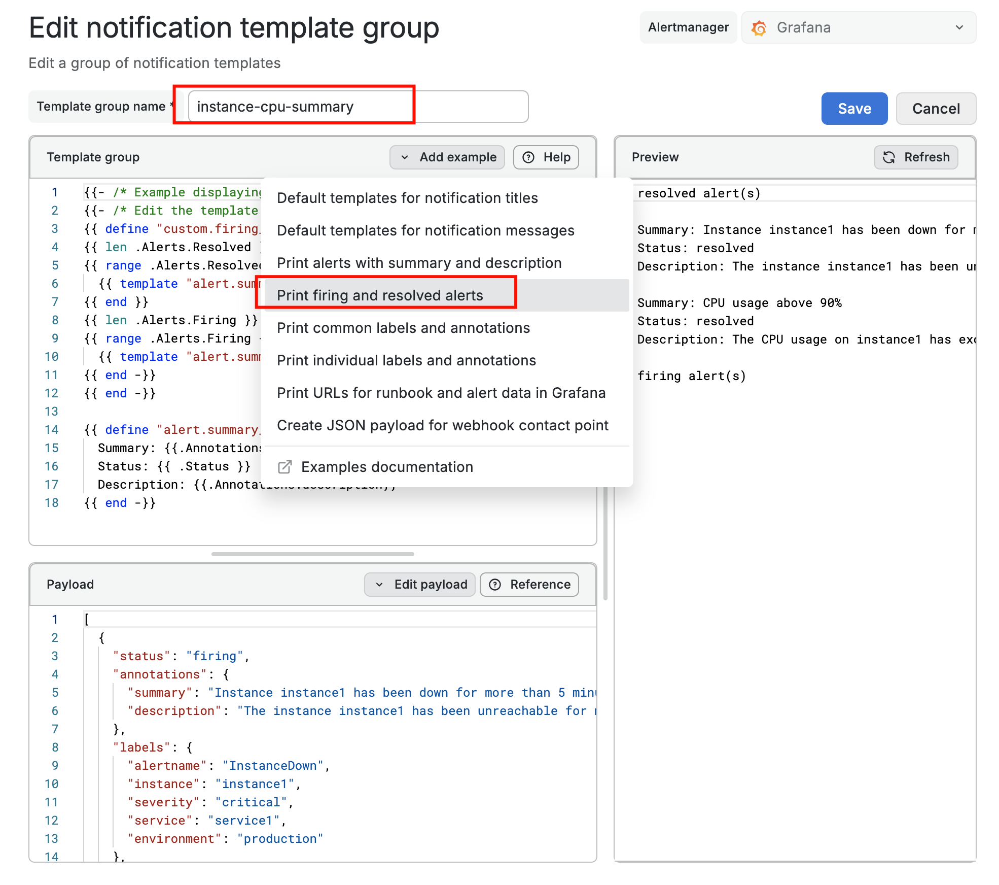
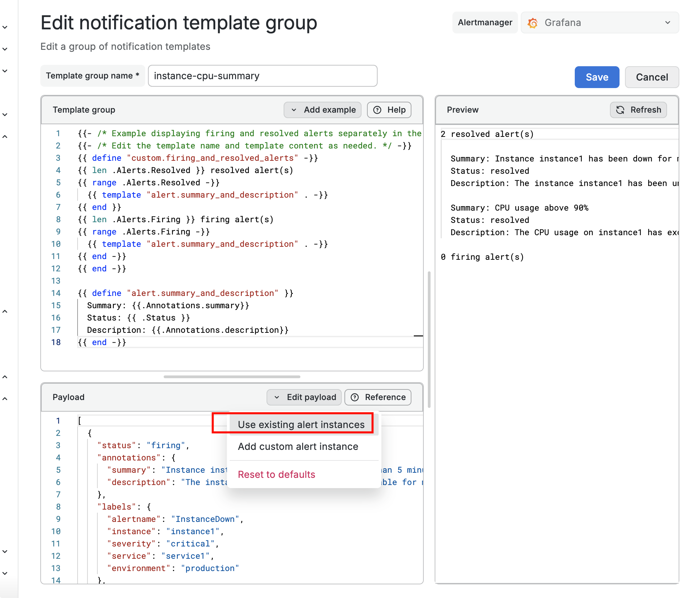
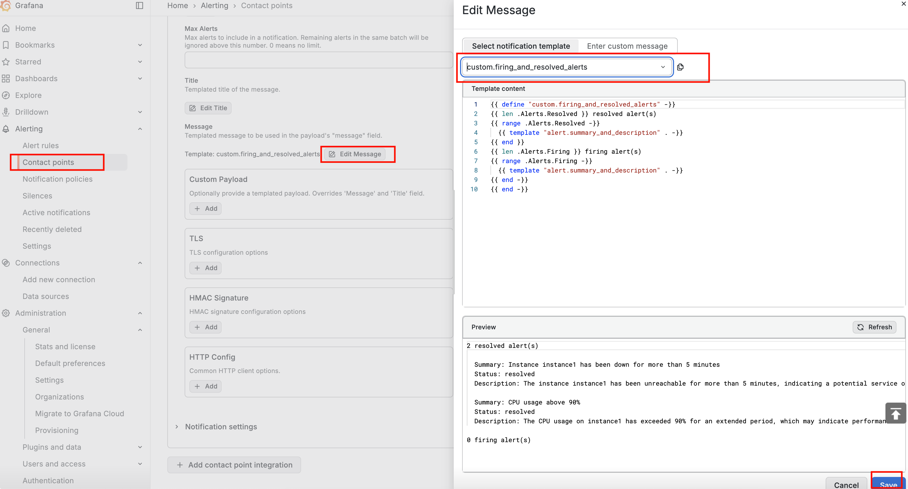

# Grafana-04-告警-配置通知模板

## 概述

在Grafana告警系统中使用模板，可以**动态地插入特定告警规则数据**，从而创建**更灵活、信息更丰富的告警通知消息**。

### 两种模板类型

1.  **标签和注释模板（labels and annotations templates）** - 应用于告警规则层面
2.  **通知模板（notification templates）** - 应用于通知格式层面

**共同技术基础**：两者都使用 **Go模板语言**。



## 标签和注释模板

### 定义与位置

-   **标签** 和 **注释** 是应用模板的主要字段
-   位于告警规则配置中

### 主要优势

通过在注释中使用模板，可以：

1.  **整合查询中的动态数据**，使告警反映触发条件的实时相关信息
2.  **自定义每个告警实例的内容**，如包含实例名称和指标数值
3.  让通知**更具信息性和可操作性**

### 注释字段

-   **摘要** - 简要说明告警内容
-   **描述** - 提供详细信息和处理建议

**示例配置**：

```go
{{/*使用 index 函数 + 引号字符串 来访问变量*/}}
{{/*\n 换行符；\t 制表符*/}}
{{- "\n" -}}
Instance: {{ index $labels "instance" }}
{{- "\t" -}} Usage: {{ index $values "A"}}%{{- "\n" -}}
```

或

```yaml
annotations:
  summary: "{{ index $labels "instance" }} CPU使用率过高"
  description: |
    实例 {{ index $labels "instance" }} 的CPU使用率已达到 {{ index $values "A" }}%，超过阈值 {{ $threshold }}%。请立即检查。
```

## 通知模板

### 核心功能

通知模板能够：

1.  **从注释中提取详细信息**：自动获取告警规则中定义的`summary`和`description`
2.  **跨渠道复用**：同一模板可在不同联系点（邮件、Slack、短信等）重复使用
3.  **智能分组展示**：按状态将告警分为不同区域（触发中/已解决）
4.  **统一消息结构**：创建标准化的通知布局

### 应用场景

特别适合处理**多个告警实例同时触发**的情况，例如：

-   多个实例的CPU使用率过高
-   多台服务器的磁盘空间不足
-   多个服务的响应时间超时

**举例：大规模CPU告警事件**

**无模板时的混乱状况**：

```
15:00:01 - CPU告警：server-01使用率95%
15:00:02 - CPU告警：server-02使用率93%  
15:00:03 - CPU告警：server-03使用率97%
15:00:04 - CPU告警：server-04使用率91%
...（共计15条独立消息）
```


**使用通知模板后的优化效果**：

```
🚨 **CPU使用率告警汇总** [15:00]
================================

🔥 正在触发的告警（15个实例）：
--------------------------------
📊 **整体概况**
• 受影响服务器：15台
• 平均使用率：94.2%
• 最高使用率：server-03 (97%)
• 首次触发：15:00:01

📋 **详细清单**
1. server-03 - 97%（超过阈值17%）
2. server-01 - 95%（超过阈值15%）
3. server-02 - 93%（超过阈值13%）
...（按严重程度排序）

🛠️ **建议操作**
1. 检查是否存在批量作业运行
2. 查看负载均衡器状态
3. 考虑临时扩容处理

📍 **快速链接**
• 监控仪表板：https://grafana/dashboards/cpu
• 应急手册：https://wiki/oncall/cpu-emergency
• 屏蔽规则：https://alerts/silence/new
================================
```

## 创建模板

### 标签和注释模板

创建告警规则，配置注释模板



### 通知模板





可以拿告警规则来预览一下



### 将模板应用到联系点


