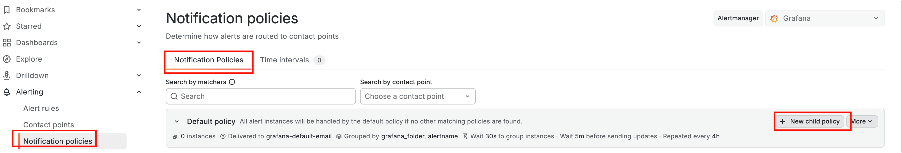
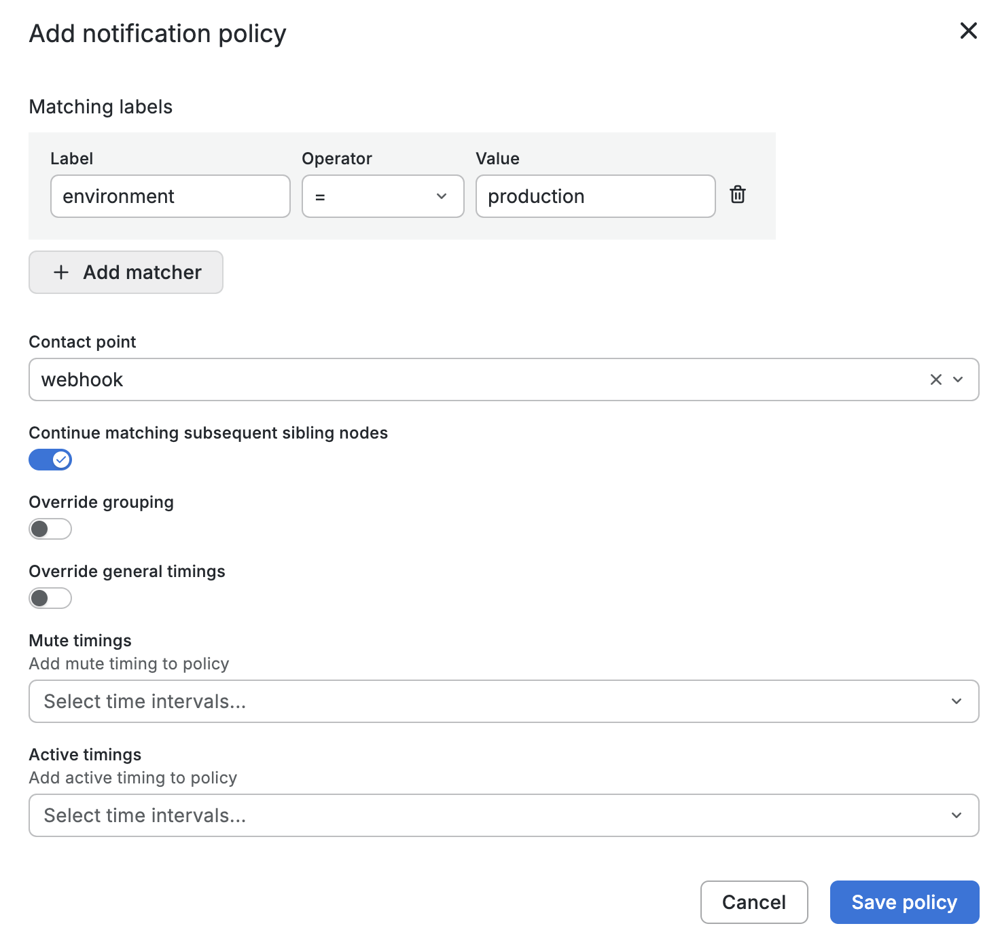
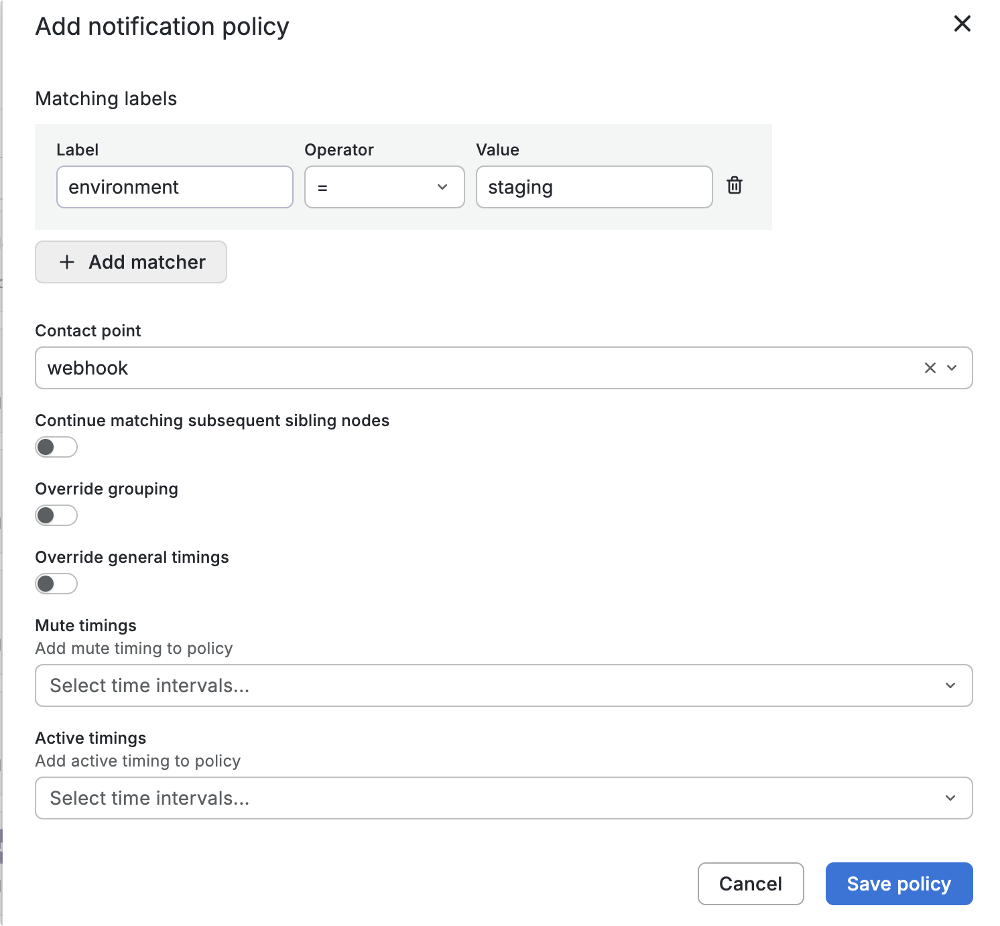
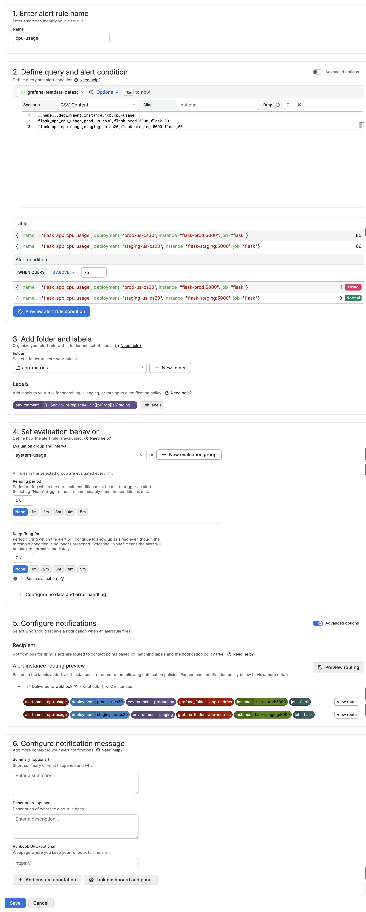
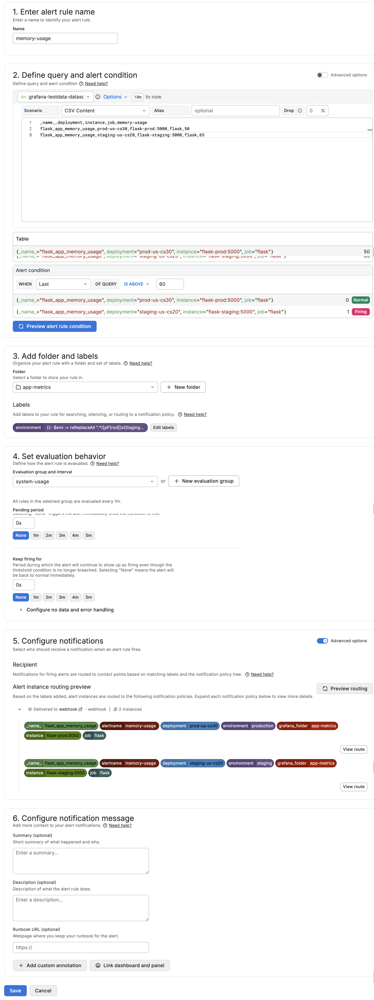
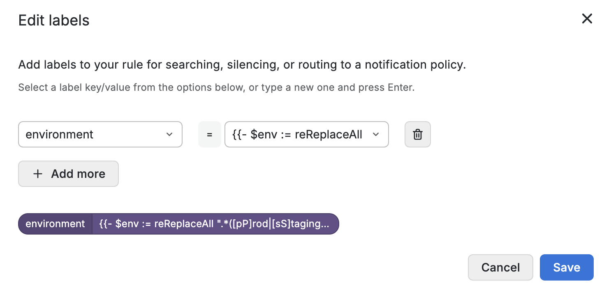

# Grafana-05-告警-基于动态标签的路由告警

## 概述

在管理Web应用或服务器集群时，虽然监控CPU、内存和磁盘使用率至关重要，但告警管理不当会导致团队被频繁通知。

可以根据动态标签来区分不同的环境或者不同的告警级别，然后通知策略会根据动态标签把不同的告警推送到不同的联系点。

## 创建动态标签

### 创建通知策略







### 创建告警规则

1.   cpu-usage



2.   Memory-usage





```go
{{- $env := reReplaceAll ".*([pP]rod|[sS]taging|[dD]ev).*" "${1}" $labels.instance -}}
{{- if eq $env "prod" -}}
production
{{- else if eq $env "staging" -}}
staging
{{- else -}}
development
{{- end -}}
```

