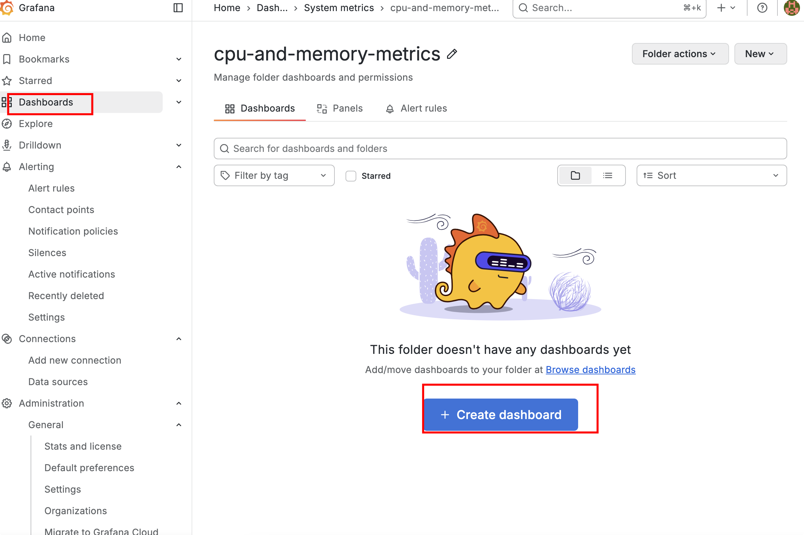
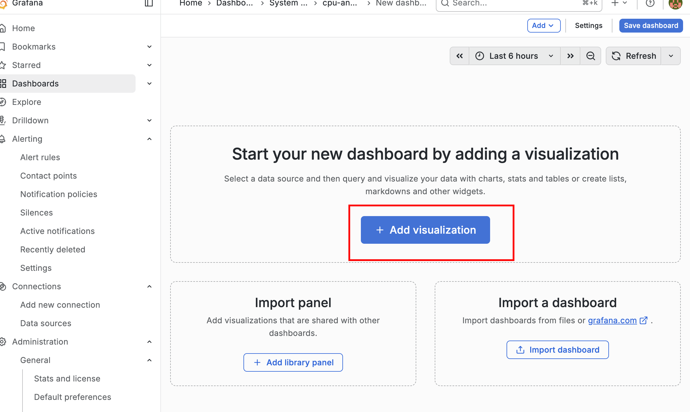
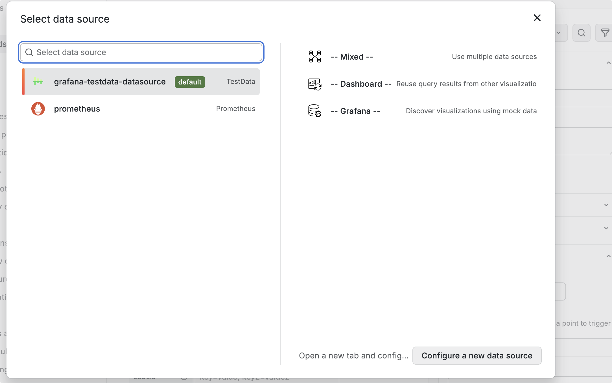
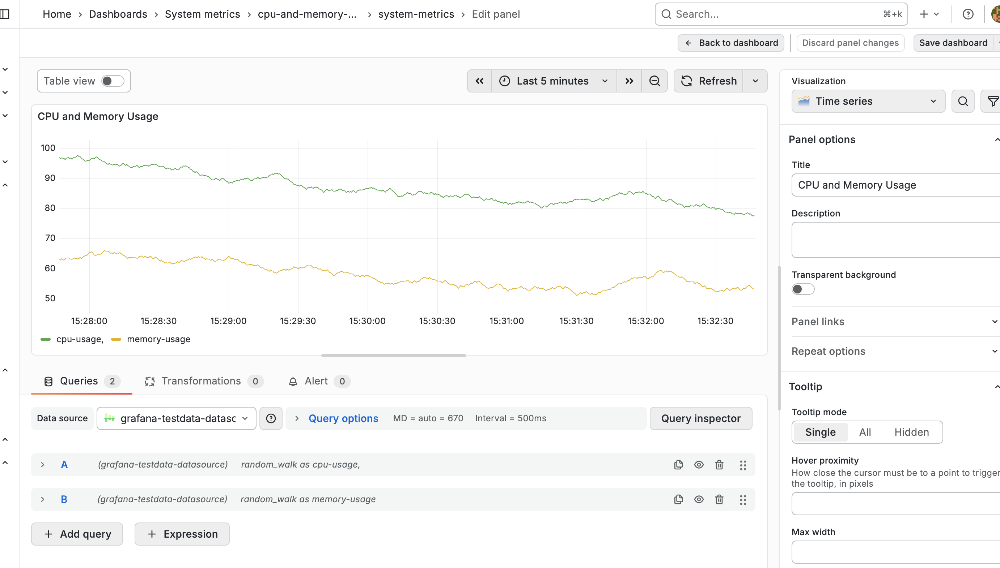
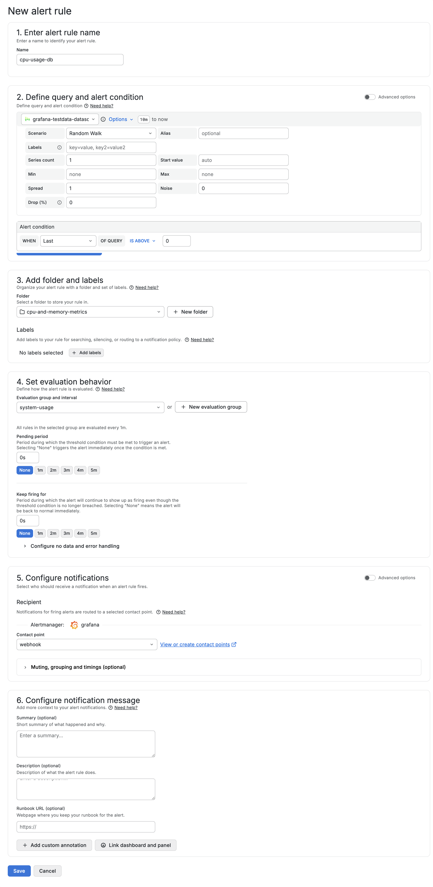
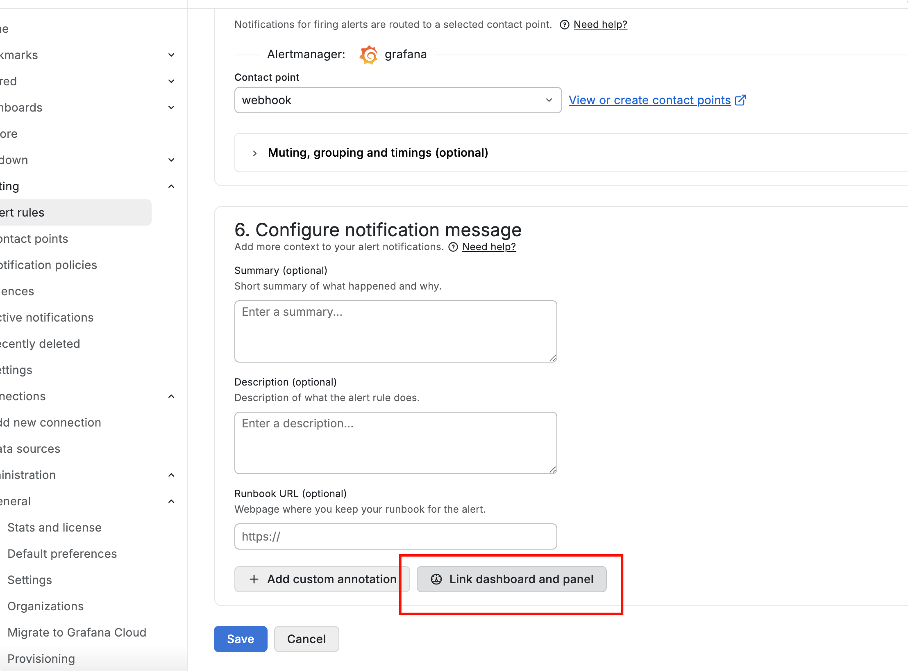
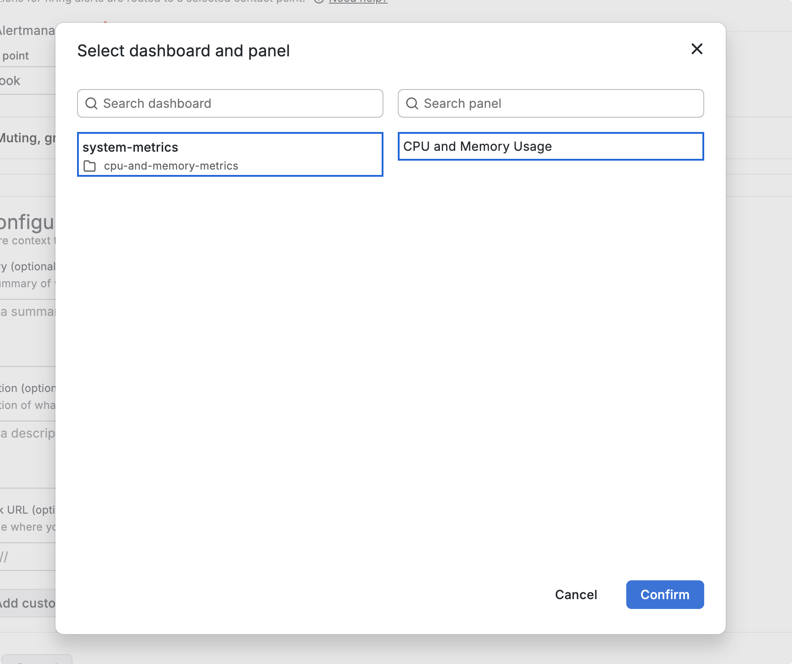
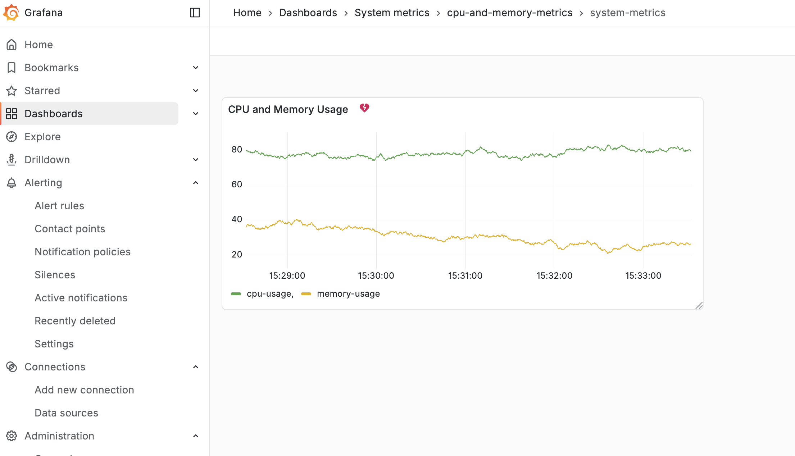
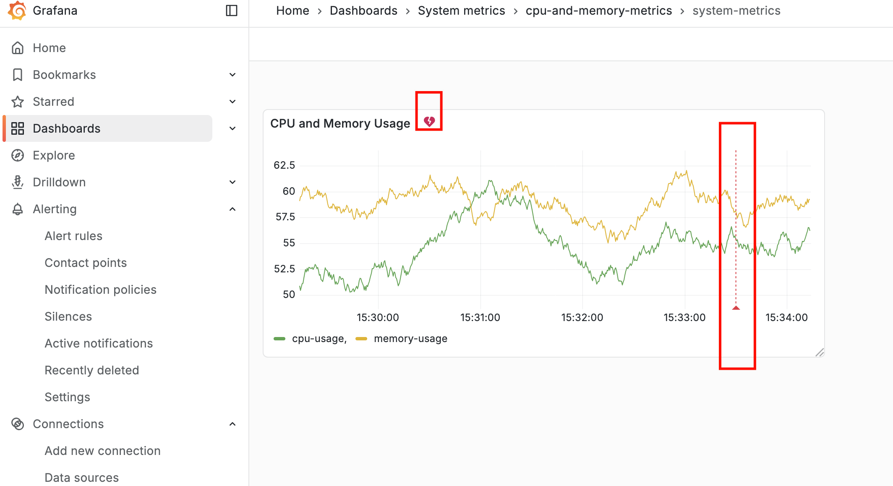

# Grafana-06-告警-将告警关联到可视化图表

## 概述

通过将告警紧密链接到可视化图表后

-   **快速定位问题**：从告警直接跳转到相关数据视图

-   **丰富上下文**：在数据可视化的背景下理解告警
-   **提高诊断效率**：一站式查看数据、告警和处理建议

## 配置可视化告警

### 创建Dashboard

### 创建告警规则

### 关联图表

