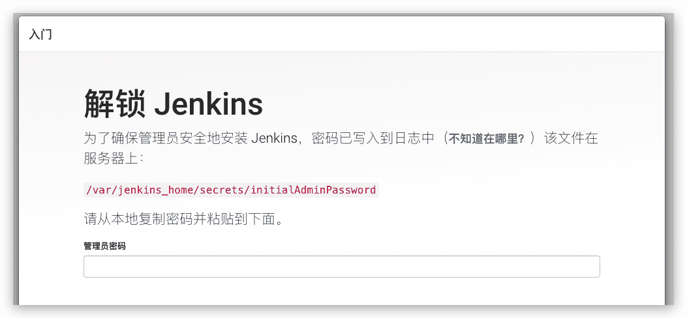
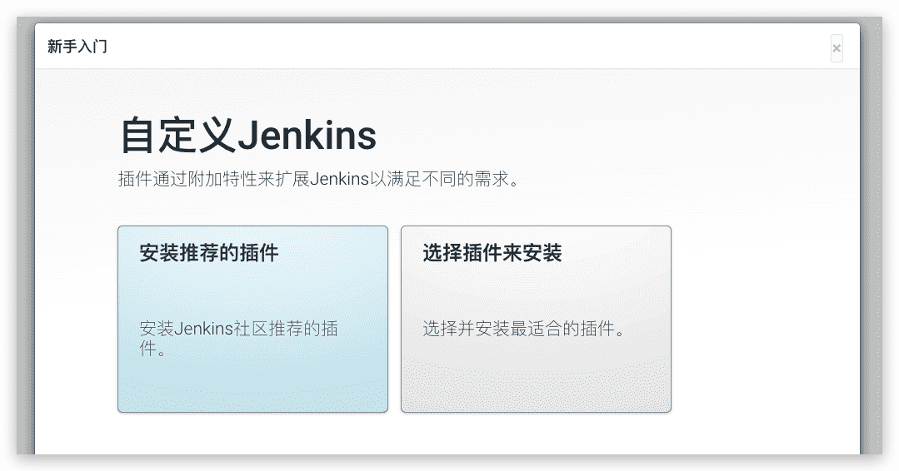
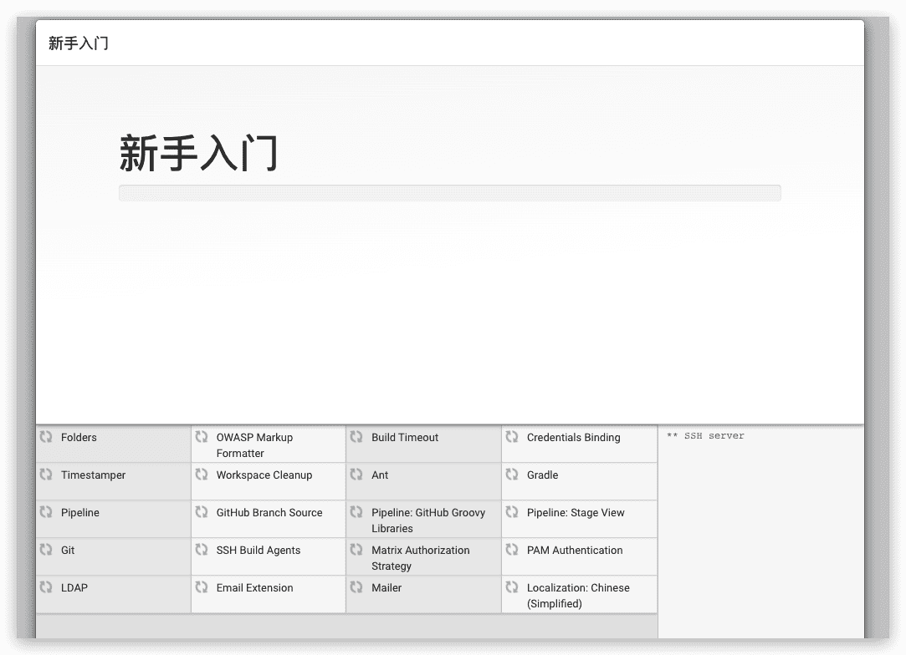
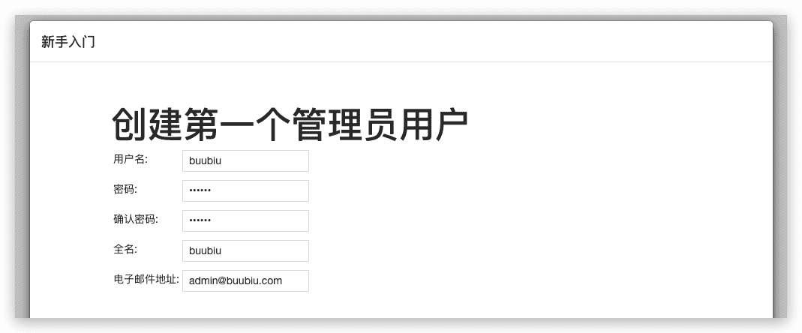
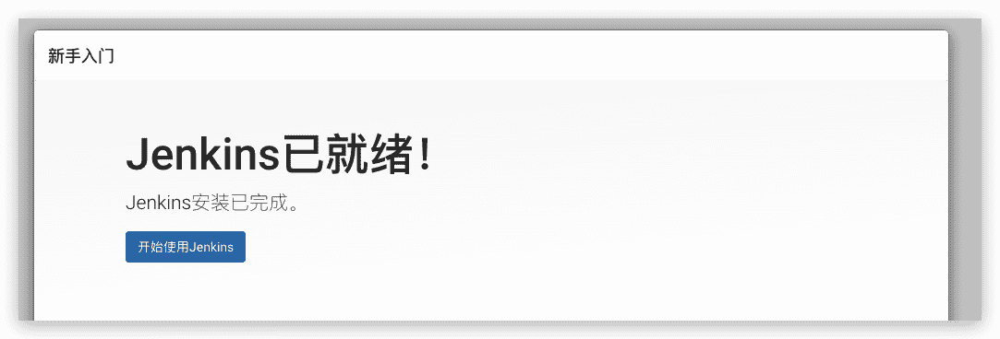

# Jenkins的介绍与安装

## Jenkins是什么

Jenkins是一款开源 CI&CD 软件，用于自动化各种任务，包括构建、测试和部署软件。

Jenkins 支持各种运行方式，可通过系统包、Docker 或者通过一个独立的 Java 程序。

## 安装Jenkins

### Docker方式

```sh
# 8080：控制台端口 
# 50000：基于JNLP的Jenkins代理通过TCP端口50000与Jenkins主站进行通信
# root：用root用户执行，否则服务挂载目录，提示copy失败，无权限
# /var/jenkins_home：jenkins的工作目录
# /var/run/docker.sock：若想Jenkins支持控制docker,挂载这个(只有Linux支持)
# /usr/bin/docker：本地docker命令所在目录挂载出来，否则jenkins不能支持docker命令(只有Linux支持)
$ docker run \
  -u root \
  -d \
  -p 8080:8080 \
  -p 50000:50000 \
  -v /opt/jenkins/jenkins_home:/var/jenkins_home \
  -v /var/run/docker.sock:/var/run/docker.sock \
  -v /usr/bin/docker:/usr/bin/docker \
  --name jenkins \
  jenkins/jenkins:latest-jdk8
```

可通过查看日志查看初始密码：

```sh
$ docker logs -f jenkins
*************************************************************

*************************************************************

*************************************************************


Jenkins initial setup is required. An admin user has been created and a password generated.

Please use the following password to proceed to installation:


7c227bb4453b411c8db81a31116d56ae


This may also be found at: /var/jenkins_home/secrets/initialAdminPassword


*************************************************************

*************************************************************

*************************************************************


2021-12-20 07:42:39.909+0000 [id=34] INFO jenkins.InitReactorRunner$1#onAttained: Completed initialization

2021-12-20 07:42:40.484+0000 [id=21] INFO hudson.WebAppMain$3#run: Jenkins is fully up and running
```


### WAR包方式

Jenkins的Web应用程序ARchive（WAR）文件版本可以安装在任何支持Java的操作系统或平台上。

**要下载并运行Jenkins的WAR文件版本，请执行以下操作:**

1. 将[最新的稳定Jenkins WAR包](https://github.com/jenkinsci/jenkins/releases) 下载到您计算机上的相应目录。

2. 在下载的目录内打开一个终端/命令提示符窗口到。

3. 运行命令`java -jar jenkins.war`，也可以指定端口：`java -jar jenkins.war --httpPort=9090`

4. 浏览http://localhost:8080并等到*Unlock Jenkins*页面出现。

   

**Notes:**

- 不像在Docker中下载和运行有Blue Ocean的Jenkins，这个过程不会自动安装Blue Ocean功能， 这将分别需要在jenkins上通过 [**Manage Jenkins**](https://www.jenkins.io/zh/doc/book/managing) > [**Manage Plugins**](https://www.jenkins.io/zh/doc/book/managing/plugins/)安装。 在[Getting started with Blue Ocean](https://www.jenkins.io/zh/doc/book/blueocean/getting-started/)有关于安装Blue Ocean的详细信息 。.
- 您可以通过`--httpPort`在运行`java -jar jenkins.war`命令时指定选项来更改端口。例如，要通过端口9090访问Jenkins，请使用以下命令运行Jenkins： `java -jar jenkins.war --httpPort=9090`

### Linux二进制

#### Debian/Ubuntu

在基于Debian的发行版（如Ubuntu）上，您可通过`apt`安装Jenkins

每 12 周从常规版本流中选择一个[LTS（长期支持）](https://www.jenkins.io/download/lts/)版本作为该时间段的稳定版本。它可以从[`debian-stable`apt 存储库](https://pkg.jenkins.io/debian-stable/)安装。

```sh
$ curl -fsSL https://pkg.jenkins.io/debian-stable/jenkins.io.key | sudo tee \
  /usr/share/keyrings/jenkins-keyring.asc > /dev/null
$ echo deb [signed-by=/usr/share/keyrings/jenkins-keyring.asc] \
  https://pkg.jenkins.io/debian-stable binary/ | sudo tee \
  /etc/apt/sources.list.d/jenkins.list > /dev/null
$ sudo apt-get update
$ sudo apt-get install jenkins
```

安装这个软件包将会：

- 将Jenkins设置为启动时启动的守护进程。查看`/etc/init.d/jenkins`获取更多细节
- 创建一个`jenkins`用户来运行此服务
- 直接将控制台日志输出到文件`/var/log/jenkins/jenkins.log`。如果您正在解决Jenkins问题，请检查此文件
- `/etc/default/jenkins`为启动填充配置参数，例如`JENKINS_HOME`
- 将Jenkins设置为在端口8080上进行监听。使用浏览器访问此端口以开始配置

>如果你的`/etc/init.d/jenkins`文件无法启动Jenkins，编辑`/etc/default/jenkins`， 修改 `----HTTP_PORT=8080----`为`----HTTP_PORT=8081----` 在这里，“8081”也可被换为其他可用端口。

#### Fedora

```sh
sudo wget -O /etc/yum.repos.d/jenkins.repo \
    https://pkg.jenkins.io/redhat-stable/jenkins.repo
sudo rpm --import https://pkg.jenkins.io/redhat-stable/jenkins.io.key
sudo dnf upgrade
# Add required dependencies for the jenkins package
sudo dnf install chkconfig java-devel
sudo dnf install jenkins
```

##### Start Jenkins

Register the Jenkins service with the command:

```sh
sudo systemctl daemon-reload
```

You can start the Jenkins service with the command:

```sh
sudo systemctl start jenkins
```

You can check the status of the Jenkins service using the command:

```sh
sudo systemctl status jenkins
```

If everything has been set up correctly, you should see an output like this:

```sh
Loaded: loaded (/etc/rc.d/init.d/jenkins; generated)
Active: active (running) since Tue 2018-11-13 16:19:01 +03; 4min 57s ago
```

#### Red Hat / CentOS

每 12 周从常规版本流中选择一个[LTS（长期支持）](https://www.jenkins.io/download/lts/)版本作为该时间段的稳定版本。它可以从[`debian-stable`apt 存储库](https://pkg.jenkins.io/debian-stable/)安装。

```sh
sudo wget -O /etc/yum.repos.d/jenkins.repo \
    https://pkg.jenkins.io/redhat-stable/jenkins.repo
sudo rpm --import https://pkg.jenkins.io/redhat-stable/jenkins.io.key
sudo yum upgrade
sudo yum install epel-release java-11-openjdk-devel
sudo yum install jenkins
sudo systemctl daemon-reload
```

##### Start Jenkins

You can start the Jenkins service with the command:

```sh
sudo systemctl start jenkins
```

You can check the status of the Jenkins service using the command:

```sh
sudo systemctl status jenkins
```

If everything has been set up correctly, you should see an output like this:

```sh
Loaded: loaded (/etc/rc.d/init.d/jenkins; generated)
Active: active (running) since Tue 2018-11-13 16:19:01 +03; 4min 57s ago
...
```

## 简单的初始配置

1. 浏览器访问http://localhost:8080/，并输入安装后得到的密码

   

2. 紧接着有两个选项
   - **安装建议的插件** - 安装推荐的一组插件，这些插件基于最常见的用例.（新手推荐）
   - **选择要安装的插件** - 选择安装的插件集。当你第一次访问插件选择页面时，默认选择建议的插件。





## 创建第一个管理员用户

安装好插件后，会提示创建用户：




