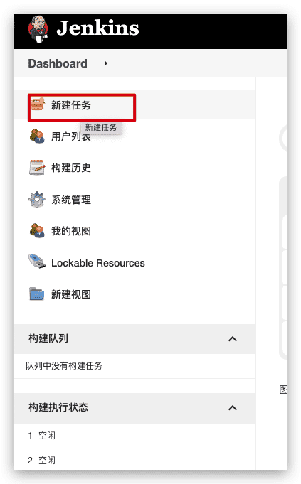
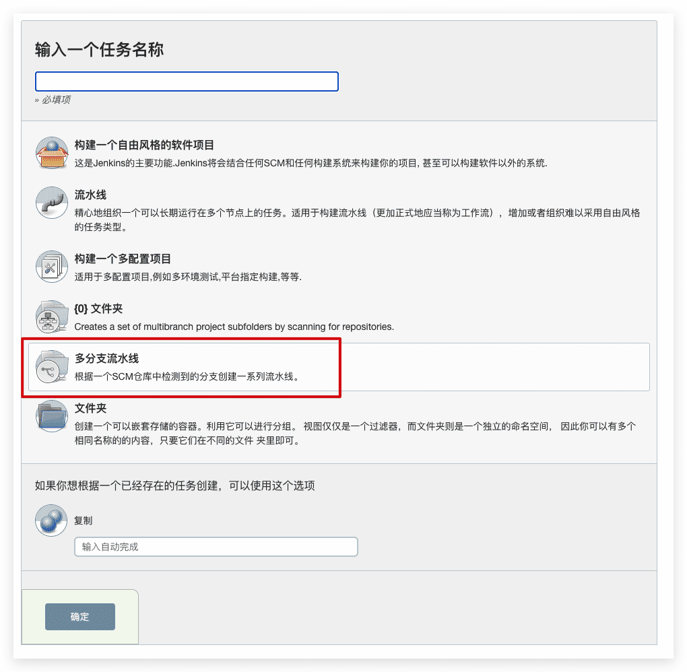
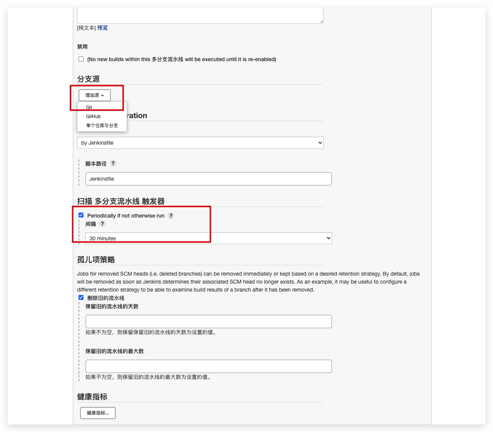

# Jenkins创建多分支pipeline

## 介绍

**Multibranch Pipeline** 项目类型能够 在同一个项目的不同分支上实现不同的Jenkinsfile。 在多分支流水线项目中, Jenkins 自动的发现, 管理和执行在源代码控制中包含`Jenkinsfile`的分支的流水线。

这消除了手动创建和管理流水线的需要。

## 操作步骤

1. 点击新建任务

   

2. 选择多分支流水线

   

3. 添加 **分支源** (比如, Git) 并输入仓库的位置

4. 默认情况下， Jenkins 不会自动的重新索引分支添加或删除的仓库(除非使用 [组织文件夹](https://www.jenkins.io/zh/doc/book/pipeline/multibranch/#organization-folders)), 所以周期性地重新索引有助于配置多分支流水线：

   

5. 点击保存，等待系统自动创建多分支job
