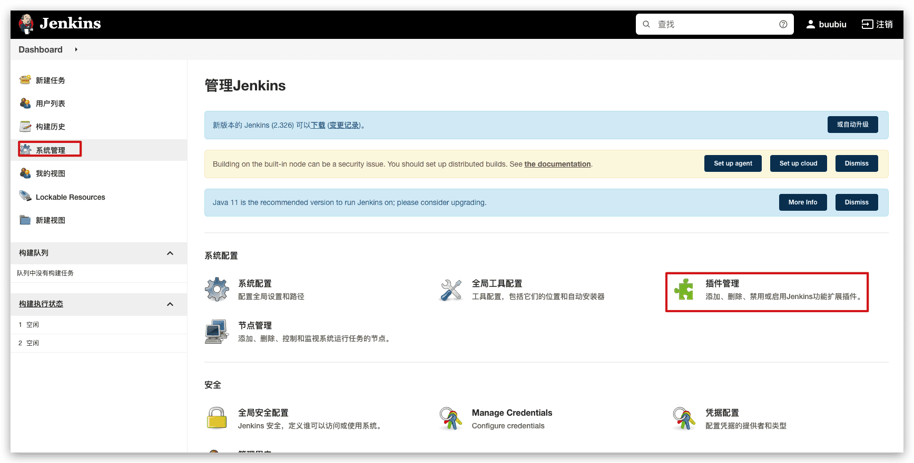
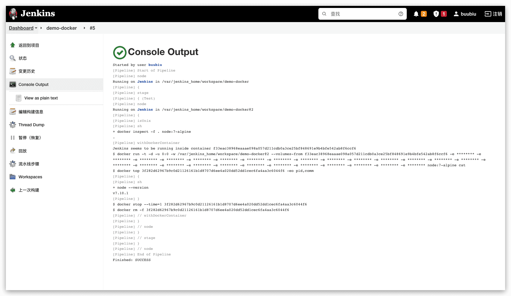
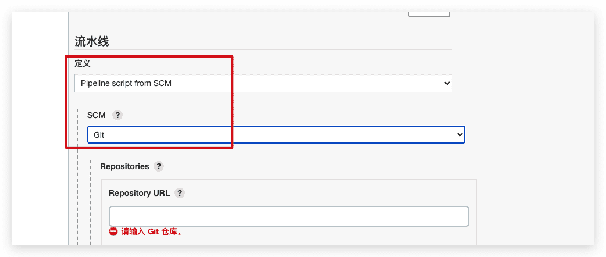
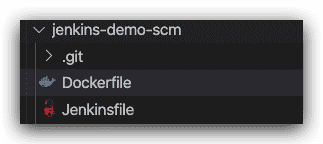
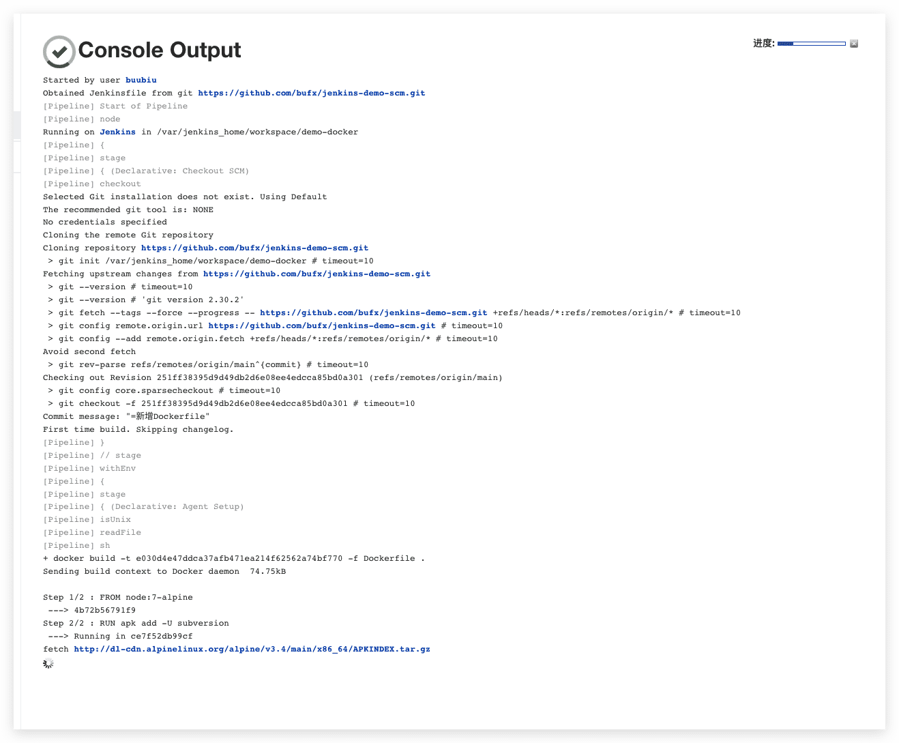
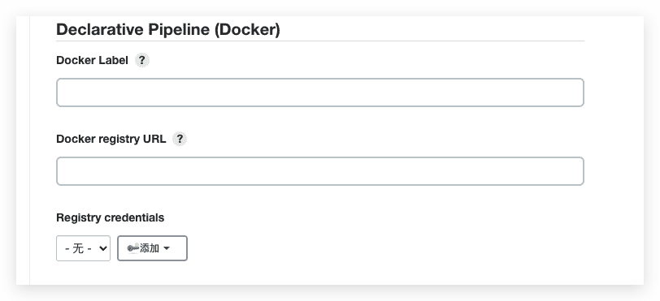

# Jenkins 在Pipeline中使用Docker

pipeline插件从2.5版本开始就内置了Docker插件，与之前不同的，在agent部分我们将node换成了docker。

## 安装docker插件

在插件仓库安装插件 `Docker Pipeline`，会自动安装依赖插件。



## 使用方法

在Pipeline中操作Docker，既可以用作全局环境，也可以每个stage的环境。

### 在镜像中执行命令

#### 参数

`docker`：表示使用docker

`image`：指定镜像

#### 示例

```groovy
pipeline {
  //在全局环境中使用docker
  agent {
    docker { image 'node:7-alpine' }//定义镜像
  }
  stages {
    stage('Test') {
      steps {
        // 在镜像 node:7-alpine 中执行该命令
        sh 'node --version'
      }
    }
  }
}

//或者
pipeline {
  agent any
  stages {
    stage('Test') {
      //在每个stage中使用docker
      agent {
        docker { image 'node:7-alpine' }
      }
      steps {
        sh 'node --version'
      }
    }
  }
}
```

#### 执行结果



### 为容器添加运行参数

这个功能也可以实现 Jenkins 缓存数据。

#### 参数

`args`：字符串类型，Jenkins执行docker run命令时所带的参数，如 -v -e 等

#### 示例

```groovy
pipeline {
  agent {
    docker {
      image 'maven:3-alpine'
      //// 为容器添加运行参数 把宿主机的maven的仓库挂载容器中
      args '-v $HOME/.m2:/root/.m2'
    }
  }
  stages {
    stage('Build') {
      steps {
        // 在容器中执行该命令
        sh 'mvn --version'
      }
    }
  }
}
```

### 在多个容器中执行命令

#### 示例

```groovy
pipeline {
  agent none
  stages {
    stage('Back-end') {
      agent {
        docker { image 'maven:3-alpine' }// 定义镜像一
      }
      steps {
        // 在容器一中执行命令
        sh 'mvn --version'
      }
    }
    stage('Front-end') {
      agent {
        docker { image 'node:7-alpine' }// 定义镜像二
      }
      steps {
        // 在容器二中执行命令
        sh 'node --version'
      }
    }
  }
}
```

### 使用Dockerfile

#### 参数

`dockerfile true`：表示用从 `Dockerfile` 中构建一个新的镜像而不是从 [Docker Hub](https://hub.docker.com/)中拉取一个

#### 示例

需要将流水线定义成SCM模式



1. 首先新建一个Dockerfile

   ```dockerfile Dockerfile
   FROM node:7-alpine
   
   RUN apk add -U subversion
   ```

2. 然后在新建Jenkinsfile编写pipeline

   ```groovy Jenkinsfile
   pipeline {
       agent { dockerfile true }
       stages {
           stage('Test') {
               steps {
                   sh 'node --version'
                   sh 'svn --version'
               }
           }
       }
   }
   ```

   



#### 执行结果



### 指定Docker标签（暂时没搞懂）

默认情况下，Pipeline 假定任何配置的 代理都能够运行基于 Docker 的 Pipelines。对于具有 macOS、Windows 或其他代理的 Jenkins 环境，无法运行 Docker 守护程序，此默认设置可能有问题。Pipeline 在Manage Jenkins页面和 文件夹 级别提供了一个全局选项，用于指定使用哪些代理（通过 Label）来运行基于 Docker 的管道。

配置路径：`系统管理--系统配置-- Declarative Pipeline（Docker）`



- Docker Label：当 pipeline 中的 agent 部分没有指定 label 选项时，就会使用此配置。如docker {image'maven：3-alpine'}。
- Docker registry URL：Docker私有仓库地址，或其他地址
- Registry credentials：登录Docker私有仓库的凭证。

## 高级用法

### 运行sidecar容器

在 Pipeline 中使用 Docker 是运行构建或一组测试可能依赖的服务的有效方法。与[sidecar 模式](https://docs.microsoft.com/en-us/azure/architecture/patterns/sidecar)类似 ，Docker Pipeline 可以“在后台”运行一个容器，同时在容器中执行工作。利用这种 sidecar 方法， Pipeline 可以为每个 Pipeline 运行提供一个“干净”的容器。

#### 举例一

假设有一个集成测试套件，它依赖于要运行的本地 MySQL 数据库。使用`withRun`在[Docker Pipeline](https://plugins.jenkins.io/docker-workflow)插件支持 Scripted Pipeline 中实现的方法， `Jenkinsfile`可以将 MySQL 作为 sidecar 运行：

```groovy
node {
  checkout scm
  /*
     * In order to communicate with the MySQL server, this Pipeline explicitly
     * maps the port (`3306`) to a known port on the host machine.
     * 将这个镜像的3306端口映射到主机了，这样就可以为jenkins提供测试环境了，而无需在本地安装mysql了
     */
  docker.image('mysql:5').withRun('-e "MYSQL_ROOT_PASSWORD=my-secret-pw" -p 3306:3306') { c ->
    /* Wait until mysql service is up */
    sh 'while ! mysqladmin ping -h0.0.0.0 --silent; do sleep 1; done'
    /* Run some tests which require MySQL */
    sh 'make check'
  }
}
```

#### 举例二

这个例子可以更进一步，同时使用两个容器。一个运行 MySQL 的“sidecar”，另一个通过使用 Docker [容器链接](https://docs.docker.com/engine/userguide/networking/default_network/dockerlinks/)提供[执行环境](https://www.jenkins.io/doc/book/pipeline/docker/#execution-environment)。

```groovy
node {
  checkout scm
  //最外面跑的容器是提供本次构建的测试环境的
  docker.image('mysql:5').withRun('-e "MYSQL_ROOT_PASSWORD=my-secret-pw"') { c ->
    //这个容器是在内部执行了一个命令
    //inside表示在容器内部运行命令
    // link 表示创建链接
    // c.id 是容器的ID，通过方法withRun的返回值c获取的
    docker.image('mysql:5').inside("--link ${c.id}:db") {
      /* Wait until mysql service is up */
      sh 'while ! mysqladmin ping -hdb --silent; do sleep 1; done'
      //在退出 pipeline之前可以通过ID查看docker容器日志
      sh "docker logs ${c.id}"
    }
    //这个容器在内部执行了一个需要mysql服务的命令
    docker.image('centos:7').inside("--link ${c.id}:db") {
      /*
       * Run some tests which require MySQL, and assume that it is
       * available on the host name `db`
       */
      sh 'make check'
    }
  }
}
```

### 构建镜像

#### docker.build()

Docker pipeline 插件提供了一个 `build()`方法，用于在流水线运行期间从存储库的 `Dockerfile`中创建一个新的镜像。

##### 用法一

`docker.build("my-image-name")`

在默认情况下， `build()` 方法使用当前目录（Jenkinsfile文件）下的 `Dockerfile`。

使用该语法的一个主要好处是脚本pipeline可以使用返回值进行后续 Docker pipeline调用，例如：

```groovy
node {
  checkout scm

  def customImage = docker.build("my-image:${env.BUILD_ID}")

  customImage.inside {
    //在构建好的镜像内部执行测试命令
    sh 'make test'
  }
}
```

##### 用法二

若想使用其他路径的 `Dockerfile`，可传入第二个参数，该参数是包含 `Dockerfile`文件的路径，仅是相对路径，例如，若想使用`./dockerfiles/test/Dockerfile`，则：

```groovy
node {
  checkout scm
  def testImage = docker.build("test-image", "./dockerfiles/test") 

  testImage.inside {
    sh 'make test'
  }
}
```

##### 用法三

若`build()`中有若干个参数，需要保证参数最后的字符串必须是以 **所用到的Dockerfile的路径**，比如，现在要是用这个文件构建：`./dockerfiles/Dockerfile.test`:

```groovy
node {
  checkout scm
  def dockerfile = 'Dockerfile.test'
  def customImage = docker.build("my-image:${env.BUILD_ID}", "-f ${dockerfile} ./dockerfiles") 
}
```

----

### 上传镜像到仓库

#### push()

该返回值也可以用于通过 `push()` 方法将Docker 镜像发布到 [Docker Hub](https://hub.docker.com/), 或 [custom Registry](https://www.jenkins.io/zh/doc/book/pipeline/docker/#custom-registry),比如:

```groovy
node {
    checkout scm
    def customImage = docker.build("my-image:${env.BUILD_ID}")
    customImage.push()
}
```

##### 参数

`push()` 方法接受可选的 `tag` 参数, 允许pipeline使用不同的标签 push `customImage` , 比如:

```groovy
node {
  checkout scm
  def customImage = docker.build("my-image:${env.BUILD_ID}")
  //customImage.push()
  
  //也可以指定上传不同的标签
  customImage.push('latest')
}
```

### 调用远程的docker

默认情况下，`Docker Pipeline`插件是与本地的Docker守护线程通过`/var/run/docker.sock`进行通信的，也就是说操作的docker都是本地的；要想操作远程服务器上的docker，比如 Docker 集群，要使用方法 `withServer()`。

```groovy
node {
  checkout scm
  //调用远程的docker服务来跑容器
  //第二个参数是在jenkins中设置好的认证id，填上去就可以了
  docker.withServer('tcp://swarm.example.com:2376', 'swarm-certs') {
    //跑这个镜像来提供本次测试的运行环境
    docker.image('mysql:5').withRun('-p 3306:3306') {
      /* do things */
    }
  }
}
```

### 使用自定义的docker仓库

默认情况下，`Docker Pipeline`集成采用`Docker Hub`的默认 Docker Registry 。

为了使用自定义 Docker Registry，Scripted Pipeline 的用户可以使用该`withRegistry()`方法包装步骤，传入自定义 Registry URL，例如：

#### 无身份验证的docker仓库

```groovy
node {
  checkout scm
  //自定义的docker仓库
  docker.withRegistry('https://registry.example.com') {
    //提供运行环境并执行命令
    docker.image('my-custom-image').inside {
      sh 'make test'
    }
  }
}
```

#### 有身份验证的docker仓库

对于需要身份验证的 Docker Registry，从 Jenkins 主页添加“用户名/密码”凭据项，并使用凭据 ID 作为第二个参数`withRegistry()`：

```groovy
node {
  checkout scm
  //设置自定义仓库的认证
  //第二个参数是在jenkins中设置好的认证id，填上去就可以了
  docker.withRegistry('https://registry.example.com', 'credentials-id') {
    //构建镜像
    def customImage = docker.build("my-image:${env.BUILD_ID}")
    //上传镜像
    /* Push the container to the custom Registry */
    customImage.push()
  }
}
```

