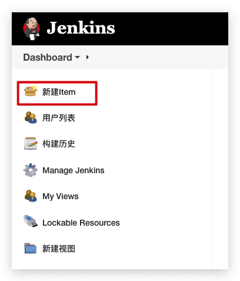
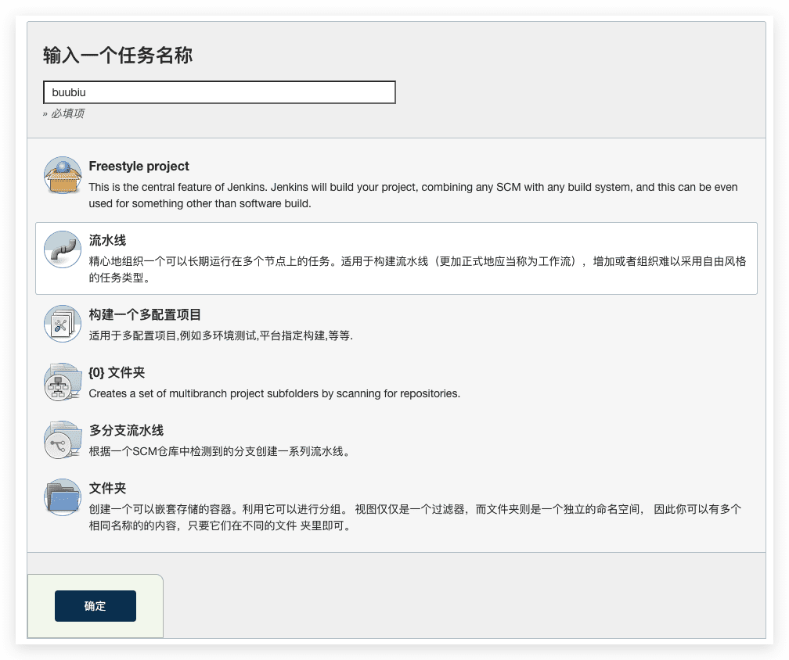
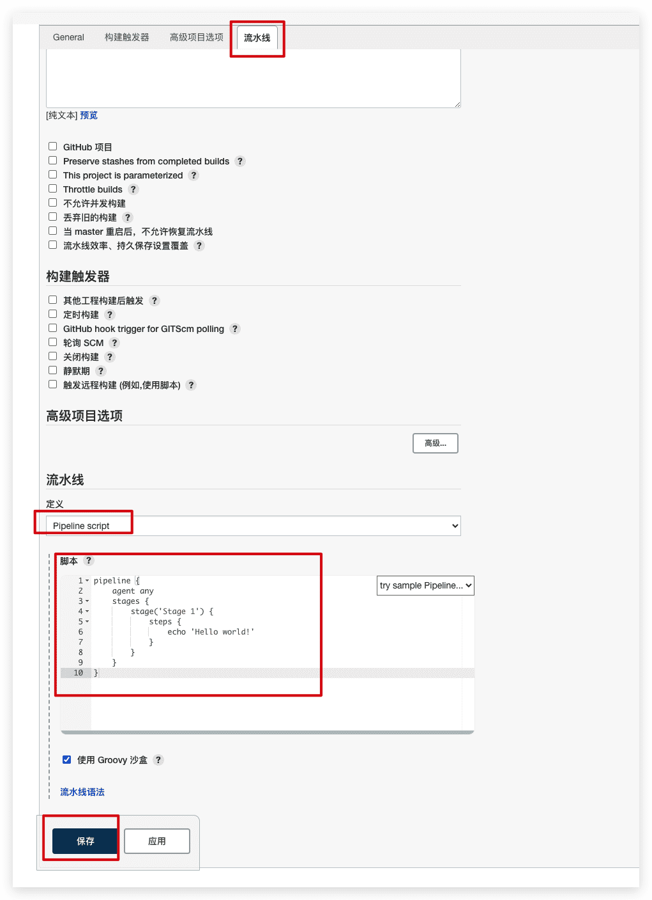
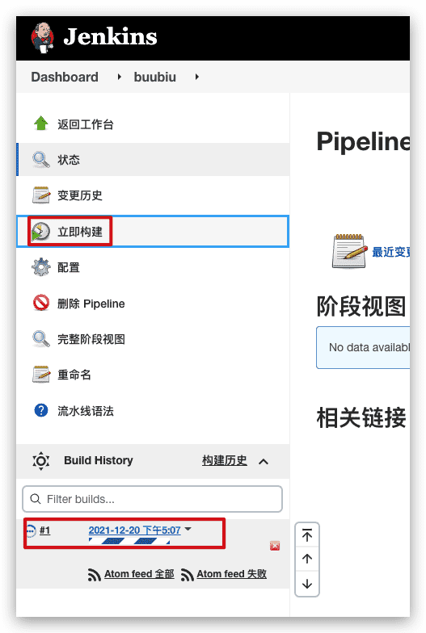
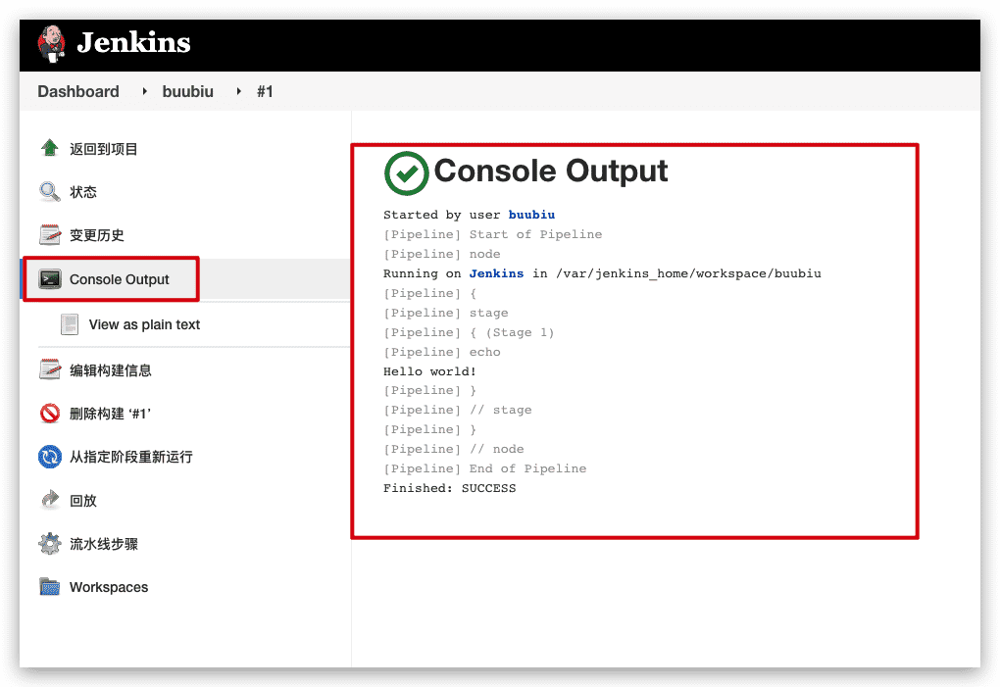
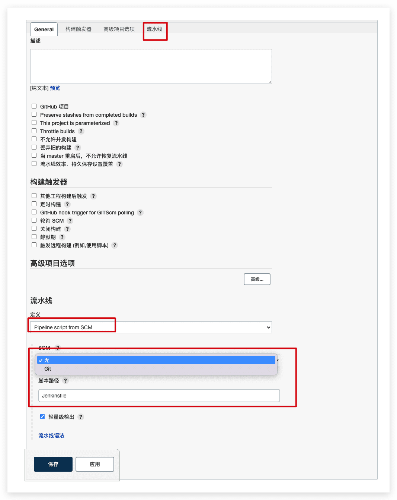

# Jenkins Pipeline使用

## 什么是Jenkins的流水线

Jenkins Pipeline（或简称为带有大写“P”的“Pipeline”）是一套插件，支持将*持续交付管道*实现和集成到 Jenkins 中。

一个*持续交付（CD）管道*是一直到你的用户和客户的过程正从版本控制软件的自动化表达。对您的软件（在源代码控制中提交）的每一次更改在发布之前都经历了一个复杂的过程。此过程涉及以可靠且可重复的方式构建软件，以及通过多个测试和部署阶段推进构建的软件（称为“构建”）。

Pipeline 提供了一组可扩展的工具，用于通过[Pipeline 域特定语言 (DSL) 语法](https://www.jenkins.io/doc/book/pipeline/syntax)对从简单到复杂的交付管道“作为代码”进行建模 

## Pipeline的定义

对Jenkins 流水线的定义被写在一个文本文件中 (称为 [`Jenkinsfile`](https://www.jenkins.io/zh/doc/book/pipeline/jenkinsfile))，该文件可以被提交到项目的源代码的控制仓库。这是"流水线即代码"的基础; 将CD 流水线作为应用程序的一部分，像其他代码一样进行版本化和审查。

`Jenkinsfile` 能使用两种语法进行编写 - 声明式和脚本化。

声明式和脚本化的流水线从根本上是不同的。 声明式流水线相较于脚本化的流水线：

- 声明式流水线提供更丰富的语法特性,
- 声明式流水线是为了使编写和读取流水线代码更容易而设计的。
- 脚本化流水线是用[Groovy 语法](http://groovy-lang.org/semantics.html)编写的

不过，许多写入 的单个语法组件（或“步骤”） `Jenkinsfile`对于声明式管道和脚本式管道都是通用的

## 创建Pipeline项目的三种方式

### 通过Blue Ocean创建

在 Blue Ocean 中设置一个流水线项目后，Blue Ocean UI 会帮你编写流水线的 `Jenkinsfile` 文件并提交到源代码管理系统。

### 通过经典UI创建（推荐）

使用经典 UI 创建的 `Jenkinsfile` 由 Jenkins 自己保存（在 Jenkins 的主目录下）。

1. 登录成功后，从Jenkins 主页（即 Jenkins 经典 UI 的工作台），点击左上的 **新建Item**。

   

2. 输入名称，点击 流水线，并确认

   >**注意：** Jenkins 使用此项目名称在磁盘上创建目录。建议避免在项目名称中使用空格，因为这样做可能会发现脚本中未正确处理目录路径中的空格的错误。

   

   3. 点击页面顶部 **流水线**选项卡，确保 **定义**字段是 **Pipeline script**选项，并写入流水线代码，保存

       

      ```groovy
      pipeline {
          agent any 
          stages {
              stage('Stage 1') {
                  steps {
                      echo 'Hello world!' 
                  }
              }
          }
      }
      ```

      - `agent` 指 Jenkins 为整个流水线分配一个执行器（在 Jenkins 环境中的任何可用代理/节点上）和工作区。
      - `echo` 写一个简单的字符串到控制台输出。
      - `node` 与上面的 `agent` 做了同样的事情。

4. 在该页面, 点击左侧的 **立即构建** 运行流水线

   

5. 在左侧的 **Build History** 下面，点击 **#1** 来访问这个特定流水线运行的详细信息。

6. 点击 **Console Output** 来查看流水线运行的全部输出。下面的输出显示你的流水线已成功运行。

   

### 通过SCM(源代码管理系统)创建

复杂的流水线如果 [通过经典UI创建](#通过经典UI创建) ，很麻烦和复杂

为简化操作，流水线的 `Jenkinsfile` 可以在文本编辑器或集成开发环境（IDE）中进行编写并提交到源码管理系统 （可选择性地与需要 Jenkins 构建的应用程序代码放在一起）。然后 Jenkins 从源代码管理系统中检出 `Jenkinsfile` 文件作为流水线项目构建过程的一部分并接着执行你的流水线。

操作步骤：

1. 按照  [通过经典UI创建](#通过经典UI创建) 上面的步骤定义你的流水线直到第3步（在流水线配置页面访问**流水线**部分）
2. 从 **定义** 字段选择 **Pipeline script from SCM** 选项。
3. 从 **SCM** 字段，选择包含 `Jenkinsfile` 文件的仓库的源代码管理系统的类型。
4. 填充对应仓库的源代码管理系统的字段。
5. 在 **脚本路径** 字段，指定你的 `Jenkinsfile` 文件的位置（和名称）。这个位置是 Jenkins 检出/克隆包括 `Jenkinsfile` 文件的仓库的位置，它应该与仓库的文件结构匹配。该字段的默认值采取名称为 "Jenkinsfile" 的 `Jenkinsfile` 文件并位于仓库的根路径。



## 创建Pipeline

对于目前最新版本的 Jenkins 来说，存在两种语法格式的 Pipeline：`脚本式 Pipeline（Scripted Pipeline）`和`声明式 Pipeline(Declarative Pipeline)`。

### 脚本式 Pipeline

脚本式 Pipeline 是早期编写 Pipelien 的语法，开发人员通过编写自己的 Groovy 脚本来定义 Pipeline，虽然这为我们提供了很强的灵活性，但需要开发者有较好的 Groovy 编程经验。

#### 格式

```groovy
node {
    stage("CodeStyle Check") {
        echo "Checking..."
    }
    stage("Build") {
        echo "Building..."
    }
    stage("Test") {
        echo "Testing..."
    }
    stage("Deploy") {
        echo "Deploying..."
    }
}
```

#### 特点

1. 最外层有`node{}`包裹
2. 可直接使用`groovy`语句

### 声明式 Pipeline（重点核心）

声明式 Pipeline 是在 Pipeline 2.5 版本中新引入的语法格式，相对于 脚本式 Pipeline 来说，声明式 Pipelien 提供了更加简洁和灵活的语法，新增了更丰富的功能，在大大降低了 Pipeline 编写难度的同时，又不失其灵活性。无论你之前是否了解过 Pipeline，声明式 Pipeline 都是你以后在编写 Pipeline 道路上的的首选方案。

#### 格式

```groovy
pipeline {
    agent any
    stages {
        stage("CodeStyle Check") {
            steps {
                echo "Checking..."
            }
        }
        stage("Build") {
            steps {
                echo "Building"
            }
        }
        stage("Test") {
            steps {
                echo "Testing"
            }
        }
        stage("Deploy") {
            steps {
                echo "Deploying"
            }
        }
    }
}
```

- `pipeline` 用于定义 Pipeline 块，所有有关 Pipeline 定义的部分必须全部被定义在该语句块内，除了 Groovy 定义的类，方法，变量等。
- `agent` 指定要执行 Pipeline 的 Jenkins 节点。
- `stages` 用来包括所有的 `stage`。
- `stage` 用来包括具体所要执行的操作。
- `steps` 用来包括要执行的指令。
- `echo` 打印字符串。

#### 特点

1. 最外层必须由`pipline{ //do something }`来进行包裹
2. 不需要分号作为分隔符，每个语句必须在一行内
3. 不能直接使用`groovy`语句（例如循环判断等），需要被script {}包裹

## Pipeline 语法

主要是介绍 声明式 Pipeline 中的语法

### pipeline

应用于全局最外层，表明该脚本为声明式pipeline

----

### agent

当我们要执行某个 Pipeline 时，必须指定执行该 Pipelien 的 Jenkins 节点，只有指定了运行节点的 Pipeline 才可以被执行。指定执行节点是通过 `agent` 来定义的。`agent` 必须被定义在 `pipeline{}` 块的最顶端，我们可以称之为全局 agent，用来为整个 Pipeline 指定一个要执行的节点。可选的，也可以在某个 `stage` 块中定义 `agent`，表明为当前 stage 指定一个执行节点，我们会在讲解 `stage` 时在具体介绍。

#### 参数列表

**`any`**

表明 Pipeline 可以在任意一个 Jenkins 节点中运行，包括 master 节点。当使用该参数时，Jenkins 会在当前空闲的节点中随意选择一个节点来运行 Pipeline。

示例：

```groovy
pipeline {
    agent any
}
```


**`label`**
通过 Jenkins 节点的 Label 属性选择节点。

示例：

```groovy
pipeline {
    agent {
        label 'Linux'
    }
}
```

该示例表明将在所有 Label 为 Linux 的节点中随机选择一个空闲的节点来执行 Pipeline。

>*注意：如果指定了一个不存在的 Label，Jenkins 会像处理离线节点那样，Job将一直等待节点上线，而并不会报出任何异常。*


**`node`**
`node` 是在 `label` 参数的基础上，添加了一些附加的选项。它是一个语句块，语句块中可以定义以下参数：

- `label`：必选参数，与 agent 的 label 参数功能一样，通过 Jenkins 节点的 Label 属性来选择适当的节点
- `customWorkspace`：可选参数，指定当前节点上执行 Pipeline 或是 Stage（在 stage 中设置了 agent）时的目录。默认情况下，当运行 Pipeline 时，Jenkins 会在工作节点机器上的默认工作目录（通过节点配置页面的 `Remote root directory` 选项指定）下创建一个与所运行 Job 同名的子目录作为 Pipeline 的执行目录。`customWorkspace` 选项可以让我们手动选择一个自定义。其值可以是一个绝对路径，也可以是一个以该节点默认的工作目录为根路径的相对路径。

示例：

```groovy
pipeline {
    agent {
      node {
          label 'Linux'
          customWorkspace '/tmp/Jenkins'
      }
  }
}
```

在这个示例中，除了我们额外使用绝对路径指定了 Pipeline 的工作目录为 `/tmp/Jenkins` 之外，其功能与使用 `label` 的示例功能完全相同。


**`none`**
只有 Pipeline 最顶端的 `agent` 可以指定为 `none` 参数，该参数表明不为当前整体 Pipeline 分配任何节点，相应地，必须在每个 `stage` 块中单独配置一个 Jenkins 节点，这样不同的 stage 可以运行在不同的 Jenkins 节点中。

示例：

```groovy
pipeline {
  //没有为当前 Pipeline 分配任何执行节点
  agent none
  stages {
    //指定 stage1 可以运行在任何一个节点中
    stage("stage1") {
      agent any
      ...
    }
    //指定 stage2 只能运行在 Label 是 Linux 的节点上
    stage("stage2") {
      agent {
        label "Linux"
      }
    }
  }
}
```

----

### stages

`stages` 是一个用来包含一个或多个 `stage` 指令的序列块，它无需任何参数。每个 Pipeline 必须有且只能有一个 `stages` 块，而且每个 `stages` 中至少需要包含一个 `stage` 指令。

而 `stage` 是用来包裹那些真正执行某些操作的指令的。每个 stage 应当包含用于去完成某个 比如构建代码，执行测试用例，部署到生产环境中去等，而这些步骤一般都被封装在各自的 `stage` 中。一个 `stages` 块中必须至少包含一个 `stage` 指令。在整个 Pipeline 中，应当有且仅有一个 `stages` 块。`stages` 在使用时不接受任何参数。

----

### stage

在编写一个 Pipeline 时，我们应当按照不同的阶段或是不同的功能，将 Pipeline 拆分成不同的阶段，比如在整个 CD 流程中，一般都至少包括 打包代码、运行自动化测试脚本以及部署等流程。`stage` 就是用来封装这些流程的，我们应当将这些流程分别定义在各自的 `stage` 中，当运行 Pipeline 时，Jenkins 会按照定义时的顺序依次执行这些流程。同时，最终生成的可视化页面也是按照 `stage` 为单位显示的。

`stage` 必须被包含在 `stages` 中，并且至少包含一个。而在每个 `stage` 中，必须包含且只能包含一个 `steps` 来执行具体的指令，或是一个 `parallel` 指令来定义需要并行执行的 `stage`，以及一些可选的如 `agent`、`environment`、`options`、`tool` 等其他指令。

#### 参数列表

`stage` 接收一个字符串参数，用来给当前 stage 命名。

示例：

```groovy
pipeline {
  agent {
    label 'Linux'
  }
  stages {
    //定义一个名为 build 的 stage
    stage("build") {
      //在该 stage 内部定义 agent，指明运行当前 stage 时所在的 Jenkins 节点
      agent {
        label 'Linux2'
      }
      //定义一个 step，这是该 stage 真正执行操作的地方。在这个示例中，通过 sh step 在节点中执行 mvn clean install 命令
      steps {
        sh 'mvn clean install'
      }
    }
    //定义一个名为 test 的 stage，该 stage 会运行在 Pipeline 中指定的节点中
    stage("test") {
      steps {
        sh "mvn test"
      }
    }
  }
}
```

----

### steps

`steps` 被定义在 `stage` 中，每个 `stage` 必须包含且只能包含一个 `steps`， 用于调用 Jenkins 中的特定指令，比如在前面的例子所中使用的 `sh` 指令。

`steps` 中除了可以调用 Jenkins 中定义的指令外，还支持 `script` 指令，在 `script` 中，我们可以定义并执行脚本式 Pipeline。

示例：

```groovy
pipeline {
  agent any
  stages {
    stage('Example') {
      steps {
        //调用 echo 指令来输出 “Hello World” 字符串
        echo 'Hello World'
        //9-14行：通过 script 指令执行 Groovy 脚本
        script {
          def browsers = ['chrome', 'firefox']
          for (int i = 0; i < browsers.size(); ++i) {
            echo "Testing the ${browsers[i]} browser"
          }
        }

      }
    }
  }
}
```

----

### environment

`environment` 指令可以帮助我们定义环境变量，当在指定的 Jenkins 节点中在执行 stage 中的指令时，定义的环境变量会被添加到节点机器的系统环境变量中去。该指令既可以被定义在 `pipeline` 最外层中，这样定义的环境变量对所有 `stage` 都有效，也可以定义在某个特定的 `stage` 中，这样定义的环境变量仅仅会应用到当前 stage 执行时所在的节点。

#### credentials 方法

`credentials` 是 `environment` 指令提供了一个附加的 helper 方法，通过将我们在 Jenkins 中定义的 credentials 时指定的 ID 作为参数传递给该方法，可以获取到该 credential 的值，并将该值赋值给指定的环境变量。使用 `credentials` 方法获取到的 credential 的值仍然是加密过的，因此用户不必担心敏感信息的泄漏问题。
如果我们不想将这些 credentials 以环境变量的形式获取，还可以使用 Jenkins 还提供的 [withCredentials](https://jenkins.io/doc/pipeline/steps/credentials-binding/) 方法。

示例：

```groovy
pipeline {
  agent any
  //4-6 行，在 Pipeline 最外层定义了一个环境变量 CC，这个环境变量可以被该 Pipeline 中的所有 stage 所引用
  environment {
    CC = 'clang'
  }
  stages {
    stage('Example') {
      //10-12行，在 stage 中定义的环境变量 AN_ACCESS_KEY，并将系统中预定义好的 ID 为 my-prefined-secret-text 的 credential 的值。该环境变量仅对当前 stage 有效
      environment {
        AN_ACCESS_KEY = credentials('my-prefined-secret-text')
      }
      steps {
        //通过执行系统的 printenv 命令里获取所有系统中所有环境变量，可以在输出中同时看到我们上面定义的 CC 和 AN_ACCESS_KEY 两个环境变量，并且 AN_ACCESS_KEY 的值是以 **** 的形式展现出来的
        sh 'printenv'
        //通过 Jenkins 中的 env 系统变量来获取指定的环境变量
        echo "${env.AN_ACCESS_KEY}"
      }
    }
  }
}
```

----

### options

`options` 指令可以让我们为当前的 Pipeline 或某个特定的 stage 设置一些附加选项。

如果该指令出现在 `pipeline` 块的最外层，则这些选项对整个 `Pipeline` 生效；

如果该指令出现在某个 `stage` 内，则这些选项设置仅对当前的 `stage` 生效。

`options` 指令中可用的选项，一部分来自于 Jenkins 自身定义好的，一部分来自于某些插件。并且对整体 Pipeline 范围来说可用的选项和 stage 范围可用的选项也不尽相同，下面让分别介绍一下在 Pipeline 级别中和 stage 级别中一些比较常用的选项。

#### Pipeline 中的可用选项

```groovy
pipeline {
  agent any
  options {
    //表示只保留最近执行的 5 个 Job 的日志和归档信息
    buildDiscarder(logRotator(numToKeepStr: '5'))
    //关闭 Pipeline 并行执行的能力
    disableConcurrentBuilds()
    //当某个 stage 执行结果状态变为 UNSTABLE 时，将跳过余下的所有 stage
    skipStagesAfterUnstable()
    //指定该 Pipeline 最多可执行 1 小时
    timeout(time: 1, unit: 'HOURS')
    //当 Pipeline 执行失败后，指定尝试重新执行该 Pipeline 的次数
    retry(3)
    //当日志信息打印到 Jenkins Job 的控制台输出页面时，同时打印出日志的时间戳信息
    timestamps()
  }
  stages {
    stage('Example') {
      steps {
        ......
      }
    }
  }
}
```


**`buildDiscarder`**
每当 Jenkins Job 被执行一次，都会产生一些日志文件，或是一些由 Job 生成的归档文件，当 Job 被执行的次数越多，生成的日志和归档文件就越多，数以千计的日志文件和归档文件不但会占用大量的系统磁盘资源，还会影响到 Jenkins 性能。因此定期清理这些无用的日志和归档文件非常重要。`buildDiscarder` 选项可以让我们选择保留该 Pipeline 最近执行的多少个 Job 的日志信息，超过这个数量的 Job 日志信息和归档文件将被自动清除。

如：`options { buildDiscarder(logRotator(numToKeepStr: '5')) }`，表示只保留最近执行的 5 个 Job 的日志和归档信息。

我们还可以直接在 Jenkins Job 的配置页面中，通过配置 `Discard old builds` 来达到同样的目的。


**`disableConcurrentBuilds`**
默认情况下，Pipeline 支持并行运行，即同一个 Pipeline 可以同时被执行多次（前提是执行 Pipeline 的 agent 设置正确）。当有些时候，我们并不希望 Pipeline 被并行执行，`disableConcurrentBuilds` 方法可以帮助我们关闭 Pipeline 并行执行的能力，如: `options { disableConcurrentBuilds() }`


**`skipStagesAfterUnstable`**
如果设定了 `skipStagesAfterUnstable` 选项，则当某个 stage 执行结果状态变为 UNSTABLE 时，将跳过余下的所有 stage。如：`options { skipStagesAfterUnstable() }`。


**`timeout`**
`timeout` 选项可用于设置 Pipeline 的最大执行时间，当超过指定时间后，Pipeline 将被自动终止。如：`options { timeout(time: 1, unit: 'HOURS') }` 指定该 Pipeline 最多可执行 1 小时。


**`retry`**
就像该参数名字的含义一样，当 Pipeline 执行失败后，我们可以通过 `retry` 参数指定尝试重新执行该 Pipeline 的次数，当尝试过指定次数后仍然失败，则 Pipeline 状态设置为失败并退出执行。如：`options { retry(3) }`。


**`timestamps`**
当日志信息打印到 Jenkins Job 的控制台输出页面时，同时打印出日志的时间戳信息。如：`options { timestamps() }`。


#### stage 中的可用的选项

这些选项在 stage 中的使用方式与在 Pipeline 中的使用方式一样，只是在 stage 中定义的选项仅对当前的 stage 有效。

**`timeout`**
设置当前 stage 的最大执行时间。


**`retry`**
设置当前 stage 执行失败后可以自动尝试重新执行的次数。


**`timestamps`**
仅为当前 stage 中的日志输出设置时间戳信息。

### parameters

虽然在创建 Jenkins job 时可以在 Job 配置页面指定执行 Job 时所需的参数，Pipeline 额外还提供了 `parameters` 指令，用于声明执行 Pipeline 时所需要的参数列表。`parameters` 指令只能被包含在 `pipeline` 块的最外层，并且在整个 Pipeline 块中只能定义一个 `parameters` 指令。

在 `parameters` 指令中支持调用两个方法：`string()` 和 `booleanParam()`， 分别用于定义一个字符串类型的参数和一个布尔值类型的参数，每个方法都可以接收以下参数：

#### 参数列表

**`name`**
必选参数，指定参数的名字。

**`defaultValue`**
指定参数的默认值，该参数为可选参数，对于字符串类型的参数来说，如果没有指定该参数，默认值为 `null`；对于布尔值类型的参数来说，如果没有指定改制，默认是为 `false`。

**`description`**
可选参数，为该参数添加描述信息，方法其他开发人员参考。

#### 示例

```groovy
pipeline {
  agent any
  //6-9行中，我们使用 parameters 指令定义了两个参数：
  //- 参数名为 PERSON 的字符串类型的，该参数默认值为 Mr Jenkins。
  //- 参数名为 DEBUG_BUILD 的布尔值类型参数，该参数默认为 true。
  parameters {
    string(name: 'PERSON', defaultValue: 'Mr Jenkins', description: 'Who should I say hello to?')
    booleanParam(name: 'DEBUG_BUILD', defaultValue: true, description: '')
  }

  stages {
    stage('Example') {
      steps {
        //通过 Jenkins 内置的 params 变量来获取这两个参数的值
        echo "Hello ${params.PERSON}"
        echo "${params.DEBUG_BUILD}"
      }
    }
  }
}
```

----

### when

`when` 指令可以帮助我们编写条件式 stage，即只有某些条件符合时，才会执行指定的 `stage` 指令，它必须定义在 `stage` 中。Jenkins 内置了许多条件表达式，让我们简单介绍一下常见的表达式。

#### 常见的表达式

**`allOf`**
至少包含一个表达式，并且当所有的表达式都为真时，才会执行该 stage。

**`anyOf`**
至少包含一个表达式，并且只要有一个条件为真，就会执行该 stage。

**`not`**
只能包含一个表达式，当该表达式为假时，就会执行该 stage。

**`environment`**
如果存在指定的环境变量，并且其值等于给定的值，则执行该 stage。

**`expression`**
当给定的 Groovy 脚本返回真时，则执行该 stage。

**`branch`**
如果当前使用的分支名与指定的分支名相同，则执行该 stage。注意，只有在多分支的 Pipeline 中才可以使用该选项。

#### `beforeAgent` 行为

默认情况下，当执行某个带有 `when` 指令的 stage 时，Jenkins 首先会进入到当前 stage 要执行的节点服务器中，然后在判断 `when` 指令中指定的条件。

如果指定 `beforeAgent` 为 `true`，则在进入到节点之前就开始进行判断，只有条件符合后才会进入到节点中执行该 stage。

#### 示例

```groovy
pipeline {
  agent any
  stages {
    stage('Example Deploy') {
      //定义 when 指令，该指令中共包含 3 个条件，when 指令默认使用 allOf，因此，只有定义的 3 个条件全部为真时，当前 stage Example Deploy 才会被执行
      when {
        //指定先对 when 中的条件进行判断，只有所有条件符合后，才会进入到某个节点中执行 steps 操作
        beforeAgent true
        //当前所操作的分支名应当为 production
        branch 'production'
        //通过 expression 指定的该表达式返回应当返回真
        expression { BRANCH_NAME ==~ /(production|staging)/ }
        //14-17行，在 anyOf 块中定义了两个表达式：执行的节点系统中存在环境变量 DEPLOY_TO，并且该值必须是 production 或 staging 中的一个值
        anyOf {
          environment name: 'DEPLOY_TO', value: 'production'
          environment name: 'DEPLOY_TO', value: 'staging'
        }
      }
      steps {
        echo 'Deploying'
      }
    }
  }
}
```

----

### tools

用于引用配置好的工具，需要提前在 **系统管理->全局工具配置**里面配置过

#### 示例

```groovy
pipeline {
  agent any
  tools {
    maven 'apache-maven-3.0.1' 
  }
  stages {
    stage('Example') {
      steps {
        sh 'mvn --version'
      }
    }
  }
}
```


### Parallel

在 Pipeline 中，默认同时只能执行一个 `stage` 块，但有些时候某些 stage 之间没有互相依赖关系，我们通常希望可以并行执行这些互相没有任何依赖的 stage，来加速整个 Pipeline 的构建速度。我们可以通过 Pipeline 提供的 `parallel` 指令来实现，该指令必须被包含在 `stage` 块中，`parallel` 中不能在嵌套其他的 `parallel`。注意，在定义了 `parallel` 的 stage 中，不能够在使用任何 `agent` 或 `tool` 等指令，如果有必须，需要在 `parallel` 中的每个 stage 中进行各自的定义。

同时，我们还可以指定，当并行执行的多个 stage 中，只要有任意一个 stage 执行失败，就可以终止所有其他并行执行的 stage，这通过设置 `failFast true` 来实现。

#### 示例

```groovy
pipeline {
  agent any
  stages {
    stage('Non-Parallel Stage') {
      steps {
        echo 'This stage will be executed first.'
      }
    }
    stage('Parallel Stage') {
      when {
        branch 'master'
      }
      //指定了 failFast true，表明 parallel 中定义的 Branch A stage 和 Branch B stage 中的任意一个执行失败，另一个则会马上停止
      failFast true
      //定义了 parralel，并在其内部定义了两个可以同时并行执行的 stage：Branch A 和 Branch B
      parallel {
        stage('Branch A') {
          //19-21行，为 ‘Branch A’ stage 指定了要执行的节点
          agent {
            label "for-branch-a"
          }
          steps {
            echo "On Branch A"
          }
        }
        stage('Branch B') {
          agent {
            label "for-branch-b"
          }
          steps {
            echo "On Branch B"
          }
        }
      }
    }
  }
}
```

----

### input

`input`指令允许暂时中断pipeline执行，等待用户输入，根据用户输入进行下一步动作

#### 示例

```groovy
pipeline {
  agent any
  stages {
    stage('Example') {
      input {
        message "Should we continue?"
        ok "Yes, we should."
        submitter "alice,bob"
        parameters {
          string(name: 'PERSON', defaultValue: 'Mr Jenkins', description: 'Who should I say hello to?')
        }
      }
      steps {
        echo "Hello, ${PERSON}, nice to meet you."
      }
    }
  }
}
```

----

### post

执行构建后的操作，根据构建结果来执行对应的操作，作用在pipeline结束后或者stage结束后。

#### 参数列表

- `always`

  无论pipeline或stage的完成状态如何，都允许在 `post` 部分运行该步骤。

- `changed`

  只有当前pipeline或stage的完成状态与它之前的运行不同时，才允许在 `post` 部分运行该步骤。

- `failure`

  只有当前pipeline或stage的完成状态为"failure"，才允许在 `post` 部分运行该步骤, 通常web UI是红色。

- `success`

  只有当前pipeline或stage的完成状态为"success"，才允许在 `post` 部分运行该步骤, 通常web UI是蓝色或绿色。

- `unstable`

  只有当前pipeline或stage的完成状态为"unstable"，才允许在 `post` 部分运行该步骤, 通常由于测试失败,代码违规等造成。通常web UI是黄色。

- `aborted`

  只有当前pipeline或stage的完成状态为"aborted"，才允许在 `post` 部分运行该步骤, 通常由于pipeline被手动的aborted。通常web UI是灰色。

#### 示例

```groovy
pipeline{
  agent any
  stages{
    stage("first stage"){
      steps("first steps"){
        echo "this is first step"
      }
    }
  }
  post{
    always{
      echo "this is ending..."
    }
  }
}
```

### 完整示例

```groovy
class myname
{
  public get() {
    print('name')
  }
}

public get() {
  print('name')
}

String name = 'zzl'

pipeline {
  agent {
    label 'Linux'
  }
  environment {
    GIT_COMMITTER_NAME = 'jenkins'
  }
  options {
    timeout(6, HOURS)
  }
  stages {
    stage('Build') {
      steps {
        sh 'mvn clean install'
      }
    }
    stage('Archive') {
      when {
        branch '*/master'
      }
      steps {
        archive '*/target/**/*'
        junit '*/target/surefire-reports/*.xml'
      }
    }
  }
  post {
    always {
      deleteDir()
    }
  }
}
```

