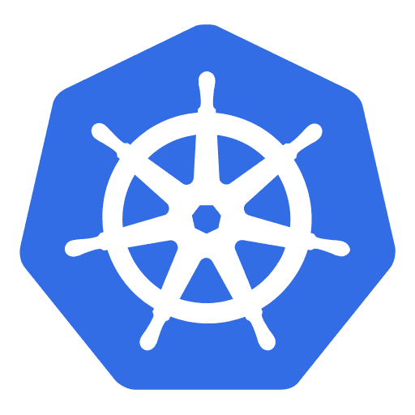
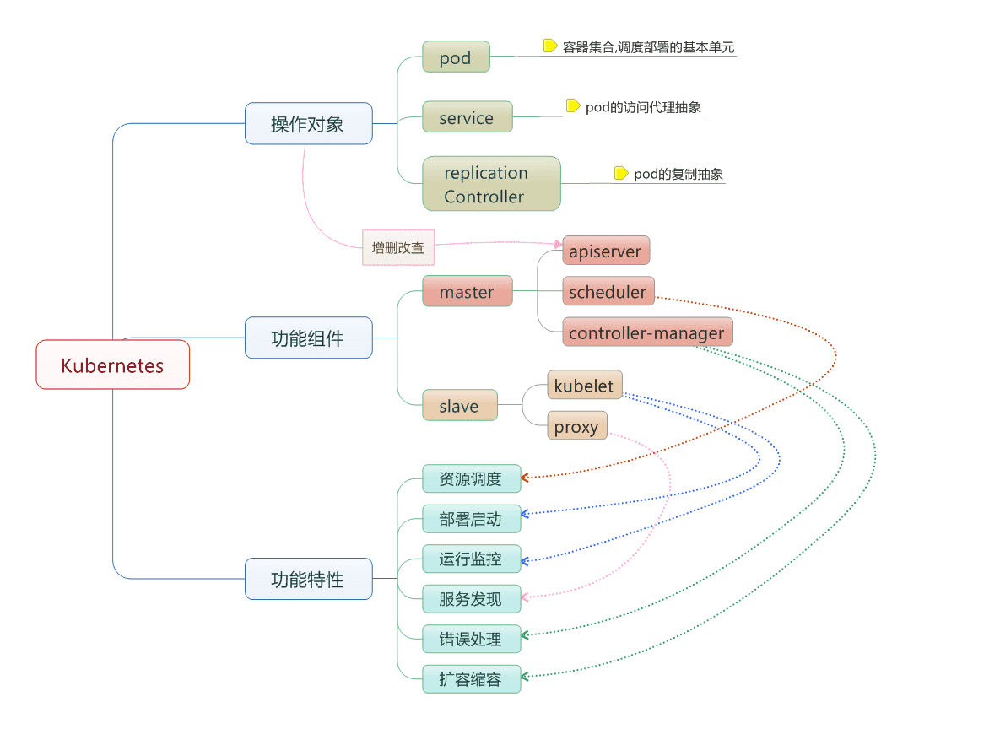
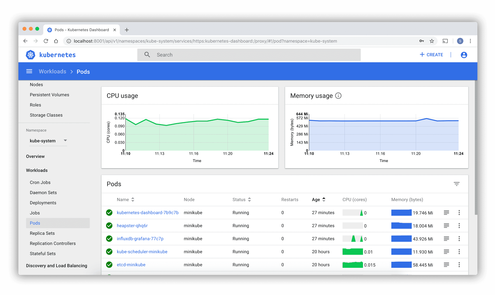

# Kubernetes基本概念

`Kubernetes`是Google团队发起并维护的基于Docker的开源容器集群管理系统，它不仅支持常见的云平台，而且支持内部数据中心。



建于 Docker 之上的 `Kubernetes` 可以构建一个容器的调度服务，其目的是让用户透过 `Kubernetes` 集群来进行云端容器集群的管理，而无需用户进行复杂的设置工作。系统会自动选取合适的工作节点来执行具体的容器集群调度处理工作。其核心概念是 `Container Pod`。一个 `Pod` 由一组工作于同一物理工作节点的容器构成。这些组容器拥有相同的网络命名空间、IP以及存储配额，也可以根据实际情况对每一个 `Pod` 进行端口映射。此外，`Kubernetes` 工作节点会由主系统进行管理，节点包含了能够运行 Docker 容器所用到的服务。

----

## 简介

`Kubernetes`是Google团队发起的开源项目，它的目标是管理跨多个主机的容器，提供基本的部署，维护以及应用伸缩，主要实现语言为Go语言。Kubernetes是：

- 易学：轻量级，简单，容易理解
- 便携：支持公有云，私有云，混合云，以及各种云平台
- 可拓展：模块化，可插拔，支持钩子，可任意组合
- 自修复：自动重调度，自动重启，自动复制

Kubernetes构建于Google数十年经验，一大半来源于Google生产环境规模的经验。结合了社区最佳的想法和实践。

在分布式系统中，部署，调度，伸缩一直是最为重要的，也是最为基础的功能。Kubernetes就是洗完解决这一序列问题的。

Kubernetes目前在[GitHub](https://github.com/kubernetes/kubernetes)镜像维护。

----

## 基本概念



- 节点（`Node`）：一个节点是一个运行Kubernetes中的主机
- 容器组（`Pod`）：一个Pod对应于由若干容器组成的一个容器组，同个组内的容器共享一个存储卷(volume)。
- 容器组生命周期（`pos-states`）：包含所有容器状态集合，包括容器组状态类型，容器组生命周期，事件，重启策略，以及replication controllers。
- `Replication Controllers`：主要负责指定数量的pod在同一时间一起运行。
- 服务（`services`）：一个Kubernetes服务是容器组逻辑的高级抽象，同时也对外提供访问容器组的策略。
- 卷（`volumes`）：一个卷就是一个目录，容器对其有访问权限。
- 标签（`labels`）：标签是用来连接一组对象的，比如容器组。标签可以被用来组织和选择子对象。
- 接口权限（`accessing_the_api`）：端口，IP地址和代理的防火墙规则。
- web界面（`ux`）：用户可以通过web界面操作Kubernetes。
- 命令行操作（`cli`）：`kubectl`命令。

----

### 节点(node)

在`Kubernetes`中，节点是实际工作的点，节点可以是虚拟机或者物理机器，依赖于一个集群环境。每个节点都有一个些必要的服务以运行容器组，并且它们都可以通过主节点来管理。必要服务包括Docker，kubelet和代理服务。

----

### 容器状态

容器状态用来描述节点的当前状态。现在，其中包含三个信息：

#### 主机IP

主机IP需要云平台来查询，`Kubernetes`把它作为状态的一部分来保存。如果`Kubernetes`没有运行在云平台上，节点ID就是必需的。IP地址可以变化，并且可以包含多种类型的IP地址，如公共IP，私有IP，动态IP，ipv6等等。

#### 节点周期

通常来说节点有`Pending(等待中)`、`Running(运行中)`、`Terminated(已终止)`三个周期，如果Kubernetes发现了一个节点并且其可用，那么Kubernetes就把它标记为`Pending`。然后在某个时刻，Kubernetes将会标记其为`Running`。节点的结束周期成为`Terminated`。一个已经`Terminated`的节点不会接受和调度任何请求，并且已经在其上运行的容器组也会删除。

#### 节点状态

节点状态主要是用来描述处于`Running`的节点。当前可用的有`NodeReachable`和`NodeReady`。

以后可能会增加其他状态。`NodeReachable`表示集群可达。`NodeReady`表示kubelet返回Status Ok并且HTTP状态检查健康。

----

### 节点管理

节点并非Kubernetes创建，而是由云平台创建，或者就是物理机器、虚拟机。在Kubernetes中，节点仅仅是一条记录，节点创建后，Kubernetes会检查其是否可用。在Kubernetes中，节点用如下结构保存：

```json
{
  "id": "10.1.2.3",
  "kind": "Minion",
  "apiVersion": "v1beta1",
  "resources": {
    "capacity": {
      "cpu": 1000,
      "memory": 1073741824
    },
  },
  "labels": {
    "name": "my-first-k8s-node",
  },
}
```

Kubernetes校验节点可用依赖于 ID。在当前的版本中，有两个接口可以用来管理节点：**节点控制**和**Kube管理**。

----

### 节点控制

在Kubernetes主节点中，节点控制器是用来管理节点的组件。主要包括：

- 集群范围内节点同步
- 单节点生命周期管理

节点控制有一个同步轮询，主要监听所有云平台的虚拟实例，会根据节点状态创建和删除。可以通过 `--node_sync_period`标志来控制该轮询。如果一个实例已经创建，节点控制将会为其创建一个结构。同样的，如果一个节点被删除，节点控制也会删除该结构。在 Kubernetes 启动时可用通过 `--machines`标记来显示指定节点。同样可以使用 `kubectl` 来一条一条的添加节点，两者是相同的。通过设置 `--sync_nodes=false`标记来禁止集群之间的节点同步，你也可以使用 api/kubectl 命令行来增删节点。

----

### 容器组（pod）

在 Kubernetes 中，使用的最小单位是容器组，容器组是创建，调度，管理的最小单位。 一个容器组使用相同的 Docker 容器并共享卷（挂载点）。一个容器组是一个特定应用的打包集合，包含一个或多个容器。

和运行的容器类似，一个容器组被认为只有很短的运行周期。容器组被调度到一组节点运行，直到容器的生命周期结束或者其被删除。如果节点死掉，运行在其上的容器组将会被删除而不是重新调度。（也许在将来的版本中会添加容器组的移动）。

#### 容器组设计的初衷

假设 Kubernetes 中调度的基本单元就是容器，对于一个非常简单的应用可以直接被调度直接使用，没有什么问题，但是往往还有很多应用程序是由多个进程组成的，有的同学可能会说把这些进程都打包到一个容器中去不就可以了吗？理论上是可以实现的，但是不要忘记了 Docker 管理的进程是 pid=1 的主进程，其他进程死掉了就会成为僵尸进程，没办法进行管理了，这种方式本身也不是容器推荐的运行方式，一个容器最**只干一件事情**，所以在真实的环境中不会使用这种方式。

那么我们就把这个应用的进程进行拆分，拆分成一个一个的容器总可以了吧？但是不要忘记一个问题，拆分成一个一个的容器后，是不是就有可能出现一个应用下面的某个进程容器被调度到了不同的节点上呢？往往我们应用内部的进程与进程间通信（通过 IPC 或者共享本地文件之类）都是要求在本地进行的，也就是需要在同一个节点上运行。

所以我们需要一个更高级别的结构来将这些容器绑定在一起，并将他们作为一个基本的调度单元进行管理，这样就可以保证这些容器始终在同一个节点上面，这也就是容器组设计的初衷。

#### 资源共享和通信

容器组主要是为了数据共享和它们之间的通信。

在一个容器组中，容器都使用相同的网络地址和端口，可以通过本地网络来相互通信。每个容器组都有独立的 IP，可以通过网络来和其他物理主机或者容器通信。

容器组有一组存储卷（挂载点），主要是为了让容器在重启之后可以不丢失数据。

#### 容器组管理

容器组是一个应用管理和部署的高层次抽象，同时也是一组容器的接口。容器组是部署、水平收缩的最小单位。

#### 容器组的使用

容器组可以通过组合来构建复杂的应用，其本来的意义包含：

- 内容管理，文件和数据加载以及本地缓存管理等。
- 日志和检查点备份，压缩，快照等。
- 监听数据变化，跟踪日志，日志和监控代理，消息发布等。
- 代理，网桥
- 控制器，管理，配置以及更新

#### 替代方案

为什么不在一个单一的容器里运行多个程序？

- **透明化**。为了使容器组中的容器保持一致的基础设施和服务，比如进程管理和资源监控。这样设计是为了用户的便利性。
- **解偶软件之间的依赖**。每个容器都可能重新构建和发布，Kubernetes 必须支持热发布和热更新（将来）。
- **方便使用**。用户不必运行独立的程序管理，也不用担心每个应用程序的退出状态。
- **高效**。考虑到基础设施有更多的职责，容器必须要轻量化。

#### 容器组的生命状态

包括若干状态值：`pending`、`running`、`succeeded`、`failed`。

##### pending

容器组已经被节点接受，但有一个或多个容器还没有运行起来。这将包含某些节点正在下载镜像的时间，这种情形会依赖于网络情况。

##### running

容器组已经被调度到节点，并且所有的容器都已经启动。至少有一个容器处于运行状态（或者处于重启状态）

##### succeeded

所有的容器都正常退出。

##### failed

容器组中所有容器都意外中断了。

#### 容器组的生命周期

通常来说，如果容器组被创建了就不会自动销毁，除非被某种行为触发，而触发此种情况可能是人为，或者复制控制器所为。唯一例外的是容器组由 succeeded 状态成功退出，或者在一定时间内重试多次依然失败。

如果某个节点死掉或者不能连接，那么节点控制器将会标记其上的容器组的状态为 `failed`。

举例如下。

- 容器组状态 `running`，有 1 容器，容器正常退出
  - 记录完成事件
  - 如果重启策略为：
    - 始终：重启容器，容器组保持 `running`
    - 失败时：容器组变为 `succeeded`
    - 从不：容器组变为 `succeeded`
- 容器组状态 `running`，有1容器，容器异常退出
  - 记录失败事件
  - 如果重启策略为：
    - 始终：重启容器，容器组保持 `running`
    - 失败时：重启容器，容器组保持 `running`
    - 从不：容器组变为 `failed`

- 容器组状态 `running`，有2容器，
  - 当有1容器异常退出
    - 记录失败事件
    - 如果重启策略为：
      - 始终：重启容器，容器组保持 `running`
      - 失败时：重启容器，容器组保持 `running`
      - 从不：容器组保持 `running`
  - 当有2容器退出
    - 记录失败事件
    - 如果重启策略为：
      - 始终：重启容器，容器组保持 `running`
      - 失败时：重启容器，容器组保持 `running`
      - 从不：容器组变为 `failed`
- 容器组状态 `running`，容器内存不足
  - 标记容器错误中断
  - 记录内存不足事件
  - 如果重启策略为：
    - 始终：重启容器，容器组保持 `running`
    - 失败时：重启容器，容器组保持 `running`
    - 从不：记录错误事件，容器组变为 `failed`

- 容器组状态 `running`，一块磁盘死掉
  - 杀死所有容器
  - 记录事件
  - 容器组变为 `failed`
  - 如果容器组运行在一个控制器下，容器组将会在其他地方重新创建
- 容器组状态 `running`，对应的节点段溢出
  - 节点控制器等到超时
  - 节点控制器标记容器组 `failed`
  - 如果容器组运行在一个控制器下，容器组将会在其他地方重新创建

----

### Replication Controllers

`ReplicationController`确保在任何时候都有特定数量的容器组副本处于运行状态。 换句话说，`ReplicationController` 确保一个 容器组 或一组同类的 容器组 总是可用的。

#### ReplicationController 如何工作

当 Pod 数量过多时，ReplicationController 会终止多余的 Pod。当 Pod 数量太少时，ReplicationController 将会启动新的 Pod。 与手动创建的 Pod 不同，由 ReplicationController 创建的 Pod 在失败、被删除或被终止时会被自动替换。 例如，在中断性维护（如内核升级）之后，你的 Pod 会在节点上重新创建。 因此，即使你的应用程序只需要一个 Pod，你也应该使用 ReplicationController 创建 Pod。 ReplicationController 类似于进程管理器，但是 ReplicationController 不是监控单个节点上的单个进程，而是监控跨多个节点的多个 Pod。

在讨论中，ReplicationController 通常缩写为 "rc"，并作为 kubectl 命令的快捷方式。

一个简单的示例是创建一个 ReplicationController 对象来可靠地无限期地运行 Pod 的一个实例。 更复杂的用例是运行一个多副本服务（如 web 服务器）的若干相同副本。

----

### 服务(service)

将运行在一组 `Pods`上的应用程序公开为网络服务的抽象方法。

使用 Kubernetes，你无需修改应用程序即可使用不熟悉的服务发现机制。 Kubernetes 为 Pods 提供自己的 IP 地址，并为一组 Pod 提供相同的 DNS 名， 并且可以在它们之间进行负载均衡。

----

### 卷

容器中的文件在磁盘上是临时存放的，这给容器中运行的较重要的应用 程序带来一些问题：

- 当容器崩溃时文件丢失。kubelet 会重新启动容器， 但容器会以干净的状态重启。 
- 会在同一 `Pod` 中运行多个容器并共享文件时出现。

 Kubernetes `卷（Volume）` 这一抽象概念能够解决这两个问题。

----

### 标签

标签（`Labels`）是附加到 Kubernetes 对象（比如 Pods）上的键值对。 标签旨在用于指定对用户有意义且相关的对象的标识属性，但不直接对核心系统有语义含义。 标签可以用于组织和选择对象的子集。标签可以在创建时附加到对象，随后可以随时添加和修改。 每个对象都可以定义一组键/值标签。每个键对于给定对象必须是唯一的。

```json
"metadata": {
  "labels": {
    "key1" : "value1",
    "key2" : "value2"
  }
}
```

标签能够支持高效的查询和监听操作，对于用户界面和命令行是很理想的。

----

### 接口权限

Pod 的安全性配置一般通过使用 **安全性上下文（Security Context）**来保证。安全性上下文允许用户逐个 Pod 地定义特权级及访问控制。

以前，对集群的安全性上下文的需求的实施及其基于策略的定义都通过使用 **Pod 安全性策略**来实现。 **Pod 安全性策略（Pod Security Policy）**是一种集群层面的资源，控制 Pod 规约中 安全性敏感的部分。

不过，新的策略实施方式不断涌现，或增强或替换 PodSecurityPolicy 的使用。

----

### web界面

`Dashboard` 是基于网页的 Kubernetes 用户界面。 你可以使用 Dashboard 将容器应用部署到 Kubernetes 集群中，也可以对容器应用排错，还能管理集群资源。 你可以使用 Dashboard 获取运行在集群中的应用的概览信息，也可以创建或者修改 Kubernetes 资源 （如 Deployment，Job，DaemonSet 等等）。 例如，你可以对 Deployment 实现弹性伸缩、发起滚动升级、重启 Pod 或者使用向导创建新的应用。

Dashboard 同时展示了 Kubernetes 集群中的资源状态信息和所有报错信息。



----

### 命令行操作

可以使用 Kubectl 命令行工具管理 Kubernetes 集群。 `kubectl` 在 `$HOME/.kube` 目录中查找一个名为 `config` 的配置文件。 可以通过设置 KUBECONFIG 环境变量或设置 [`--kubeconfig`](https://kubernetes.io/zh/docs/concepts/configuration/organize-cluster-access-kubeconfig/) 参数来指定其它 kubeconfig文件。

------


## 安装工具介绍

### Kubeadm

Kubeadm 是一个提供了 `kubeadm init` 和 `kubeadm join` 的工具，作为创建 Kubernetes 集群的 “快捷途径” 的最佳实践。

kubeadm 通过执行必要的操作来启动和运行最小可用集群。按照设计，它只关注启动引导，而非配置机器。同样的，安装各种 “锦上添花” 的扩展，例如 Kubernetes Dashboard, 监控方案，以及特定云平台的扩展，都不在讨论范围内。

相反，我们希望在 kubeadm 之上构建更高级别以及更加合规的工具，理想情况下，使用 kubeadm 作为所有部署工作的基准将会更加易于创建一致性集群。

### Kubectl

使用 Kubectl 命令行工具管理 Kubernetes 集群。

从用户的角度来看，kubectl是控制Kubernetes的驾驶舱。它允许您执行所有可能的Kubernetes操作。

从技术角度来看，kubectl是Kubernetes API的客户端。

Kubernetes API是一个HTTP REST API。此API是真正的Kubernetes用户接口。通过API我们可以完全控制Kubernetes。这意味着每个Kubernetes操作都作为API端点公开，并且可以通过对此端点的HTTP请求来执行。

因此，kubectl的主要工作是对Kubernetes API执行HTTP请求。

### Kubelet

Kubelet 是 kubernetes 工作节点上的一个代理组件，运行在每个节点上。

Kubelet是工作节点上的主要服务，定期从kube-apiserver组件接收新的或修改的Pod规范，并确保Pod及其容器在期望规范下运行。同时该组件作为工作节点的监控组件，向kube-apiserver汇报主机的运行状况。

kubelet 是运行在每个节点上的主要的“节点代理”，每个节点都会启动 kubelet进程，用来处理 Master 节点下发到本节点的任务，按照 PodSpec 描述来管理Pod 和其中的容器（PodSpec 是用来描述一个 pod 的 YAML 或者 JSON 对象）。

kubelet 通过各种机制（主要通过 apiserver ）获取一组 PodSpec 并保证在这些 PodSpec 中描述的容器健康运行。
