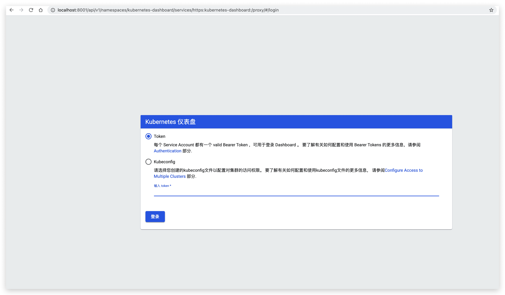
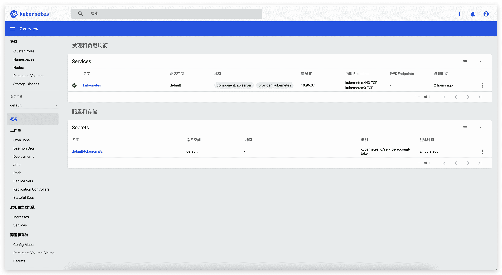

# Kubernetes的Dashboard部署

## Web 界面 (Dashboard)

[Kubernetes Dashboard](https://github.com/kubernetes/dashboard) 是基于网页的 Kubernetes 用户界面。

你可以使用 Dashboard 将容器应用部署到 Kubernetes 集群中，也可以对容器应用排错，还能管理集群资源。 你可以使用 Dashboard 获取运行在集群中的应用的概览信息，也可以创建或者修改 Kubernetes 资源 （如 Deployment，Job，DaemonSet 等等）。 例如，你可以对 Deployment 实现弹性伸缩、发起滚动升级、重启 Pod 或者使用向导创建新的应用。

Dashboard 同时展示了 Kubernetes 集群中的资源状态信息和所有报错信息。


## 部署 Dashboard UI[ ](https://kubernetes.io/zh/docs/tasks/access-application-cluster/web-ui-dashboard/#部署-dashboard-ui)

默认情况下不会部署 Dashboard。可以通过以下命令部署：

```bash
$ kubectl apply -f https://raw.githubusercontent.com/kubernetes/dashboard/v2.0.4/aio/deploy/recommended.yaml
```

或

```bash
kubectl create -f kubernetes-dashboard.yaml
```

检查 kubernetes-dashboard 应用状态

```bash
kubectl get pod -n kubernetes-dashboard
```

## 访问 Dashboard UI

通过命令行代理访问，执行以下命令：

```bash
$ kubectl proxy
```

通过如下 URL 访问 Kubernetes dashboard

http://localhost:8001/api/v1/namespaces/kubernetes-dashboard/services/https:kubernetes-dashboard:/proxy/



## 登录Dashboard UI

### 访问令牌登录

对于Mac环境

```bash
TOKEN=$(kubectl -n kube-system describe secret default| awk '$1=="token:"{print $2}')
kubectl config set-credentials docker-for-desktop --token="${TOKEN}"
echo $TOKEN
```

对于Windows环境

```bash
$TOKEN=((kubectl -n kube-system describe secret default | Select-String "token:") -split " +")[1]
kubectl config set-credentials docker-for-desktop --token="${TOKEN}"
echo $TOKEN
```

选择 **令牌**,输入上文控制台输出的内容，即可登录。



### Kubeconfig登录

路径如下：

```markdown
Mac: $HOME/.kube/config
Win: %UserProfile%\.kube\config
```

点击登陆，进入Kubernetes Dashboard
