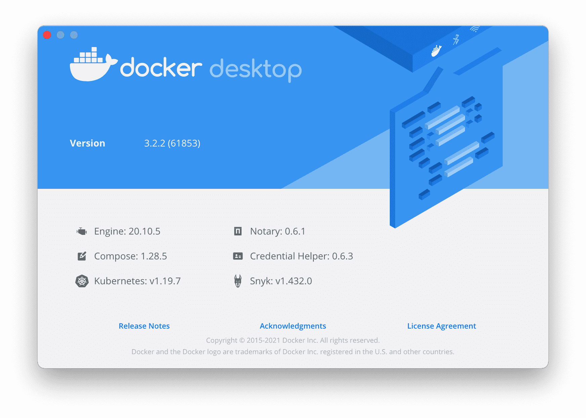
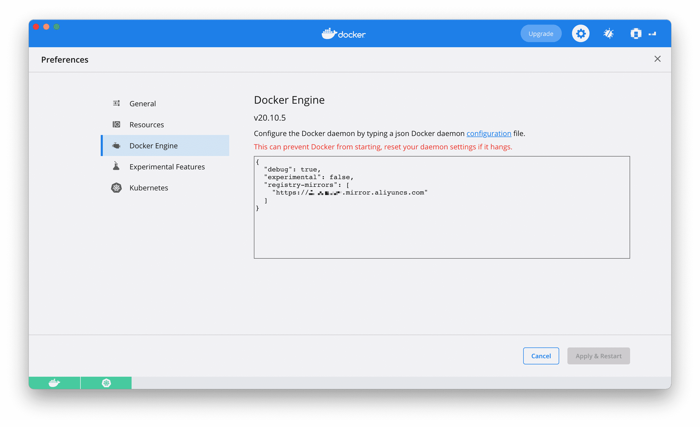
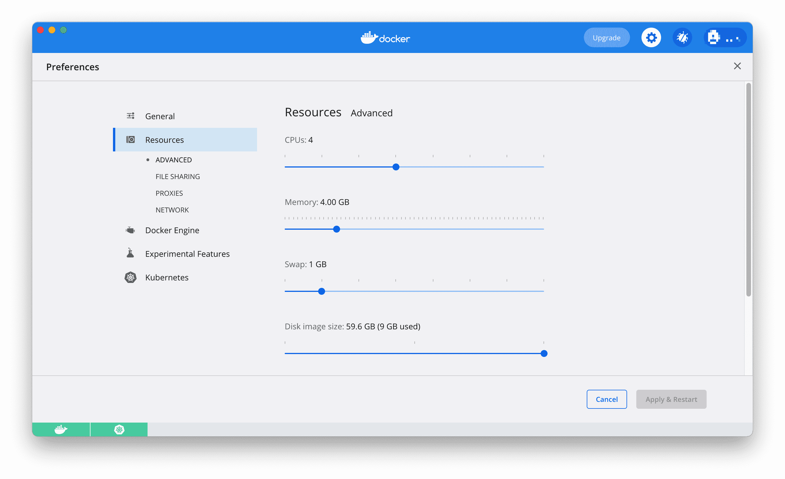
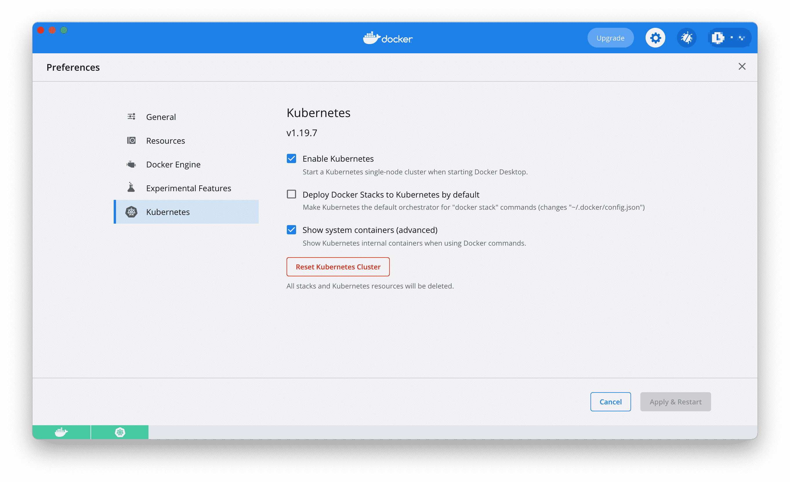

# Kubernetes的部署-Docker Desktop方式

使用 Docker Desktop 可以很方便的启用 Kubernetes，由于国内获取不到 `k8s.gcr.io` 镜像，我们必须首先解决这一问题。

### 获取 `k8s.gcr.io` 镜像

由于国内拉取不到 `k8s.gcr.io` 镜像，我们可以使用开源项目 [AliyunContainerService/k8s-for-docker-desktop](https://github.com/AliyunContainerService/k8s-for-docker-desktop) 来获取所需的镜像。

```bash
git clone git@github.com:AliyunContainerService/k8s-for-docker-desktop.git
```

说明:

- 需安装 Docker Desktop 的 Mac 或者 Windows 版本，如果没有请下载[下载 Docker CE最新版本](https://store.docker.com/search?type=edition&offering=community)
- 当前 master 分支已经在 Docker for Mac/Windows 3.1.0 (包含 Docker CE 20.10.3 和 Kubernetes 1.19.7) 版本测试通过
- 如果需要测试其他版本，请查看 Docker Desktop版本，Docker -> About Docker Desktop



注：如果发现K8s版本与您的环境不一致，可以修改`images.properties`文件指明所需镜像版本，欢迎Pull Request。

### 开启 Kubernetes

为 Docker daemon 配置镜像加速，参考[阿里云镜像服务](https://cr.console.aliyun.com/cn-hangzhou/instances/mirrors) 或中科大镜像加速地址`https://docker.mirrors.ustc.edu.cn`



可选操作: 为 Kubernetes 配置 CPU 和 内存资源，建议分配 4GB 或更多内存。



从阿里云镜像服务下载 Kubernetes 所需要的镜像

在 Mac 上执行如下脚本

```bash
./load_images.sh
```

在Windows上，使用 PowerShell

```bash
 .\load_images.ps1
```

说明:

- 如果因为安全策略无法执行 PowerShell 脚本，请在 “以管理员身份运行” 的 PowerShell 中执行 `Set-ExecutionPolicy RemoteSigned` 命令。
- 如果需要，可以通过修改 `images.properties` 文件自行加载你自己需要的镜像

在 Docker Desktop 设置页面，点击 `Kubernetes`，选择 `Enable Kubernetes`，稍等片刻，看到左下方 `Kubernetes` 变为 `running`，Kubernetes 启动成功。



**问题诊断**：

如果看到 Kubernetes一直在启动状态，请参考

- 在macOS上面，退出docker，执行 `rm -fr ~/Library/Group\ Containers/group.com.docker/pki`，然后重启docker
- 在Windows上面删除 'C:\ProgramData\DockerDesktop\pki' 目录 和 'C:\Users\yourUserName\AppData\Local\Docker\pki' 目录

### 验证

验证 Kubernetes 集群状态

```bash
$ kubectl version #查看版本 如果正常输出信息，则证明 Kubernetes 成功启动。
$ kubectl cluster-info
$ kubectl get nodes
```
