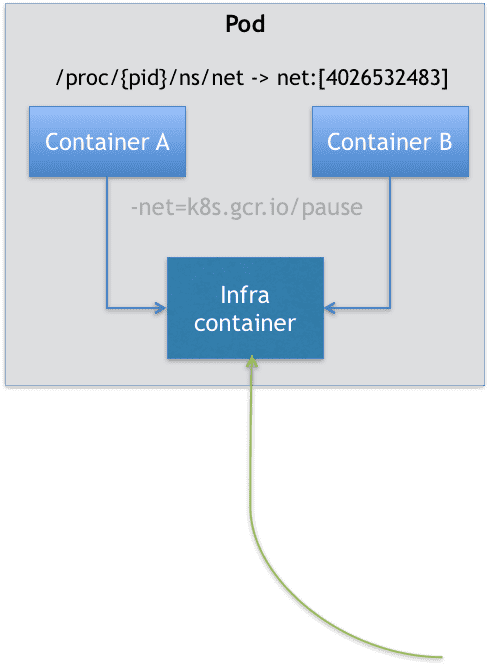

# Kubernetes-Pod的实现原理以及设计模式

## 为什么我们会需要 Pod

Pod，是 Kubernetes 项目中最小的 API 对象。如果换一个更专业的说法，我们可以这样描述：Pod，是 Kubernetes 项目的原子调度单位。

容器的本质是进程，容器镜像就是这个系统里的“.exe”安装包，Kubernetes 就是操作系统！

而 Kubernetes 项目所做的，其实就是将“进程组”的概念映射到了容器技术中，并使其成为了这个云计算“操作系统”里的“一等公民”。

Kubernetes 项目之所以要这么做的原因，我在前面介绍 Kubernetes 和 Borg 的关系时曾经提到过：在 Borg 项目的开发和实践过程中，Google 公司的工程师们发现，他们部署的应用，往往都存在着类似于“进程和进程组”的关系。更具体地说，就是这些应用之间有着密切的协作关系，使得它们必须部署在同一台机器上。

而如果事先没有“组”的概念，像这样的运维关系就会非常难以处理。

容器间的紧密协作，我们可以称为“**超亲密关系**”。这些具有“超亲密关系”容器的典型特征包括但不限于：

- 互相之间会发生直接的文件交换
- 使用 localhost 或者 Socket 文件进行本地通信
- 会发生非常频繁的远程调用
- 需要共享某些 Linux Namespace（比如，一个容器要加入另一个容器的 Network Namespace）等等。

这也就意味着，并不是所有有“关系”的容器都属于同一个 Pod。比如，PHP 应用容器和 MySQL 虽然会发生访问关系，但并没有必要、也不应该部署在同一台机器上，它们更适合做成两个 Pod

## Pod 的实现原理

**首先，关于 Pod 最重要的一个事实是：它只是一个逻辑概念。**

也就是说，Kubernetes 真正处理的，还是宿主机操作系统上 Linux 容器的 Namespace 和 Cgroups，而并不存在一个所谓的 Pod 的边界或者隔离环境。

Pod，其实是一组共享了某些资源的容器。**Pod 里的所有容器，共享的是同一个 Network Namespace，并且可以声明共享同一个 Volume。**

在 Kubernetes 项目里，Pod 的实现需要使用一个中间容器，这个容器叫作 **Infra 容器**。在这个 Pod 中，Infra 容器永远都是第一个被创建的容器，而其他用户定义的容器，则通过 Join Network Namespace 的方式，与 Infra 容器关联在一起。这样的组织关系，可以用下面这样一个示意图来表达：



如上图所示，这个 Pod 里有两个用户容器 A 和 B，还有一个 Infra 容器。很容易理解，在 Kubernetes 项目里，Infra 容器一定要占用极少的资源，所以它使用的是一个非常特殊的镜像，叫作：k8s.gcr.io/pause。这个镜像是一个用汇编语言编写的、永远处于“暂停”状态的容器，解压后的大小也只有 100~200 KB 左右。

而在 Infra 容器“Hold 住”Network Namespace 后，用户容器就可以加入到 Infra 容器的 Network Namespace 当中了。所以，如果你查看这些容器在宿主机上的 Namespace 文件（这个 Namespace 文件的路径），它们指向的值一定是完全一样的。

这也就意味着，对于 Pod 里的容器 A 和容器 B 来说：

- 它们可以直接使用 localhost 进行通信；
- 它们看到的网络设备跟 Infra 容器看到的完全一样；
- 一个 Pod 只有一个 IP 地址，也就是这个 Pod 的 Network Namespace 对应的 IP 地址；
- 当然，其他的所有网络资源，都是一个 Pod 一份，并且被该 Pod 中的所有容器共享；
- Pod 的生命周期只跟 Infra 容器一致，而与容器 A 和 B 无关。

**而对于同一个 Pod 里面的所有用户容器来说，它们的进出流量，也可以认为都是通过 Infra 容器完成的**

## 容器设计模式

### sidecar

sidecar 指的就是我们可以在一个 Pod 中，启动一个辅助容器，来完成一些独立于主进程（主容器）之外的工作

**最典型的例子是：WAR 包与 Web 服务器**

我们现在有一个 Java Web 应用的 WAR 包，它需要被放在 Tomcat 的 webapps 目录下运行起来。

假如，你现在只能用 Docker 来做这件事情，那该如何处理这个组合关系呢？

- 一种方法是，把 WAR 包直接放在 Tomcat 镜像的 webapps 目录下，做成一个新的镜像运行起来。可是，这时候，如果你要更新 WAR 包的内容，或者要升级 Tomcat 镜像，就要重新制作一个新的发布镜像，非常麻烦。

- 另一种方法是，你压根儿不管 WAR 包，永远只发布一个 Tomcat 容器。不过，这个容器的 webapps 目录，就必须声明一个 hostPath 类型的 Volume，从而把宿主机上的 WAR 包挂载进 Tomcat 容器当中运行起来。不过，这样你就必须要解决一个问题，即：如何让每一台宿主机，都预先准备好这个存储有 WAR 包的目录呢？这样来看，你只能独立维护一套分布式存储系统了。

实际上，有了 Pod 之后，这样的问题就很容易解决了。我们可以把 WAR 包和 Tomcat 分别做成镜像，然后把它们作为一个 Pod 里的两个容器“组合”在一起。这个 Pod 的配置文件如下所示：

```yaml
apiVersion: v1
kind: Pod
metadata:
  name: javaweb-2
spec:
  initContainers:
  - image: geektime/sample:v2
    name: war
    command: ["cp", "/sample.war", "/app"]
    volumeMounts:
    - mountPath: /app
      name: app-volume
  containers:
  - image: geektime/tomcat:7.0
    name: tomcat
    command: ["sh","-c","/root/apache-tomcat-7.0.42-v2/bin/start.sh"]
    volumeMounts:
    - mountPath: /root/apache-tomcat-7.0.42-v2/webapps
      name: app-volume
    ports:
    - containerPort: 8080
      hostPort: 8001 
  volumes:
  - name: app-volume
    emptyDir: {}
```

在这个 Pod 中，我们定义了两个容器，第一个容器使用的镜像是 geektime/sample:v2，这个镜像里只有一个 WAR 包（sample.war）放在根目录下。而第二个容器则使用的是一个标准的 Tomcat 镜像。

不过，你可能已经注意到，WAR 包容器的类型不再是一个普通容器，而是一个 `Init Container` 类型的容器。

**在 Pod 中，所有 Init Container 定义的容器，都会比 spec.containers 定义的用户容器先启动。并且，Init Container 容器会按顺序逐一启动，而直到它们都启动并且退出了，用户容器才会启动。**

所以，这个 Init Container 类型的 WAR 包容器启动后，我执行了一句"cp /sample.war /app"，把应用的 WAR 包拷贝到 /app 目录下，然后退出。

而后这个 /app 目录，就挂载了一个名叫 app-volume 的 Volume。

接下来就很关键了。Tomcat 容器，同样声明了挂载 app-volume 到自己的 webapps 目录下。

所以，等 Tomcat 容器启动时，它的 webapps 目录下就一定会存在 sample.war 文件：这个文件正是 WAR 包容器启动时拷贝到这个 Volume 里面的，而这个 Volume 是被这两个容器共享的。

像这样，我们就用一种“组合”方式，解决了 WAR 包与 Tomcat 容器之间耦合关系的问题。

实际上，这个所谓的“组合”操作，正是容器设计模式里最常用的一种模式，它的名字叫：sidecar。


**第二个例子，则是容器的日志收集。**

比如，我现在有一个应用，需要不断地把日志文件输出到容器的 /var/log 目录中。

这时，我就可以把一个 Pod 里的 Volume 挂载到应用容器的 /var/log 目录上。

然后，在这个 Pod 里同时运行一个 sidecar 容器，它也声明挂载同一个 Volume 到自己的 /var/log 目录上。

这样，接下来 sidecar 容器就只需要做一件事儿，那就是不断地从自己的 /var/log 目录里读取日志文件，转发到 MongoDB 或者 Elasticsearch 中存储起来。这样，一个最基本的日志收集工作就完成了。


跟第一个例子一样，这个例子中的 sidecar 的主要工作也是使用共享的 Volume 来完成对文件的操作。

但不要忘记，Pod 的另一个重要特性是，它的所有容器都共享同一个 Network Namespace。这就使得很多与 Pod 网络相关的配置和管理，也都可以交给 sidecar 完成，而完全无须干涉用户容器。这里最典型的例子莫过于 Istio 这个微服务治理项目了。
