# Kubernetes-03-集群搭建

## 集群搭建类型

- **minikube**
    只是一个 K8S 集群模拟器，只有一个节点的集群，只为测试用，master 和 worker 都在一起。

- **裸机安装**
    至少需要两台机器（主节点、工作节点个一台），需要自己安装 Kubernetes 组件，配置会稍微麻烦点。
    缺点：配置麻烦，缺少生态支持，例如负载均衡器、云存储。

- **直接用云平台 Kubernetes**
    可视化搭建，只需简单几步就可以创建好一个集群。
    优点：安装简单，生态齐全，负载均衡器、存储等都给你配套好，简单操作就搞定

- **k3s**

    安装简单，脚本自动完成。

    优点：轻量级，配置要求低，安装简单，生态齐全。


## minikube

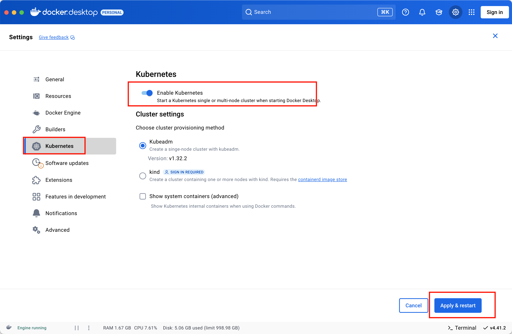

## 裸机安装

### 环境准备

- 节点数量: 3 台虚拟机 centos7
- 硬件配置: 2G或更多的RAM，2个CPU或更多的CPU，硬盘至少30G 以上
- 网络要求: 多个节点之间网络互通，每个节点能访问外网

### 初始化系统

#### 创建虚拟机

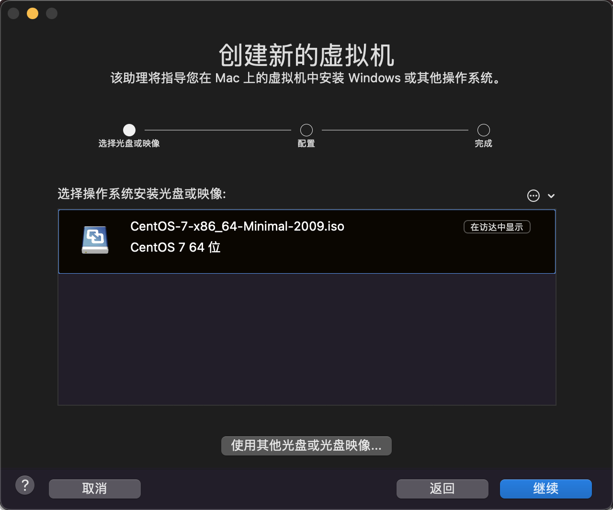

#### 配置cpu 内存 硬盘


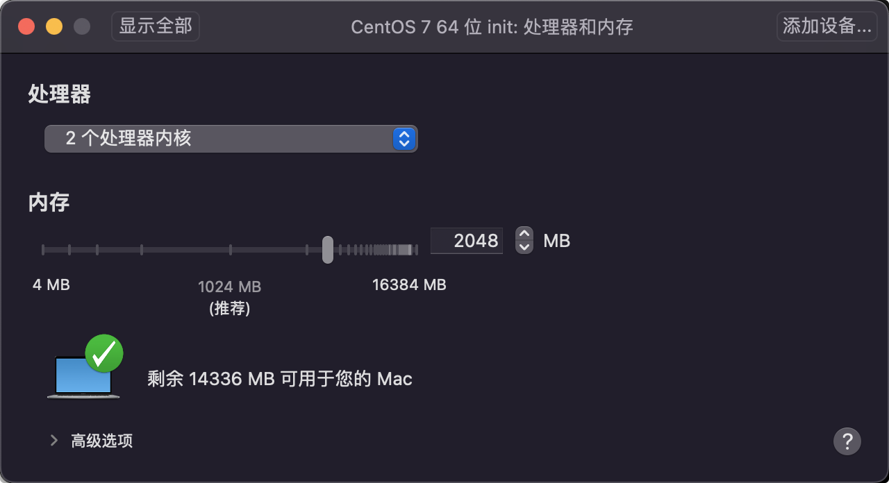


#### 网络默认

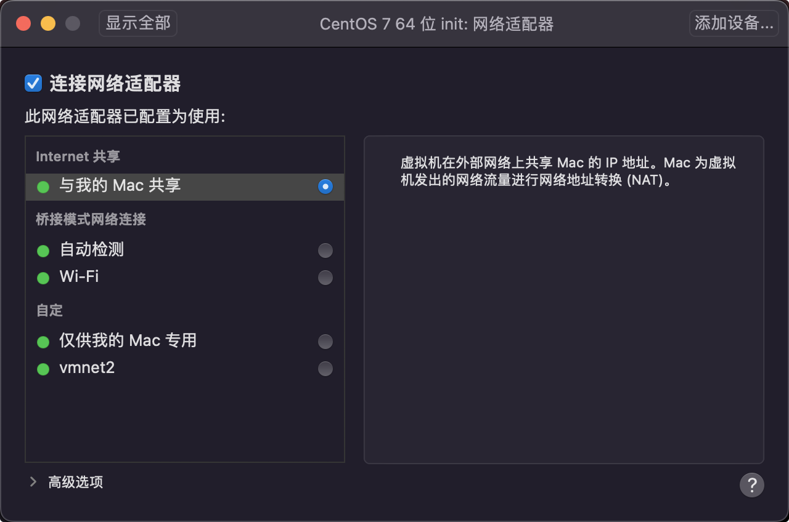

#### 开始安装

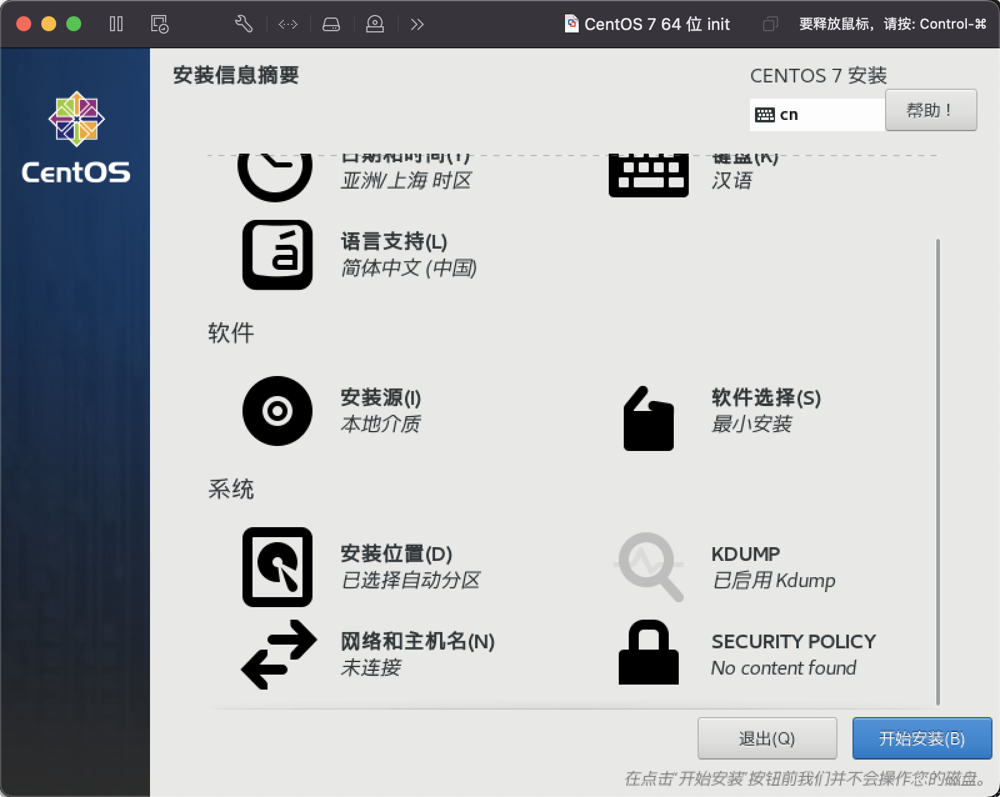

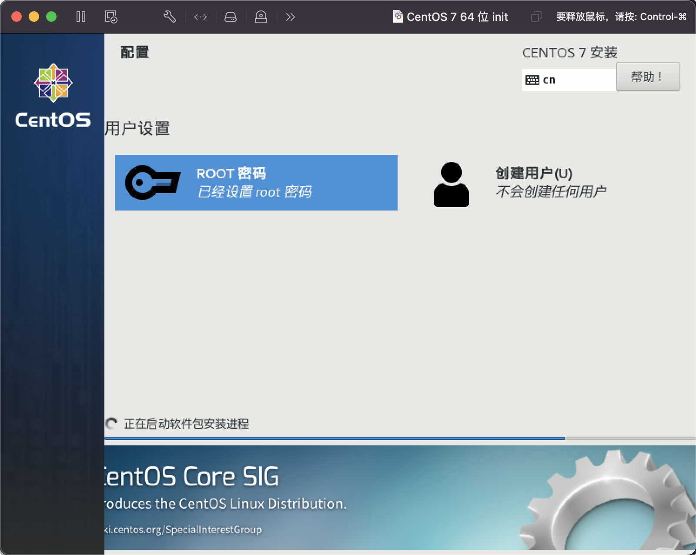

#### 启动成功

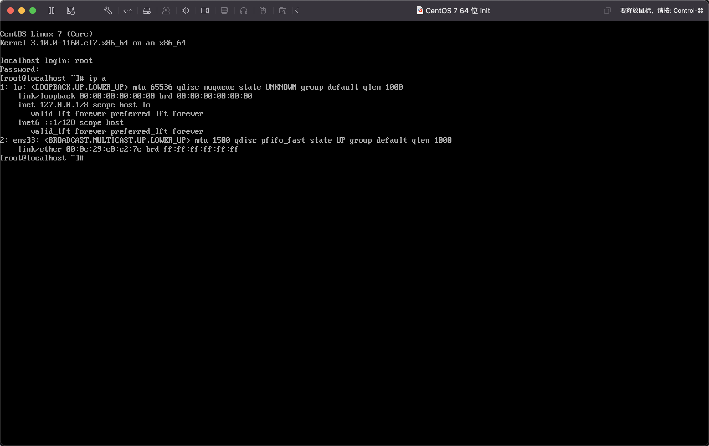

#### 关机新增第二个网卡


#### 设置网络

修改第一个网卡为自定义

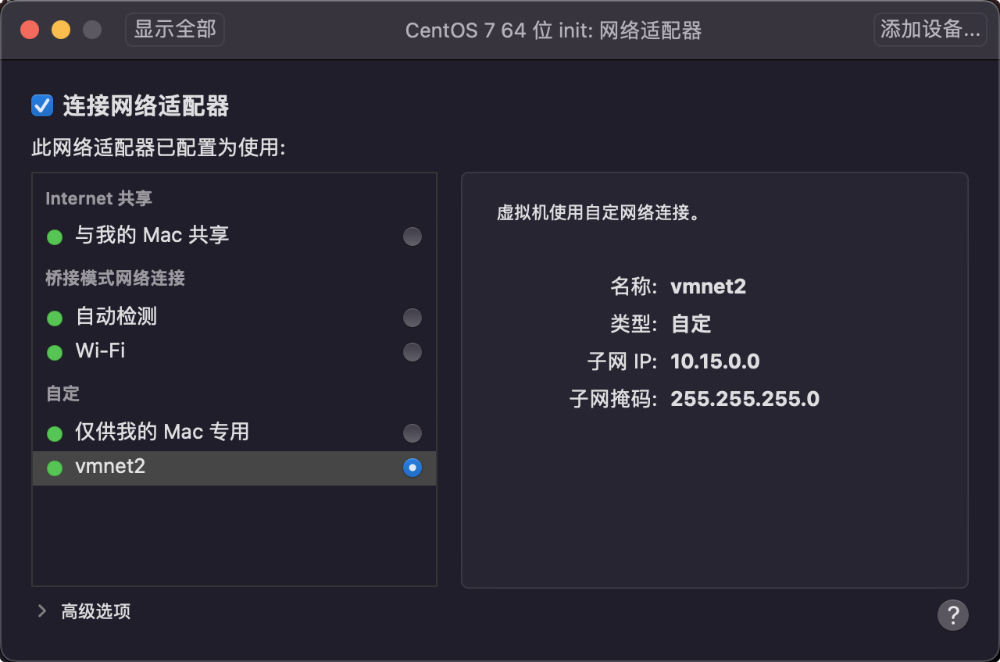

#### 编辑网络

```bash
$ ip a
1: lo: <LOOPBACK,UP,LOWER_UP> mtu 65536 qdisc noqueue state UNKNOWN group default qlen 1000
    link/loopback 00:00:00:00:00:00 brd 00:00:00:00:00:00
    inet 127.0.0.1/8 scope host lo
       valid_lft forever preferred_lft forever
    inet6 ::1/128 scope host 
       valid_lft forever preferred_lft forever
2: ens33: <BROADCAST,MULTICAST,UP,LOWER_UP> mtu 1500 qdisc pfifo_fast state UP group default qlen 1000
    link/ether 00:0c:29:c0:c2:7c brd ff:ff:ff:ff:ff:ff
3: ens36: <BROADCAST,MULTICAST,UP,LOWER_UP> mtu 1500 qdisc pfifo_fast state UP group default qlen 1000
    link/ether 00:0c:29:c0:c2:86 brd ff:ff:ff:ff:ff:ff
    inet 192.168.107.134/24 brd 192.168.107.255 scope global noprefixroute dynamic ens36
       valid_lft 1775sec preferred_lft 1775sec
    inet6 fe80::631c:2b44:99d2:9c67/64 scope link noprefixroute 
       valid_lft forever preferred_lft forever
       
$ vi /etc/sysconf/network-scripts/ifcfg-ens33
TYPE=Ethernet
PROXY_METHOD=none
BROWSER_ONLY=no
BOOTPROTO=static
IPADDR=10.15.0.20
DEFROUTE=yes
IPV4_FAILURE_FATAL=no
IPV6INIT=yes
IPV6_AUTOCONF=yes
IPV6_DEFROUTE=yes
IPV6_FAILURE_FATAL=no
IPV6_ADDR_GEN_MODE=stable-privacy
NAME=ens33
UUID=bb689580-f52d-449d-b6be-e65fd4a87cfc
DEVICE=ens33
ONBOOT=yes

$ systemctl restart network

$ ip a
1: lo: <LOOPBACK,UP,LOWER_UP> mtu 65536 qdisc noqueue state UNKNOWN group default qlen 1000
    link/loopback 00:00:00:00:00:00 brd 00:00:00:00:00:00
    inet 127.0.0.1/8 scope host lo
       valid_lft forever preferred_lft forever
    inet6 ::1/128 scope host 
       valid_lft forever preferred_lft forever
2: ens33: <BROADCAST,MULTICAST,UP,LOWER_UP> mtu 1500 qdisc pfifo_fast state UP group default qlen 1000
    link/ether 00:0c:29:c0:c2:7c brd ff:ff:ff:ff:ff:ff
    inet 10.15.0.20/8 brd 10.255.255.255 scope global noprefixroute ens33
       valid_lft forever preferred_lft forever
    inet6 fe80::9e10:b08b:d772:77a0/64 scope link noprefixroute 
       valid_lft forever preferred_lft forever
3: ens36: <BROADCAST,MULTICAST,UP,LOWER_UP> mtu 1500 qdisc pfifo_fast state UP group default qlen 1000
    link/ether 00:0c:29:c0:c2:86 brd ff:ff:ff:ff:ff:ff
    inet 192.168.107.134/24 brd 192.168.107.255 scope global noprefixroute dynamic ens36
       valid_lft 1775sec preferred_lft 1775sec
    inet6 fe80::631c:2b44:99d2:9c67/64 scope link noprefixroute 
       valid_lft forever preferred_lft forever
```


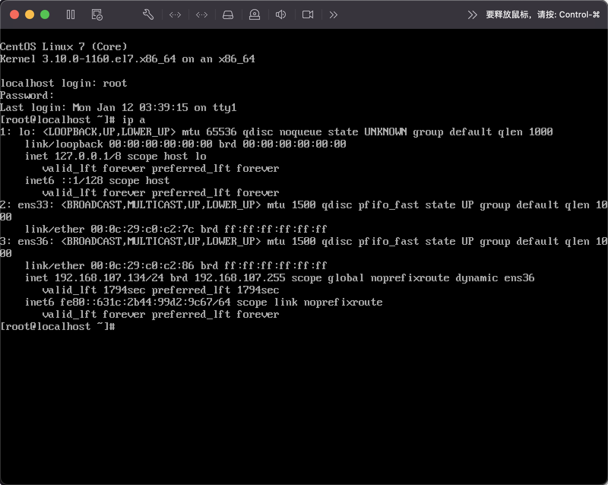

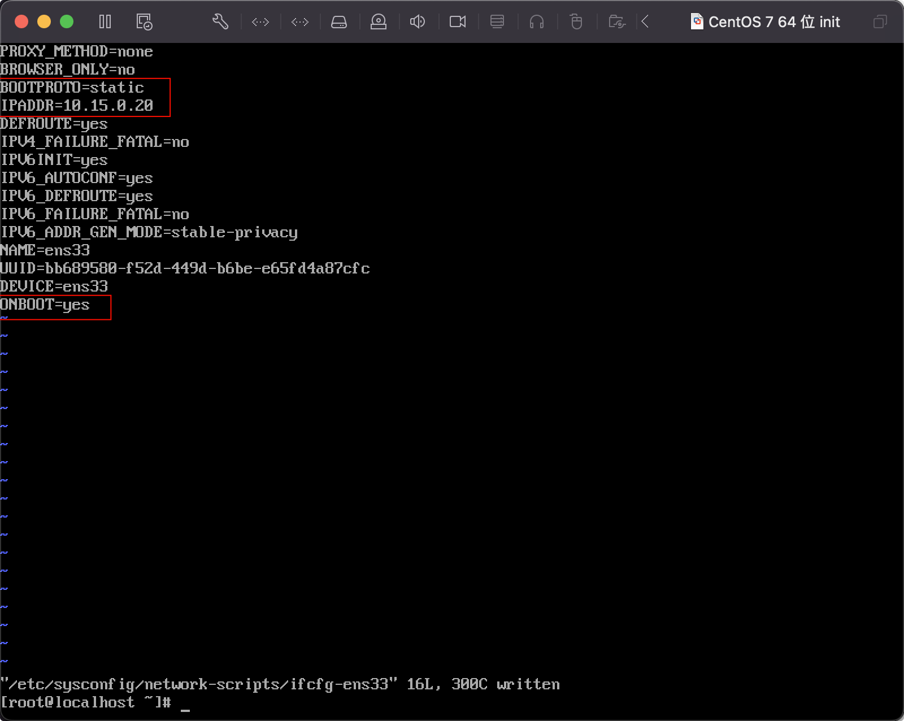

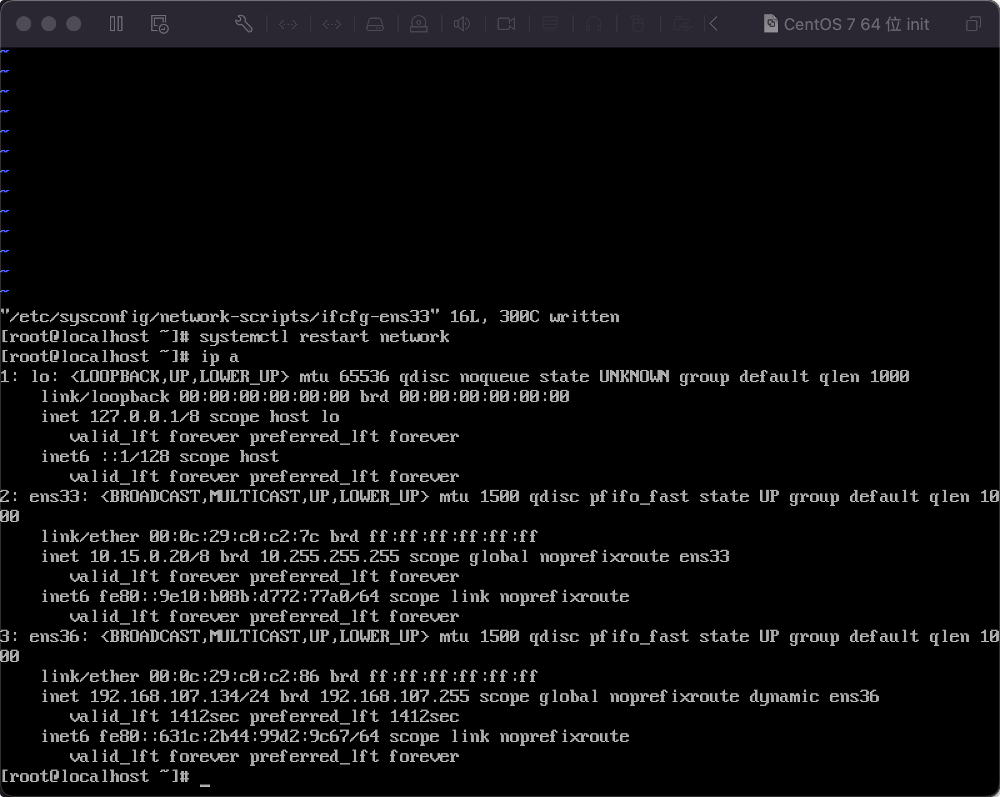

#### 修改源

```sh
$ cat /etc/centos-release
CentOS Linux release 7.9.2009 (Core)

$ sed -e "s|^mirrorlist=|#mirrorlist=|g" \
    -e "s|^#baseurl=http://mirror.centos.org/centos/\$releasever|baseurl=https://mirrors.tuna.tsinghua.edu.cn/centos-vault/7.9.2009|g" \
    -e "s|^#baseurl=http://mirror.centos.org/\$contentdir/\$releasever|baseurl=https://mirrors.tuna.tsinghua.edu.cn/centos-vault/7.9.2009|g" \
    -i.bak \
    /etc/yum.repos.d/CentOS-*.repo
    
$ sed -i \
  -e 's/^enabled=0/enabled=1/g' \
  /etc/yum.repos.d/CentOS-Base.repo
  
$ yum clean all
Loaded plugins: fastestmirror
Cleaning repos: base centosplus extras updates

$ yum makecache
Loaded plugins: fastestmirror
Determining fastest mirrors
base                                                                                                  | 3.6 kB  00:00:00     
centosplus                                                                                            | 2.9 kB  00:00:00     
extras                                                                                                | 2.9 kB  00:00:00     
updates                                                                                               | 2.9 kB  00:00:00     
(1/13): base/x86_64/group_gz                                                                          | 153 kB  00:00:00     
(2/13): base/x86_64/primary_db                                                                        | 6.1 MB  00:00:00     
(3/13): base/x86_64/filelists_db                                                                      | 7.2 MB  00:00:01     
(4/13): base/x86_64/other_db                                                                          | 2.6 MB  00:00:00     
(5/13): centosplus/x86_64/filelists_db                                                                | 3.7 MB  00:00:00     
(6/13): centosplus/x86_64/other_db                                                                    | 175 kB  00:00:00     
(7/13): centosplus/x86_64/primary_db                                                                  | 8.3 MB  00:00:01     
(8/13): extras/x86_64/filelists_db                                                                    | 305 kB  00:00:00     
(9/13): extras/x86_64/primary_db                                                                      | 253 kB  00:00:00     
(10/13): extras/x86_64/other_db                                                                       | 154 kB  00:00:00     
(11/13): updates/x86_64/filelists_db                                                                  |  15 MB  00:00:01     
(12/13): updates/x86_64/other_db                                                                      | 1.6 MB  00:00:00     
(13/13): updates/x86_64/primary_db                                                                    |  27 MB  00:00:02     
Metadata Cache Created

$ yum repolist
Loaded plugins: fastestmirror
Loading mirror speeds from cached hostfile
repo id                                                    repo name                                                   status
base/x86_64                                                CentOS-7 - Base                                             10,072
centosplus/x86_64                                          CentOS-7 - Plus                                                277
extras/x86_64                                              CentOS-7 - Extras                                              526
updates/x86_64                                             CentOS-7 - Updates                                           6,173
repolist: 17,048
```

### 集群规划

- k8s-node1：10.15.0.21
- k8s-node2：10.15.0.22
- k8s-node3：10.15.0.23

从初始化的系统中克隆三台，克隆的时候需要重新生成MAC地址，并分别修改固定IP。

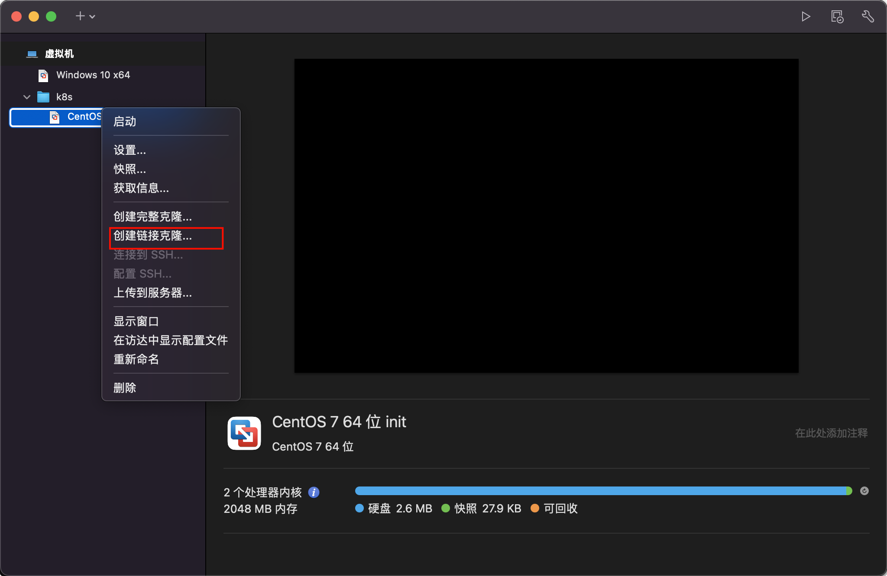

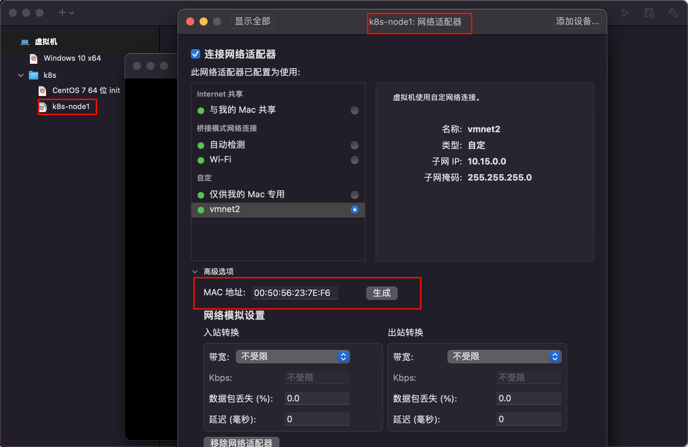

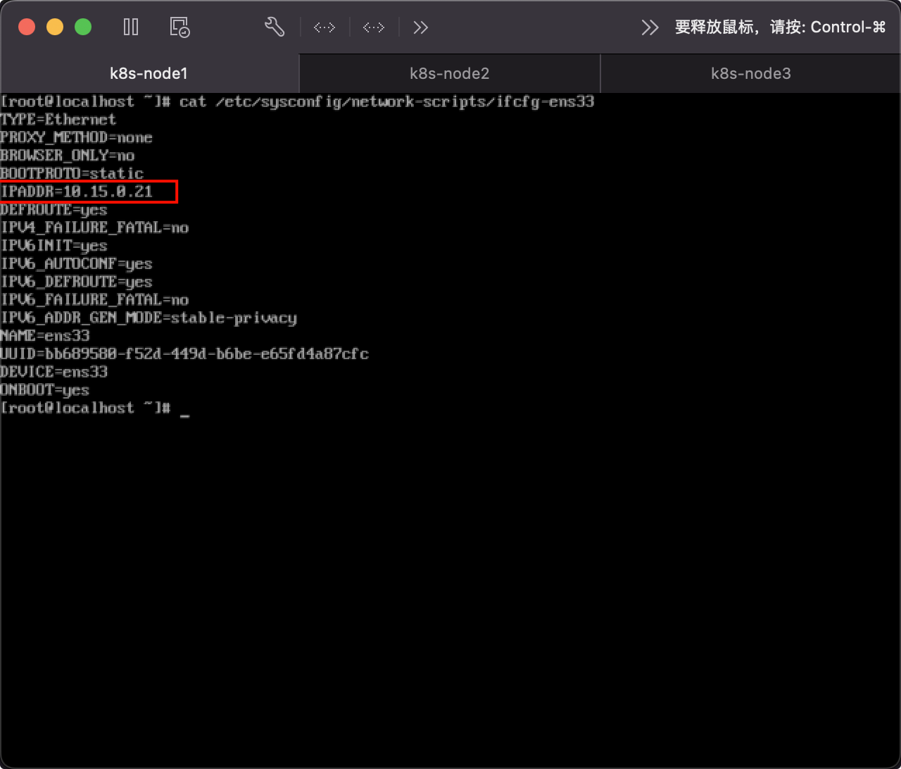

### 集群系统基础环境配置

#### 设置主机名

```bash
$ hostnamectl set-hostname k8s-node1  
$ hostnamectl set-hostname k8s-node2
$ hostnamectl set-hostname k8s-node3
```

#### 同步 hosts 文件

>  如果 DNS 不支持主机名称解析，还需要在每台机器的 `/etc/hosts` 文件中添加主机名和 IP 的对应关系：

```bash
cat >> /etc/hosts <<EOF
10.15.0.21 k8s-node1
10.15.0.22 k8s-node2
10.15.0.23 k8s-node3
EOF
```

#### 关闭防火墙

```bash
$ systemctl stop firewalld && systemctl disable firewalld
```

#### 关闭 SELINUX

> 注意: ARM 架构请勿执行,执行会出现 ip 无法获取问题!

```bash
$ setenforce 0 && sed -i 's/SELINUX=enforcing/SELINUX=disabled/g' /etc/selinux/config
```

#### 关闭 swap 分区

```bash
$ swapoff -a && sed -ri 's/.*swap.*/#&/' /etc/fstab
```

#### 同步时间

```bash
$ yum install ntpdate -y
$ ntpdate time.windows.com
```

### 安装 containerd

```bash
# 安装 yum-config-manager 相关依赖
$ yum install -y yum-utils device-mapper-persistent-data lvm2
# 添加 containerd yum 源
$ yum-config-manager --add-repo http://mirrors.aliyun.com/docker-ce/linux/centos/docker-ce.repo
# 安装 containerd
$ yum install  -y containerd.io cri-tools  
# 配置 containerd
$ cat >  /etc/containerd/config.toml <<EOF
disabled_plugins = ["restart"]
[plugins.linux]
shim_debug = true
[plugins.cri.registry.mirrors."docker.io"]
endpoint = ["https://frz7i079.mirror.aliyuncs.com"]
[plugins.cri]
sandbox_image = "registry.aliyuncs.com/google_containers/pause:3.2"
EOF
# 启动 containerd 服务 并 开机配置自启动
$ systemctl enable containerd && systemctl start containerd && systemctl status containerd 

# 配置 containerd 配置
$ cat > /etc/modules-load.d/containerd.conf <<EOF
overlay
br_netfilter
EOF

# 配置 k8s 网络配置
$ cat  > /etc/sysctl.d/k8s.conf <<EOF
net.bridge.bridge-nf-call-ip6tables = 1
net.bridge.bridge-nf-call-iptables = 1
net.ipv4.ip_forward = 1
EOF

# 加载 overlay br_netfilter 模块
$ modprobe overlay
$ modprobe br_netfilter

# 查看当前配置是否生效
$ sysctl -p /etc/sysctl.d/k8s.conf
```

###  安装 k8s

#### 添加源

- 查看源

```bash
$ yum repolist
```

- 添加源 x86

```bash
$ cat <<EOF > kubernetes.repo
[kubernetes]
name=Kubernetes
baseurl=https://mirrors.aliyun.com/kubernetes/yum/repos/kubernetes-el7-x86_64
enabled=1
gpgcheck=0
repo_gpgcheck=0
gpgkey=https://mirrors.aliyun.com/kubernetes/yum/doc/yum-key.gpg https://mirrors.aliyun.com/kubernetes/yum/doc/rpm-package-key.gpg
EOF
$ mv kubernetes.repo /etc/yum.repos.d/
$ yum makecache 
```

- 添加源 ARM

```bash
$ cat << EOF > kubernetes.repo 
[kubernetes]
name=Kubernetes
baseurl=https://mirrors.aliyun.com/kubernetes/yum/repos/kubernetes-el7-aarch64
enabled=1
gpgcheck=0
repo_gpgcheck=0
gpgkey=https://mirrors.aliyun.com/kubernetes/yum/doc/yum-key.gpg https://mirrors.aliyun.com/kubernetes/yum/doc/rpm-package-key.gpg
EOF

$ mv kubernetes.repo /etc/yum.repos.d/
$ yum makecache
```

#### 执行安装

```bash
# 安装最新版本
$ yum install -y kubelet kubeadm kubectl

# 指定版本安装
# yum install -y kubelet-1.26.0 kubectl-1.26.0 kubeadm-1.26.0

# 启动 kubelet
$ sudo systemctl enable kubelet && sudo systemctl start kubelet && sudo systemctl status kubelet
```

#### 初始化集群

- **`注意: 初始化 k8s 集群仅仅需要再在 master 节点进行集群初始化!`**

```bash
# 主节点执行
$ kubeadm init \
--apiserver-advertise-address=10.15.0.21 \
--pod-network-cidr=10.244.0.0/16 \
--image-repository registry.aliyuncs.com/google_containers \
--cri-socket=unix:///var/run/containerd/containerd.sock

......
Your Kubernetes control-plane has initialized successfully!

To start using your cluster, you need to run the following as a regular user:

  mkdir -p $HOME/.kube
  sudo cp -i /etc/kubernetes/admin.conf $HOME/.kube/config
  sudo chown $(id -u):$(id -g) $HOME/.kube/config

Alternatively, if you are the root user, you can run:

  export KUBECONFIG=/etc/kubernetes/admin.conf

You should now deploy a pod network to the cluster.
Run "kubectl apply -f [podnetwork].yaml" with one of the options listed at:
  https://kubernetes.io/docs/concepts/cluster-administration/addons/

Then you can join any number of worker nodes by running the following on each as root:

kubeadm join 10.15.0.21:6443 --token 2szcty.rro9hxs3krlrn1ws \
        --discovery-token-ca-cert-hash sha256:43e18607bdcbd2e302efb3549bd48134f5370adbf6af5cf7443c0f240f240ef8

$ mkdir -p $HOME/.kube
$ sudo cp -i /etc/kubernetes/admin.conf $HOME/.kube/config
$ sudo chown $(id -u):$(id -g) $HOME/.kube/config
$ kubectl get nodes
NAME        STATUS     ROLES           AGE     VERSION
k8s-node1   NotReady   control-plane   6m45s   v1.28.2
$ watch -n 1 -d kubectl get nodes

# 若上面的token忘记了
$ kubeadm token create --print-join-command --ttl=0

# 添加新节点-node节点执行
$ kubeadm join 10.15.0.21:6443 --token 2szcty.rro9hxs3krlrn1ws \
        --discovery-token-ca-cert-hash sha256:43e18607bdcbd2e302efb3549bd48134f5370adbf6af5cf7443c0f240f240ef8 
```

#### 配置集群网络

- `注意: 只在主节点执行即可!`

```bash
# 创建配置: kube-flannel.yml ,执行 kubectl apply -f kube-flannel.yml
$ vi kube-flannel.yml
$ kubectl apply -f kube-flannel.yml
```


```yml
---
kind: Namespace
apiVersion: v1
metadata:
  name: kube-flannel
  labels:
    pod-security.kubernetes.io/enforce: privileged
---
kind: ClusterRole
apiVersion: rbac.authorization.k8s.io/v1
metadata:
  name: flannel
rules:
- apiGroups:
  - ""
  resources:
  - pods
  verbs:
  - get
- apiGroups:
  - ""
  resources:
  - nodes
  verbs:
  - get
  - list
  - watch
- apiGroups:
  - ""
  resources:
  - nodes/status
  verbs:
  - patch
---
kind: ClusterRoleBinding
apiVersion: rbac.authorization.k8s.io/v1
metadata:
  name: flannel
roleRef:
  apiGroup: rbac.authorization.k8s.io
  kind: ClusterRole
  name: flannel
subjects:
- kind: ServiceAccount
  name: flannel
  namespace: kube-flannel
---
apiVersion: v1
kind: ServiceAccount
metadata:
  name: flannel
  namespace: kube-flannel
---
kind: ConfigMap
apiVersion: v1
metadata:
  name: kube-flannel-cfg
  namespace: kube-flannel
  labels:
    tier: node
    app: flannel
data:
  cni-conf.json: |
    {
      "name": "cbr0",
      "cniVersion": "0.3.1",
      "plugins": [
        {
          "type": "flannel",
          "delegate": {
            "hairpinMode": true,
            "isDefaultGateway": true
          }
        },
        {
          "type": "portmap",
          "capabilities": {
            "portMappings": true
          }
        }
      ]
    }
  net-conf.json: |
    {
      "Network": "10.244.0.0/16",
      "Backend": {
        "Type": "vxlan"
      }
    }
---
apiVersion: apps/v1
kind: DaemonSet
metadata:
  name: kube-flannel-ds
  namespace: kube-flannel
  labels:
    tier: node
    app: flannel
spec:
  selector:
    matchLabels:
      app: flannel
  template:
    metadata:
      labels:
        tier: node
        app: flannel
    spec:
      affinity:
        nodeAffinity:
          requiredDuringSchedulingIgnoredDuringExecution:
            nodeSelectorTerms:
            - matchExpressions:
              - key: kubernetes.io/os
                operator: In
                values:
                - linux
      hostNetwork: true
      priorityClassName: system-node-critical
      tolerations:
      - operator: Exists
        effect: NoSchedule
      serviceAccountName: flannel
      initContainers:
      - name: install-cni-plugin
       #image: flannelcni/flannel-cni-plugin:v1.1.0 for ppc64le and mips64le (dockerhub limitations may apply)
        image: docker.io/rancher/mirrored-flannelcni-flannel-cni-plugin:v1.1.0
        command:
        - cp
        args:
        - -f
        - /flannel
        - /opt/cni/bin/flannel
        volumeMounts:
        - name: cni-plugin
          mountPath: /opt/cni/bin
      - name: install-cni
       #image: flannelcni/flannel:v0.20.2 for ppc64le and mips64le (dockerhub limitations may apply)
        image: docker.io/rancher/mirrored-flannelcni-flannel:v0.20.2
        command:
        - cp
        args:
        - -f
        - /etc/kube-flannel/cni-conf.json
        - /etc/cni/net.d/10-flannel.conflist
        volumeMounts:
        - name: cni
          mountPath: /etc/cni/net.d
        - name: flannel-cfg
          mountPath: /etc/kube-flannel/
      containers:
      - name: kube-flannel
       #image: flannelcni/flannel:v0.20.2 for ppc64le and mips64le (dockerhub limitations may apply)
        image: docker.io/rancher/mirrored-flannelcni-flannel:v0.20.2
        command:
        - /opt/bin/flanneld
        args:
        - --ip-masq
        - --kube-subnet-mgr
        resources:
          requests:
            cpu: "100m"
            memory: "50Mi"
          limits:
            cpu: "100m"
            memory: "50Mi"
        securityContext:
          privileged: false
          capabilities:
            add: ["NET_ADMIN", "NET_RAW"]
        env:
        - name: POD_NAME
          valueFrom:
            fieldRef:
              fieldPath: metadata.name
        - name: POD_NAMESPACE
          valueFrom:
            fieldRef:
              fieldPath: metadata.namespace
        - name: EVENT_QUEUE_DEPTH
          value: "5000"
        volumeMounts:
        - name: run
          mountPath: /run/flannel
        - name: flannel-cfg
          mountPath: /etc/kube-flannel/
        - name: xtables-lock
          mountPath: /run/xtables.lock
      volumes:
      - name: run
        hostPath:
          path: /run/flannel
      - name: cni-plugin
        hostPath:
          path: /opt/cni/bin
      - name: cni
        hostPath:
          path: /etc/cni/net.d
      - name: flannel-cfg
        configMap:
          name: kube-flannel-cfg
      - name: xtables-lock
        hostPath:
          path: /run/xtables.lock
          type: FileOrCreate
```

#### 查看集群状态

```bash
# 查看集群节点状态 全部为 Ready 代表集群搭建成功
$ kubectl get nodes
NAME        STATUS   ROLES           AGE   VERSION
k8s-node1   Ready    control-plane   29m   v1.28.2
k8s-node2   Ready    <none>          18m   v1.28.2
k8s-node3   Ready    <none>          18m   v1.28.2

# 查看集群系统 pod 运行情况,下面所有 pod 状态为 Running 代表集群可用
$ kubectl get pod -A
NAMESPACE      NAME                                READY   STATUS    RESTARTS   AGE
kube-flannel   kube-flannel-ds-ltxk5               1/1     Running   0          119s
kube-flannel   kube-flannel-ds-r7fl4               1/1     Running   0          119s
kube-flannel   kube-flannel-ds-sb4xl               1/1     Running   0          119s
kube-system    coredns-66f779496c-q79xm            1/1     Running   0          29m
kube-system    coredns-66f779496c-qcs8b            1/1     Running   0          29m
kube-system    etcd-k8s-node1                      1/1     Running   0          30m
kube-system    kube-apiserver-k8s-node1            1/1     Running   0          30m
kube-system    kube-controller-manager-k8s-node1   1/1     Running   0          30m
kube-system    kube-proxy-56wjm                    1/1     Running   0          29m
kube-system    kube-proxy-t85dn                    1/1     Running   0          18m
kube-system    kube-proxy-xtp7h                    1/1     Running   0          18m
kube-system    kube-scheduler-k8s-node1            1/1     Running   0          30m
```
