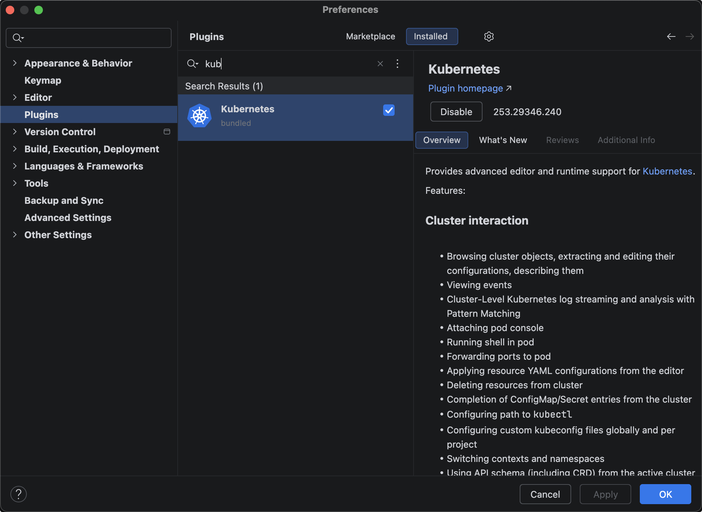
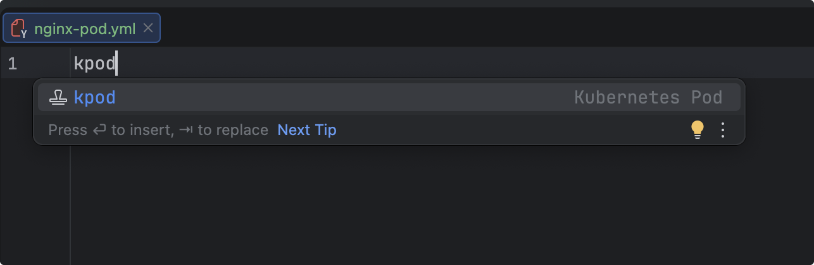
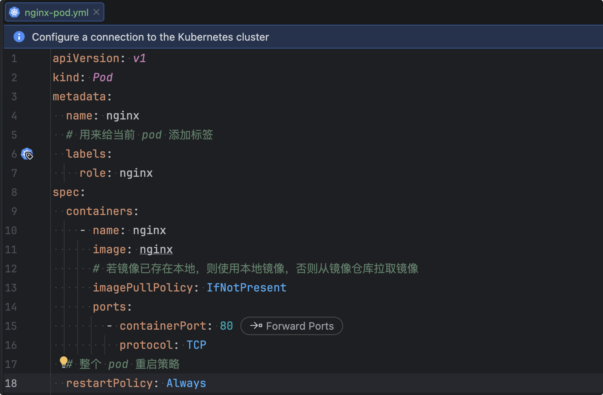

# Kubernetes-05-Pod基本操作

## 查看 Pod

K8s 给 Pod 设计了逻辑隔离，就是命名空间 namespace，默认是 default（创建时不指定） 和 kube-system（k8s集群自身的）


```bash
# 查看默认命名空间的 pod
$ kubectl get pods|pod|po
No resources found in default namespace.
# 等价于
$ kubectl get pods|pod|po -n default
No resources found in default namespace.

# 查看系统命名空间的 pod
$ kubectl get pods|pod|po -n kube-system
NAME                                READY   STATUS    RESTARTS      AGE
coredns-66f779496c-q79xm            1/1     Running   1 (69s ago)   26h
coredns-66f779496c-qcs8b            1/1     Running   1 (69s ago)   26h
etcd-k8s-node1                      1/1     Running   1 (72s ago)   26h
kube-apiserver-k8s-node1            1/1     Running   1 (72s ago)   26h
kube-controller-manager-k8s-node1   1/1     Running   1 (72s ago)   26h
kube-proxy-56wjm                    1/1     Running   1 (72s ago)   26h
kube-proxy-t85dn                    1/1     Running   1 (69s ago)   26h
kube-proxy-xtp7h                    1/1     Running   1 (97s ago)   26h
kube-scheduler-k8s-node1            1/1     Running   1 (72s ago)   26h

# 查看所有命名空间的 pod
$ kubectl get pods|pod|po -A
NAMESPACE      NAME                                READY   STATUS    RESTARTS       AGE
kube-flannel   kube-flannel-ds-ltxk5               1/1     Running   1 (87s ago)    25h
kube-flannel   kube-flannel-ds-r7fl4               1/1     Running   1 (85s ago)    25h
kube-flannel   kube-flannel-ds-sb4xl               1/1     Running   2 (51s ago)    25h
kube-system    coredns-66f779496c-q79xm            1/1     Running   1 (85s ago)    26h
kube-system    coredns-66f779496c-qcs8b            1/1     Running   1 (85s ago)    26h
kube-system    etcd-k8s-node1                      1/1     Running   1 (88s ago)    26h
kube-system    kube-apiserver-k8s-node1            1/1     Running   1 (88s ago)    26h
kube-system    kube-controller-manager-k8s-node1   1/1     Running   1 (88s ago)    26h
kube-system    kube-proxy-56wjm                    1/1     Running   1 (88s ago)    26h
kube-system    kube-proxy-t85dn                    1/1     Running   1 (85s ago)    26h
kube-system    kube-proxy-xtp7h                    1/1     Running   1 (113s ago)   26h
kube-system    kube-scheduler-k8s-node1            1/1     Running   1 (88s ago)    26h

# 查看默认命名空间下 pod 的详细信息
$ kubectl get pods|pod|po -o wide
No resources found in default namespace.

# 查看指定命名空间下 pod 的详细信息
$ kubectl get pods|pod|po -o wide -n kube-system
NAME                                READY   STATUS    RESTARTS        AGE   IP           NODE        NOMINATED NODE   READINESS GATES
coredns-66f779496c-q79xm            1/1     Running   1 (107s ago)    26h   10.244.2.4   k8s-node3   <none>           <none>
coredns-66f779496c-qcs8b            1/1     Running   1 (107s ago)    26h   10.244.2.5   k8s-node3   <none>           <none>
etcd-k8s-node1                      1/1     Running   1 (110s ago)    26h   10.15.0.21   k8s-node1   <none>           <none>
kube-apiserver-k8s-node1            1/1     Running   1 (110s ago)    26h   10.15.0.21   k8s-node1   <none>           <none>
kube-controller-manager-k8s-node1   1/1     Running   1 (110s ago)    26h   10.15.0.21   k8s-node1   <none>           <none>
kube-proxy-56wjm                    1/1     Running   1 (110s ago)    26h   10.15.0.21   k8s-node1   <none>           <none>
kube-proxy-t85dn                    1/1     Running   1 (107s ago)    26h   10.15.0.23   k8s-node3   <none>           <none>
kube-proxy-xtp7h                    1/1     Running   1 (2m15s ago)   26h   10.15.0.22   k8s-node2   <none>           <none>
kube-scheduler-k8s-node1            1/1     Running   1 (110s ago)    26h   10.15.0.21   k8s-node1   <none>           <none>

# 查看所有命名空间下 pod 的详细信息
$ kubectl get pods|pod|po -o wide -A
NAMESPACE      NAME                                READY   STATUS    RESTARTS        AGE   IP           NODE        NOMINATED NODE   READINESS GATES
kube-flannel   kube-flannel-ds-ltxk5               1/1     Running   1 (2m10s ago)   25h   10.15.0.21   k8s-node1   <none>           <none>
kube-flannel   kube-flannel-ds-r7fl4               1/1     Running   1 (2m8s ago)    25h   10.15.0.23   k8s-node3   <none>           <none>
kube-flannel   kube-flannel-ds-sb4xl               1/1     Running   2 (94s ago)     25h   10.15.0.22   k8s-node2   <none>           <none>
kube-system    coredns-66f779496c-q79xm            1/1     Running   1 (2m8s ago)    26h   10.244.2.4   k8s-node3   <none>           <none>
kube-system    coredns-66f779496c-qcs8b            1/1     Running   1 (2m8s ago)    26h   10.244.2.5   k8s-node3   <none>           <none>
kube-system    etcd-k8s-node1                      1/1     Running   1 (2m11s ago)   26h   10.15.0.21   k8s-node1   <none>           <none>
kube-system    kube-apiserver-k8s-node1            1/1     Running   1 (2m11s ago)   26h   10.15.0.21   k8s-node1   <none>           <none>
kube-system    kube-controller-manager-k8s-node1   1/1     Running   1 (2m11s ago)   26h   10.15.0.21   k8s-node1   <none>           <none>
kube-system    kube-proxy-56wjm                    1/1     Running   1 (2m11s ago)   26h   10.15.0.21   k8s-node1   <none>           <none>
kube-system    kube-proxy-t85dn                    1/1     Running   1 (2m8s ago)    26h   10.15.0.23   k8s-node3   <none>           <none>
kube-system    kube-proxy-xtp7h                    1/1     Running   1 (2m36s ago)   26h   10.15.0.22   k8s-node2   <none>           <none>
kube-system    kube-scheduler-k8s-node1            1/1     Running   1 (2m11s ago)   26h   10.15.0.21   k8s-node1   <none>           <none>

# 实时监控 pod 的状态
$ kubectl get pod -w
$ kubectl get pod -w -n 命名空间名称
$ kubectl get pod -A -w

# 查看 pod 详情
$ kubectl describe pod pod名称

```

## 创建 Pod

### 命令创建

与 Docker 创建类似，有 `run  --port='' --privileged=false --restart=false --i --t` 等 ，可以通过 `kubectl run --help`获取帮助。

```bash
# kubectl run pod名称 --image=镜像标签，默认创建在 default 命名空间下
$ kubectl run nginx --image=nginx:1.19
pod/nginx created
$ kubectl get pods
NAME    READY   STATUS              RESTARTS   AGE
nginx   0/1     ContainerCreating   0          16s
$ kubectl get pods -o wide
NAME    READY   STATUS    RESTARTS   AGE    IP           NODE        NOMINATED NODE   READINESS GATES
nginx   1/1     Running   0          117s   10.244.1.4   k8s-node2   <none>           <none>
$ kubectl describe pods nginx
Name:             nginx
Namespace:        default
Priority:         0
Service Account:  default
Node:             k8s-node2/10.15.0.22
Start Time:       Mon, 12 Jan 2026 23:27:44 +0800
Labels:           run=nginx
Annotations:      <none>
Status:           Running
IP:               10.244.1.4
IPs:
  IP:  10.244.1.4
Containers:
  nginx:
    Container ID:   containerd://48157f84cb920e15940dbced403219bc6c41b1b495803fcff38794a32268896d
    Image:          nginx:1.19
    Image ID:       docker.io/library/nginx@sha256:df13abe416e37eb3db4722840dd479b00ba193ac6606e7902331dcea50f4f1f2
    Port:           <none>
    Host Port:      <none>
    State:          Running
      Started:      Mon, 12 Jan 2026 23:28:49 +0800
    Ready:          True
    Restart Count:  0
    Environment:    <none>
    Mounts:
      /var/run/secrets/kubernetes.io/serviceaccount from kube-api-access-2fmdh (ro)
Conditions:
  Type              Status
  Initialized       True 
  Ready             True 
  ContainersReady   True 
  PodScheduled      True 
Volumes:
  kube-api-access-2fmdh:
    Type:                    Projected (a volume that contains injected data from multiple sources)
    TokenExpirationSeconds:  3607
    ConfigMapName:           kube-root-ca.crt
    ConfigMapOptional:       <nil>
    DownwardAPI:             true
QoS Class:                   BestEffort
Node-Selectors:              <none>
Tolerations:                 node.kubernetes.io/not-ready:NoExecute op=Exists for 300s
                             node.kubernetes.io/unreachable:NoExecute op=Exists for 300s
Events:
  Type    Reason     Age   From               Message
  ----    ------     ----  ----               -------
  Normal  Scheduled  69s   default-scheduler  Successfully assigned default/nginx to k8s-node2
  Normal  Pulling    68s   kubelet            Pulling image "nginx:1.19"
  Normal  Pulled     4s    kubelet            Successfully pulled image "nginx:1.19" in 1m3.996s (1m3.996s including waiting)
  Normal  Created    4s    kubelet            Created container nginx
  Normal  Started    4s    kubelet            Started container nginx
```

### 通过 yml 创建

>   官网参考地址: https://kubernetes.io/zh-cn/docs/reference/kubernetes-api/workload-resources/pod-v1/

`cat nginx-pod.yml`

```yml nginx-pod.yml
# 代表使用的 api 版本
apiVersion: v1
# 代表创建的类型
kind: Pod
# 用来书写对应元数据信息，比如指定 Pod 名称以及 namespace 命名空间，也可以自定义名字
metadata:
  name: nginx
# 对 Pod 预期行为的规约，比如配置容器
spec:
  containers:
    - name: nginx
      image: nginx:1.19
      ports:
        - containerPort: 80
```

使用 `kubectl create/apply -f` 创建 pod

**区别**：

`create` 仅仅是不存在时创建,如果已经存在则报错！

`apply` 不存在创建，存在更新配置。推荐使用 apply！`

```bash
$ kubectl create -f nginx-pod.yml 
pod/nginx created
$ kubectl get pods
NAME    READY   STATUS    RESTARTS   AGE
nginx   1/1     Running   0          9s
$ kubectl create -f nginx-pod.yml 
Error from server (AlreadyExists): error when creating "nginx-pod.yml": pods "nginx" already exists

$ kubectl apply -f nginx-pod.yml 
pod/nginx created
$ kubectl get pods
NAME    READY   STATUS    RESTARTS   AGE
nginx   1/1     Running   0          6s
$ kubectl apply -f nginx-pod.yml 
pod/nginx unchanged
```

### 通过IDEA插件生成Pod模板

Idea 安装插件：



打开 Idea 创建文件 nginx-pod.yml，输入小写 kpod即可





```yml nginx-pod.yml
apiVersion: v1
kind: Pod
metadata:
  name: nginx
  # 用来给当前 pod 添加标签
  labels:
    role: nginx
spec:
  containers:
    - name: nginx
      image: nginx
      # 若镜像已存在本地，则使用本地镜像，否则从镜像仓库拉取镜像
      imagePullPolicy: IfNotPresent
      ports:
        - containerPort: 80
          protocol: TCP
  # 整个 pod 重启策略
  restartPolicy: Always
```

## 删除 Pod

```bash
# 直接根据 pod 名称 删除
$ kubectl delete pod nginx
pod "nginx" deleted
# 根据 yml 文件删除
$ kubectl delete -f nginx-pod.yml 
pod "nginx" deleted

# 强制删除 pod 
# --grace-period 优雅终止期 默认30秒 
# --grace-period=0立即强制删除，不等待优雅终止（常用）
$ kubectl delete pod nginx --force --grace-period=0
$ kubectl delete pod myapp-label --force
# 等价于：
$ kubectl delete pod myapp-label --grace-period=30 --force
```

## 进入 Pod 中容器

```shell
# 这种方式进入容器默认只会进入 pod 中第一个容器
$ kubectl exec -it nginx(pod名称) --(固定写死) bash(执行命令)
# 进入指定 pod 中的容器
$ kubectl exec -it nginx(pod名称) -c nignx(容器名称) --(固定写死) bash(执行命令)
```

## 查看 Pod 日志

```shell
# 这种方式默认查看 pod 中第一个容器日志
$ kubectl logs -f(可选，实时) nginx(pod名称)
# 查看 pod 指定容器的日志
$ kubectl logs -f(可选，实时) nginx(pod名称) -c nginx(容器名称)
```

## 查看 Pod 描述信息

```shell
$ kubectl describe pod nignx(pod名称)
```

## Pod 运行多个容器

### 创建 pod

```yml myapp-pod.yml
apiVersion: v1
kind: Pod
metadata:
  name: myapp-pod
  labels:
    role: myapp-pod
spec:
  containers:
    - name: nginx
      image: nginx:1.19
      imagePullPolicy: IfNotPresent
      ports:
        - containerPort: 80
          protocol: TCP
          
    - name: redis
      image: redis:5.0.10
      ports:
        - containerPort: 6379
          protocol: TCP
      imagePullPolicy: IfNotPresent
      
  restartPolicy: Always
```

### 启动 pod

```shell
$ kubectl apply -f 002-myapp-pod.yml 
pod/myapp-pod created
$ kubectl get pod 
NAME        READY   STATUS    RESTARTS   AGE
myapp-pod   2/2     Running   0          3m4s
$ kubectl describe pod myapp-pod
Name:             myapp-pod
Namespace:        default
Priority:         0
Service Account:  default
Node:             k8s-node2/10.15.0.22
Start Time:       Tue, 20 Jan 2026 21:39:22 +0800
Labels:           role=myapp-pod
Annotations:      <none>
Status:           Running
IP:               10.244.1.8
IPs:
  IP:  10.244.1.8
Containers:
  nginx:
    Container ID:   containerd://47db8b7aac0ffc2bb3ffae23c125fc431b0fab68ca4b8f7caa7766ada22ea8b3
    Image:          nginx:1.19
    Image ID:       docker.io/library/nginx@sha256:df13abe416e37eb3db4722840dd479b00ba193ac6606e7902331dcea50f4f1f2
    Port:           80/TCP
    Host Port:      0/TCP
    State:          Running
      Started:      Tue, 20 Jan 2026 21:39:23 +0800
    Ready:          True
    Restart Count:  0
    Environment:    <none>
    Mounts:
      /var/run/secrets/kubernetes.io/serviceaccount from kube-api-access-rr45d (ro)
  redis:
    Container ID:   containerd://2a340a45fdc3833057dddb24e1e0a0f595efa596c17042b0fdf1106d14943098
    Image:          redis:5.0.10
    Image ID:       docker.io/library/redis@sha256:2236b827820ab65836a7aa5b494e03c3ede6e8801a853a0e24c9d6afbcfe0461
    Port:           6379/TCP
    Host Port:      0/TCP
    State:          Running
      Started:      Tue, 20 Jan 2026 21:40:23 +0800
    Ready:          True
    Restart Count:  0
    Environment:    <none>
    Mounts:
      /var/run/secrets/kubernetes.io/serviceaccount from kube-api-access-rr45d (ro)
Conditions:
  Type              Status
  Initialized       True 
  Ready             True 
  ContainersReady   True 
  PodScheduled      True 
Volumes:
  kube-api-access-rr45d:
    Type:                    Projected (a volume that contains injected data from multiple sources)
    TokenExpirationSeconds:  3607
    ConfigMapName:           kube-root-ca.crt
    ConfigMapOptional:       <nil>
    DownwardAPI:             true
QoS Class:                   BestEffort
Node-Selectors:              <none>
Tolerations:                 node.kubernetes.io/not-ready:NoExecute op=Exists for 300s
                             node.kubernetes.io/unreachable:NoExecute op=Exists for 300s
Events:
  Type    Reason     Age    From               Message
  ----    ------     ----   ----               -------
  Normal  Scheduled  5m20s  default-scheduler  Successfully assigned default/myapp-pod to k8s-node2
  Normal  Pulled     5m19s  kubelet            Container image "nginx:1.19" already present on machine
  Normal  Created    5m19s  kubelet            Created container nginx
  Normal  Started    5m19s  kubelet            Started container nginx
  Normal  Pulling    5m19s  kubelet            Pulling image "redis:5.0.10"
  Normal  Pulled     4m19s  kubelet            Successfully pulled image "redis:5.0.10" in 59.698s (59.698s including waiting)
  Normal  Created    4m19s  kubelet            Created container redis
  Normal  Started    4m19s  kubelet            Started container redis
```

### 查看容器日志

```shell
# 查看日志 (默认只查看第一个容器日志，这里是展示 nginx 日志)
$ kubectl logs -f myapp-pod
Defaulted container "nginx" out of: nginx, redis
/docker-entrypoint.sh: /docker-entrypoint.d/ is not empty, will attempt to perform configuration
/docker-entrypoint.sh: Looking for shell scripts in /docker-entrypoint.d/
/docker-entrypoint.sh: Launching /docker-entrypoint.d/10-listen-on-ipv6-by-default.sh
10-listen-on-ipv6-by-default.sh: info: Getting the checksum of /etc/nginx/conf.d/default.conf
10-listen-on-ipv6-by-default.sh: info: Enabled listen on IPv6 in /etc/nginx/conf.d/default.conf
/docker-entrypoint.sh: Launching /docker-entrypoint.d/20-envsubst-on-templates.sh
/docker-entrypoint.sh: Launching /docker-entrypoint.d/30-tune-worker-processes.sh
/docker-entrypoint.sh: Configuration complete; ready for start up

# 查看 pod 中指定容器的日志
$ kubectl logs -f myapp-pod -c nginx(容器名称)
/docker-entrypoint.sh: /docker-entrypoint.d/ is not empty, will attempt to perform configuration
/docker-entrypoint.sh: Looking for shell scripts in /docker-entrypoint.d/
/docker-entrypoint.sh: Launching /docker-entrypoint.d/10-listen-on-ipv6-by-default.sh
10-listen-on-ipv6-by-default.sh: info: Getting the checksum of /etc/nginx/conf.d/default.conf
10-listen-on-ipv6-by-default.sh: info: Enabled listen on IPv6 in /etc/nginx/conf.d/default.conf
/docker-entrypoint.sh: Launching /docker-entrypoint.d/20-envsubst-on-templates.sh
/docker-entrypoint.sh: Launching /docker-entrypoint.d/30-tune-worker-processes.sh
/docker-entrypoint.sh: Configuration complete; ready for start up
$ kubectl logs -f myapp-pod -c redis(容器名称)
1:C 20 Jan 2026 13:40:23.358 # oO0OoO0OoO0Oo Redis is starting oO0OoO0OoO0Oo
1:C 20 Jan 2026 13:40:23.358 # Redis version=5.0.10, bits=64, commit=00000000, modified=0, pid=1, just started
1:C 20 Jan 2026 13:40:23.358 # Warning: no config file specified, using the default config. In order to specify a config file use redis-server /path/to/redis.conf
1:M 20 Jan 2026 13:40:23.360 * Running mode=standalone, port=6379.
1:M 20 Jan 2026 13:40:23.360 # WARNING: The TCP backlog setting of 511 cannot be enforced because /proc/sys/net/core/somaxconn is set to the lower value of 128.
1:M 20 Jan 2026 13:40:23.360 # Server initialized
1:M 20 Jan 2026 13:40:23.360 # WARNING you have Transparent Huge Pages (THP) support enabled in your kernel. This will create latency and memory usage issues with Redis. To fix this issue run the command 'echo never > /sys/kernel/mm/transparent_hugepage/enabled' as root, and add it to /etc/rc.local in order to retain the setting after a reboot. Redis must be restarted after THP is disabled.
1:M 20 Jan 2026 13:40:23.365 * Ready to accept connections
```

### 进入容器

```shell
# 进入 pod 的容器 (默认进入第一个容器内部，这里会进入 nginx 容器内部)
$ kubectl exec -it myapp-pod -- bash
Defaulted container "nginx" out of: nginx, redis
root@myapp-pod:/# exit
exit

# 进入 pod 中指定容器内部
$ kubectl exec -it myapp-pod -c nginx -- bash
root@myapp-pod:/# 
$ kubectl exec -it myapp-pod -c redis -- bash
root@myapp-pod:/data# 
```
