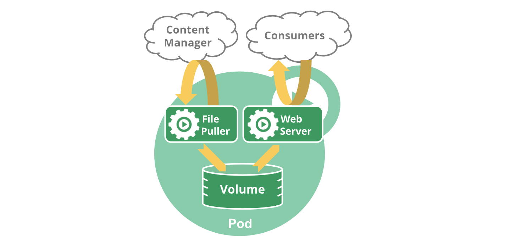

# Kubernetes-07-Pod的生命周期

## 概述

>   官网: https://kubernetes.io/zh-cn/docs/concepts/workloads/pods/pod-lifecycle/

Pod 遵循预定义的生命周期，起始于 `Pending` 阶段， 如果至少其中有一个主要容器正常启动，则进入 `Running`，之后取决于 Pod 中是否有容器以失败状态结束而进入 `Succeeded` 或者 `Failed` 阶段。与此同时Pod 在其生命周期中只会被调度一次。 一旦 Pod 被调度（分派）到某个节点，Pod 会一直在该节点运行，直到 Pod 停止或者被终止。

## 生命周期

和一个个独立的应用容器一样，Pod 也被认为是相对临时性（而不是长期存在）的实体。 Pod 会被创建、赋予一个唯一的 ID(UID)， 并被调度到节点，并在终止（根据重启策略）或删除之前一直运行在该节点。如果一个节点死掉了，调度到该节点的 Pod 也被计划在给定超时期限结束后删除。

Pod 自身不具有自愈能力。如果 Pod 被调度到某节点而该节点之后失效， Pod 会被删除；类似地，Pod 无法在因节点资源耗尽或者节点维护而被驱逐期间继续存活。 Kubernetes 使用一种高级抽象来管理这些相对而言可随时丢弃的 Pod 实例， 称作控制器。

任何给定的 Pod （由 UID 定义）从不会被“重新调度（rescheduled）”到不同的节点； 相反，这一 Pod 可以被一个新的、几乎完全相同的 Pod 替换掉。 如果需要，新 Pod 的名字可以不变，但是其 UID 会不同。

如果某物声称其生命期与某 Pod 相同，例如存储卷， 这就意味着该对象在此 Pod （UID 亦相同）存在期间也一直存在。 如果 Pod 因为任何原因被删除，甚至完全相同的替代 Pod 被创建时， 这个相关的对象（例如这里的卷）也会被删除并重建。

## Pod 的阶段

Pod 阶段的数量和含义是严格定义的。 除了本文档中列举的内容外，不应该再假定 Pod 有其他的 `phase` 值。

| 取值                | 描述                                                         |
| :------------------ | :----------------------------------------------------------- |
| `Pending`（悬决）   | Pod 已被 Kubernetes 系统接受，但有一个或者多个容器尚未创建亦未运行。此阶段包括等待 Pod 被调度的时间和通过网络下载镜像的时间。 |
| `Running`（运行中） | Pod 已经绑定到了某个节点，Pod 中所有的容器都已被创建。至少有一个容器仍在运行，或者正处于启动或重启状态。 |
| `Succeeded`（成功） | Pod 中的所有容器都已成功终止，并且不会再重启。               |
| `Failed`（失败）    | Pod 中的所有容器都已终止，并且至少有一个容器是因为失败终止。也就是说，容器以非 0 状态退出或者被系统终止。 |
| `Unknown`（未知）   | 因为某些原因无法取得 Pod 的状态。这种情况通常是因为与 Pod 所在主机通信失败。 |

> **说明：**
>
> 1. 当一个 Pod 被删除时，执行一些 kubectl 命令会展示这个 Pod 的状态为 `Terminating`（终止）。 这个 `Terminating` 状态并不是 Pod 阶段之一。 Pod 被赋予一个可以体面终止的期限，默认为 30 秒。 你可以使用 `--force` 参数来强制终止 Pod。
>
> 2. 如果某节点死掉或者与集群中其他节点失联，Kubernetes 会实施一种策略，将失去的节点上运行的所有 Pod 的 `phase` 设置为 `Failed`。
