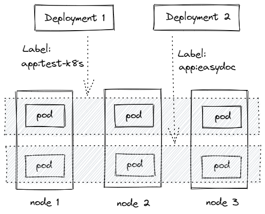

# Kubernetes部署应用

## 运行应用

### 直接命令行运行


```sh
# kubectl run NAME --image=镜像地址[:TAG]
$ kubectl run testapp --image=ccr.ccs.tencentyun.com/k8s-tutorial/test-k8s:v1
pod/testapp created

# 查看运行的pod
$ kubectl get pod
NAME      READY   STATUS    RESTARTS   AGE
testapp   1/1     Running   0          61s
```

### yaml方式启动

#### Pod方式

```yaml pod.yaml
apiVersion: v1
# 定义以 pod 方式管理
kind: Pod
# 定义元数据
metadata:
  # pod 的名称
  name: test-pod
spec:
  # 定义容器，可以多个
  containers:
    - name: test-k8s # 容器名字
      image: ccr.ccs.tencentyun.com/k8s-tutorial/test-k8s:v1 # 镜像
```


```sh
# 运行pod：
$ kubectl apply -f pod.yaml
pod/test-pod created

# 查看运行的pod
$ kubectl get pod
NAME       READY   STATUS    RESTARTS   AGE
test-pod   1/1     Running   0          22s
testapp    1/1     Running   0          2m29s
```

#### Deployment方式

**Deployment 通过 label 关联起来 Pods**



单独运行pod不是很方便，在集群里面会有很多pod，这样需要用 Deployment ：

```yaml deployment.yaml
apiVersion: apps/v1
# 定义以 Deployment 方式管理
kind: Deployment
metadata:
  # Deployment 的名称
  name: test-k8s
spec:
  # 运行的 pod 副本数量
  replicas: 2
  # 用来查找关联的 Pod，所有标签都匹配才行
  selector:
    matchLabels:
      app: test-k8s
  # 定义 Pod 相关数据
  template:
    metadata:
      labels:
        app: test-k8s
    spec:
      # 定义容器，可以多个
      containers:
      - name: test-k8s # 容器名字
        image: ccr.ccs.tencentyun.com/k8s-tutorial/test-k8s:v1 # 镜像
```


```sh
# 运行 deployment
$ kubectl apply -f deployment.yaml
deployment.apps/test-k8s created

# 查看运行的 deployment
$ kubectl get deployment
NAME       READY   UP-TO-DATE   AVAILABLE   AGE
test-k8s   2/2     2            2           28s
```

##  常用命令

### 部署应用

```sh
# kubectl apply -f app.yaml
$ kubectl apply -f deployment.yaml
deployment.apps/test-k8s created
```


### 查看 deployment pod

```sh
# 查看运行的 deployment
$ kubectl get deployment
NAME       READY   UP-TO-DATE   AVAILABLE   AGE
test-k8s   2/2     2            2           8s

# 查看运行的 pod
$ kubectl get pod
NAME                        READY   STATUS    RESTARTS   AGE
test-k8s-8598bbb8c6-pwhjh   1/1     Running   0          27s
test-k8s-8598bbb8c6-t2szm   1/1     Running   0          27s

# 查看详细的pod，带有ip,运行在哪个节点等
$ kubectl get pod -o wide
NAME                        READY   STATUS    RESTARTS   AGE   IP           NODE    NOMINATED NODE   READINESS GATES
test-k8s-8598bbb8c6-pwhjh   1/1     Running   0          43s   10.244.0.7   node2   <none>           <none>
test-k8s-8598bbb8c6-t2szm   1/1     Running   0          43s   10.244.0.7   node1   <none>           <none>

# 查看 pod 详细数据
# kubectl describe pod POD-NAME
# 或者 kubectl describe pod/POD-NAME
$ kubectl describe pod test-k8s-8598bbb8c6-pwhjh
Name:         test-k8s-8598bbb8c6-pwhjh
Namespace:    default
Priority:     0
Node:         node2/10.211.55.103
Start Time:   Fri, 07 Jan 2022 14:02:34 +0800
Labels:       app=test-k8s
              pod-template-hash=8598bbb8c6
Annotations:  <none>
Status:       Running
IP:           10.244.0.7 # ip
IPs:
  IP:           10.244.0.7
Controlled By:  ReplicaSet/test-k8s-8598bbb8c6
Containers: # 容器相关信息
  test-k8s:
    Container ID:   docker://9aa023b175d4c7655bd5a601975be90d34c5896b2b8a871fab7bd1227cea6ca5
    Image:          ccr.ccs.tencentyun.com/k8s-tutorial/test-k8s:v1
    Image ID:       docker-pullable://ccr.ccs.tencentyun.com/k8s-tutorial/test-k8s@sha256:9b452816d6493045a21d8b3d6a851f21ca2e50c86cd57ba8c41141f001d9911d
    Port:           <none>
    Host Port:      <none>
    State:          Running
      Started:      Fri, 07 Jan 2022 14:02:35 +0800
    Ready:          True
    Restart Count:  0
    Environment:    <none>
    Mounts:
      /var/run/secrets/kubernetes.io/serviceaccount from kube-api-access-r8nvq (ro)
Conditions:
  Type              Status
  Initialized       True
  Ready             True
  ContainersReady   True
  PodScheduled      True
Volumes:
  kube-api-access-r8nvq:
    Type:                    Projected (a volume that contains injected data from multiple sources)
    TokenExpirationSeconds:  3607
    ConfigMapName:           kube-root-ca.crt
    ConfigMapOptional:       <nil>
    DownwardAPI:             true
QoS Class:                   BestEffort
Node-Selectors:              <none>
Tolerations:                 node.kubernetes.io/not-ready:NoExecute op=Exists for 300s
                             node.kubernetes.io/unreachable:NoExecute op=Exists for 300s
# 事件（重要）-按照时间倒序
Events:
  Type    Reason     Age   From               Message
  ----    ------     ----  ----               -------
  # 节点上的 kubelet 收到了任务后，进行拉取镜像，并启动镜像
  Normal  Pulled     72s   kubelet            Container image "ccr.ccs.tencentyun.com/k8s-tutorial/test-k8s:v1" already present on machine
  Normal  Created    72s   kubelet            Created container test-k8s
  Normal  Started    72s   kubelet            Started container test-k8s
  # 1.首先节点上的 kubelet 收到了任务后，进行拉取镜像，并启动镜像
  Normal  Scheduled  70s   default-scheduler  Successfully assigned default/test-k8s-8598bbb8c6-pwhjh to node2
```


### 查看 log

```sh
# 查看 pod 上的日志, -f 为持续查看日志
# kubectl logs POD-NAME [-f]
# 或者 kubectl logs pods/POD-NAME [-f]
$ kubectl logs test-k8s-8598bbb8c6-pwhjh -f
[2022-01-07T06:02:36.007] [INFO] app - run in docker
[2022-01-07T06:02:36.014] [INFO] app - Server started successfully and listened on 8080
http://localhost:8080

```


### 进入 Pod 容器终端

```sh
# 进入 Pod 容器终端
# 若pod里面有多个容器，可以加上 -c container-name 可以指定进入哪个容器。
# kubectl exec -it POD-NAME [-c container-name] -- bash
$ kubectl exec -it test-k8s-8598bbb8c6-pwhjh -- bash
root@test-k8s-8598bbb8c6-pwhjh:/app$ ls
app.js	docker-compose.yml  draw  log  log.js  log4js.json  node_modules  package-lock.json  package.json  yaml
root@test-k8s-8598bbb8c6-pwhjh:/app$ exit
exit
```


### 伸缩副本数量

两种方式

#### 修改配置文件

1. 首先修改 deployment.yaml 文件内的 spec.replicas 为5

   ```yaml deployment.yaml
   apiVersion: apps/v1
   # 定义以 Deployment 方式管理
   kind: Deployment
   metadata:
     # Deployment 的名称
     name: test-k8s
   spec:
     # 运行的 pod 副本数量
     replicas: 5
     # 用来查找关联的 Pod，所有标签都匹配才行
     selector:
       matchLabels:
         app: test-k8s
     # 定义 Pod 相关数据
     template:
       metadata:
         labels:
           app: test-k8s
       spec:
         # 定义容器，可以多个
         containers:
         - name: test-k8s # 容器名字
           image: ccr.ccs.tencentyun.com/k8s-tutorial/test-k8s:v1 # 镜像
   ```

2. 重新执行 yaml 文件

   ```sh
   $ kubectl apply -f deployment.yaml
   deployment.apps/test-k8s configured
   
   # 查看 pod
   $ kubectl get pod -o wide
   NAME                        READY   STATUS    RESTARTS   AGE     IP            NODE    NOMINATED NODE   READINESS GATES
   test-k8s-8598bbb8c6-66jzz   1/1     Running   0          38s     10.244.0.8    node1   <none>           <none>
   test-k8s-8598bbb8c6-pwhjh   1/1     Running   0          6m14s   10.244.0.7    node2   <none>           <none>
   test-k8s-8598bbb8c6-qjcnd   1/1     Running   0          38s     10.244.0.9    node2   <none>           <none>
   test-k8s-8598bbb8c6-t2szm   1/1     Running   0          6m14s   10.244.0.7    node1   <none>           <none>
   test-k8s-8598bbb8c6-wsprz   1/1     Running   0          38s     10.244.0.8    node2   <none>           <none>
   ```


#### 通过命令行调整

```sh
# kubectl scale deployment DEPLOYMENT-NAME --replicas=副本数量
$ kubectl scale deployment test-k8s --replicas=10
deployment.apps/test-k8s scaled

# 查看 pod
$ kubectl get pod -o wide
NAME                        READY   STATUS    RESTARTS   AGE     IP             NODE    NOMINATED NODE   READINESS GATES
test-k8s-8598bbb8c6-66jzz   1/1     Running   0          67s     10.244.0.8     node1   <none>           <none>
test-k8s-8598bbb8c6-7qcqq   1/1     Running   0          10s     10.244.0.11    node1   <none>           <none>
test-k8s-8598bbb8c6-k8nlz   1/1     Running   0          10s     10.244.0.10    node2   <none>           <none>
test-k8s-8598bbb8c6-n6bsl   1/1     Running   0          10s     10.244.0.10    node1   <none>           <none>
test-k8s-8598bbb8c6-nmrm2   1/1     Running   0          10s     10.244.0.9     node1   <none>           <none>
test-k8s-8598bbb8c6-pwhjh   1/1     Running   0          6m43s   10.244.0.7     node2   <none>           <none>
test-k8s-8598bbb8c6-qjcnd   1/1     Running   0          67s     10.244.0.9     node2   <none>           <none>
test-k8s-8598bbb8c6-t2szm   1/1     Running   0          6m43s   10.244.0.7     node1   <none>           <none>
test-k8s-8598bbb8c6-wsprz   1/1     Running   0          67s     10.244.0.8     node2   <none>           <none>
test-k8s-8598bbb8c6-zrctz   1/1     Running   0          10s     10.244.0.11    node2   <none>           <none>

# 也可以减下来
$ kubectl scale deployment test-k8s --replicas=2
deployment.apps/test-k8s scaled

# 查看 pod
$ kubectl get pod -o wide
NAME                        READY   STATUS        RESTARTS   AGE    IP             NODE    NOMINATED NODE   READINESS GATES
test-k8s-8598bbb8c6-66jzz   1/1     Terminating   0          93s    10.244.0.8     node1   <none>           <none>
test-k8s-8598bbb8c6-7qcqq   1/1     Terminating   0          36s    10.244.0.11    node1   <none>           <none>
test-k8s-8598bbb8c6-k8nlz   1/1     Terminating   0          36s    10.244.0.10    node2   <none>           <none>
test-k8s-8598bbb8c6-n6bsl   1/1     Terminating   0          36s    10.244.0.10    node1   <none>           <none>
test-k8s-8598bbb8c6-nmrm2   1/1     Terminating   0          36s    10.244.0.9     node1   <none>           <none>
test-k8s-8598bbb8c6-pwhjh   1/1     Running       0          7m9s   10.244.0.7     node2   <none>           <none>
test-k8s-8598bbb8c6-qjcnd   1/1     Terminating   0          93s    10.244.0.9     node2   <none>           <none>
test-k8s-8598bbb8c6-t2szm   1/1     Running       0          7m9s   10.244.0.7     node1   <none>           <none>
test-k8s-8598bbb8c6-wsprz   1/1     Terminating   0          93s    10.244.0.8     node2   <none>           <none>
test-k8s-8598bbb8c6-zrctz   1/1     Terminating   0          36s    10.244.0.11    node2   <none>           <none>

$ kubectl get pod -o wide
NAME                        READY   STATUS    RESTARTS   AGE     IP            NODE    NOMINATED NODE   READINESS GATES
test-k8s-8598bbb8c6-pwhjh   1/1     Running   0          7m37s   10.244.0.7    node2   <none>           <none>
test-k8s-8598bbb8c6-t2szm   1/1     Running   0          7m37s   10.244.0.7    node1   <none>           <none>
```


### 把集群内端口映射到节点

```sh
# kubectl port-forward POD-NAME 宿主机端口:容器内端口
# 或者 kubectl port-forward pod/POD-NAME 宿主机端口:容器内端口
# 或者 kubectl port-forward deployment/DEPLOYMENT-NAME 宿主机端口:容器内端口
$ kubectl port-forward test-k8s-8598bbb8c6-pwhjh 8090:8080
Forwarding from 127.0.0.1:8090 -> 8080
Forwarding from [::1]:8090 -> 8080

```


### 查看历史版本

1. 目前只有一个历史版本

   ```sh
   # kubectl rollout history deployment DEPLOYMENT-NAME
   # 目前只有一个历史
   $ kubectl rollout history deployment test-k8s
   deployment.apps/test-k8s
   REVISION  CHANGE-CAUSE
   1         <none>
   ```

   

2. 现在修改 yaml 文件 中的镜像版本

   ```yaml deployment.yaml
   apiVersion: apps/v1
   # 定义以 Deployment 方式管理
   kind: Deployment
   metadata:
     # Deployment 的名称
     name: test-k8s
   spec:
     # 运行的 pod 副本数量
     replicas: 5
     # 用来查找关联的 Pod，所有标签都匹配才行
     selector:
       matchLabels:
         app: test-k8s
     # 定义 Pod 相关数据
     template:
       metadata:
         labels:
           app: test-k8s
       spec:
         # 定义容器，可以多个
         containers:
         - name: test-k8s # 容器名字
           image: ccr.ccs.tencentyun.com/k8s-tutorial/test-k8s:v2-with-error # 镜像
   ```

3. 重新部署

   ```sh
   $ kubectl apply -f deployment.yaml
   deployment.apps/test-k8s configured
   
   $ kubectl get pod -o wide
   NAME                        READY   STATUS        RESTARTS   AGE     IP             NODE    NOMINATED NODE   READINESS GATES
   test-k8s-5dd85b6897-628bb   1/1     Running       0          36s     10.244.0.12    node2   <none>           <none>
   test-k8s-5dd85b6897-6twbp   1/1     Running       0          36s     10.244.0.14    node1   <none>           <none>
   test-k8s-5dd85b6897-ld72w   1/1     Running       0          36s     10.244.0.14    node2   <none>           <none>
   test-k8s-5dd85b6897-r287p   1/1     Running       0          31s     10.244.0.15    node1   <none>           <none>
   test-k8s-5dd85b6897-vbr9v   1/1     Running       0          31s     10.244.0.15    node2   <none>           <none>
   test-k8s-8598bbb8c6-hnfgk   1/1     Terminating   0          36s     10.244.0.13    node2   <none>           <none>
   test-k8s-8598bbb8c6-nsdld   1/1     Terminating   0          36s     10.244.0.13    node1   <none>           <none>
   test-k8s-8598bbb8c6-pwhjh   1/1     Terminating   0          9m25s   10.244.0.7     node2   <none>           <none>
   test-k8s-8598bbb8c6-t2szm   1/1     Terminating   0          9m25s   10.244.0.7     node1   <none>           <none>
   
   $ kubectl get pod -o wide
   NAME                        READY   STATUS    RESTARTS   AGE   IP             NODE    NOMINATED NODE   READINESS GATES
   test-k8s-5dd85b6897-628bb   1/1     Running   0          42s   10.244.0.12    node2   <none>           <none>
   test-k8s-5dd85b6897-6twbp   1/1     Running   0          42s   10.244.0.14    node1   <none>           <none>
   test-k8s-5dd85b6897-ld72w   1/1     Running   0          42s   10.244.0.14    node2   <none>           <none>
   test-k8s-5dd85b6897-r287p   1/1     Running   0          37s   10.244.0.15    node1   <none>           <none>
   test-k8s-5dd85b6897-vbr9v   1/1     Running   0          37s   10.244.0.15    node2   <none>           <none>                  1/1     Running   0          88m
   ```

4. 查看现在的历史版本

   现在有两个版本了

   ```sh
   $ kubectl rollout history deployment test-k8s
   deployment.apps/test-k8s
   REVISION  CHANGE-CAUSE
   1         <none>
   2         <none>
   ```

   

### 回到上个版本

```sh
# kubectl rollout undo DEPLOYMENT-NAME 
$ kubectl rollout undo deployment test-k8s
deployment.apps/test-k8s rolled back

$ kubectl get pod -o wide
NAME                        READY   STATUS        RESTARTS   AGE   IP             NODE    NOMINATED NODE   READINESS GATES
test-k8s-5dd85b6897-6twbp   1/1     Terminating   0          99s   10.244.0.14    node1   <none>           <none>
test-k8s-5dd85b6897-ld72w   1/1     Terminating   0          99s   10.244.0.14    node2   <none>           <none>
test-k8s-5dd85b6897-r287p   1/1     Terminating   0          94s   10.244.0.15    node1   <none>           <none>
test-k8s-5dd85b6897-vbr9v   1/1     Terminating   0          94s   10.244.0.15    node2   <none>           <none>
test-k8s-8598bbb8c6-g556j   1/1     Running       0          30s   10.244.0.18    node1   <none>           <none>
test-k8s-8598bbb8c6-k599w   1/1     Running       0          31s   10.244.0.16    node2   <none>           <none>
test-k8s-8598bbb8c6-krz9j   1/1     Running       0          30s   10.244.0.17    node2   <none>           <none>
test-k8s-8598bbb8c6-qnclg   1/1     Running       0          31s   10.244.0.17    node1   <none>           <none>
test-k8s-8598bbb8c6-s98pd   1/1     Running       0          31s   10.244.0.16    node1   <none>           <none>

$ kubectl get pod -o wide
NAME                        READY   STATUS    RESTARTS   AGE   IP             NODE    NOMINATED NODE   READINESS GATES
test-k8s-8598bbb8c6-g556j   1/1     Running   0          34s   10.244.0.18    node1   <none>           <none>
test-k8s-8598bbb8c6-k599w   1/1     Running   0          35s   10.244.0.16    node2   <none>           <none>
test-k8s-8598bbb8c6-krz9j   1/1     Running   0          34s   10.244.0.17    node2   <none>           <none>
test-k8s-8598bbb8c6-qnclg   1/1     Running   0          35s   10.244.0.17    node1   <none>           <none>
test-k8s-8598bbb8c6-s98pd   1/1     Running   0          35s   10.244.0.16    node1   <none>           <none>

# 查看历史版本
$ kubectl rollout history deployment test-k8s
deployment.apps/test-k8s
REVISION  CHANGE-CAUSE
2         <none>
3         <none>
```


### 回到指定版本

```sh
# kubectl rollout undo deployment DEPLOYMENT-NAME --to-revision=版本号
$ kubectl rollout undo deployment test-k8s --to-revision=2
deployment.apps/test-k8s rolled back

$ kubectl get pod -o wide
NAME                        READY   STATUS        RESTARTS   AGE   IP             NODE    NOMINATED NODE   READINESS GATES
test-k8s-5dd85b6897-5b2l4   1/1     Running       0          27s   10.244.0.18    node2   <none>           <none>
test-k8s-5dd85b6897-ldrz4   1/1     Running       0          27s   10.244.0.20    node1   <none>           <none>
test-k8s-5dd85b6897-mhfrx   1/1     Running       0          25s   10.244.0.21    node1   <none>           <none>
test-k8s-5dd85b6897-txh85   1/1     Running       0          25s   10.244.0.19    node2   <none>           <none>
test-k8s-5dd85b6897-zmm7h   1/1     Running       0          27s   10.244.0.19    node1   <none>           <none>
test-k8s-8598bbb8c6-g556j   1/1     Terminating   0          89s   10.244.0.18    node1   <none>           <none>
test-k8s-8598bbb8c6-k599w   1/1     Terminating   0          90s   10.244.0.16    node2   <none>           <none>
test-k8s-8598bbb8c6-krz9j   1/1     Terminating   0          89s   10.244.0.17    node2   <none>           <none>
test-k8s-8598bbb8c6-qnclg   1/1     Terminating   0          90s   10.244.0.17    node1   <none>           <none>
test-k8s-8598bbb8c6-s98pd   1/1     Terminating   0          90s   10.244.0.16    node1   <none>           <none>

$ kubectl get pod -o wide
NAME                        READY   STATUS    RESTARTS   AGE   IP             NODE    NOMINATED NODE   READINESS GATES
test-k8s-5dd85b6897-5b2l4   1/1     Running   0          38s   10.244.0.18    node2   <none>           <none>
test-k8s-5dd85b6897-ldrz4   1/1     Running   0          38s   10.244.0.20    node1   <none>           <none>
test-k8s-5dd85b6897-mhfrx   1/1     Running   0          36s   10.244.0.21    node1   <none>           <none>
test-k8s-5dd85b6897-txh85   1/1     Running   0          36s   10.244.0.19    node2   <none>           <none>
test-k8s-5dd85b6897-zmm7h   1/1     Running   0          38s   10.244.0.19    node1   <none>           <none>

# 查看历史版本
$ kubectl rollout history deployment test-k8s
deployment.apps/test-k8s
REVISION  CHANGE-CAUSE
3         <none>
4         <none>
```


### 删除部署

```sh
# kubectl delete deployment DEPLOYMENT-NAME
$ kubectl delete deployment test-k8s
deployment.apps "test-k8s" deleted

$ kubectl get pod -o wide
NAME                        READY   STATUS        RESTARTS   AGE   IP             NODE    NOMINATED NODE   READINESS GATES
test-k8s-5dd85b6897-5b2l4   1/1     Terminating   0          69s   10.244.0.18    node2   <none>           <none>
test-k8s-5dd85b6897-ldrz4   1/1     Terminating   0          69s   10.244.0.20    node1   <none>           <none>
test-k8s-5dd85b6897-mhfrx   1/1     Terminating   0          67s   10.244.0.21    node1   <none>           <none>
test-k8s-5dd85b6897-txh85   1/1     Terminating   0          67s   10.244.0.19    node2   <none>           <none>
test-k8s-5dd85b6897-zmm7h   1/1     Terminating   0          69s   10.244.0.19    node1   <none>           <none>

$ kubectl get pod -o wide
No resources found in default namespace.

$ kubectl get deployment
No resources found in default namespace.
```


## 其他命令

### 查看全部

```sh
$ kubectl get all
NAME                            READY   STATUS    RESTARTS   AGE
pod/test-k8s-8598bbb8c6-cp4bp   1/1     Running   0          96s
pod/test-k8s-8598bbb8c6-jq9s7   1/1     Running   0          96s
pod/test-k8s-8598bbb8c6-mn9w9   1/1     Running   0          96s
pod/test-k8s-8598bbb8c6-snfk4   1/1     Running   0          96s
pod/test-k8s-8598bbb8c6-vntkv   1/1     Running   0          96s

NAME                 TYPE        CLUSTER-IP   EXTERNAL-IP   PORT(S)   AGE
service/kubernetes   ClusterIP   10.96.0.1    <none>        443/TCP   158m

NAME                       READY   UP-TO-DATE   AVAILABLE   AGE
deployment.apps/test-k8s   5/5     5            5           96s

NAME                                  DESIRED   CURRENT   READY   AGE
replicaset.apps/test-k8s-8598bbb8c6   5         5         5       96s
```


### 重新部署

```sh
# kubectl rollout restart deployment DEPLOYMENT-NAME
$ kubectl rollout restart deployment test-k8s
deployment.apps/test-k8s restarted

$ kubectl get pod -o wide
NAME                        READY   STATUS        RESTARTS   AGE     IP             NODE    NOMINATED NODE   READINESS GATES
test-k8s-8598bbb8c6-cp4bp   1/1     Terminating   0          2m56s   10.244.0.21    node2   <none>           <none>
test-k8s-8598bbb8c6-jq9s7   1/1     Terminating   0          2m56s   10.244.0.20    node2   <none>           <none>
test-k8s-8598bbb8c6-mn9w9   1/1     Terminating   0          2m56s   10.244.0.22    node1   <none>           <none>
test-k8s-8598bbb8c6-snfk4   1/1     Terminating   0          2m56s   10.244.0.24    node1   <none>           <none>
test-k8s-8598bbb8c6-vntkv   1/1     Terminating   0          2m56s   10.244.0.23    node1   <none>           <none>
test-k8s-cf5b7766c-7n6cv    1/1     Running       0          5s      10.244.0.22    node2   <none>           <none>
test-k8s-cf5b7766c-8fqx4    1/1     Running       0          4s      10.244.0.24    node2   <none>           <none>
test-k8s-cf5b7766c-dfznv    1/1     Running       0          5s      10.244.0.25    node1   <none>           <none>
test-k8s-cf5b7766c-dxldl    1/1     Running       0          4s      10.244.0.26    node1   <none>           <none>
test-k8s-cf5b7766c-q68qb    1/1     Running       0          5s      10.244.0.23    node2   <none>           <none>

$ kubectl get pod -o wide
NAME                       READY   STATUS    RESTARTS   AGE   IP             NODE    NOMINATED NODE   READINESS GATES
test-k8s-cf5b7766c-7n6cv   1/1     Running   0          35s   10.244.0.22    node2   <none>           <none>
test-k8s-cf5b7766c-8fqx4   1/1     Running   0          34s   10.244.0.24    node2   <none>           <none>
test-k8s-cf5b7766c-dfznv   1/1     Running   0          35s   10.244.0.25    node1   <none>           <none>
test-k8s-cf5b7766c-dxldl   1/1     Running   0          34s   10.244.0.26    node1   <none>           <none>
test-k8s-cf5b7766c-q68qb   1/1     Running   0          35s   10.244.0.23    node2   <none>           <none>
```


### 命令修改镜像

```sh
# kubectl set image deployment DEPLOYMENT-NAME CONTAINER-NAME=镜像地址:TAG --record
# --record 表示把这个命令记录到操作历史中 方便历史版本回退
$ kubectl set image deployment test-k8s test-k8s=ccr.ccs.tencentyun.com/k8s-tutorial/test-k8s:v2-with-error --record
Flag --record has been deprecated, --record will be removed in the future
deployment.apps/test-k8s image updated

# 查看历史记录
$ kubectl rollout history deployment test-k8s
deployment.apps/test-k8s
REVISION  CHANGE-CAUSE
1         <none>
2         <none>
3         kubectl set image deployment test-k8s test-k8s=ccr.ccs.tencentyun.com/k8s-tutorial/test-k8s:v2-with-error --record=true

# 回退到历史版本
$ kubectl rollout undo deployment test-k8s --to-revision=2
deployment.apps/test-k8s rolled back

$ kubectl get pod -o wide
NAME                        READY   STATUS        RESTARTS   AGE   IP             NODE    NOMINATED NODE   READINESS GATES
test-k8s-6d9979f884-8m78s   1/1     Terminating   0          70s   10.244.0.25    node2   <none>           <none>
test-k8s-6d9979f884-d7kgf   1/1     Terminating   0          70s   10.244.0.27    node1   <none>           <none>
test-k8s-6d9979f884-mvcr8   1/1     Terminating   0          69s   10.244.0.26    node2   <none>           <none>
test-k8s-6d9979f884-w28bb   1/1     Terminating   0          68s   10.244.0.29    node1   <none>           <none>
test-k8s-6d9979f884-xlth7   1/1     Terminating   0          70s   10.244.0.28    node1   <none>           <none>
test-k8s-cf5b7766c-4skvd    1/1     Running       0          7s    10.244.0.27    node2   <none>           <none>
test-k8s-cf5b7766c-gltpn    1/1     Running       0          5s    10.244.0.31    node1   <none>           <none>
test-k8s-cf5b7766c-gzwtw    1/1     Running       0          5s    10.244.0.29    node2   <none>           <none>
test-k8s-cf5b7766c-jn69v    1/1     Running       0          7s    10.244.0.28    node2   <none>           <none>
test-k8s-cf5b7766c-nj9ml    1/1     Running       0          7s    10.244.0.30    node1   <none>           <none>

$ kubectl get pod -o wide
NAME                       READY   STATUS    RESTARTS   AGE   IP             NODE    NOMINATED NODE   READINESS GATES
test-k8s-cf5b7766c-4skvd   1/1     Running   0          78s   10.244.0.27    node2   <none>           <none>
test-k8s-cf5b7766c-gltpn   1/1     Running   0          76s   10.244.0.31    node1   <none>           <none>
test-k8s-cf5b7766c-gzwtw   1/1     Running   0          76s   10.244.0.29    node2   <none>           <none>
test-k8s-cf5b7766c-jn69v   1/1     Running   0          78s   10.244.0.28    node2   <none>           <none>
test-k8s-cf5b7766c-nj9ml   1/1     Running   0          78s   10.244.0.30    node1   <none>           <none>
```


### 暂停运行

```sh
# 暂停后，对 deployment 的修改不会立刻生效，恢复后才应用设置
# kubectl rollout pause deployment DEPLOYMENT-NAME
$ kubectl rollout pause deployment test-k8s
deployment.apps/test-k8s paused
```


### 恢复运行

```sh
# kubectl rollout resume deployment DEPLOYMENT-NAME
$ kubectl rollout resume deployment test-k8s
deployment.apps/test-k8s resumed
```


### 输出到文件

#### 通过 yaml 格式

```sh
# kubectl get deployment DEPLOYMENT-NAME -o yaml
$ kubectl get deployment test-k8s -o yaml
apiVersion: apps/v1
kind: Deployment
metadata:
  annotations:
    deployment.kubernetes.io/revision: "4"
    kubectl.kubernetes.io/last-applied-configuration: |
      {"apiVersion":"apps/v1","kind":"Deployment","metadata":{"annotations":{},"name":"test-k8s","namespace":"default"},"spec":{"replicas":5,"selector":{"matchLabels":{"app":"test-k8s"}},"template":{"metadata":{"labels":{"app":"test-k8s"}},"spec":{"containers":[{"image":"ccr.ccs.tencentyun.com/k8s-tutorial/test-k8s:v1","name":"test-k8s"}]}}}}
  creationTimestamp: "2022-01-07T06:16:44Z"
  generation: 6
  name: test-k8s
  namespace: default
  resourceVersion: "16052"
  uid: ac382819-09e6-415b-a021-5110e94a5c1c
spec:
  progressDeadlineSeconds: 600
  replicas: 5
  revisionHistoryLimit: 10
  selector:
    matchLabels:
      app: test-k8s
  strategy:
    rollingUpdate:
      maxSurge: 25%
      maxUnavailable: 25%
    type: RollingUpdate
  template:
    metadata:
      annotations:
        kubectl.kubernetes.io/restartedAt: "2022-01-07T14:19:35+08:00"
      creationTimestamp: null
      labels:
        app: test-k8s
    spec:
      containers:
      - image: ccr.ccs.tencentyun.com/k8s-tutorial/test-k8s:v1
        imagePullPolicy: IfNotPresent
        name: test-k8s
        resources: {}
        terminationMessagePath: /dev/termination-log
        terminationMessagePolicy: File
      dnsPolicy: ClusterFirst
      restartPolicy: Always
      schedulerName: default-scheduler
      securityContext: {}
      terminationGracePeriodSeconds: 30
status:
  availableReplicas: 5
  conditions:
  - lastTransitionTime: "2022-01-07T06:16:47Z"
    lastUpdateTime: "2022-01-07T06:16:47Z"
    message: Deployment has minimum availability.
    reason: MinimumReplicasAvailable
    status: "True"
    type: Available
  - lastTransitionTime: "2022-01-07T06:28:51Z"
    lastUpdateTime: "2022-01-07T06:28:51Z"
    message: ReplicaSet "test-k8s-cf5b7766c" has successfully progressed.
    reason: NewReplicaSetAvailable
    status: "True"
    type: Progressing
  observedGeneration: 6
  readyReplicas: 5
  replicas: 5
  updatedReplicas: 5
  
# kubectl get deployment DEPLOYMENT-NAME -o yaml >> 文件名
$ kubectl get deployment test-k8s -o yaml >> deployment2.yaml

$ ll
总用量 8
-rw-r--r-- 1 root root 2093 1月   7 14:33 deployment2.yaml
-rw-r--r-- 1 root root  549 1月   7 14:16 deployment.yaml
```


#### 通过 json 格式

```sh
# kubectl get deployment DEPLOYMENT-NAME -o json
$ kubectl get deployment test-k8s -o json
{
    "apiVersion": "apps/v1",
    "kind": "Deployment",
    "metadata": {
        "annotations": {
            "deployment.kubernetes.io/revision": "4",
            "kubectl.kubernetes.io/last-applied-configuration": "{\"apiVersion\":\"apps/v1\",\"kind\":\"Deployment\",\"metadata\":{\"annotations\":{},\"name\":\"test-k8s\",\"namespace\":\"default\"},\"spec\":{\"replicas\":5,\"selector\":{\"matchLabels\":{\"app\":\"test-k8s\"}},\"template\":{\"metadata\":{\"labels\":{\"app\":\"test-k8s\"}},\"spec\":{\"containers\":[{\"image\":\"ccr.ccs.tencentyun.com/k8s-tutorial/test-k8s:v1\",\"name\":\"test-k8s\"}]}}}}\n"
        },
        "creationTimestamp": "2022-01-07T06:16:44Z",
        "generation": 6,
        "name": "test-k8s",
        "namespace": "default",
        "resourceVersion": "16052",
        "uid": "ac382819-09e6-415b-a021-5110e94a5c1c"
    },
    "spec": {
        "progressDeadlineSeconds": 600,
        "replicas": 5,
        "revisionHistoryLimit": 10,
        "selector": {
            "matchLabels": {
                "app": "test-k8s"
            }
        },
        "strategy": {
            "rollingUpdate": {
                "maxSurge": "25%",
                "maxUnavailable": "25%"
            },
            "type": "RollingUpdate"
        },
        "template": {
            "metadata": {
                "annotations": {
                    "kubectl.kubernetes.io/restartedAt": "2022-01-07T14:19:35+08:00"
                },
                "creationTimestamp": null,
                "labels": {
                    "app": "test-k8s"
                }
            },
            "spec": {
                "containers": [
                    {
                        "image": "ccr.ccs.tencentyun.com/k8s-tutorial/test-k8s:v1",
                        "imagePullPolicy": "IfNotPresent",
                        "name": "test-k8s",
                        "resources": {},
                        "terminationMessagePath": "/dev/termination-log",
                        "terminationMessagePolicy": "File"
                    }
                ],
                "dnsPolicy": "ClusterFirst",
                "restartPolicy": "Always",
                "schedulerName": "default-scheduler",
                "securityContext": {},
                "terminationGracePeriodSeconds": 30
            }
        }
    },
    "status": {
        "availableReplicas": 5,
        "conditions": [
            {
                "lastTransitionTime": "2022-01-07T06:16:47Z",
                "lastUpdateTime": "2022-01-07T06:16:47Z",
                "message": "Deployment has minimum availability.",
                "reason": "MinimumReplicasAvailable",
                "status": "True",
                "type": "Available"
            },
            {
                "lastTransitionTime": "2022-01-07T06:28:51Z",
                "lastUpdateTime": "2022-01-07T06:28:51Z",
                "message": "ReplicaSet \"test-k8s-cf5b7766c\" has successfully progressed.",
                "reason": "NewReplicaSetAvailable",
                "status": "True",
                "type": "Progressing"
            }
        ],
        "observedGeneration": 6,
        "readyReplicas": 5,
        "replicas": 5,
        "updatedReplicas": 5
    }
}
  
# kubectl get deployment DEPLOYMENT-NAME -o json >> 文件名
$ kubectl get deployment test-k8s -o json >> deployment2.json

$ ll
总用量 12
-rw-r--r-- 1 root root 3252 1月   7 14:36 deployment2.json
-rw-r--r-- 1 root root 2093 1月   7 14:33 deployment2.yaml
-rw-r--r-- 1 root root  549 1月   7 14:16 deployment.yaml
```


###  删除全部资源

```sh
# 正常删除
$ kubectl delete all --all
pod "test-k8s-cf5b7766c-4skvd" deleted
pod "test-k8s-cf5b7766c-gltpn" deleted
pod "test-k8s-cf5b7766c-gzwtw" deleted
pod "test-k8s-cf5b7766c-jn69v" deleted
pod "test-k8s-cf5b7766c-nj9ml" deleted
service "kubernetes" deleted
deployment.apps "test-k8s" deleted
replicaset.apps "test-k8s-6d9979f884" deleted

# 强制删除
$ kubectl delete all --all --grace-period=0 --force
```


### 更多...

更多官网关于 [Deployment](https://kubernetes.io/zh/docs/concepts/workloads/controllers/deployment/) 的介绍

将 Pod 指定到某个节点运行：[nodeselector](https://kubernetes.io/zh/docs/concepts/scheduling-eviction/assign-pod-node/#nodeselector)
限定 CPU、内存总量：[文档](https://kubernetes.io/zh/docs/concepts/policy/resource-quotas/#计算资源配额)

```yaml
apiVersion: v1
kind: Pod
metadata:
  name: nginx
  labels:
    env: test
spec:
  containers:
  - name: nginx
    image: nginx
    imagePullPolicy: IfNotPresent
  nodeSelector:
    disktype: ssd
```


## 工作负载分类

- Deployment
  适合无状态应用，所有pod等价，可替代
- StatefulSet
  有状态的应用，适合数据库这种类型。
- DaemonSet
  在每个节点上跑一个 Pod，可以用来做节点监控、节点日志收集等
- Job & CronJob
  Job 用来表达的是一次性的任务，而 CronJob 会根据其时间规划反复运行。


官方文档：[文档](https://kubernetes.io/zh/docs/concepts/workloads/)
