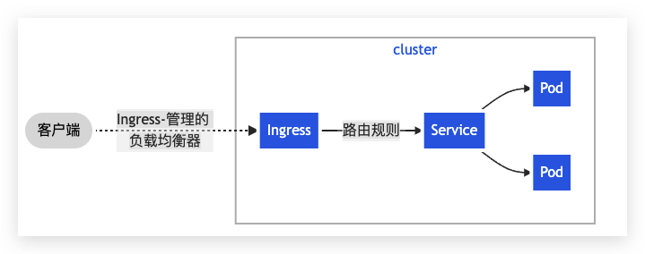
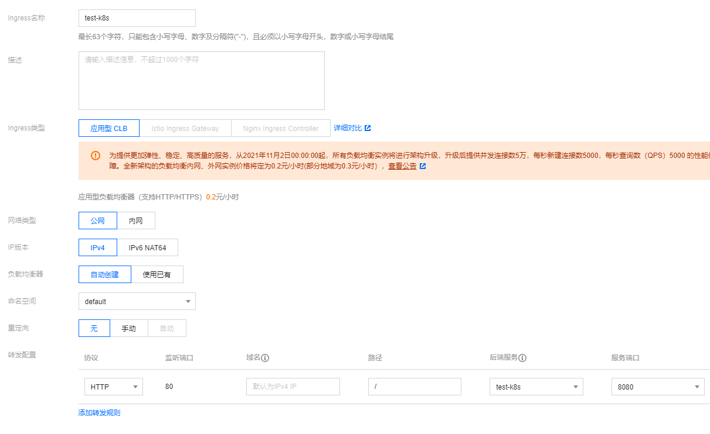

# Kubernetes-Ingress的使用

## 介绍

官方文档：[Ingress](https://kubernetes.io/zh/docs/concepts/services-networking/ingress/)

`Ingress` 为外部访问集群提供了一个 **统一** 入口，避免了对外暴露集群端口；功能类似 Nginx，可以根据域名、路径把请求转发到不同的 Service。可以配置 https

**跟 LoadBalancer 有什么区别？**

- LoadBalancer 需要对外暴露端口，不安全；
- 无法根据域名、路径转发流量到不同 Service，多个 Service 则需要开多个 LoadBalancer；
- 功能单一，无法配置 https




## 使用

要使用 Ingress，需要一个**负载均衡器** + **Ingress Controller**

如果是裸机（bare metal) 搭建的集群，你需要自己安装一个负载均衡插件，可以安装 [MetalLB](https://metallb.universe.tf/)

如果是云服务商，会自动给你配置，否则你的外部 IP 会是 "pending" 状态，无法使用。

### 裸机搭建

#### 准备好 LoadBalancer 类型的Service

```yaml test-k8s.yaml
apiVersion: apps/v1
# 定义以 Deployment 方式管理
kind: Deployment
metadata:
  # Deployment 的名称
  name: test-k8s
spec:
  # 运行的 pod 副本数量
  replicas: 2
  # 用来查找关联的 Pod，所有标签都匹配才行
  selector:
    matchLabels:
      app: test-k8s
  # 定义 Pod 相关数据
  template:
    metadata:
      labels:
        app: test-k8s
    spec:
      # 定义容器，可以多个
      containers:
      - name: test-k8s # 容器名字
        image: ccr.ccs.tencentyun.com/k8s-tutorial/test-k8s:v1 # 镜像
---
apiVersion: v1
# 制定类型为 Service
kind: Service
metadata:
  # 服务的名称
  name: test-k8s
spec:
  # 标签 ，要与 pod的标签对应上，否则关联不起来
  selector:
    app: test-k8s
    
  # ClusterIP：集群内可访问 （默认）
  # NodePort：节点可访问
  # LoadBalancer：负载均衡模式（需要负载均衡才可用）
  type: LoadBalancer
  ports:
    - port: 8080        # 本 Service 的端口
      targetPort: 8080  # 容器端口
    #  nodePort: 31000 # 节点端口，范围固定 30000 ～ 32767
```


```sh
$ kubectl apply -f deployment.yaml
deployment.apps/test-k8s created
service/test-k8s created

# service 的 EXTERNAL-IP一直是pending状态
$ kubectl get all
NAME                            READY   STATUS    RESTARTS   AGE
pod/test-k8s-7f8b7548fc-289cv   1/1     Running   0          14s
pod/test-k8s-7f8b7548fc-qxjgd   1/1     Running   0          14s

NAME                 TYPE           CLUSTER-IP     EXTERNAL-IP   PORT(S)          AGE
service/kubernetes   ClusterIP      10.96.0.1      <none>         443/TCP          6d7h
service/test-k8s     LoadBalancer   10.111.43.66   <pending>     8080:31000/TCP   14s

NAME                       READY   UP-TO-DATE   AVAILABLE   AGE
deployment.apps/test-k8s   2/2     2            2           14s

NAME                                  DESIRED   CURRENT   READY   AGE
replicaset.apps/test-k8s-7f8b7548fc   2         2         2       14s
```


#### 安装负载均衡器(MetalLB)

开源地址：[GitHub](https://github.com/metallb/metallb)

1. 下载 yaml 文件安装

```sh
# 创建命名空间 
$ kubectl apply -f https://raw.githubusercontent.com/metallb/metallb/v0.11.0/manifests/namespace.yaml

# 直接运行 yaml 文件
# 后续想要卸载的话，可以执行
# kubectl delete -f  https://raw.githubusercontent.com/metallb/metallb/v0.11.0/manifests/metallb.yaml
$ kubectl apply -f https://raw.githubusercontent.com/metallb/metallb/v0.11.0/manifests/metallb.yaml
Warning: policy/v1beta1 PodSecurityPolicy is deprecated in v1.21+, unavailable in v1.25+
podsecuritypolicy.policy/controller created
podsecuritypolicy.policy/speaker created
serviceaccount/controller created
serviceaccount/speaker created
clusterrole.rbac.authorization.k8s.io/metallb-system:controller created
clusterrole.rbac.authorization.k8s.io/metallb-system:speaker created
role.rbac.authorization.k8s.io/config-watcher created
role.rbac.authorization.k8s.io/pod-lister created
role.rbac.authorization.k8s.io/controller created
clusterrolebinding.rbac.authorization.k8s.io/metallb-system:controller created
clusterrolebinding.rbac.authorization.k8s.io/metallb-system:speaker created
rolebinding.rbac.authorization.k8s.io/config-watcher created
rolebinding.rbac.authorization.k8s.io/pod-lister created
rolebinding.rbac.authorization.k8s.io/controller created
daemonset.apps/speaker created
deployment.apps/controller created

# 会生成一个 namespace metallb-system
$ kubectl get ns
NAME              STATUS   AGE
default           Active   6d7h
kube-node-lease   Active   6d7h
kube-public       Active   6d7h
kube-system       Active   6d7h
metallb-system    Active   39m

# 查看所有
$ kubectl get all -n metallb-system
NAME                              READY   STATUS    RESTARTS   AGE
# 负责IP地址的分配，以及service和endpoint的监听
pod/controller-7dcc8764f4-58fs4   1/1     Running   0          119s
# 负责保证service地址可达
pod/speaker-jfb7w                 1/1     Running   0          119s

NAME                     DESIRED   CURRENT   READY   UP-TO-DATE   AVAILABLE   NODE SELECTOR            AGE
daemonset.apps/speaker   1         1         1         1            1           kubernetes.io/os=linux   119s

NAME                         READY   UP-TO-DATE   AVAILABLE   AGE
deployment.apps/controller   1/1     1            1           119s

NAME                                    DESIRED   CURRENT   READY   AGE
replicaset.apps/controller-7dcc8764f4   1         1         1       119s
```

2. 地址分配

   MetalLB会为用户的load balancer类型service分配IP地址，该IP地址不是凭空产生的，需要用户预先分配。

3. 外部声明

4. 地址分配后还需要通知到网络中的其他主机。MetalLB支持两种声明模式，都是通过 `ConfigMap`来进行配置的

   - Layer 2模式：ARP/NDP

   - BGP模式

##### Layer 2模式部署

1. yaml 文件，官方：[YAML](https://github.com/metallb/metallb/blob/v0.11/manifests/example-layer2-config.yaml)

   ```yaml metallb-config-layer2.yaml
   apiVersion: v1
   kind: ConfigMap
   metadata:
     namespace: metallb-system
     name: metallb-config-layer2
   data:
     config: |
       address-pools:
       - name: my-ip-space
         protocol: layer2
         addresses:
         - 192.168.1.240/28
   ```

2. 部署 ConfigMap

   ```sh
   $ kubectl apply -f metallb-config-layer2.yaml
   configmap/metallb-config-layer2 configured
   ```

3. 检查是否成功（暂时没验证成功，不知道原因）

   ```sh
   $ kubectl get all
   
   ```


##### BGP模式部署（推荐）

1. yaml 文件，官方：[YAML](https://raw.githubusercontent.com/metallb/metallb/v0.11/manifests/tutorial-3.yaml)

   ```yaml metallb-config-bgp.yaml
   apiVersion: v1
   kind: ConfigMap
   metadata:
     namespace: metallb-system
     name: config
   data:
     config: |
       peers:
       - my-asn: 64512
         peer-asn: 64512
         peer-address: 10.96.0.100
       - my-asn: 64512
         peer-asn: 64512
         peer-address: 10.96.0.101
       - my-asn: 64512
         peer-asn: 64512
         peer-address: 10.96.0.102
       address-pools:
       - name: my-ip-space
         protocol: bgp
         avoid-buggy-ips: true
         addresses:
         - 198.51.100.0/24
   ```

   >- **avoid-buggy-ips: true**：代表 Load Balancer 在分配 IP 的时候，会从 `.1` 开始分配，而不会从 `.0` 开始
   >- **198.51.100.0/24**：Load Balancer 能分配的 IP 池

2. 部署 ConfigMap

   ```sh
   $ kubectl apply -f metallb-config-bgp.yaml
   configmap/metallb-config-bgp configured
   ```

3. 检查是否成功

   发现 service/test-k8s，EXTERNAL-IP 不在是 pending ，而是分配了一个 IP

   ```sh
   $ kubectl get all
   NAME                            READY   STATUS    RESTARTS   AGE
   pod/test-k8s-7f8b7548fc-289cv   1/1     Running   0          25m
   pod/test-k8s-7f8b7548fc-qxjgd   1/1     Running   0          25m
   
   NAME                 TYPE           CLUSTER-IP     EXTERNAL-IP    PORT(S)          AGE
   service/kubernetes   ClusterIP      10.96.0.1      <none>         443/TCP          6d7h
   service/test-k8s     LoadBalancer   10.111.43.66   198.51.100.1   8080:31000/TCP   25m
   
   NAME                       READY   UP-TO-DATE   AVAILABLE   AGE
   deployment.apps/test-k8s   2/2     2            2           25m
   
   NAME                                  DESIRED   CURRENT   READY   AGE
   replicaset.apps/test-k8s-7f8b7548fc   2         2         2       25m
   
   $ curl http://198.51.100.1:8080
   index page
   
   IP lo10.244.2.2, hostname: test-k8s-8598bbb8c6-rx5tn
   ```

   

#### 安装 Ingress Controller

##### Minikube 中部署 Ingress Controller

官方文档：[ingress](https://kubernetes.io/zh/docs/tasks/access-application-cluster/ingress-minikube/)

```yaml ingress.yaml
apiVersion: networking.k8s.io/v1
kind: Ingress
metadata:
  name: example-ingress
spec:
  rules:
    - host: hello-world.info
      http:
        paths:
          - path: /
            pathType: Prefix
            backend:
              service:
                name: web
                port:
                  number: 8080
```


##### Helm 安装

官方文档：[ingress-nginx](https://artifacthub.io/packages/helm/ingress-nginx/ingress-nginx)

```sh
$ helm repo add ingress-nginx https://kubernetes.github.io/ingress-nginx
"ingress-nginx" has been added to your repositories

$ helm repo update
Hang tight while we grab the latest from your chart repositories...
...Successfully got an update from the "ingress-nginx" chart repository
...Successfully got an update from the "bitnami" chart repository
Update Complete. ⎈Happy Helming!⎈

$ helm install my-ingress-nginx ingress-nginx/ingress-nginx
```


### 腾讯云搭建




