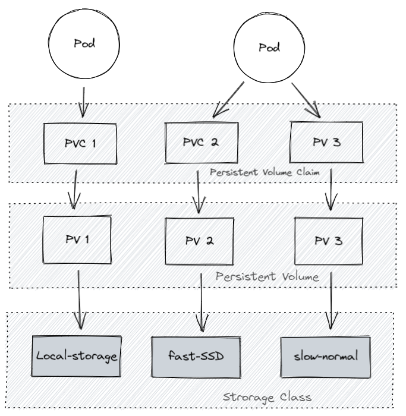
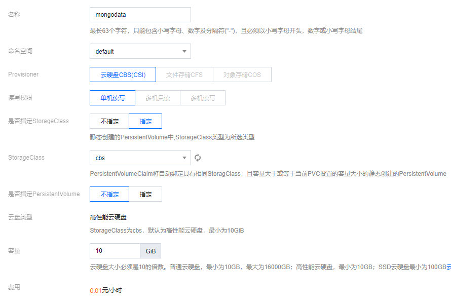

# Kubernetes-数据持久化

## 介绍

kubernetes 集群不会为你处理数据的存储，我们可以为数据库挂载一个磁盘来确保数据的安全。
你可以选择云存储、本地磁盘、NFS。

- hostPath：把节点上的一个目录挂载到Pod，官方不推荐了，仅供单节点测试使用；不适用于多节点集群；

- 本地磁盘：可以挂载某个节点上的目录，但是这需要限定 pod 在这个节点上运行
- 云存储：不限定节点，不受集群影响，安全稳定；需要云服务商提供，裸机集群是没有的。
- NFS：不限定节点，不受集群影响


## hostPath 挂载

### 优缺点

- 把节点上的一个目录挂载到 Pod，但是已经不推荐使用了，[文档](https://kubernetes.io/zh/docs/concepts/storage/volumes/#hostpath)
- 配置方式简单，需要手动指定 Pod 跑在某个固定的节点。
- 仅供单节点测试使用；不适用于多节点集群。
- minikube 提供了 hostPath 存储，[文档](https://minikube.sigs.k8s.io/docs/handbook/persistent_volumes/)

### 示例

1. 创建 yaml 文件

   ```yaml mongo.yaml
   apiVersion: apps/v1
   kind: StatefulSet
   metadata:
     name: mongodb
   spec:
     serviceName: mongodb
     replicas: 1
     selector:
       matchLabels:
         app: mongodb
     template:
       metadata:
         labels:
           app: mongodb
       spec:
         containers:
           - name: mongo
             image: mongo:4.4
             # IfNotPresent 仅本地没有镜像时才远程拉，Always 永远都是从远程拉，Never 永远只用本地镜像，本地没有则报错
             imagePullPolicy: IfNotPresent
             volumeMounts:
               - mountPath: /data/db # 容器里面的挂载路径
                 name: mongo-data    # 卷名字，必须跟下面定义的名字一致
         volumes:
           - name: mongo-data              # 卷名字
             hostPath:
               path: /data/mongo-data      # 节点上的路径
               type: DirectoryOrCreate     # 指向一个目录，不存在时自动创建
   ---
   apiVersion: v1
   kind: Service
   metadata:
     name: mongodb
   spec:
     selector:
       app: mongodb
     type: ClusterIP
     # HeadLess
     clusterIP: None
     ports:
       - port: 27017
         protocol: TCP
         targetPort: 27017
   ```

2. 部署 yaml

   ```sh
   $ kubectl apply -f mongo.yaml
   statefulset.apps/mongodb created
   service/mongodb created
   
   $ kubectl get pod -o wide
   NAME             READY   STATUS    RESTARTS   AGE     IP           NODE       NOMINATED NODE   READINESS GATES
   mongodb-0        1/1     Running   0          14s     172.17.0.2   minikube   <none>           <none>
   ```

3. 查看目录是否挂载成功，即 看节点上是否有目录 `/data/mogo-data`

   ```sh
   $ docker exec -it minikube bash
   root@minikube:/$ cd /data/mongo-data/
   root@minikube:/data/mongo-data% ls
   WiredTiger       WiredTiger.turtle  WiredTigerHS.wt  collection-0-4204941809035389281.wt  collection-4-4204941809035389281.wt  index-1-4204941809035389281.wt  index-5-4204941809035389281.wt  journal      sizeStorer.wt
   WiredTiger.lock  WiredTiger.wt      _mdb_catalog.wt  collection-2-4204941809035389281.wt  diagnostic.data                      index-3-4204941809035389281.wt  index-6-4204941809035389281.wt  mongod.lock  storage.bson
   ```

   

## 更高级的抽象



### Storage Class (SC)

将存储卷划分为不同的种类，例如：SSD，普通磁盘，本地磁盘，按需使用。[文档](https://kubernetes.io/zh/docs/concepts/storage/storage-classes/)

```yaml sc.yaml
apiVersion: storage.k8s.io/v1
kind: StorageClass
metadata:
  name: slow
provisioner: kubernetes.io/aws-ebs
parameters:
  type: io1
  iopsPerGB: "10"
  fsType: ext4
```

### Persistent Volume (PV)

描述卷的具体信息，例如磁盘大小，[访问模式](https://kubernetes.io/zh/docs/concepts/storage/persistent-volumes/#access-modes)。[文档](https://kubernetes.io/zh/docs/concepts/storage/persistent-volumes/)，[类型](https://kubernetes.io/zh/docs/concepts/storage/persistent-volumes/#types-of-persistent-volumes)，[Local 示例](https://kubernetes.io/zh/docs/concepts/storage/volumes/#local)

```yaml pv.yaml
apiVersion: v1
kind: PersistentVolume
metadata:
  name: mongodata
spec:
  capacity:
    storage: 2Gi
  volumeMode: Filesystem  # Filesystem（文件系统） Block（块）
  accessModes:
    - ReadWriteOnce       # 卷可以被一个节点以读写方式挂载
  persistentVolumeReclaimPolicy: Delete
  storageClassName: local-storage
  local:
    path: /root/data
  nodeAffinity:
    required:
      # 通过 hostname 限定在某个节点创建存储卷
      nodeSelectorTerms:
        - matchExpressions:
            - key: kubernetes.io/hostname
              operator: In
              values:
                - node2
```

### Persistent Volume Claim (PVC)

对存储需求的一个申明，可以理解为一个申请单，系统根据这个申请单去找一个合适的 PV
还可以根据 PVC 自动创建 PV。

```yaml pvc.yaml
apiVersion: v1
kind: PersistentVolumeClaim
metadata:
  name: mongodata
spec:
  accessModes: ["ReadWriteOnce"]
  storageClassName: "local-storage"
  resources:
    requests:
      storage: 2Gi
```

### 为什么要这么多层抽象

- 更好的分工，运维人员负责提供好存储，开发人员不需要关注磁盘细节，只需要写一个申请单。
- 方便云服务商提供不同类型的，配置细节不需要开发者关注，只需要一个申请单。
- [动态创建](https://kubernetes.io/zh/docs/concepts/storage/dynamic-provisioning/)，开发人员写好申请单后，供应商可以根据需求自动创建所需存储卷。

## 腾讯云示例



## 本地磁盘示例

不支持动态创建，需要提前创建好

配置文件也可以分开写，也可以写在一起，用 `---`隔开

```yaml mongo.yaml
apiVersion: apps/v1
kind: StatefulSet
metadata:
  name: mongodb
spec:
  serviceName: mongodb
  replicas: 1
  selector:
    matchLabels:
      app: mongodb
  template:
    metadata:
      labels:
        app: mongodb
    spec:
      containers:
        - name: mongo
          image: mongo:4.4
          # IfNotPresent 仅本地没有镜像时才远程拉，Always 永远都是从远程拉，Never 永远只用本地镜像，本地没有则报错
          imagePullPolicy: IfNotPresent
          volumeMounts:
            - mountPath: /data/db # 容器里面的挂载路径
              name: mongo-data    # 卷名字，必须跟下面定义的名字一致
      volumes:
        - name: mongo-data
          persistentVolumeClaim:
             claimName: mongodata
---
apiVersion: v1
kind: Service
metadata:
  name: mongodb
spec:
  clusterIP: None
  ports:
  - port: 27017
    protocol: TCP
    targetPort: 27017
  selector:
    app: mongodb
  type: ClusterIP
---
apiVersion: storage.k8s.io/v1
kind: StorageClass
metadata:
  name: local-storage
provisioner: kubernetes.io/no-provisioner
volumeBindingMode: WaitForFirstConsumer
---
apiVersion: v1
kind: PersistentVolume
metadata:
  name: mongodata
spec:
  capacity:
    storage: 2Gi
  volumeMode: Filesystem  # Filesystem（文件系统） Block（块）
  accessModes:
    - ReadWriteOnce       # 卷可以被一个节点以读写方式挂载
  persistentVolumeReclaimPolicy: Delete
  storageClassName: local-storage
  local:
    path: /root/data
  nodeAffinity:
    required:
      # 通过 hostname 限定在某个节点创建存储卷
      # 由于我使用的是 minikube 虚拟出来的节点，所以这里配置 minikube
      # 正常的话，应该配置某个节点，例如：node2
      nodeSelectorTerms:
        - matchExpressions:
            - key: kubernetes.io/hostname
              operator: In
              values:
                - minikube
---
apiVersion: v1
kind: PersistentVolumeClaim
metadata:
  name: mongodata
spec:
  accessModes: ["ReadWriteOnce"]
  storageClassName: "local-storage"
  resources:
    requests:
      storage: 2Gi
```

部署 yaml ：

**因为我们挂载目录到 /root/data ,所以先要提前创建好该目录**

```sh
# 提前创建好挂载到的目录
$ mkdir -p /root/data

# 执行 yaml 文件
$ kubectl apply -f mongo.yaml
statefulset.apps/mongodb created
service/mongodb created
storageclass.storage.k8s.io/local-storage created
persistentvolume/mongodata created
persistentvolumeclaim/mongodata created

# 查看 pod
$ kubectl get all
NAME            READY   STATUS    RESTARTS   AGE
pod/mongodb-0   1/1     Running   0          15s

NAME                 TYPE        CLUSTER-IP   EXTERNAL-IP   PORT(S)     AGE
service/kubernetes   ClusterIP   10.96.0.1    <none>        443/TCP     5d2h
service/mongodb      ClusterIP   None         <none>        27017/TCP   15s

NAME                       READY   AGE
statefulset.apps/mongodb   1/1     16s

# 查看 sc pv pvc
$ kubectl get sc
NAME                 PROVISIONER                    RECLAIMPOLICY   VOLUMEBINDINGMODE      ALLOWVOLUMEEXPANSION   AGE
local-storage        kubernetes.io/no-provisioner   Delete          WaitForFirstConsumer   false                  3m52s
standard (default)   k8s.io/minikube-hostpath       Delete          Immediate              false                  5d2h

$ kubectl get pv
NAME        CAPACITY   ACCESS MODES   RECLAIM POLICY   STATUS   CLAIM               STORAGECLASS    REASON   AGE
mongodata   2Gi        RWO            Delete           Bound    default/mongodata   local-storage            3m55s

$ kubectl get pvc
NAME        STATUS   VOLUME      CAPACITY   ACCESS MODES   STORAGECLASS    AGE
mongodata   Bound    mongodata   2Gi        RWO            local-storage   3m58s

# 查看目录是否挂载成功，即:查看 目录 /root/data 中是否有文件
$ docker exec -it minikube bash
root@minikube:/$ cd /root/data
root@minikube:~/data$ ls
WiredTiger       WiredTiger.turtle  WiredTigerHS.wt  collection-0--1433628362673469070.wt  collection-4--1433628362673469070.wt  index-1--1433628362673469070.wt  index-5--1433628362673469070.wt  journal      sizeStorer.wt
WiredTiger.lock  WiredTiger.wt      _mdb_catalog.wt  collection-2--1433628362673469070.wt  diagnostic.data                       index-3--1433628362673469070.wt  index-6--1433628362673469070.wt  mongod.lock  storage.bson
```

