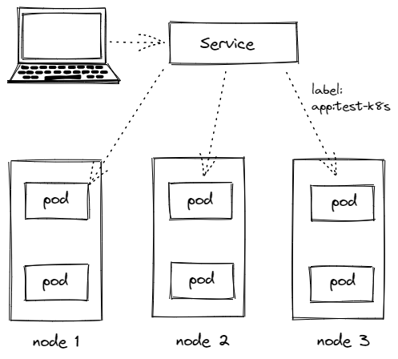

# Kubernetes-Service的使用

## 特性

- Service 通过 label 关联对应的 Pod
- Servcie 生命周期不跟 Pod 绑定，不会因为 Pod 重创改变 IP
- 提供了负载均衡功能，自动转发流量到不同 Pod
- 可对集群外部提供访问端口
- 集群内部可通过服务名字访问




## 创建Service

创建 一个 Service，通过标签`test-k8s`跟对应的 Pod 关联上
`service.yaml`

```yaml service.yaml
apiVersion: v1
# 制定类型为 Service
kind: Service
metadata:
  # 服务的名称
  name: test-k8s
spec:
  # 标签 ，要与 pod的标签对应上，否则关联不起来
  selector:
    app: test-k8s
    
  # ClusterIP：集群内可访问 （默认）
  # NodePort：节点可访问
  # LoadBalance：负载均衡模式（需要负载均衡才可用）
  type: NodePort
  ports:
    - port: 8090        # 本 Service 的端口
      targetPort: 8080  # 容器端口
      nodePort: 31000 # 节点端口，范围固定 30000 ～ 32767
```

### 部署 Service

```sh
# 首先创建 deployment
$ kubectl apply -f deployment.yaml
deployment.apps/test-k8s created

# 查看 pod
$ kubectl get pod -o wide
NAME                        READY   STATUS    RESTARTS   AGE     IP             NODE    NOMINATED NODE   READINESS GATES
test-k8s-8598bbb8c6-l9dp7   1/1     Running   0          3m38s   10.244.0.32    node2   <none>           <none>
test-k8s-8598bbb8c6-xgvn8   1/1     Running   0          3m38s   10.244.0.35    node1   <none>           <none>

# 创建 Service
$ kubectl apply -f service.yaml
service/test-k8s created
```


### 查看 Service

```sh
# 查看 service
# kubectl get service 或者 kubectl get svc
$ kubectl get service
NAME         TYPE        CLUSTER-IP       EXTERNAL-IP   PORT(S)          AGE
kubernetes   ClusterIP   10.96.0.1        <none>        443/TCP          66m
test-k8s     NodePort    10.107.238.211   <none>        8090:31000/TCP   36s

$ kubectl get svc
NAME         TYPE        CLUSTER-IP       EXTERNAL-IP   PORT(S)          AGE
kubernetes   ClusterIP   10.96.0.1        <none>        443/TCP          66m
test-k8s     NodePort    10.107.238.211   <none>        8090:31000/TCP   41s
```

### 查看 Service 详情

```sh
# kubectl describe svc SERVICE-NAME
$ kubectl describe svc test-k8s
Name:                     test-k8s
Namespace:                default
Labels:                   <none>
Annotations:              <none>
Selector:                 app=test-k8s
Type:                     NodePort
IP Family Policy:         SingleStack
IP Families:              IPv4
IP:                       10.107.238.211
IPs:                      10.107.238.211
Port:                     <unset>  8090/TCP
TargetPort:               8080/TCP
NodePort:                 <unset>  31000/TCP
Endpoints:                10.244.0.32:8080,10.244.0.35:8080
Session Affinity:         None
External Traffic Policy:  Cluster
Events:                   <none>
```

解释说明：

1. `Endpoints`：可以发现 Endpoints 是各个 Pod 的 IP，也就是他会把流量转发到这些节点。
2. `Type`：服务的类型，可以为 *ClusterIP* *NodePort* *LoadBalancer*

## 对外暴露服务

### ClusterIP

服务的默认类型是`ClusterIP`，只能在集群内部访问`ClusterIP`：

1. 修改一下 `service.yaml`中的 type ，并且去掉 最后一行 `nodePort`

   ```yaml  service.yaml
   apiVersion: v1
   # 制定类型为 Service
   kind: Service
   metadata:
     # 服务的名称
     name: test-k8s
   spec:
     # 标签 ，要与 pod的标签对应上，否则关联不起来
     selector:
       app: test-k8s
       
     # ClusterIP：集群内可访问 （默认）
     # NodePort：节点可访问
     # LoadBalance：负载均衡模式（需要负载均衡才可用）
     type: ClusterIP
     ports:
       - port: 8090        # 本 Service 的端口
         targetPort: 8080  # 容器端口
       #  nodePort: 31000 # 节点端口，范围固定 30000 ～ 32767
   ```

2. 重新部署一下

   ```sh
   $ kubectl apply -f service.yaml
   service/test-k8s configured
   
   $ kubectl get svc
   NAME         TYPE        CLUSTER-IP       EXTERNAL-IP   PORT(S)    AGE
   kubernetes   ClusterIP   10.96.0.1        <none>        443/TCP    85m
   test-k8s     ClusterIP   10.107.238.211   <none>        8090/TCP   19m
   
   $ kubectl describe svc test-k8s
   Name:              test-k8s
   Namespace:         default
   Labels:            <none>
   Annotations:       <none>
   Selector:          app=test-k8s
   Type:              ClusterIP
   IP Family Policy:  SingleStack
   IP Families:       IPv4
   IP:                10.107.238.211
   IPs:               10.107.238.211
   Port:              <unset>  8090/TCP
   TargetPort:        8080/TCP
   Endpoints:         10.244.0.32:8080,10.244.0.35:8080
   Session Affinity:  None
   Events:            <none>
   ```

3. 可以进入到 Pod 里面访问：

   ```sh
   # kubectl exec -it POD-NAME -- bash
   $ kubectl exec -it test-k8s-8598bbb8c6-smxnw -- bash
   root@test-k8s-8598bbb8c6-smxnw:/app$ curl http://test-k8s:8090
   暂时不通--不知道为什么...
   root@test-k8s-8598bbb8c6-smxnw:/app$ curl http://10.107.238.211:8090
   index page
   
   IP lo10.244.0.34, hostname: test-k8s-8598bbb8c6-smxnw
   ```

4. 如果要在集群外部访问，可以通过端口转发实现（只适合临时测试用）：

   ```sh
   $ kubectl port-forward service/test-k8s 8888:8090
   Forwarding from 127.0.0.1:8888 -> 8080
   Forwarding from [::1]:8888 -> 8080
   
   # 在主节点上，可以 curl http://127.0.0.1:8888 访问到应用
   $ curl http://127.0.0.1:8888/
   index page
   
   IP lo10.244.0.34, hostname: test-k8s-8598bbb8c6-smxnw
   ```

5. 如果你用 minikube，也可以这样`minikube service test-k8s`来转发服务到本机

### NodePort

上面我们是通过端口转发的方式可以在外面访问到集群里的服务，如果想要直接把集群服务暴露出来，我们可以使用`NodePort` 和 `Loadbalancer` 类型的 Service

1. 修改 yaml 文件，修改 type 为 NodePort ，并且加上 nodePort 转发端口

   ```yaml service.yaml
   apiVersion: v1
   kind: Service
   metadata:
     name: test-k8s
   spec:
     selector:
       app: test-k8s
     # 默认 ClusterIP 集群内可访问，NodePort 节点可访问，LoadBalancer 负载均衡模式（需要负载均衡器才可用）
     type: NodePort
     ports:
       - port: 8090        # 本 Service 的端口
         targetPort: 8080  # 容器端口
         nodePort: 31000   # 节点端口，范围固定 30000 ~ 32767
   ```

2. 重新部署

   ```sh
   $ kubectl apply -f service.yaml
   service/test-k8s configured
   
   # 在节点上，我们可以 curl http://localhost:31000/hello/easydoc 访问到应用
   # 并且是有负载均衡的，网页的信息可以看到被转发到了不同的 Pod
   $ docker ps
   CONTAINER ID   IMAGE                    COMMAND                  CREATED      STATUS         PORTS                                                                                                                                  NAMES
   2afb7bcea2f8   kicbase/stable:v0.0.28   "/usr/local/bin/entr…"   4 days ago   Up 3 minutes   127.0.0.1:49157->22/tcp, 127.0.0.1:49156->2376/tcp, 127.0.0.1:49155->5000/tcp, 127.0.0.1:49154->8443/tcp, 127.0.0.1:49153->32443/tcp   minikube
   
   $ docker exec -it minikube bash
   root@minikube:/$ curl http://localhost:31000/hello/easydoc
   hello easydoc
   
   IP lo172.17.0.8, hostname: test-k8s-68bb74d654-ztg6h
   
   root@minikube:/$ curl http://localhost:31000/hello/easydoc
   hello easydoc
   
   IP lo172.17.0.9, hostname: test-k8s-68bb74d654-xnxkc
   ```

   >如果你是用 minikube，因为是模拟集群，你的电脑并不是节点，节点是 minikube 模拟出来的，所以你并不能直接在电脑上访问到服务

### Loadbalancer

`Loadbalancer` 也可以对外提供服务，这需要一个负载均衡器的支持，因为它需要生成一个新的 IP 对外服务，否则状态就一直是 pendding，这个很少用了，后面我们会讲更高端的 Ingress 来代替它。

```sh
$ kubectl get svc
NAME         TYPE           CLUSTER-IP      EXTERNAL-IP   PORT(S)          AGE
kubernetes   ClusterIP      10.96.0.1       <none>        443/TCP          4d4h
test-k8s     LoadBalancer   10.98.202.206   <pending>     8090:31000/TCP   23m
```

## 多端口

多端口时必须配置 name， [文档](https://kubernetes.io/zh/docs/concepts/services-networking/service/#multi-port-services)

```yaml service.yaml
apiVersion: v1
kind: Service
metadata:
  name: test-k8s
spec:
  selector:
    app: test-k8s
  type: NodePort
  ports:
    - port: 8080        # 本 Service 的端口
      name: test-k8s    # 必须配置
      targetPort: 8080  # 容器端口
      nodePort: 31000   # 节点端口，范围固定 30000 ~ 32767
    - port: 8090
      name: test-other
      targetPort: 8090
      nodePort: 32000
```

## 总结

### ClusterIP

默认的，仅在集群内可用

### NodePort

暴露端口到节点，提供了集群外部访问的入口
端口范围固定 30000 ~ 32767

### LoadBalancer

需要负载均衡器（通常都需要云服务商提供，裸机可以安装 [METALLB](https://metallb.universe.tf/) 测试）
会额外生成一个 IP 对外服务
K8S 支持的负载均衡器：[负载均衡器](https://kubernetes.io/zh/docs/concepts/services-networking/service/#internal-load-balancer)

### Headless

适合数据库
clusterIp 设置为 None 就变成 Headless 了，不会再分配 IP，后面会再讲到具体用法
[官网文档](https://kubernetes.io/zh/docs/concepts/services-networking/service/#headless-services)
