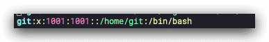

# 云服务器部署博客

这里主要记录一下我的博客部署在腾讯云的全过程。

## 安装docker

见[docker的安装](https://www.buubiu.com/2021/02/01/Docker%E7%9A%84%E5%9F%BA%E6%9C%AC%E6%A6%82%E5%BF%B5/#Docker%E7%9A%84%E5%AE%89%E8%A3%85)

## 安装nginx

1. 先启动一个基础容器

   ```sh
   $ docker run -d -p 80:80 --name buubiu_nginx nginx
   ```

2. 在宿主机创建映射目录和网站目录

   ```sh
   $ mkdir -p /data/docker_volumes/nginx/config
   $ mkdir -p /data/docker_volumes/nginx/data
   ```

3. 复制容器内的配置文件到宿主机映射目录

   ```sh
   $ docker cp buubiu_nginx:/etc/nginx/conf.d /data/docker_volumes/nginx/config
   $ docker cp buubiu_nginx:/etc/nginx/nginx.conf /data/docker_volumes/nginx/config
   $ docker cp buubiu_nginx:/usr/share/nginx/html /data/docker_volumes/nginx/data/
   ```

4. 删除容器，并重建映射的容器

   ```sh
   $ docker rm -f buubiu_nginx
   $ docker run -d -p 80:80 -p 443:443\
     --restart=always \
     --name buubiu_nginx \
     -v /data/docker_volumes/nginx/config/conf.d:/etc/nginx/conf.d \
     -v /data/docker_volumes/nginx/config/nginx.conf:/etc/nginx/nginx.conf \
     -v /data/docker_volumes/nginx/data:/usr/share/nginx \
     -v /etc/localtime:/etc/localtime \
     nginx
   ```

## 配置域名证书

由于需要https，所以需要从厂商下载域名证书到服务器中。

1. 创建相关目录

   ```sh
   $ mkdir -p /data/docker_volumes/nginx/config/conf.d/pki/buubiu.com
   ```

   

2. 把`buubiu.pem、buubiu.key`拷贝到`/data/docker_volumes/nginx/congfig/conf.d/pki/buubiu.com`中

## 配置网站页面

1. 创建网站目录

   ```sh
   $ mkdir -p /data/docker_volumes/nginx/data/buubiu
   $ chmod -R 757 /data/docker_volumes/nginx/data/buubiu
   ```

2. 把工程通过hexo编译后打包，把`public`目录下的文件部署到服务器中的`/data/docker_volumes/data/buubiu`目录中

## 新建nginx配置

在目录`/data/docker_volumes/nginx/conf.d`创建配置：

**注意：配置文件中不要把注释单独放在一行，一定要放在行尾**

```sh buubiu.conf
server {
    listen 80;
    server_name buubiu.com; #需要将yourdomain.com替换成证书绑定的域名。
    
    return 301 https://buubiu.com$request_uri;
}

server {
    listen 80;
    listen 443 ssl;
    server_name www.buubiu.com;  #需要将yourdomain.com替换成证书绑定的域名。

    ssl_certificate "/etc/nginx/conf.d/pki/buubiu.com/buubiu.pem";  #需要将cert-file-name.pem替换成已上传的证书文件的名称。
    ssl_certificate_key "/etc/nginx/conf.d/pki/buubiu.com/buubiu.key"; #需要将cert-file-name.key替换成已上传的证书密钥文件的名称。
    ssl_session_timeout 5m;
    ssl_ciphers ECDHE-RSA-AES128-GCM-SHA256:ECDHE:ECDH:AES:HIGH:!NULL:!aNULL:!MD5:!ADH:!RC4;
    ssl_protocols TLSv1 TLSv1.1 TLSv1.2; #表示使用的TLS协议的类型。
    ssl_prefer_server_ciphers on;

    return 301 https://buubiu.com$request_uri;
}
server {
    listen 443 ssl;
    server_name buubiu.com; #需要将yourdomain.com替换成证书绑定的域名。

    ssl_certificate "/etc/nginx/conf.d/pki/buubiu.com/buubiu.pem";  #需要将cert-file-name.pem替换成已上传的证书文件的名称。
    ssl_certificate_key "/etc/nginx/conf.d/pki/buubiu.com/buubiu.key"; #需要将cert-file-name.key替换成已上传的证书密钥文件的名称。
    ssl_session_timeout 5m;
    ssl_ciphers ECDHE-RSA-AES128-GCM-SHA256:ECDHE:ECDH:AES:HIGH:!NULL:!aNULL:!MD5:!ADH:!RC4;
    ssl_protocols TLSv1 TLSv1.1 TLSv1.2; #表示使用的TLS协议的类型。
    ssl_prefer_server_ciphers on;

    location / {
        root /usr/share/nginx/buubiu;
        index index.html index.htm;
    }
}
```

## 重启nginx

```sh
$ docker restart buubiu_nginx
```

## 安装配置git(拓展)

hexo支持通过git自动发布到服务器中，所以要想实时的发布博客，只需要让服务器支持git即可。

### 安装

```sh
$ yum -y install git
$ git --version
git version 2.27.0
```

### 配置

1. 创建git账号和密码

   ```sh
   $ adduser git
   $ passwd git
   ```

2. 创建git仓库，并初始化博客目录

   ```sh
   $ su git
   $ mkdir -p /home/git/blog & cd /home/git/blog
   $ git init --bare buubiu.git
   ```

3. 创建git钩子（hook）

   目的：当我们用hexo通过git上传代码到这个仓库时，让该仓库的代码与我们的nginx指定的博客数据保持一致。

   ```sh
   # 创建钩子文件 目录/home/git/blog/buubiu.git/hook/post-receive
   $ vi post-receive
   #!/bin/sh
   git --work-tree=/data/docker_volumes/nginx/data/buubiu --git-dir=/home/git/blog/buubiu.git checkout -f && cd /data/docker_volumes/nginx/data/buubiu && chmod -R 755 *
   # 保存并退出后, 给该文件添加可执行权限
   $ chmod +x /home/git/blog/buubiu.git/hooks/post-receive
   ```

### 配置客户端免密码登录

1. 创建`.ssh`目录

   ```sh
   $ su git
   $ cd /home/git
   $ mkdir .ssh
   ```

2. 创建校验公钥的配置文件

   ```sh
   $ cd /home/git/.ssh
   $ touch authorized_keys
   ```

3. 设置权限

   ```sh
   $ chmod 700 /home/git/.ssh/
   $ chmod 600 /home/git/.ssh/authorized_keys
   ```

### 打开RSA认证（centos7.4及以下使用)

1. 切换回  root 用户

   ```sh
   $ su root
   ```

2. 进入  /etc/ssh 目录，编辑  sshd_config

   ```sh
   $ cd /etc/ssh
   $ vi ssh_config
   #打开以下三个配置的注释（带  # 为注释）
   RSAAuthentication yes
   PubkeyAuthentication yes
   AuthorizedKeysFile .ssh/authorized_keys
   ```

3. 保存后重启 sshd 服务

   ```sh
   $ systemctl restart sshd
   ```

### 禁止客户端 shell 登录

> 如果  git 客户端可以直接通过  shell 使用  git 账户来远程登录服务器，这样是不安全的

1. 在  /home/git 下面创建  git-shell-commands 目录，并把目录的拥有者设置为  git 账户

   ```sh
   $ su git
   $ mkdir /home/git/git-shell-commands
   ```

2. 修改  /etc/passwd 文件

   ```sh
   $ su root
   $ vim /etc/passwd
   ```

   

找到下图所示内容，其中  1000 可能是别的数字



将

```sh
git:x:1001:1001::/home/git:/bin/bash
```

改为

```sh
git:x:1001:1001::/home/git:/bin/git-shell 
```

## 在本地（客户端）创建公钥私钥

1. 创建`ssh-keys`

   ```sh
   # -f  指定目录和文件名
   # 碰到需要输入到地方直接回车即可
   $ ssh-keygen -t rsa -f ~/.ssh/git_key/tencent_buubiu/id_rsa -C "xxxxxxxx@gmail.com"
   ```

2. 将公钥（.pub)添加到服务器当中

   将文件 `~/.ssh/git_key/tencent_buubiu/id_rsa.pub`的内容复制到服务器的  `/home/git/.ssh/authorized_keys`文件中

## 配置hexo

1. 在本机的config 配置

   ```sh
   # 路径：/Users/xxxxx/.ssh/config  追加以下内容
    Host blog.buubiu.com
    HostName 服务器IP
    User git
    IdentityFile /Users/xxxxx/.ssh/git_key/tencent_buubiu/id_rsa
   ```

   

2. 去hexo项目的_config.yml文件最后追加一条git记录

   ```yaml _config.yml
   deploy:
   - type: git
     repo: git@blog.buubiu.com:/home/git/blog/buubiu.git
     branch: master
   ```
