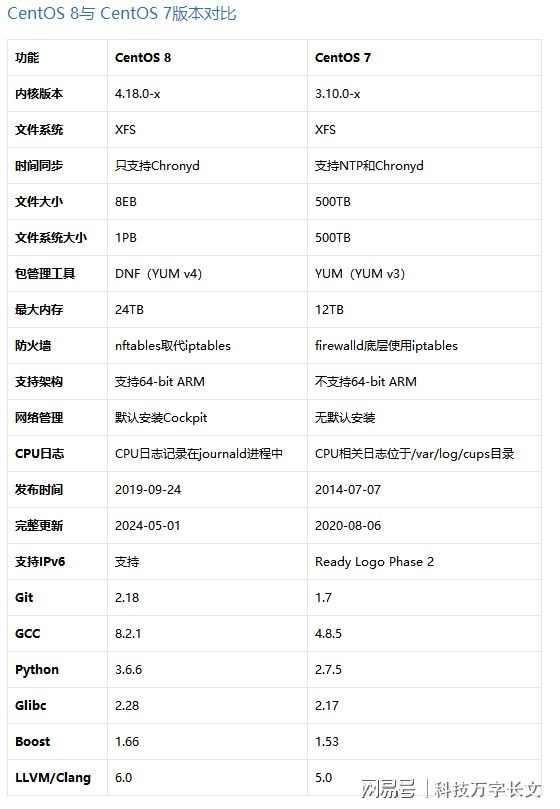

# RedHat8.4初始化

## 介绍

这边参考 centos；

CentOS 8基于RHEL 8版本，最初发行时使用Linux kernel 4.18, GCC 8.2, glibc 2.28, systemd 239和GNOME 3.28。
虽然yum仍然可以作为软件包管理器使用，并且您可以像以前一样继续使用它，但是它已经在后端进行了重大升级，从CentOS 7的版本3升级到CentOS 8的版本4。



## 网络设置

### 修改静态IP

```sh
$ vi /etc/sysconfig/network-scripts/ifcfg-enp0s5
TYPE=Ethernet
PROXY_METHOD=none
BROWSER_ONLY=no
BOOTPROTO=none
DEFROUTE=yes
IPV4_FAILURE_FATAL=no
IPV6INIT=yes
IPV6_AUTOCONF=yes
IPV6_DEFROUTE=yes
IPV6_FAILURE_FATAL=no
NAME=enp0s5
UUID=be641410-f4bd-40c3-a3e6-558f3d5d0df2
DEVICE=enp0s5
ONBOOT=yes

IPADDR=10.211.55.200
PREFIX=24
GATEWAY=10.211.55.1
DNS1=10.211.55.1

# 让网络设置生效
$ systemctl restart NetworkManager
$ nmcli connection up enp0s5

```

### 防火墙设置

```sh
$ systemctl start firewalld # 启动
$ systemctl stop firewalld # 停止
$ systemctl enable firewalld # 启用自动启动
$ systemctl disable firewalld # 禁用自动启动

#  查看状态
$ systemctl status firewalld 
# 或者 
$ firewall-cmd --state

$ firewall-cmd --list-ports #查看端口开放列表

# 添加端口
$ firewall-cmd --permanent --zone=public --add-port=7001/tcp
$ firewall-cmd --permanent --zone=public --add-port=8080/udp

# 删除端口
$ firewall-cmd --permanent --zone=public --remove-port=8080/tcp

# 生效
$ firewall-cmd --reload
```

## 修改yum源

由于RedHat是付费版本Linux  因此不注册不能使用yum装软件。已开始在使用yum的时候会提示：

```sh
$ yum -y install wget
Failed to set locale, defaulting to C.UTF-8
Updating Subscription Management repositories.
Unable to read consumer identity

This system is not registered to Red Hat Subscription Management. You can use subscription-manager to register.

Error: There are no enabled repositories in "/etc/yum.repos.d", "/etc/yum/repos.d", "/etc/distro.repos.d".
```

**解决办法就是用centos的源替换RedHat的源**

### 备份

提前备份 /etc/yum.repos.d/ 内的文件

```sh
$ rename '.repo' '.repo.bak' /etc/yum.repos.d/*.repo
```

### 关闭官方订阅

>Centos不需要执行

1. 配置文件中关闭这个官方的订阅

```sh
$ sed -i 's/enabled=1/enabled=0/g' /etc/yum/pluginconf.d/subscription-manager.conf
```

2. 删除官方订阅(可选择)

```sh
$ yum remove -y subscription-manager
```

### 新建 repo 源文件

#### 从阿里官方下载

1. 下载最新的repo文件

```sh
$ wget https://mirrors.aliyun.com/repo/Centos-vault-8.4.2105.repo -O /etc/yum.repos.d/Centos-vault-8.4.2105.repo
$ wget https://mirrors.aliyun.com/repo/epel-archive-8.repo -O /etc/yum.repos.d/epel-archive-8.repo
```

2. 替换repo文件中的链接

```sh
$ sed -i 's/mirrors.cloud.aliyuncs.com/url_tmp/g'  /etc/yum.repos.d/Centos-vault-8.4.2105.repo &&  sed -i 's/mirrors.aliyun.com/mirrors.cloud.aliyuncs.com/g' /etc/yum.repos.d/Centos-vault-8.4.2105.repo && sed -i 's/url_tmp/mirrors.aliyun.com/g' /etc/yum.repos.d/Centos-vault-8.4.2105.repo
```


#### 手动输入

```sh
$ vi /etc/yum.repos.d/Centos-vault-8.4.2105.repo
$ vi /etc/yum.repos.d/epel-archive-8.repo
```

`CentOS-8.4.2105.repo`

```ini CentOS-8.4.2105.repo
# CentOS-8.4.2105.repo
#
# The mirror system uses the connecting IP address of the client and the
# update status of each mirror to pick mirrors that are updated to and
# geographically close to the client.  You should use this for CentOS updates
# unless you are manually picking other mirrors.
#
# If the mirrorlist= does not work for you, as a fall back you can try the 
# remarked out baseurl= line instead.
#
#
 
[base]
name=CentOS-8.4.2105 - Base - mirrors.cloud.aliyuncs.com
baseurl=http://mirrors.cloud.aliyuncs.com/centos-vault/8.4.2105/BaseOS/$basearch/os/
        http://mirrors.aliyuncs.com/centos-vault/8.4.2105/BaseOS/$basearch/os/
        http://mirrors.aliyun.com/centos-vault/8.4.2105/BaseOS/$basearch/os/
gpgcheck=0
gpgkey=http://mirrors.cloud.aliyuncs.com/centos/RPM-GPG-KEY-CentOS-Official

#additional packages that may be useful
[extras]
name=CentOS-8.4.2105 - Extras - mirrors.cloud.aliyuncs.com
baseurl=http://mirrors.cloud.aliyuncs.com/centos-vault/8.4.2105/extras/$basearch/os/
        http://mirrors.aliyuncs.com/centos-vault/8.4.2105/extras/$basearch/os/
        http://mirrors.aliyun.com/centos-vault/8.4.2105/extras/$basearch/os/
gpgcheck=0
gpgkey=http://mirrors.cloud.aliyuncs.com/centos/RPM-GPG-KEY-CentOS-Official

#additional packages that extend functionality of existing packages
[centosplus]
name=CentOS-8.4.2105 - Plus - mirrors.cloud.aliyuncs.com
baseurl=http://mirrors.cloud.aliyuncs.com/centos-vault/8.4.2105/centosplus/$basearch/os/
        http://mirrors.aliyuncs.com/centos-vault/8.4.2105/centosplus/$basearch/os/
        http://mirrors.aliyun.com/centos-vault/8.4.2105/centosplus/$basearch/os/
gpgcheck=0
enabled=0
gpgkey=http://mirrors.cloud.aliyuncs.com/centos/RPM-GPG-KEY-CentOS-Official

[PowerTools]
name=CentOS-8.4.2105 - PowerTools - mirrors.cloud.aliyuncs.com
baseurl=http://mirrors.cloud.aliyuncs.com/centos-vault/8.4.2105/PowerTools/$basearch/os/
        http://mirrors.aliyuncs.com/centos-vault/8.4.2105/PowerTools/$basearch/os/
        http://mirrors.aliyun.com/centos-vault/8.4.2105/PowerTools/$basearch/os/
gpgcheck=0
enabled=0
gpgkey=http://mirrors.cloud.aliyuncs.com/centos/RPM-GPG-KEY-CentOS-Official


[AppStream]
name=CentOS-8.4.2105 - AppStream - mirrors.cloud.aliyuncs.com
baseurl=http://mirrors.cloud.aliyuncs.com/centos-vault/8.4.2105/AppStream/$basearch/os/
        http://mirrors.aliyuncs.com/centos-vault/8.4.2105/AppStream/$basearch/os/
        http://mirrors.aliyun.com/centos-vault/8.4.2105/AppStream/$basearch/os/
gpgcheck=0
gpgkey=http://mirrors.cloud.aliyuncs.com/centos/RPM-GPG-KEY-CentOS-Official
```

`epel-archive-8.repo`

```ini epel-archive-8.repo
[epel-archive]
name=Extra Packages for Enterprise Linux 8 - $basearch
baseurl=http://mirrors.aliyun.com/epel-archive/8/Everything/$basearch
enabled=1
gpgcheck=0

[epel-archive-debuginfo]
name=Extra Packages for Enterprise Linux 8 - $basearch - Debug
baseurl=http://mirrors.aliyun.com/epel-archive/8/Everything/$basearch/debug
enabled=0
gpgcheck=0

[epel-archive-source]
name=Extra Packages for Enterprise Linux 8 - $basearch - Source
baseurl=http://mirrors.aliyun.com/epel-archive/8/Everything/SRPMS
enabled=0
gpgcheck=0
```

### 重新创建缓存

```sh
$ yum clean all && yum makecache
```

