# 扩展linux系统根目录大小

> 情况说明：添加新的硬盘，然后扩容根目录大小

1. 查看新增的磁盘分区，新增磁盘分区/dev/sdb ，大小 100GB

```shell
[root@localhost ~]# fdisk -l
```

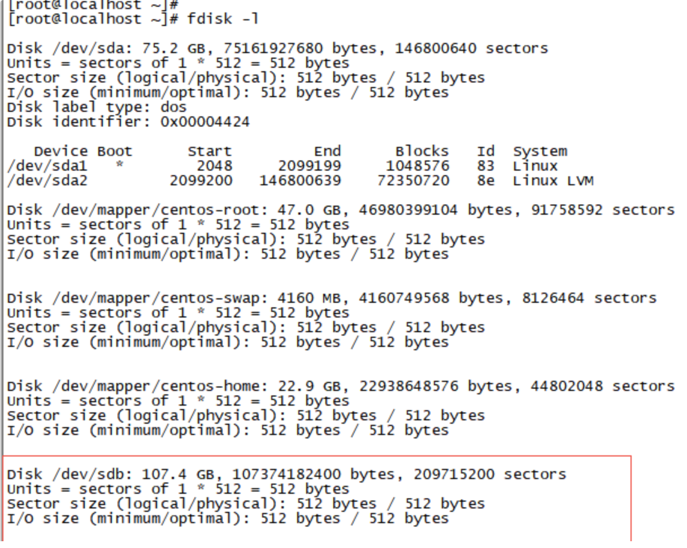

2. 划分新的磁盘分区

> 注：对新增的磁盘分区进行分区，详见截图

```shell
[root@localhost ~]# fdisk /dev/sdb
```

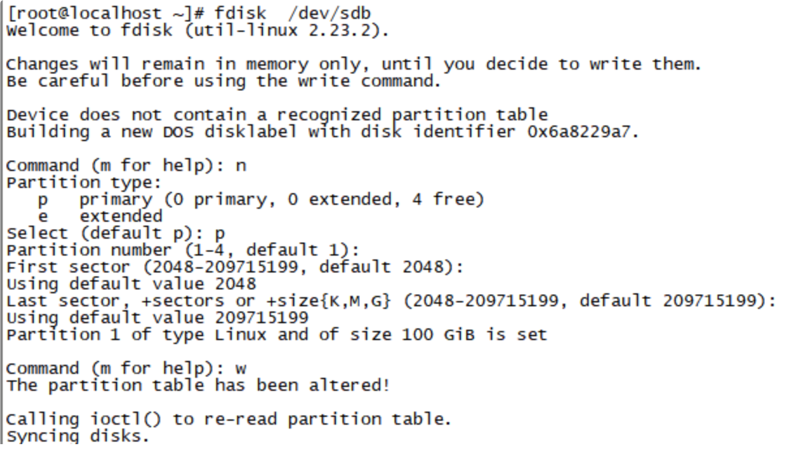
再次查看分区信息， 看到划分好的分区/dev/sdb1

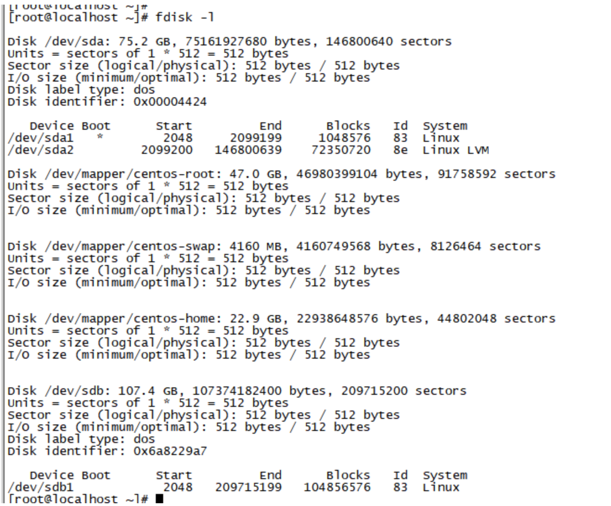

3.  创建 pv 卷

> 注：创建一个新的 pv 卷

```shell
[root@localhost ~]# pvcreate  /dev/sdb1
```


```shell
[root@localhost ~]# pvdisplay
```

> 注：查看确认已经创建的 pv 卷

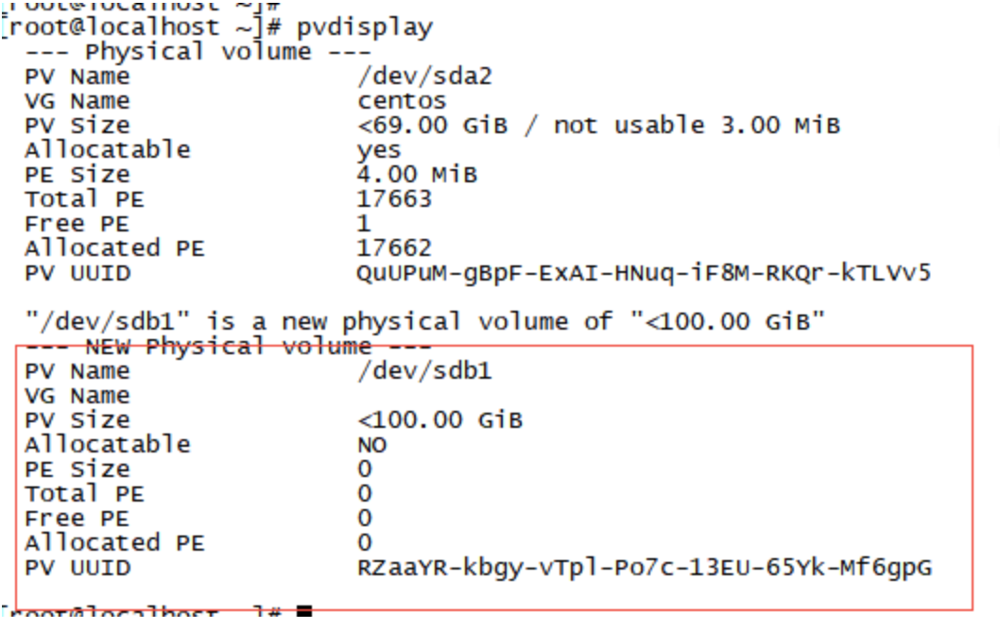

4. 将 pv 添加进 vg

```shell
[root@localhost ~]# vgdisplay
```

查看现有的 vg 卷，现有的 vg 名称为：centos
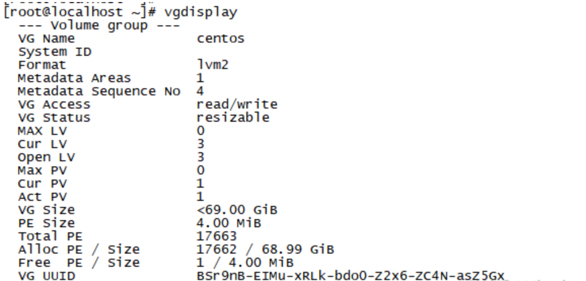
将新建的 pv 添加进现有的 vg 内

```shell
[root@localhost ~]# vgextend centos /dev/sdb1
```

> 注：centos 为 vg 的名称，这时的/dev/sdb1 为 pv

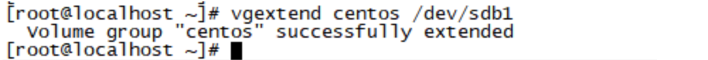

5. 扩容 lv

/dev/centos/root 是执行 lvdisplay 获得的

```shell
[root@localhost ~]# lvextend -l +100%FREE /dev/centos/root
```

注：这里是添加 lv 所在的 vg 剩下的空余空间
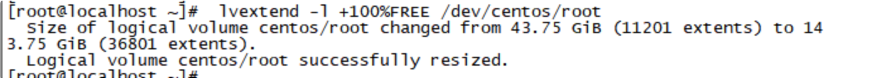

```shell
[root@localhost ~]# lvdisplay
```

> 注：查看 lv 卷现在的大小，原大小为 43G，已经增加了 100G 的空间

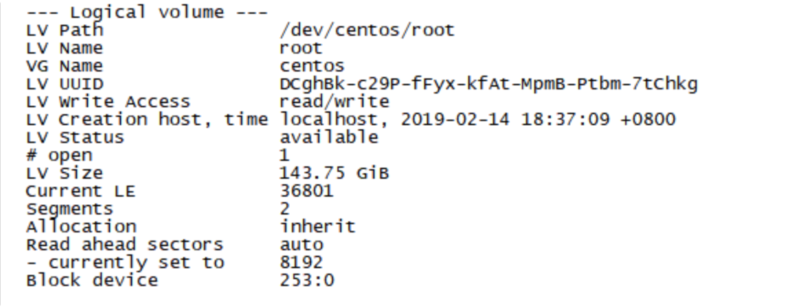

6. 同步文件系统

```shell
[root@localhost ~]# df -h
```

发现文件系统的大小没有改变，需要同步文件系统
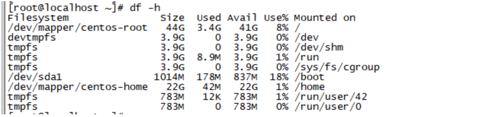

```shell
[root@localhost ~]# xfs_growfs /dev/centos/root
```

> 注：使用以上命令同步文件系统，centos7 的默认文件系统 XFS

如系统版本为 centos 6 请使用命令 resize2fs /dev/centos/root

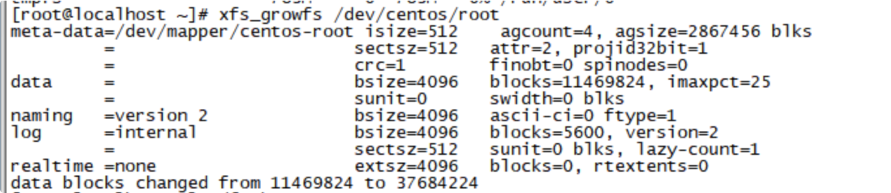

再次查看文件系统的大小，确认已增加了 100G,扩容完成

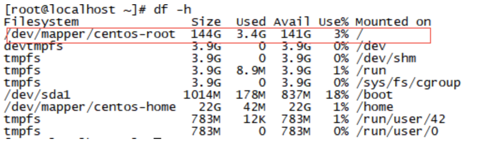
