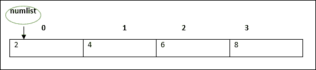
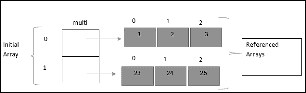

# TypeScript Array（数组）

数组对象是使用单独的变量名来存储一系列的值。

数组非常常用。

TypeScript 声明数组的语法格式如下所示：

```typescript
var array_name[:datatype];        //声明 
array_name = [val1,val2,valn..]   //初始化
```

或者直接在声明时初始化：

```typescript
var array_name[:data type] = [val1,val2…valn]
```

如果数组声明时未设置类型，则会被认为是 any 类型，在初始化时根据第一个元素的类型来推断数组的类型。

**实例**

创建一个 number 类型的数组：

```typescript
var numlist:number[] = [2,4,6,8]
```

整个数组结构如下所示：



索引值第一个为 0，我们可以根据索引值来访问数组元素：

**以下实例我们在先声明数组在初始化：**

```typescript
var sites:string[]; 
sites = ["Google","Buubiu","Taobao"] 
console.log(sites[0]); 
console.log(sites[1]);
```

编译以上代码得到如下 JavaScript 代码：

```js
var sites;
sites = ["Google", "Buubiu", "Taobao"];
console.log(sites[0]);
console.log(sites[1]);
```

执行以上 JavaScript 代码，输出结果为：

```js
Google
Buubiu
```


**以下实例我们在声明时直接初始化：**

```typescript
var nums:number[] = [1,2,3,4] 
console.log(nums[0]); 
console.log(nums[1]); 
console.log(nums[2]); 
console.log(nums[3]);
```

编译以上代码得到如下 JavaScript 代码：

```js
var nums = [1, 2, 3, 4];
console.log(nums[0]);
console.log(nums[1]);
console.log(nums[2]);
console.log(nums[3]);
```

执行以上 JavaScript 代码，输出结果为：

```
1 
2 
3 
4 
```

----

## Array 对象

我们也可以使用 Array 对象创建数组。

Array 对象的构造函数接受以下两种值：

- 表示数组大小的数值。
- 初始化的数组列表，元素使用逗号分隔值。

**实例**

指定数组初始化大小：

```typescript
var arr_names:number[] = new Array(4)  
 
for(var i = 0; i<arr_names.length; i++) { 
        arr_names[i] = i * 2 
        console.log(arr_names[i]) 
}
```

编译以上代码得到如下 JavaScript 代码：

```js
var arr_names = new Array(4);
for (var i = 0; i < arr_names.length; i++) {
        arr_names[i] = i * 2;
        console.log(arr_names[i]);
}
```

执行以上 JavaScript 代码，输出结果为：

```
0
2
4
6
```


**以下实例我们直接初始化数组元素：**

```typescript
var sites:string[] = new Array("Google","Buubiu","Taobao","Facebook") 
 
for(var i = 0;i<sites.length;i++) { 
        console.log(sites[i]) 
}
```

编译以上代码得到如下 JavaScript 代码：

```js
var sites = new Array("Google", "Buubiu", "Taobao", "Facebook");
for (var i = 0; i < sites.length; i++) {
        console.log(sites[i]);
}
```

执行以上 JavaScript 代码，输出结果为：

```
Google
Buubiu
Taobao
Facebook
```

----

## 数组解构

我们也可以把数组元素赋值给变量，如下所示：

**实例**

```typescript
var arr:number[] = [12,13] 
var[x,y] = arr // 将数组的两个元素赋值给变量 x 和 y
console.log(x) 
console.log(y)
```

编译以上代码得到如下 JavaScript 代码：

```js
var arr = [12, 13];
var x = arr[0], y = arr[1]; // 将数组的两个元素赋值给变量 x 和 y
console.log(x);
console.log(y);
```

执行以上 JavaScript 代码，输出结果为：

```
12
13
```

----

## 数组迭代

我们可以使用 for 语句来循环输出数组的各个元素：

**实例**

```typescript
var j:any; 
var nums:number[] = [1001,1002,1003,1004] 
 
for(j in nums) { 
    console.log(nums[j]) 
}
```

编译以上代码得到如下 JavaScript 代码：

```js
var j;
var nums = [1001, 1002, 1003, 1004];
for (j in nums) {
    console.log(nums[j]);
}
```

执行以上 JavaScript 代码，输出结果为：

```
1001
1002
1003
1004
```

----

## 多维数组

一个数组的元素可以是另外一个数组，这样就构成了多维数组（Multi-dimensional Array）。

最简单的多维数组是二维数组，定义方式如下：

```typescript
var arr_name:datatype[][]=[ [val1,val2,val3],[v1,v2,v3] ]
```

**实例**

定义一个二维数组，每一个维度的数组有三个元素。



```typescript
var multi:number[][] = [[1,2,3],[23,24,25]]  
console.log(multi[0][0]) 
console.log(multi[0][1]) 
console.log(multi[0][2]) 
console.log(multi[1][0]) 
console.log(multi[1][1]) 
console.log(multi[1][2])
```

编译以上代码得到如下 JavaScript 代码：

```js
var multi = [[1, 2, 3], [23, 24, 25]];
console.log(multi[0][0]);
console.log(multi[0][1]);
console.log(multi[0][2]);
console.log(multi[1][0]);
console.log(multi[1][1]);
console.log(multi[1][2]);
```

执行以上 JavaScript 代码，输出结果为：

```
1
2
3
23
24
25
```

----

## 数组在函数中的使用

### 作为参数传递给函数

**实例**

```typescript
var sites:string[] = new Array("Google","Buubiu","Taobao","Facebook") 
 
function disp(arr_sites:string[]) {
        for(var i = 0;i<arr_sites.length;i++) { 
                console.log(arr_sites[i]) 
        }  
}  
disp(sites);
```

编译以上代码得到如下 JavaScript 代码：

```js
var sites = new Array("Google", "Buubiu", "Taobao", "Facebook");
function disp(arr_sites) {
        for (var i = 0; i < arr_sites.length; i++) {
                console.log(arr_sites[i]);
        }
}
disp(sites);
```

执行以上 JavaScript 代码，输出结果为：

```
Google
Buubiu
Taobao
Facebook
```

### 作为函数的返回值

**实例**

```typescript
function disp():string[] { 
        return new Array("Google", "Buubiu", "Taobao", "Facebook");
} 
 
var sites:string[] = disp() 
for(var i in sites) { 
        console.log(sites[i]) 
}
```

编译以上代码得到如下 JavaScript 代码：

```js
function disp() {
        return new Array("Google", "Buubiu", "Taobao", "Facebook");
}
var sites = disp();
for (var i in sites) {
        console.log(sites[i]);
}
```

执行以上 JavaScript 代码，输出结果为：

```
Google
Buubiu
Taobao
Facebook
```

----

## 数组方法

### concat()

描述：连接两个或更多的数组，并返回结果。

**实例**

```typescript
var alpha = ["a", "b", "c"]; 
var numeric = [1, 2, 3];

var alphaNumeric = alpha.concat(numeric); 
console.log("alphaNumeric : " + alphaNumeric );    // a,b,c,1,2,3 
```

### every()

描述：检测数值元素的每个元素是否都符合条件。

**实例**

```typescript
function isBigEnough(element, index, array) { 
        return (element >= 10); 
} 
        
var passed = [12, 5, 8, 130, 44].every(isBigEnough); 
console.log("Test Value : " + passed ); // false
```

### filter()

描述：检测数值元素，并返回符合条件所有元素的数组。

**实例**

```typescript
function isBigEnough(element, index, array) { 
   return (element >= 10); 
} 
          
var passed = [12, 5, 8, 130, 44].filter(isBigEnough); 
console.log("Test Value : " + passed ); // 12,130,44
```

### forEach()

描述：数组每个元素都执行一次回调函数。

**实例**

```typescript
let num = [7, 8, 9];
num.forEach(function (value) {
    console.log(value);
}); 
```

编译成 JavaScript 代码：

```js
var num = [7, 8, 9];
num.forEach(function (value) {
    console.log(value);  // 7   8   9
});
```

### indexOf()

描述：搜索数组中的元素，并返回它所在的位置。如果搜索不到，返回值 -1，代表没有此项。

**实例**

```typescript
var index = [12, 5, 8, 130, 44].indexOf(8); 
console.log("index is : " + index );  // 2
```

### join()

描述：把数组的所有元素放入一个字符串。

**实例**

```typescript
var arr = new Array("Google","Buubiu","Taobao"); 
          
var str = arr.join(); 
console.log("str : " + str );  // Google,Buubiu,Taobao
          
var str = arr.join(", "); 
console.log("str : " + str );  // Google, Buubiu, Taobao
          
var str = arr.join(" + "); 
console.log("str : " + str );  // Google + Buubiu + Taobao
```

### lastIndexOf()

描述：返回一个指定的字符串值最后出现的位置，在一个字符串中的指定位置从后向前搜索。

**实例**

```typescript
var index = [12, 5, 8, 130, 44].lastIndexOf(8); 
console.log("index is : " + index );  // 2
```

### map()

描述：通过指定函数处理数组的每个元素，并返回处理后的数组。

**实例**

```typescript
var numbers = [1, 4, 9]; 
var roots = numbers.map(Math.sqrt); 
console.log("roots is : " + roots );  // 1,2,3
```

### pop()

描述：删除数组的最后一个元素并返回删除的元素。

**实例**

```typescript
var numbers = [1, 4, 9]; 
          
var element = numbers.pop(); 
console.log("element is : " + element );  // 9
          
var element = numbers.pop(); 
console.log("element is : " + element );  // 4
```

### push()

描述：向数组的末尾添加一个或更多元素，并返回新的长度。

**实例**

```typescript
var numbers = new Array(1, 4, 9); 
var length = numbers.push(10); 
console.log("new numbers is : " + numbers );  // 1,4,9,10 
length = numbers.push(20); 
console.log("new numbers is : " + numbers );  // 1,4,9,10,20
```

### reduce()

描述：将数组元素计算为一个值（从左到右）。

**实例**

```typescript
var total = [0, 1, 2, 3].reduce(function(a, b){ return a + b; }); 
console.log("total is : " + total );  // 6
```

### reduceRight()

描述：将数组元素计算为一个值（从右到左）。

**实例**

```typescript
var total = [0, 1, 2, 3].reduceRight(function(a, b){ return a + b; }); 
console.log("total is : " + total );  // 6
```

### reverse()

描述：反转数组的元素顺序。

**实例**

```typescript
var arr = [0, 1, 2, 3].reverse(); 
console.log("Reversed array is : " + arr );  // 3,2,1,0
```

### shift()

描述：删除并返回数组的第一个元素。

**实例**

```typescript
var arr = [10, 1, 2, 3].shift(); 
console.log("Shifted value is : " + arr );  // 10
```

### slice()

描述：选取数组的的一部分，并返回一个新数组。

**实例**

```typescript
var arr = ["orange", "mango", "banana", "sugar", "tea"]; 
console.log("arr.slice( 1, 2) : " + arr.slice( 1, 2) );  // mango
console.log("arr.slice( 1, 3) : " + arr.slice( 1, 3) );  // mango,banana
```

### some()

描述：检测数组元素中是否有元素符合指定条件。

**实例**

```typescript
function isBigEnough(element, index, array) { 
   return (element >= 10); 
          
} 
          
var retval = [2, 5, 8, 1, 4].some(isBigEnough);
console.log("Returned value is : " + retval );  // false
          
var retval = [12, 5, 8, 1, 4].some(isBigEnough); 
console.log("Returned value is : " + retval );  // true
```

### sort()

描述：对数组的元素进行排序。

**实例**

```typescript
var arr = new Array("orange", "mango", "banana", "sugar"); 
var sorted = arr.sort(); 
console.log("Returned string is : " + sorted );  // banana,mango,orange,sugar
```

### splice()

描述：从数组中添加或删除元素。

**实例**

```typescript
var arr = ["orange", "mango", "banana", "sugar", "tea"];  
var removed = arr.splice(2, 0, "water");  
console.log("After adding 1: " + arr );    // orange,mango,water,banana,sugar,tea 
console.log("removed is: " + removed); 
          
removed = arr.splice(3, 1);  
console.log("After removing 1: " + arr );  // orange,mango,water,sugar,tea 
console.log("removed is: " + removed);  // banana
```

### toString()

描述：把数组转换为字符串，并返回结果。

**实例**

```typescript
var arr = new Array("orange", "mango", "banana", "sugar");         
var str = arr.toString(); 
console.log("Returned string is : " + str );  // orange,mango,banana,sugar
```

### unshift()

描述：向数组的开头添加一个或更多元素，并返回新的长度。

**实例**

```typescript
var arr = new Array("orange", "mango", "banana", "sugar"); 
var length = arr.unshift("water"); 
console.log("Returned array is : " + arr );  // water,orange,mango,banana,sugar 
console.log("Length of the array is : " + length ); // 5
```
