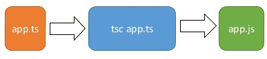
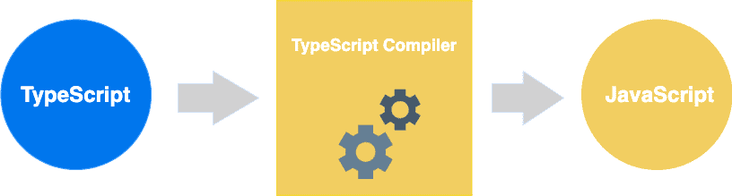

# TypeScript 安装

## NPM 安装 TypeScript

使用国内镜像：

```sh
$ npm config set registry https://registry.npm.taobao.org
```

安装 typescript：

```sh
$ npm install -g typescript
```

安装完成后我们可以使用 **tsc** 命令来执行 TypeScript 的相关代码，以下是查看版本号：

```sh
$ tsc -v
Version 4.3.5
```

## 测试

新建一个 app.ts 的文件，代码如下：

```typescript
var message:string = "Hello World" 
console.log(message)
```

通常使用 **.ts** 作为 TypeScript 代码文件的扩展名。

然后执行以下命令将 TypeScript 转换为 JavaScript 代码：

```sh
tsc app.ts
```



这时候再当前目录下（与 app.ts 同一目录）就会生成一个 app.js 文件，代码如下：

```typescript
var message = "Hello World";
console.log(message);
```

使用 node 命令来执行 app.js 文件：

```sh
$ node app.js 
Hello World
```

TypeScript 转换为 JavaScript 过程如下图：


