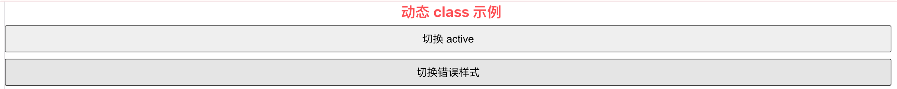
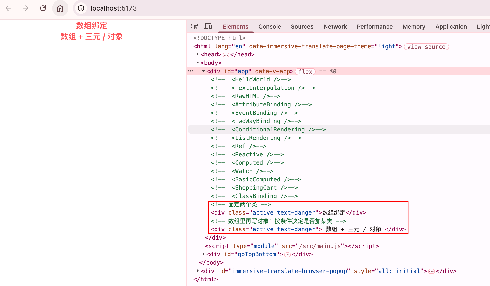
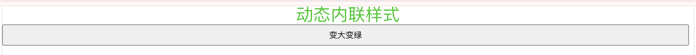
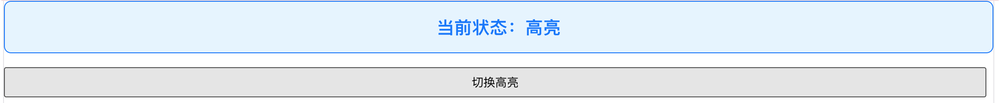

# 类与样式绑定

Vue 对 `class` 和 `style` 做了专门增强：可以用字符串、对象、数组来动态控制样式，数据一变，类名和内联样式自动跟着变。

适合：高亮当前项、按钮禁用态、主题切换、根据状态换颜色等场景。

## 为什么要动态绑定

写死的 class / style 改不了界面状态。用响应式数据驱动，模板更清晰：

```vue
<!-- 不推荐：到处拼字符串 -->
<div :class="'box ' + (active ? 'active' : '')"></div>

<!-- 推荐：对象 / 数组语法更直观 -->
<div :class="{ active: isActive, disabled: isDisabled }"></div>
```

## 绑定 HTML class

### 对象语法

**最常用**

对象的 **key 是类名**，**value 为真** 时才会加上该类：

```vue
<script setup>
/**
 * class 对象语法 Demo
 * 根据开关动态添加 / 移除类名
 */
import { ref } from 'vue'

const isActive = ref(true)
const hasError = ref(false)

function toggle() {
  isActive.value = !isActive.value
}
</script>

<template>
  <!-- isActive 为 true 时有 active；hasError 为 true 时有 text-danger -->
  <div :class="{ active: isActive, 'text-danger': hasError }">
    动态 class 示例
  </div>
  <button @click="toggle">切换 active</button>
  <button @click="hasError = !hasError">切换错误样式</button>
</template>

<style>
.active {
  font-weight: bold;
  color: #1677ff;
}
.text-danger {
  color: #ff4d4f;
}
</style>
```

运行截图：



也可以把对象提成变量或计算属性：

```js
import { reactive, computed } from 'vue'

const classObj = reactive({
  active: true,
  'text-danger': false
})

// 或用 computed，依赖变了自动更新
const classObj2 = computed(() => ({
  active: isActive.value && !error.value,
  'text-danger': error.value
}))
```

```vue
<div :class="classObj"></div>
```

### 数组语法

一次绑定多个类名，元素可以是字符串，也可以再嵌套对象：

```vue
<script setup>
/**
 * class 数组语法 Demo
 */
import { ref } from 'vue'

const activeClass = ref('active')
const errorClass = ref('text-danger')
const isActive = ref(true)
</script>

<template>
  <!-- 固定两个类 -->
  <div :class="[activeClass, errorClass]">数组绑定</div>

  <!-- 数组里再写对象：按条件决定是否加某类 -->
  <div :class="[isActive ? activeClass : '', { 'text-danger': true }]">
    数组 + 三元 / 对象
  </div>
</template>

<style>
.active {
  font-weight: bold;
  color: #1677ff;
}

.text-danger {
  color: #ff4d4f;
}
</style>
```

运行截图：



### 和普通 class 共存

静态 `class` 和动态 `:class` 可以写在一起，最终会合并：

```vue
<div class="box" :class="{ active: isActive }"></div>
<!-- isActive 为 true 时结果：class="box active" -->
```

## 绑定内联 style

### 对象语法

`:style` 绑定一个 **CSS 属性对象**（可用驼峰或短横线）：

```vue
<script setup>
/**
 * style 对象语法 Demo
 * 用响应式数据控制颜色和字号
 */
import { reactive } from 'vue'

const styleObj = reactive({
  color: '#1677ff',
  fontSize: '20px' // 驼峰写法，等价于 'font-size'
})

function bigger() {
  styleObj.fontSize = '28px'
  styleObj.color = '#52c41a'
}
</script>

<template>
  <p :style="styleObj">动态内联样式</p>
  <button @click="bigger">变大变绿</button>
</template>
```

运行截图：



多组 style 对象可以数组合并（后面的会覆盖前面的同名属性）：

```vue
<div :style="[baseStyle, overrideStyle]"></div>
```

### 常用小技巧

```vue
<!-- 直接在模板里写对象也可以 -->
<p :style="{ color: activeColor, fontSize: fontSize + 'px' }"></p>

<!-- 自动加浏览器前缀（如 transform） -->
<div :style="{ transform: 'rotate(10deg)' }"></div>
```

## 入门综合 Demo

一个小面板：点击切换高亮，并改背景色和字号。

```vue
<script setup>
/**
 * 类与样式绑定综合 Demo
 * - class：控制是否高亮
 * - style：控制背景色和字号
 */
import { ref, reactive } from 'vue'

const isHighlight = ref(false)

const boxStyle = reactive({
  backgroundColor: '#f5f5f5',
  fontSize: '16px',
  padding: '16px',
  borderRadius: '8px'
})

/** 切换高亮，并同步改样式 */
function toggleHighlight() {
  isHighlight.value = !isHighlight.value
  if (isHighlight.value) {
    boxStyle.backgroundColor = '#e6f4ff'
    boxStyle.fontSize = '20px'
  } else {
    boxStyle.backgroundColor = '#f5f5f5'
    boxStyle.fontSize = '16px'
  }
}
</script>

<template>
  <div
    class="panel"
    :class="{ highlight: isHighlight }"
    :style="boxStyle"
  >
    当前状态：{{ isHighlight ? '高亮' : '普通' }}
  </div>
  <button @click="toggleHighlight">切换高亮</button>
</template>

<style>
.panel {
  border: 1px solid #d9d9d9;
  margin-bottom: 12px;
}
.highlight {
  border-color: #1677ff;
  font-weight: bold;
  color: #1677ff;
}
</style>
```

运行效果预期：

1. 初始：灰色背景、普通边框
2. 点击按钮：加上 `highlight` 类，背景变浅蓝、字变大变蓝
3. 再点一次：恢复普通样式

运行截图：

