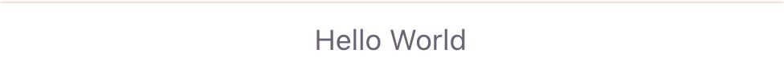
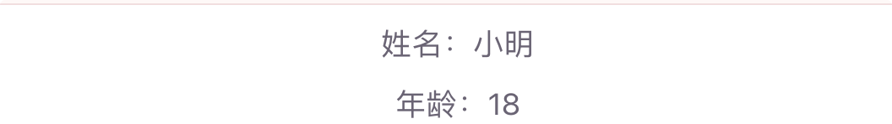
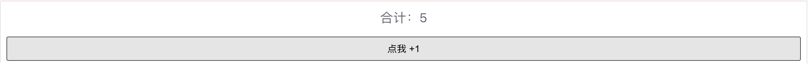

# 组件基础

组件是 Vue 应用的基本构建块：把页面拆成可复用的独立单元（按钮、卡片、表单、列表项等），每个单元有自己的模板、逻辑和样式。

掌握「单文件组件 + props 传参 + emit 事件 + 插槽」，就能搭出大部分常见界面。

## 为什么需要组件

没有组件时，所有 UI 和逻辑挤在一个大文件里，难维护、难复用：

```vue
<!-- 不推荐：整页堆在一起 -->
<template>
  <div class="user-card">...</div>
  <div class="user-card">...</div>
  <!-- 重复很多遍 -->
</template>
```

拆成组件后，一处定义、多处使用，结构更清晰：

```vue
<template>
  <UserCard name="小明" />
  <UserCard name="小红" />
</template>
```

## 单文件组件（SFC）

一个 `.vue` 文件通常分三块：

| 区块             | 作用            |
| ---------------- | --------------- |
| `<template>`     | 结构（HTML）    |
| `<script setup>` | 逻辑（JS / TS） |
| `<style>`        | 样式（CSS）     |

最小示例：

```vue
<script setup>
/**
 * 打招呼组件 Demo
 * 展示最简单的单文件组件结构
 */
const msg = '你好，Vue3'
</script>

<template>
  <h1>{{ msg }}</h1>
</template>

<style scoped>
/* scoped：样式只作用于当前组件，不会污染全局 */
h1 {
  color: #42b883;
}
</style>
```

日常推荐用 `<script setup>`，写法更短，变量和函数可直接在模板里用。

运行截图：


## 注册与使用组件

在父组件里 `import` 子组件，然后在模板里像标签一样用：

```vue
<!-- App.vue -->
<script setup>
/**
 * 父组件：引入并使用 HelloWorld
 */
import HelloWorld from './components/HelloWorld.vue'
</script>

<template>
  <HelloWorld />
</template>
```

```vue
<!-- components/HelloWorld.vue -->
<script setup>
/**
 * 子组件：简单展示一段文字
 */
const title = 'Hello World'
</script>

<template>
  <p>{{ title }}</p>
</template>
```

要点：

- 组件名建议用帕斯卡命名：`HelloWorld`、`UserCard`
- 模板里也可以写成 `<hello-world />`（kebab-case），效果等价
- 每个组件最好只做一件事，职责单一

运行截图：



## Props 父传子

父组件通过「属性」把数据传给子组件，子组件用 `defineProps` 声明接收：

```vue
<!-- 父组件 -->
<script setup>
import UserCard from './UserCard.vue'
</script>

<template>
  <UserCard name="小明" :age="18" />
</template>
```

```vue
<!-- UserCard.vue -->
<script setup>
/**
 * 用户卡片：通过 props 接收父组件数据
 */
// 声明 props（推荐带类型）
defineProps({
  name: {
    type: String,
    required: true
  },
  age: {
    type: Number,
    default: 0
  }
})
</script>

<template>
  <div class="card">
    <p>姓名：{{ name }}</p>
    <p>年龄：{{ age }}</p>
  </div>
</template>
```

注意：

- 静态字符串：`name="小明"`
- 动态值（数字、布尔、变量）：必须加冒号，如 `:age="18"`、`:user="userInfo"`
- **不要在子组件里直接改 props**（单向数据流：父 → 子）

运行输出：



用脚本里拿到 props 对象时：

```js
const props = defineProps({ name: String })
console.log(props.name)
```

## Emits 子传父

子组件要通知父组件时，用 `defineEmits` 触发自定义事件：

```vue
<!-- Counter.vue 子组件 -->
<script setup>
/**
 * 计数器：点击后把结果通过事件告诉父组件
 */
const emit = defineEmits(['change'])

/** 通知父组件：数值变成了 1 */
function handleClick() {
  emit('change', 1)
}
</script>

<template>
  <button @click="handleClick">点我 +1</button>
</template>
```

```vue
<!-- 父组件 -->
<script setup>
/**
 * 父组件监听子组件的 change 事件
 */
import { ref } from 'vue'
import Counter from './Counter.vue'

const total = ref(0)

/** 收到子组件传来的增量 */
function onChange(n) {
  total.value += n
}
</script>

<template>
  <p>合计：{{ total }}</p>
  <Counter @change="onChange" />
</template>
```

简单记：**props 往下传数据，emit 往上报消息**。

运行截图：



## 插槽（slot）父传内容

插槽让父组件可以向子组件「塞一段模板内容」：

```vue
<!-- Card.vue -->
<script setup>
/**
 * 卡片容器：用默认插槽接收父组件传入的内容
 */
</script>

<template>
  <div class="card">
    <slot>这里是默认内容</slot>
  </div>
</template>
```

```vue
<!-- 父组件使用 -->
<script setup>
import Card from './Card.vue'
</script>

<template>
  <Card>
    <h3>标题</h3>
    <p>插槽里可以放任意内容</p>
  </Card>
</template>
```

没有传内容时，会显示 `<slot>` 里的默认文案。

