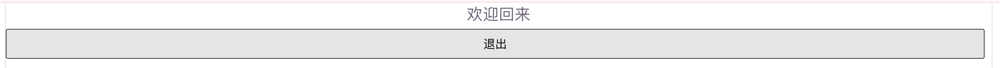
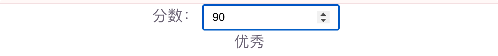
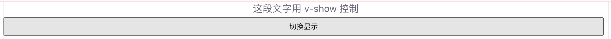
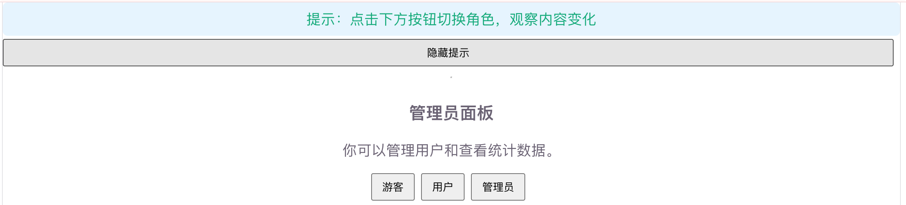

# 条件渲染

条件渲染用来根据数据的真假，**决定某块 DOM 要不要显示**。Vue3 提供 `v-if` / `v-else-if` / `v-else` 和 `v-show` 两套写法。

适合：登录后显示用户信息、空列表提示、切换 Tab 内容、权限控制可见区域等场景。

## 为什么需要条件渲染

页面上经常有「有时显示、有时隐藏」的内容。如果用原生 JS 手动改 `display` 或增删节点，逻辑会散落各处。用指令绑定响应式数据，数据一变，界面自动切换：

```js
<!-- 不推荐：到处手写显示隐藏 -->
const loginTip = document.getElementById('login-tip')
const guestTip = document.getElementById('guest-tip')

function updateUI() {
  loginTip.style.display = isLogin ? 'block' : 'none'
  guestTip.style.display = isLogin ? 'none' : 'block'
}

<!-- 比手动操作 DOM 更清晰 -->
<p v-if="isLogin">已登录</p>
<p v-else>请先登录</p>
```

## v-if

`v-if / v-else-if / v-else`

### 基本用法

`v-if` 的表达式为真时，才会渲染该元素；为假则**不会创建到 DOM 里**。

```vue
<script setup>
/**
 * v-if 基础 Demo
 * 根据登录状态显示不同内容
 */
import { ref } from 'vue'

const isLogin = ref(false)

/** 切换登录状态 */
function toggleLogin() {
  isLogin.value = !isLogin.value
}
</script>

<template>
  <p v-if="isLogin">欢迎回来</p>
  <p v-else>请先登录</p>
  <button @click="toggleLogin">
    {{ isLogin ? '退出' : '登录' }}
  </button>
</template>
```

要点：

- `v-else` 必须紧挨在带 `v-if`（或 `v-else-if`）的元素后面
- 条件为假时，对应节点**不会存在于 DOM**（不是隐藏，是不创建）

运行截图：



### 多分支：v-else-if

类似 `if / else if / else`：

```vue
<script setup>
/**
 * v-else-if 多分支 Demo
 * 根据分数显示等级
 */
import { ref } from 'vue'

const score = ref(75)
</script>

<template>
  <p>
    分数：
    <input v-model.number="score" type="number" />
  </p>

  <p v-if="score >= 90">优秀</p>
  <p v-else-if="score >= 60">及格</p>
  <p v-else>不及格</p>
</template>
```

运行截图：



### 用 `<template>` 包一组元素

想一次性控制多个相邻标签时，用 `<template>` 包起来（`<template>` 本身不会渲染成真实标签）：

```vue
<template v-if="isLogin">
  <h3>个人中心</h3>
  <p>昵称：小明</p>
  <p>角色：普通用户</p>
</template>
```

## v-show

`v-show` 始终会渲染元素，只是通过 CSS 的 `display` 切换显示/隐藏：

```vue
<script setup>
/**
 * v-show Demo
 * 点击按钮显示 / 隐藏提示框
 */
import { ref } from 'vue'

const visible = ref(true)
</script>

<template>
  <p v-show="visible">这段文字用 v-show 控制</p>
  <button @click="visible = !visible">切换显示</button>
</template>
```

运行截图：



注意：`v-show` **没有** `v-else`，也不能用在 `<template>` 上。

## v-if 和 v-show 怎么选

|          | `v-if`                     | `v-show`                 |
| -------- | -------------------------- | ------------------------ |
| 原理     | 条件为假时不创建 DOM       | 始终在 DOM，改 `display` |
| 切换开销 | 较大（创建/销毁）          | 较小（只改样式）         |
| 初始开销 | 条件为假时更轻             | 无论真假都会渲染         |
| 适用     | 很少切换、条件决定是否存在 | 频繁切换显示隐藏         |

简单记：

- **偶尔切换、或根本不需要这块 DOM** → 用 `v-if`
- **经常点来点去切换显示** → 用 `v-show`

## 入门综合 Demo

一个小面板：根据用户类型显示不同欢迎语，并用 `v-show` 控制提示条。

```vue
<script setup>
/**
 * 条件渲染综合 Demo
 * - v-if / v-else-if / v-else：按角色显示内容
 * - v-show：控制提示条显隐
 */
import { ref } from 'vue'

/** 角色：guest | user | admin */
const role = ref('guest')
/** 是否显示顶部提示 */
const showTip = ref(true)

/** 切换角色 */
function setRole(next) {
  role.value = next
}
</script>

<template>
  <p v-show="showTip" class="tip">
    提示：点击下方按钮切换角色，观察内容变化
  </p>
  <button @click="showTip = !showTip">
    {{ showTip ? '隐藏提示' : '显示提示' }}
  </button>

  <hr />

  <div v-if="role === 'admin'">
    <h3>管理员面板</h3>
    <p>你可以管理用户和查看统计数据。</p>
  </div>
  <div v-else-if="role === 'user'">
    <h3>普通用户</h3>
    <p>欢迎回来，可以浏览内容和修改个人资料。</p>
  </div>
  <div v-else>
    <h3>游客模式</h3>
    <p>请先登录后使用完整功能。</p>
  </div>

  <div class="actions">
    <button @click="setRole('guest')">游客</button>
    <button @click="setRole('user')">用户</button>
    <button @click="setRole('admin')">管理员</button>
  </div>
</template>

<style>
.tip {
  background: #e6f4ff;
  padding: 8px 12px;
  border-radius: 6px;
}
.actions {
  margin-top: 12px;
}
.actions button {
  margin-right: 8px;
}
</style>
```

运行效果预期：

1. 初始：显示蓝色提示条，内容为「游客模式」
2. 点「用户 / 管理员」：中间区域换成对应文案（`v-if` 分支切换）
3. 点「隐藏提示」：提示条消失但 DOM 仍在（`v-show`）

运行截图：

