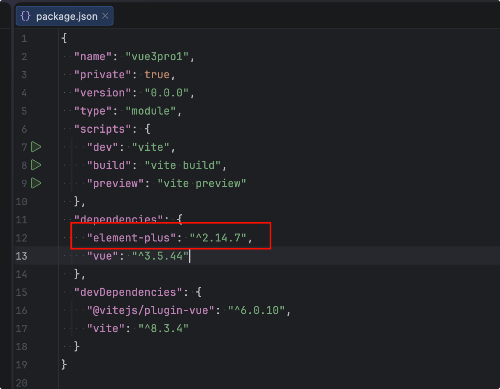
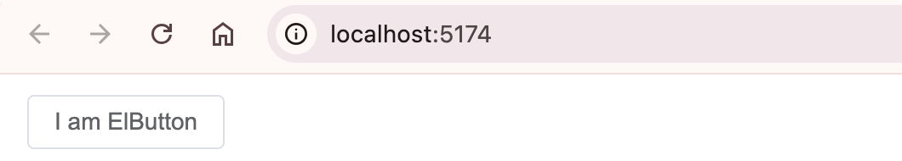
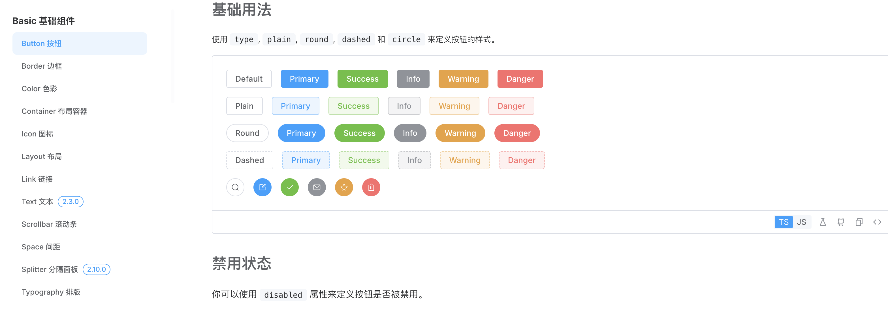
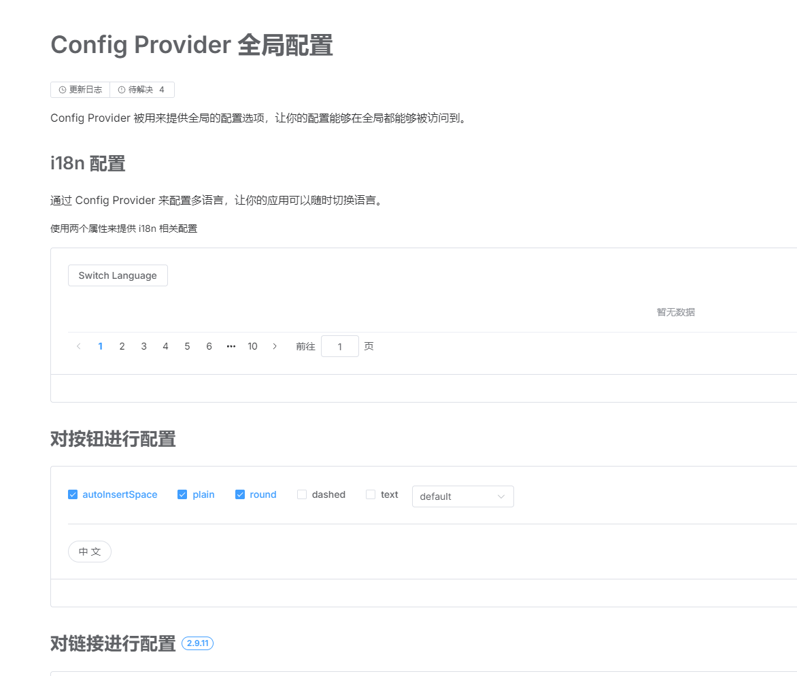
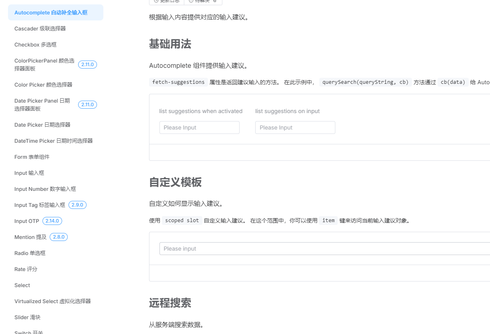
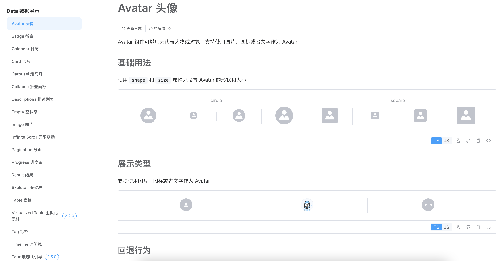
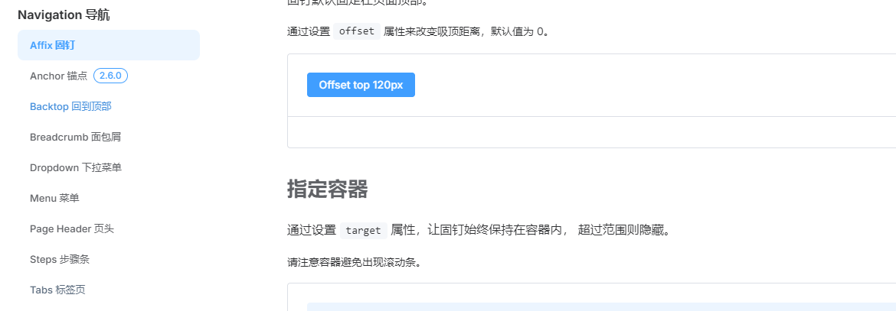
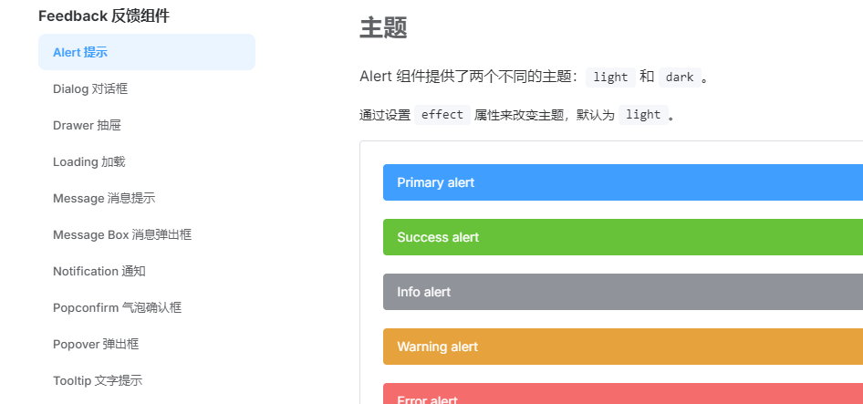
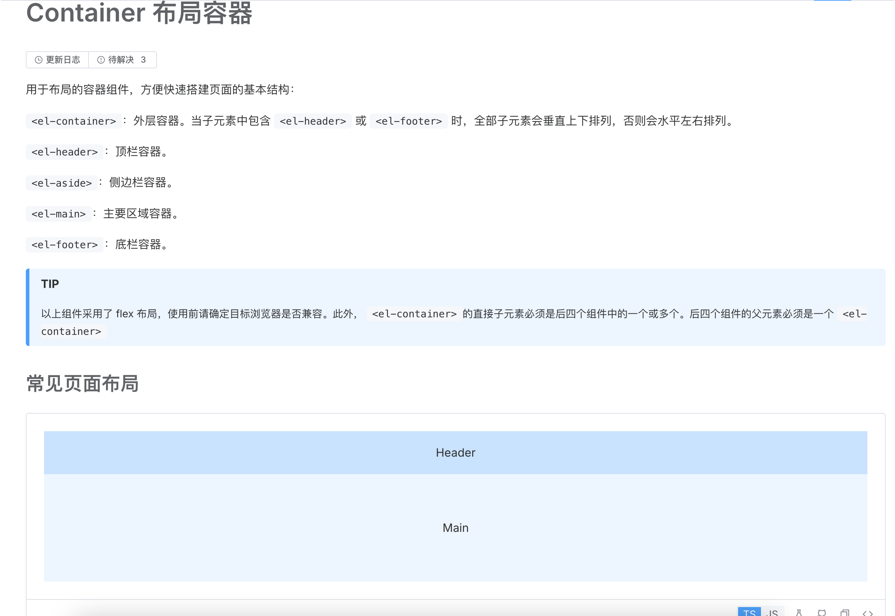

# element-plus UI框架

## 简介

**Element Plus 是一套为 Vue 3 设计的、基于 TypeScript 的企业级桌面端 UI 组件库**。它是广受欢迎的 Element UI 的官方升级版，旨在为开发者、设计师和产品经理提供一套完整、统一且美观的 UI 解决方案。

element-plus官网： https://element-plus.org/zh-CN/

用户指南：https://element-plus.org/zh-CN/guide/design

组件文档：https://element-plus.org/zh-CN/component/overview

## 核心特性

- **完美适配 Vue 3**：Element Plus 并非简单的兼容升级，而是**使用 Vue 3 的 Composition API 重写了几乎每一行代码**。这使得它能充分利用 Vue 3 的性能优势（如 Proxy 响应式系统），并提供更现代化、更易于维护的 API。
- **TypeScript 深度集成**：整个库完全由 TypeScript 编写，并提供了**完整的类型定义文件**。这意味着在 IDE 中可以获得精准的代码补全和类型检查，大幅降低错误率，提升开发体验。
- **丰富的组件库**：Element Plus 提供了**超过 60 个高质量组件**，覆盖了企业级应用开发的绝大多数场景。
- **成熟的设计规范**：它继承并完善了 Element UI 成熟的设计体系，从色彩、字体到间距都有明确标准。其默认的明亮、友好的蓝色主题，确保了产品视觉风格的一致性。
- **高度可定制**：支持通过 SCSS 变量进行**主题定制**，并利用 Vue 3 的 `Teleport` 等特性优化了渲染性能。
- **国际化与可访问性**：内置多语言支持，并遵循 WCAG 标准，提供了良好的无障碍体验。
- **开源与活跃**：Element Plus 是一个开源项目，在 GitHub 上拥有超过 2.5 万 Star，每周下载量超过 50 万次，由社区和饿了么前端团队共同维护。

## 组件生态

Element Plus 的组件分类清晰，方便开发者按需使用。根据其官方文档，组件主要分为以下几大类：

- **基础组件 (Basic)**：如按钮 (Button)、图标 (Icon) 等，共 12 个。
- **表单组件 (Form)**：如输入框 (Input)、选择器 (Select)、日期选择器等，共 25 个。
- **数据展示 (Data)**：如表格 (Table)、树形控件 (Tree)、分页 (Pagination) 等，共 23 个。
- **导航组件 (Navigation)**：如菜单 (Menu)、标签页 (Tabs)、面包屑 (Breadcrumb) 等，共 9 个。
- **反馈组件 (Feedback)**：如对话框 (Dialog)、消息提示 (Message)、通知 (Notification) 等，共 10 个。
- **其他**：还包括布局 (Layout) 等 2 个其他组件。

## 适用场景

凭借其强大的功能和设计，Element Plus 特别适合用于构建：

- **企业级中后台系统**：其清晰的信息层级和专业的视觉风格，非常适合数据密集、操作复杂的后台应用。
- **各类管理系统和仪表盘**：丰富的 Table、Tree 等数据展示组件，使其成为构建管理后台和数据分析平台的理想选择。
- **需要快速迭代的产品**：通过使用预设组件，可以快速搭建出高质量的产品原型，大大缩短开发周期。


## 项目搭建

首先把element-plus库安装下：

element-plus 安装命令：

```shell
npm install element-plus
```

会在package.json里面添加依赖



main.js导入下element-plus组件和样式：

```javascript
// import { createApp } from 'vue'
// import './style.css'
// import App from './App.vue'
//
// createApp(App).mount('#app')

import { createApp } from 'vue'
import ElementPlus from 'element-plus'
import 'element-plus/dist/index.css'
import App from './App.vue'

const app = createApp(App)

app.use(ElementPlus)
app.mount('#app')
```


App.vue

```html
<script setup lang="ts">
import { ElButton } from 'element-plus'
</script>

<template>
  <el-button type="primary">I am ElButton</el-button>
</template>
```


运行结果：




## 基础组件

我们直接看文档：https://element-plus.org/zh-CN/component/button




## 配置组件

我们直接看文档：https://element-plus.org/zh-CN/component/config-provider




## Form表单组件

我们直接看文档：https://element-plus.org/zh-CN/component/autocomplete




## Data数据展示组件

我们直接看文档：https://element-plus.org/zh-CN/component/avatar




## Navigation导航组件

我们直接看文档：https://element-plus.org/zh-CN/component/affix




## Feedback反馈组件

我们直接看文档：https://element-plus.org/zh-CN/component/alert




## Container布局组件

我们直接看文档：https://element-plus.org/zh-CN/component/container

