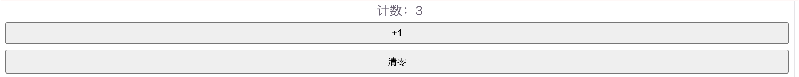
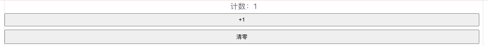
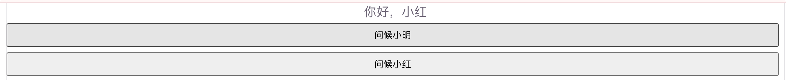
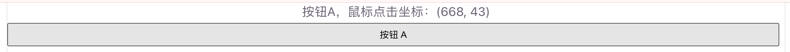
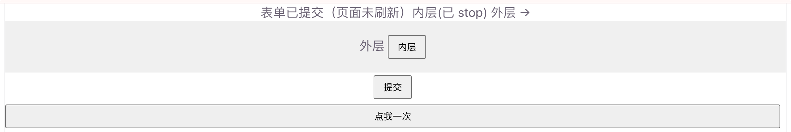
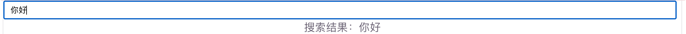
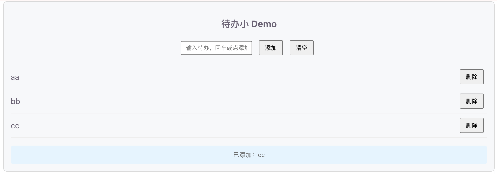

# 事件处理

事件处理用来**监听用户操作**（点击、输入、键盘等），并执行对应逻辑。Vue3 用 `v-on` 指令，模板里通常写成更短的 `@`。

适合：按钮点击、表单提交、键盘回车搜索、阻止默认行为等场景。

## 为什么需要事件处理

页面交互几乎都建立在「用户做了某件事 → 程序做出反应」。原生写法要自己 `addEventListener`，还要自己管解绑。Vue 里把事件和响应式数据绑在一起，写法更集中：

```vue
<!-- 推荐：声明式绑定 -->
<button @click="count++">点我</button>

<!-- 等价完整写法 -->
<button v-on:click="count++">点我</button>
```

日常开发优先用 `@事件名`。

## 基本用法

### 内联处理

简单逻辑可以直接写在模板里：

```vue
<script setup>
/**
 * 内联事件 Demo
 * 点击按钮让计数 +1
 */
import { ref } from 'vue'

const count = ref(0)
</script>

<template>
  <p>计数：{{ count }}</p>
  <button @click="count++">+1</button>
  <button @click="count = 0">清零</button>
</template>
```

运行截图：



### 方法处理

逻辑稍复杂时，写成函数更清晰（也方便复用和加注释）：

```vue
<script setup>
/**
 * 方法事件 Demo
 * 把逻辑放进函数里
 */
import { ref } from 'vue'

const count = ref(0)

/** 计数加一 */
function add() {
  count.value++
}

/** 重置为 0 */
function reset() {
  count.value = 0
}
</script>

<template>
  <p>计数：{{ count }}</p>
  <button @click="add">+1</button>
  <button @click="reset">清零</button>
</template>
```

运行截图：



注意：模板里写 `@click="add"`（传函数引用），不要写成 `@click="add()"` 除非你确实要立刻执行并传参。

## 传参与事件对象

### 给处理函数传参

需要传自定义参数时，写成方法调用：

```vue
<script setup>
/**
 * 事件传参 Demo
 */
import { ref } from 'vue'

const msg = ref('')

/** 显示问候语 */
function sayHello(name) {
  msg.value = `你好，${name}`
}
</script>

<template>
  <p>{{ msg }}</p>
  <button @click="sayHello('小明')">问候小明</button>
  <button @click="sayHello('小红')">问候小红</button>
</template>
```

运行截图：



### 同时拿到原生事件对象

内联调用时如果还需要原生 `event`，用 `$event`：

```vue
<script setup>
/**
 * $event Demo
 * 自定义参数 + 原生事件对象一起用
 */
import { ref } from 'vue'

const info = ref('')

/**
 * 记录点击来源
 * @param {string} label 按钮名称
 * @param {MouseEvent} e 原生事件
 */
function onClick(label, e) {
  info.value = `${label}，鼠标点击坐标：(${e.clientX}, ${e.clientY})`
}
</script>

<template>
  <p>{{ info }}</p>
  <button @click="onClick('按钮A', $event)">按钮 A</button>
</template>
```

运行截图：



如果方法只有一个参数且是事件对象，可以省略 `$event`：

```vue
<button @click="onClick">点我</button>
```

对应函数：`function onClick(e) { ... }`

## 事件修饰符

修饰符写在事件名后面，用 `.` 连接，用来处理常见 DOM 细节，少写样板代码。

| 修饰符     | 作用                                             |
| ---------- | ------------------------------------------------ |
| `.stop`    | 阻止冒泡（`event.stopPropagation()`）            |
| `.prevent` | 阻止默认行为（`event.preventDefault()`）         |
| `.self`    | 只有事件来自元素自身（不是子元素冒泡上来）才触发 |
| `.once`    | 只触发一次                                       |
| `.capture` | 在捕获阶段监听                                   |
| `.passive` | 对应 `addEventListener` 的 `{ passive: true }`   |

示例：

```vue
<script setup>
/**
 * 事件修饰符 Demo
 */
import { ref } from 'vue'

const log = ref('')

/** 外层盒子被点击 */
function onOuter() {
  log.value += '外层 → '
}

/** 内层按钮被点击（并阻止冒泡） */
function onInner() {
  log.value += '内层(已 stop) '
}

/** 提交表单（阻止默认刷新） */
function onSubmit() {
  log.value = '表单已提交（页面未刷新）'
}
</script>

<template>
  <p>{{ log }}</p>

  <!-- 点击内层不会触发外层，因为 .stop 阻止了冒泡 -->
  <div @click="onOuter" style="padding: 16px; background: #f0f0f0">
    外层
    <button @click.stop="onInner">内层</button>
  </div>

  <!-- 阻止表单默认提交刷新 -->
  <form @submit.prevent="onSubmit">
    <button type="submit">提交</button>
  </form>

  <!-- 只触发一次 -->
  <button @click.once="log = '只触发了一次'">点我一次</button>
</template>
```

修饰符可以连写，例如：`@click.stop.prevent`。

运行截图：



## 按键修饰符

监听键盘时，可以限定具体按键：

| 写法                                        | 说明       |
| ------------------------------------------- | ---------- |
| `@keyup.enter`                              | 回车       |
| `@keyup.esc`                                | Esc        |
| `@keyup.space`                              | 空格       |
| `@keyup.up` / `.down` / `.left` / `.right`  | 方向键     |
| `@keyup.ctrl` / `.alt` / `.shift` / `.meta` | 系统修饰键 |

```vue
<script setup>
/**
 * 按键修饰符 Demo
 * 回车触发搜索
 */
import { ref } from 'vue'

const keyword = ref('')
const result = ref('')

/** 模拟搜索 */
function search() {
  result.value = keyword.value
    ? `搜索结果：${keyword.value}`
    : '请输入关键词'
}
</script>

<template>
  <input
    v-model="keyword"
    placeholder="输入后按回车"
    @keyup.enter="search"
  />
  <p>{{ result }}</p>
</template>
```

也可以组合：`@keyup.ctrl.enter="search"`（Ctrl + Enter）。

运行截图：



## 入门综合 Demo

一个迷你待办输入区：支持点击添加、回车添加、清空列表，并演示 `.prevent` / `.stop`。

```vue
<script setup>
/**
 * 事件处理综合 Demo
 * - @click / @keyup.enter：添加待办
 * - @submit.prevent：阻止表单刷新
 * - @click.stop：内层操作不冒泡到外层
 */
import { ref } from 'vue'

/** 输入框内容 */
const text = ref('')
/** 待办列表 */
const list = ref([])
/** 底部日志 */
const tip = ref('还没有操作')

/** 添加一条待办 */
function addTodo() {
  const value = text.value.trim()
  if (!value) {
    tip.value = '内容不能为空'
    return
  }
  list.value.push(value)
  text.value = ''
  tip.value = `已添加：${value}`
}

/**
 * 删除某一项
 * @param {number} index 下标
 */
function removeTodo(index) {
  const removed = list.value[index]
  list.value.splice(index, 1)
  tip.value = `已删除：${removed}`
}

/** 清空全部 */
function clearAll() {
  list.value = []
  tip.value = '列表已清空'
}

/** 点击外层容器时的提示 */
function onPanelClick() {
  tip.value = '你点到了面板空白处'
}
</script>

<template>
  <div class="panel" @click="onPanelClick">
    <h3>待办小 Demo</h3>

    <!-- 提交时阻止页面刷新 -->
    <form @submit.prevent="addTodo">
      <input
        v-model="text"
        placeholder="输入待办，回车或点添加"
        @keyup.enter="addTodo"
      />
      <!-- .stop：点按钮不要触发外层 panel 的 click -->
      <button type="submit" @click.stop>添加</button>
      <button type="button" @click.stop="clearAll">清空</button>
    </form>

    <ul>
      <li v-for="(item, index) in list" :key="index">
        {{ item }}
        <button type="button" @click.stop="removeTodo(index)">删除</button>
      </li>
    </ul>

    <p class="tip">{{ tip }}</p>
  </div>
</template>

<style>
.panel {
  padding: 16px;
  background: #f7f8fa;
  border-radius: 8px;
}
.tip {
  color: #666;
  font-size: 14px;
}
button {
  margin-left: 8px;
}
</style>

```

运行效果预期：

1. 输入文字后按回车或点「添加」：列表多一条，输入框清空
2. 点「删除」：只删该项，不会触发面板的「点到空白处」提示（`.stop`）
3. 点面板空白处：底部 tip 变成「你点到了面板空白处」
4. 表单提交不会刷新页面（`.prevent`）

运行截图：



## 快速对照

| 写法       | 示例                  | 说明                   |
| ---------- | --------------------- | ---------------------- |
| 基本监听   | `@click="fn"`         | 最常用                 |
| 内联语句   | `@click="count++"`    | 适合一行逻辑           |
| 传参       | `@click="fn(id)"`     | 调用方法并传参         |
| 原生事件   | `@click="fn($event)"` | 需要 event 时          |
| 阻止冒泡   | `@click.stop`         | 等价 `stopPropagation` |
| 阻止默认   | `@submit.prevent`     | 等价 `preventDefault`  |
| 只触发一次 | `@click.once`         | 第二次不再触发         |
| 按键       | `@keyup.enter`        | 限定按键               |

